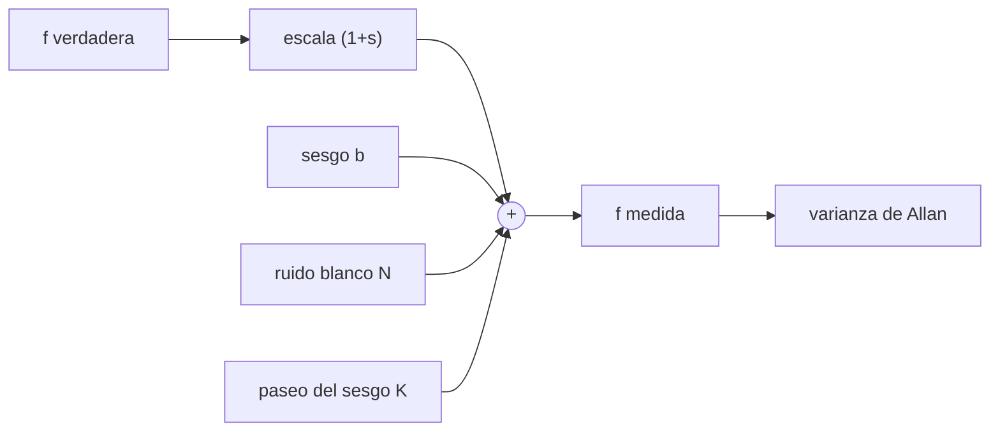

# B80-C02 — Modelo de error de acelerómetros

<!-- nav:top -->
[🏠 Programa](../../../../README.md) · [📚 Bloque B80](../../../tronco-comun/B80-navegacion-inercial-y-fusion-multisensorial.md) · [← Anterior: B80-C01 — Principios de navegación inercial espacial](../B80-C01-principios-de-navegacion-inercial-espacial/CLASE.md) · [Siguiente: B80-C03 — Mecanización strapdown e integración de actitud y velocidad →](../B80-C03-mecanizacion-strapdown-e-integracion-de-actitud-y-velocidad/CLASE.md)
<!-- /nav -->

## 1. Ubicación, nivel y alcance

Clase 2 del bloque B80. Nivel N3. Sigue a [B80-C01](../B80-C01-principios-de-navegacion-inercial-espacial/CLASE.md): allí el sesgo era un número; aquí lo modelas junto con el factor de escala y el ruido, y aprendes a estimar la parte aleatoria con la varianza de Allan. Los datos son sintéticos.

## 2. Por qué esta clase existe

Para predecir cuánto derivará una navegación hay que describir el sensor con pocas cifras que se puedan medir y comparar. Ninguna clase actual trata acelerómetros: B87 cubre sensores de actitud. La decisión central: **¿qué parte del error es determinista y se puede calibrar, y qué parte es aleatoria y solo se puede acotar?**

## 3. Lo que podrás hacer al terminar

1. Escribir el modelo de medición `f_m = (1 + s) f + b + ruido` y nombrar cada término.
2. Calcular el efecto de un factor de escala en `ppm` sobre la velocidad ganada.
3. Calcular el paseo aleatorio de velocidad y de posición debidos al ruido blanco.
4. Calcular la desviación de Allan de una serie y relacionarla con `N` y `K`.
5. Localizar el mínimo de la curva de Allan y explicar qué significa.
6. Distinguir lo calibrable de lo aleatorio y rotular los datos como sintéticos.

La evidencia es la **ficha de caracterización de un acelerómetro sintético** del ejercicio 12 (sección 20).

## 4. Con qué llegas y cómo comprobarlo

1. ¿Qué es el ruido blanco?
2. ¿Qué es un paseo aleatorio?
3. ¿Qué es una desviación típica?
4. ¿Qué es un `ppm`?
5. ¿Qué es la densidad espectral de ruido?

<details>
<summary>Ver respuestas</summary>

1. Una señal aleatoria con valores no correlacionados entre muestras. 2. La suma acumulada de pasos aleatorios independientes; su desviación crece con la raíz del tiempo. 3. La raíz de la varianza; mide la dispersión. 4. Partes por millón, `10⁻⁶`. 5. La potencia de ruido por unidad de ancho de banda; aquí se expresa en `m/s²/√Hz`.
</details>

Con cuatro o cinco aciertos, sigue; si no, repasa los prerrequisitos.

## 5. Un caso de contexto y casos de referencia

Un acelerómetro sintético con factor de escala `200 ppm`, sesgo `2,0 × 10⁻³ m/s²`, ruido `N = 5,0 × 10⁻⁴ m/s²/√Hz` y paseo del sesgo `K = 1,0 × 10⁻⁶ m/s²·√Hz` medido durante una hora a `100 Hz` da una desviación de Allan de `4,97 × 10⁻⁴ m/s²` a `τ = 1 s` (la fórmula da `5,00 × 10⁻⁴`) y un mínimo teórico `2,40 × 10⁻⁵ m/s²` en `τ = 866 s`. A `60 s` el sesgo produce `0,1200 m/s` y `3,600 m`. Es el **ejemplo conductor**. Todo es **sintético**.

## 6. Vocabulario

El **factor de escala** `s` es el error proporcional a la señal. El **sesgo** `b` es el error constante (con una parte que deriva lentamente, la *inestabilidad de sesgo*). El **ruido blanco** `N` produce un **paseo aleatorio de velocidad** (VRW) con densidad `N` en `m/s/√s`. La **varianza de Allan** `σ_A²(τ)` es la mitad del promedio del cuadrado de la diferencia entre promedios consecutivos de duración `τ`; sirve para identificar el tipo de ruido por la pendiente de la curva.

## 7. Modelo mental: una balanza de baño con tres defectos



*Descripción textual:* la fuerza específica pasa por un factor de escala y se le suman el sesgo, el ruido blanco y el paseo del sesgo; la serie medida alimenta el cálculo de la varianza de Allan.

Analogía: una balanza de baño que marca un poco de más (escala), parte de un valor distinto de cero (sesgo) y tiembla (ruido). Límite: un acelerómetro real añade dependencia de la temperatura, no linealidades y desalineación de ejes que este modelo no incluye.

## 8. La explicación, paso a paso

### 8.1 El modelo de medición

`f_m = (1 + s) f + b + n_w + b_rw`. En la simulación, con `f = 0`, la media medida es `2,0429 × 10⁻³ m/s²` (el sesgo fijo más el paseo). Con `f = 1 m/s²` es `1,002243 m/s²`, frente a `1,002200` del modelo sin paseo: el factor de escala de `200 ppm` aporta `2,0 × 10⁻⁴ m/s²`.

### 8.2 Efecto del factor de escala

El error de velocidad por escala es `s Δv`. Para un cambio de velocidad `Δv = 100 m/s`, `200 ppm` producen `0,0200 m/s`. Se calibra con maniobras de aceleración conocida, no con reposo.

### 8.3 Ruido blanco y paseo aleatorio

El ruido blanco de densidad `N` integrado una vez da un error de velocidad con desviación `N √t`: a `60 s`, `0,00387 m/s`. Integrado dos veces, el error de posición tiene desviación `N √(t³/3)`: a `60 s`, `0,134 m`. El sesgo constante domina a tiempos largos: `0,1200 m/s` y `3,600 m` en `60 s`.

### 8.4 Varianza de Allan

Se agrupan las muestras en bloques de duración `τ`, se promedian y se calcula `σ_A²(τ) = ½ ⟨(ȳ_{k+1} − ȳ_k)²⟩`. Para ruido blanco y paseo aleatorio del sesgo, `σ_A²(τ) = N²/τ + K² τ/3`. La pendiente `−½` en escala log-log delata el ruido blanco; la pendiente `+½`, el paseo del sesgo. El mínimo está en `τ = √3 N/K = 866,0 s`, con `σ_A = 2,403 × 10⁻⁵ m/s²`.

| `τ` (s) | `σ_A` simulada (m/s²) | `σ_A` fórmula (m/s²) | cociente |
|---|---|---|---|
| 0,1 | 1,5898 × 10⁻³ | 1,5811 × 10⁻³ | 1,005 |
| 1 | 4,9738 × 10⁻⁴ | 5,0000 × 10⁻⁴ | 0,995 |
| 10 | 1,5589 × 10⁻⁴ | 1,5812 × 10⁻⁴ | 0,986 |
| 100 | 5,3829 × 10⁻⁵ | 5,0332 × 10⁻⁵ | 1,069 |
| 300 | 3,2148 × 10⁻⁵ | 3,0551 × 10⁻⁵ | 1,052 |

### 8.5 Segunda vía

La fórmula cerrada es la segunda vía: coincide con la serie simulada dentro del 7 % en los puntos de la tabla (tolerancia fijada en 15 %). El sesgo constante no aparece en la curva de Allan, porque se cancela en la diferencia de promedios.

## 9. Magnitudes, símbolos y unidades

| Símbolo | Qué es | Unidad | Valor / nota |
|---|---|---|---|
| `s` | factor de escala | adimensional | 200 ppm (sintético) |
| `b` | sesgo constante | m/s² | 2,0 × 10⁻³ (sintético) |
| `N` | densidad de ruido blanco | m/s²/√Hz | 5,0 × 10⁻⁴ (sintético) |
| `K` | densidad del paseo del sesgo | m/s²·√Hz | 1,0 × 10⁻⁶ (sintético) |
| `τ` | tiempo de promediado | s | 0,1 a 300 |
| `σ_A` | desviación de Allan | m/s² | 4,97 × 10⁻⁴ a `τ` = 1 s |

## 10. Convenciones y referencias

Ejes del cuerpo, unidades SI, muestreo de `100 Hz`, semilla `80002`, una hora de datos. La definición de varianza de Allan usada es la solapada de promedios consecutivos; la fórmula `N²/τ + K²τ/3` es una relación estándar que se verifica contra la simulación. Python 3.12.9, solo biblioteca estándar.

## 11. De dónde sale lo que afirmamos

| ID | Fuente | Localizador | Respalda | Estado |
|---|---|---|---|---|
| S2 | NIST, CODATA, aceleración estándar de la gravedad `gₙ` — https://physics.nist.gov/cgi-bin/cuu/Value?gn (consultada 2026-11-10) | página del valor | `gₙ` = 9,806 65 m/s² (exacto por definición) | Consultada |
| — | Definición de la varianza de Allan para sensores inerciales (norma IEEE 952) | — | solo se cita como nombre del procedimiento; la fórmula se verifica en el laboratorio | No consultada |

Límites: los parámetros del sensor son sintéticos y no proceden de una hoja de datos; no se modelan temperatura, no linealidad ni ruido de cuantización ni de tasa.

## 12. Cómo ver el ruido de un acelerómetro

| Magnitud | Valor |
|---|---|
| `σ_A` a 1 s | 4,97 × 10⁻⁴ m/s² (fórmula 5,00 × 10⁻⁴) |
| `σ_A` a 100 s | 5,38 × 10⁻⁵ m/s² (fórmula 5,03 × 10⁻⁵) |
| mínimo teórico | 2,40 × 10⁻⁵ m/s² en 866 s |
| error a 60 s por sesgo | 0,1200 m/s y 3,600 m |
| ruido blanco a 60 s | 0,00387 m/s |

Descripción larga: la curva de Allan baja con pendiente `−½` mientras domina el ruido blanco, toca un mínimo cerca de `866 s` y sube cuando domina el paseo del sesgo.

## 13. Ejemplo trabajado: el error de velocidad en un minuto

**Paso 1 · Sesgo.** `δv_b = b t = 2,0 × 10⁻³ × 60 = 0,1200 m/s`.

**Paso 2 · Ruido blanco.** `δv_n = N √t = 5,0 × 10⁻⁴ × √60 = 0,00387 m/s`.

**Paso 3 · Comparación.** El sesgo es `31` veces mayor, de modo que conviene calibrarlo antes de preocuparse por el ruido.

**Paso 4 · Escala.** Con `Δv = 100 m/s`, `s Δv = 0,0200 m/s`.

## 14. Distintas formas de describir el error de un acelerómetro

**Por modelo:** `s`, `b`, `N`, `K`. **Por curva:** pendientes de la gráfica de Allan. **Por tiempo:** el sesgo domina a tiempos largos y el ruido a cortos. **Por tabla:** valores de `σ_A(τ)`.

## 15. Práctica guiada

**Ejercicio 1 · con los pasos indicados.** Calcula el error de velocidad por sesgo `2,0 × 10⁻³ m/s²` en `30 s`. *Pasos:* `b t`.

<details><summary>Solución comentada</summary>

`0,0600 m/s`.
</details>

**Ejercicio 2 · con una pista.** Calcula `σ_A(τ = 4 s)` con la fórmula. *Pista:* `N²/τ + K²τ/3`; el segundo término es despreciable.

<details><summary>Solución comentada</summary>

`√(2,5 × 10⁻⁷/4) = 2,50 × 10⁻⁴ m/s²`.
</details>

**Ejercicio 3 · casi autónomo.** ¿Qué `τ` minimiza la curva?

<details><summary>Solución comentada</summary>

`τ = √3 N/K = 1,732 × 5 × 10⁻⁴/10⁻⁶ = 866 s`.
</details>

## 16. Práctica autónoma, transferencia e integrador

**Ejercicio 4 · autónomo.** Error de velocidad por escala `200 ppm` en un cambio de `50 m/s`.

<details><summary>Solución comentada</summary>

`0,0100 m/s`.
</details>

**Ejercicio 5 · autónomo.** Desviación del paseo de velocidad por ruido blanco a `100 s`.

<details><summary>Solución comentada</summary>

`5,0 × 10⁻⁴ × 10 = 5,0 × 10⁻³ m/s`.
</details>

**Ejercicio 6 · autónomo.** Desviación de posición por ruido blanco a `60 s`.

<details><summary>Solución comentada</summary>

`N √(t³/3) = 5,0 × 10⁻⁴ × √(72 000) = 0,134 m`.
</details>

**Ejercicio 7 · autónomo.** Si `K` se reduce a la mitad, ¿cómo cambia `τ_min` y el mínimo?

<details><summary>Solución comentada</summary>

`τ_min` se duplica a `1732 s`; el mínimo `√(2NK/√3)` baja a `1,70 × 10⁻⁵ m/s²` (factor `1/√2`).
</details>

**Ejercicio 8 · autónomo.** ¿Por qué una curva de Allan no revela el sesgo constante?

<details><summary>Solución comentada</summary>

Porque cada diferencia entre promedios consecutivos cancela una constante.
</details>

**Ejercicio 9 · transferencia.** **Transferencia.** Un fabricante cita solo el sesgo. ¿Qué otras cifras pedirías para predecir la deriva?

<details><summary>Solución comentada</summary>

El factor de escala, la densidad de ruido, la inestabilidad de sesgo o `K`, los efectos de temperatura y la desalineación.
</details>

**Ejercicio 10 · transferencia.** **Transferencia.** Tienes una curva de Allan medida (hipotética) con pendiente `+½` desde `τ = 100 s`. ¿Qué diagnóstico haces?

<details><summary>Solución comentada</summary>

Domina el paseo del sesgo; a partir de ahí conviene corregir con mediciones externas o estimar el sesgo en el filtro.
</details>

**Ejercicio 11 · transferencia.** **Transferencia.** ¿Por qué se mide el factor de escala con maniobras y no en reposo?

<details><summary>Solución comentada</summary>

Porque el término `s f` es proporcional a la señal; en reposo `f` es casi `g` o cero y no distingue escala de sesgo.
</details>

**Ejercicio 12 · integrador.** **Integrador.** Elabora tu *ficha de caracterización de un acelerómetro sintético*: parámetros, tabla de Allan, mínimo y errores a un minuto.

<details><summary>Solución comentada</summary>

Secciones 8.1–8.5 y la salida del laboratorio.
</details>

## 17. Laboratorio: serie sintética y varianza de Allan

El script [acelerometro.py](acelerometro.py) simula una serie con sesgo, escala, ruido blanco y paseo del sesgo, calcula la desviación de Allan solapada y la contrasta con la fórmula cerrada (**comprueba** cociente cercano a 1 y pendiente `−½`).

**Datos:** todos los parámetros y la serie son **sintéticos** (semilla fija 80002); solo el valor de `gₙ` del NIST está consultado y no se usa en el cálculo. **Predice antes de ejecutar:** ¿qué pendiente tendrá la curva entre 0,1 y 10 s? (−½: la raíz de 10 en el cociente.) **Ejecución del 2026-11-10 (Python 3.12.9):**

```text
Python 3.12.9 (biblioteca estandar)
Datos SINTETICOS, semilla 80002, 360000 muestras a 100 Hz. Fuerza especifica verdadera 0: media medida = 2.0429e-03 m/s2 (sesgo fijo 2.0e-03 + paseo)
Con f = 1.000 m/s2 la media medida es 1.002243 m/s2 (esperado 1.002200 + paseo del sesgo)
 tau [s]   sigma_A simulada [m/s2]   sigma_A formula [m/s2]   cociente
     0.1                1.5898e-03               1.5811e-03      1.005
     1.0                4.9738e-04               5.0000e-04      0.995
    10.0                1.5589e-04               1.5812e-04      0.986
   100.0                5.3829e-05               5.0332e-05      1.069
   300.0                3.2148e-05               3.0551e-05      1.052
Minimo teorico en tau = sqrt(3) N/K = 866.0 s, sigma_min = 2.403e-05 m/s2
Tras 60 s: error de velocidad por sesgo = 0.1200 m/s ; error de posicion = 3.600 m ; por ruido blanco (1 sigma) velocidad = 0.00387 m/s
Pruebas superadas.
```

```bash
python programa/clases/B80/B80-C02-modelo-de-error-de-acelerometros/acelerometro.py
```

**Límites:** un eje, sin temperatura ni no linealidad, una sola realización.

## 18. Errores frecuentes y cómo corregirlos

**Confundir sesgo con inestabilidad de sesgo.** Se corrige con la sección 6.

**Esperar que la curva de Allan muestre el sesgo constante.** Se corrige con 8.5.

**Sumar errores de ruido blanco linealmente con el tiempo.** Se corrige con 8.3: crecen con `√t`.

**Presentar los parámetros como reales.** Se corrige con la sección 10.

## 19. Cómo sabrás que vas bien

Tras 8.4: ¿qué cociente esperabas a `τ = 1 s`? Si dudas, repasa el ejemplo 13. Tras el laboratorio, ¿qué comprueba? (ver la sección 17).

## 20. Qué entregas y cómo se evalúa

El producto es tu **ficha de caracterización de un acelerómetro sintético** (ejercicio 12).

| Criterio | Inicial | En desarrollo | Logrado | Destacado |
|---|---|---|---|---|
| Conceptos | Los confunde | Parciales | Distingue sesgo, escala y ruido | Interpreta la curva de Allan |
| Cálculo | Sin unidades | Con errores | Calcula con unidades | Calcula casos nuevos |
| Verificación | Sin comprobar | Un caso | Contraste con la fórmula cerrada | Discute el cociente por tramo |
| Fuentes | Sin fuente | Sin fecha | Fuentes con fecha y estado | Declara lo sintético y lo no consultado |
| Límites | No los nombra | Uno | Nombra tres límites del modelo | Discute qué falta del modelo |

**Condiciones críticas (no se compensan con promedio):** rotular los parámetros como sintéticos; no atribuirlos a un sensor real; rotular como sintéticos o ilustrativos los datos y los parámetros; no presentar una simulación como observación; citar solo lo consultado.

## 21. Ética, seguridad y límites

Clase educativa: los modelos son simplificados y sus datos son sintéticos o ilustrativos; ningún resultado describe un vehículo real, un sensor comercial ni una misión, y nada de lo simulado debe presentarse como observado. No sustituye a la verificación, validación y certificación de un sistema de navegación de vuelo. Accesibilidad: tablas equivalentes a las gráficas, fórmulas en texto, ejercicios sin conexión.

## 22. Para cerrar y seguir

Un sesgo calibrado se resta, pero el ruido y su paseo solo se acotan: a un minuto el sesgo pesa `31` veces más que el ruido blanco y la curva de Allan separa ambos con su mínimo en `866 s`. Queda una pregunta: ¿cómo se usan estas lecturas para actualizar la actitud y la velocidad?

**Glosario español–inglés.** factor de escala · *scale factor*; paseo aleatorio de velocidad · *velocity random walk*; varianza de Allan · *Allan variance*; inestabilidad de sesgo · *bias instability*; ruido blanco · *white noise*.

**Continuidad.** [B80-C03](../B80-C03-mecanizacion-strapdown-e-integracion-de-actitud-y-velocidad/CLASE.md) construye la mecanización que integra las mediciones.

**Referencias:** ver sección 11.

<!-- nav:bottom -->
---

[← Anterior: B80-C01 — Principios de navegación inercial espacial](../B80-C01-principios-de-navegacion-inercial-espacial/CLASE.md) · [📚 Bloque B80](../../../tronco-comun/B80-navegacion-inercial-y-fusion-multisensorial.md) · [Siguiente: B80-C03 — Mecanización strapdown e integración de actitud y velocidad →](../B80-C03-mecanizacion-strapdown-e-integracion-de-actitud-y-velocidad/CLASE.md)
<!-- /nav -->
