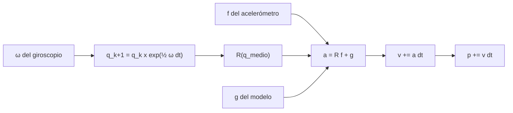

# B80-C03 — Mecanización strapdown e integración de actitud y velocidad

<!-- nav:top -->
[🏠 Programa](../../../../README.md) · [📚 Bloque B80](../../../tronco-comun/B80-navegacion-inercial-y-fusion-multisensorial.md) · [← Anterior: B80-C02 — Modelo de error de acelerómetros](../B80-C02-modelo-de-error-de-acelerometros/CLASE.md) · [Siguiente: B80-C04 — Fusión inercial con mediciones externas (acoplamiento débil y fuerte) →](../B80-C04-fusion-inercial-con-mediciones-externas-acoplamiento-debil-y-fuerte/CLASE.md)
<!-- /nav -->

## 1. Ubicación, nivel y alcance

Clase 3 del bloque B80. Nivel N3. Sigue a [B80-C02](../B80-C02-modelo-de-error-de-acelerometros/CLASE.md). En un sistema *strapdown* la IMU va fijada al vehículo: mide en ejes del cuerpo, y es el computador quien debe mantener la actitud, rotar la fuerza específica al marco de navegación, sumar la gravedad e integrar. Aquí construyes esa mecanización con cuaterniones y la comparas con una solución analítica. La trayectoria es sintética.

## 2. Por qué esta clase existe

Las clases B10-C12..C15 dan las rotaciones y los cuaterniones, pero ninguna construye la cadena completa actitud → velocidad → posición. La decisión central: **¿cómo se integra la actitud para que el error numérico no domine al error del sensor?**

## 3. Lo que podrás hacer al terminar

1. Escribir el cuaternión de rotación de un incremento angular `ω Δt` y propagarlo con la exponencial.
2. Rotar la fuerza específica al marco de navegación y sumar la gravedad para obtener la aceleración.
3. Integrar velocidad y posición con la actitud del punto medio del paso.
4. Comparar la exponencial con la integración de Euler normalizada y medir cómo escalan sus errores con `Δt`.
5. Explicar por qué un cuaternión y su opuesto representan la misma rotación.
6. Verificar una mecanización con una solución analítica y rotular lo sintético.

La evidencia es la **ficha de verificación de una mecanización strapdown** del ejercicio 12 (sección 20).

## 4. Con qué llegas y cómo comprobarlo

1. ¿Qué es un cuaternión unitario?
2. ¿Qué es la fuerza específica?
3. ¿Qué es un marco de navegación?
4. ¿Qué es el orden de un método numérico?
5. ¿Qué es una rotación respecto del cuerpo?

<details>
<summary>Ver respuestas</summary>

1. Cuatro números `(w, x, y, z)` de norma 1 que representan una rotación. 2. Lo que mide un acelerómetro: aceleración menos gravedad (ver B80-C01). 3. El sistema de referencia en que se expresa la posición y la velocidad. 4. El exponente de `Δt` con que decrece el error al reducir el paso. 5. Una rotación expresada en los ejes que giran con el vehículo.
</details>

Con cuatro o cinco aciertos, sigue; si no, repasa los prerrequisitos.

## 5. Un caso de contexto y casos de referencia

Un cuerpo gira a `0,5 rad/s` alrededor de `z` durante `20 s` (`10 rad`) y mide una fuerza específica de `(1,0; 0; 9,80665) m/s²`. La solución analítica da `v = (−1,08804; 3,67814) m/s` y `p = (7,3563; 42,1761) m`. La mecanización con la exponencial del cuaternión y actitud de punto medio (`Δt = 0,01 s`) tiene un error de posición de `4,014 × 10⁻⁵ m`; la integración con Euler y actitud de inicio de paso, `0,1071 m`. Es el **ejemplo conductor**. Todo es **sintético**; la gravedad estándar es la del NIST.

## 6. Vocabulario

El **cuaternión** `q = (w, x, y, z)` rota del cuerpo al marco de navegación. Para un incremento angular constante, `q_{k+1} = q_k ⊗ exp(½ ω Δt)`. La **mecanización** es el conjunto de ecuaciones `q̇ = ½ q ⊗ (0, ω)`, `v̇ = R(q) f + g` y `ṗ = v`. La **actitud de punto medio** usa `q` a mitad del paso para rotar `f`, lo que sube el orden del método de uno a dos.

## 7. Modelo mental: una brújula que gira mientras se anota la marcha



*Descripción textual:* el giroscopio actualiza el cuaternión; con la actitud del punto medio se rota la fuerza específica, se suma la gravedad y se integra la velocidad y la posición.

Analogía: caminar anotando pasos mientras giras una brújula: si usas el rumbo del inicio del paso y no el del medio, tus pasos quedan sesgados hacia el lado de donde giras. Límite: aquí no hay rotación terrestre, ni transporte, ni coning ni sculling; es el caso inercial más simple.

## 8. La explicación, paso a paso

### 8.1 Propagación de la actitud

Con velocidad angular constante `ω` en el cuerpo, la rotación en `Δt` es la exponencial del cuaternión: `exp(½ ω Δt) = (cos(½ θ), û sen(½ θ))` con `θ = |ω| Δt`. Esta actualización es exacta para `ω` constante y conserva la norma `1` (a `10⁻¹⁵`). La alternativa de Euler suma `½ q ⊗ (0, ω) Δt` y renormaliza: la norma se restituye a mano y queda un error en la actitud (`1,04 × 10⁻³` con `Δt = 0,1 s`, `1,04 × 10⁻⁵` con `0,01 s`).

### 8.2 Velocidad y posición

La aceleración en el marco de navegación es `a = R(q) f + g`, con `g = (0, 0, −9,80665) m/s²`. Para el paso se usa la actitud del punto medio `q ⊗ exp(½ ω Δt/2)`; entonces `v += a Δt`, `p += v Δt + ½ a Δt²`. Con la actitud del inicio del paso el error es de primer orden, porque la dirección de la aceleración cambia durante el paso.

### 8.3 La IMU mide fuerza específica

En caída libre `f_b = 0` y la mecanización devuelve `a_z = −9,80665 m/s²`: es la gravedad modelada la que acelera al vehículo, no un valor medido. Una IMU en reposo mide `f = (0, 0, +g)`.

### 8.4 Resultados frente a la solución analítica

La trayectoria da un movimiento que se puede integrar a mano: `a = (cos ωt, sen ωt)`, `v = (sen ωt/ω, (1 − cos ωt)/ω)`, `p = ((1 − cos ωt)/ω², (t − sen ωt/ω)/ω)`.

| método | `Δt` (s) | error de posición (m) | error de velocidad (m/s) | error de actitud |
|---|---|---|---|---|
| exponencial, punto medio | 0,1 | 4,014 × 10⁻³ | 3,996 × 10⁻⁴ | 6,4 × 10⁻¹⁵ |
| exponencial, punto medio | 0,01 | 4,014 × 10⁻⁵ | 3,996 × 10⁻⁶ | 2,3 × 10⁻¹⁴ |
| Euler, inicio de paso | 0,1 | 1,076 | 9,992 × 10⁻² | 1,041 × 10⁻³ |
| Euler, inicio de paso | 0,01 | 0,1071 | 9,629 × 10⁻³ | 1,042 × 10⁻⁵ |

El error de posición del método de punto medio cae por `100` al dividir el paso por `10` (segundo orden); el de Euler cae por `10` (primer orden). Tras una vuelta completa (`ψ = 2π`) el cuaternión vale `(−1, 0, 0, −0,0009)`: `q` y `−q` son la misma rotación.

## 9. Magnitudes, símbolos y unidades

| Símbolo | Qué es | Unidad | Valor / nota |
|---|---|---|---|
| `q` | cuaternión de actitud | — | norma 1 |
| `ω` | velocidad angular | rad/s | (0, 0, 0,5) sintética |
| `f` | fuerza específica en el cuerpo | m/s² | (1,0; 0; 9,80665) sintética |
| `g` | gravedad | m/s² | 9,80665 (NIST, `gₙ`) |
| `Δt` | paso de integración | s | 0,1 y 0,01 |
| `v`, `p` | velocidad y posición | m/s, m | ver tabla 8.4 |

## 10. Convenciones y referencias

Marco inercial local sin rotación terrestre, gravedad uniforme hacia `−z`. Cuaternión `(w, x, y, z)` de cuerpo a navegación; ejes del cuerpo `x, y, z`. Unidades SI y radianes. Sin aleatoriedad. Python 3.12.9, solo biblioteca estándar; tolerancias: `10⁻⁹` en la actitud exponencial y `10⁻³` en Euler con `Δt = 0,01 s`.

## 11. De dónde sale lo que afirmamos

| ID | Fuente | Localizador | Respalda | Estado |
|---|---|---|---|---|
| S2 | NIST, CODATA, aceleración estándar de la gravedad `gₙ` — https://physics.nist.gov/cgi-bin/cuu/Value?gn (consultada 2026-11-10) | página del valor | `gₙ` = 9,806 65 m/s² (exacto por definición) | Consultada |
| — | Mecanización strapdown, exponencial del cuaternión y compensación de *coning* y *sculling* (texto de navegación inercial) | — | relaciones estándar que verifica el laboratorio con una solución analítica | No consultada en una fuente concreta |

Límites: no se incluyen rotación terrestre, transporte ni modelo de gravedad variable; no se modelan coning ni sculling ni los errores de los sensores.

## 12. Cómo ver la calidad de una mecanización

| Magnitud | Valor |
|---|---|
| `v` analítica | (−1,08804; 3,67814) m/s |
| `p` analítica | (7,3563; 42,1761) m |
| error de posición, exponencial, `Δt` = 0,01 s | 4,014 × 10⁻⁵ m |
| error de posición, Euler, `Δt` = 0,01 s | 0,1071 m |
| norma de `q` tras 20 s | 1,000000000 |

Descripción larga: la exponencial con punto medio queda a menos de una décima de milímetro de la solución exacta mientras que Euler con inicio de paso está a diez centímetros.

## 13. Ejemplo trabajado: un paso de actitud

**Paso 1 · Ángulo.** Con `ω = 0,5 rad/s` y `Δt = 0,1 s`, `θ = 0,05 rad`.

**Paso 2 · Cuaternión.** `exp(½ ω Δt) = (cos 0,025; 0; 0; sen 0,025) = (0,999688; 0; 0; 0,024997)`.

**Paso 3 · Punto medio.** Para rotar `f` se usa media rotación: `θ/2 = 0,025 rad` más desde `q_k`.

**Paso 4 · Aceleración.** Si `q_k` es la identidad, `R f ≈ (cos 0,025; sen 0,025) = (0,9997; 0,0250)` en `xy`, y `a = (0,9997; 0,0250; 0)` tras restar `g`.

## 14. Distintas formas de describir una rotación

**Por cuaternión:** `(w, x, y, z)`. **Por matriz:** `R(q)`. **Por ángulo y eje:** `θ û`. **Por ecuación diferencial:** `q̇ = ½ q ⊗ (0, ω)`.

## 15. Práctica guiada

**Ejercicio 1 · con los pasos indicados.** Escribe el cuaternión de una rotación de `10 rad` alrededor de `z`. *Pasos:* `(cos 5, 0, 0, sen 5)`.

<details><summary>Solución comentada</summary>

`(0,28366; 0; 0; −0,95892)`.
</details>

**Ejercicio 2 · con una pista.** Calcula `exp(½ ω Δt)` para `ω = 0,5 rad/s`, `Δt = 0,1 s`. *Pista:* ángulo `0,05 rad`.

<details><summary>Solución comentada</summary>

`(0,999688; 0; 0; 0,024997)`.
</details>

**Ejercicio 3 · casi autónomo.** Con `q = (1, 0, 0, 0)` y `f_b = (1; 0; 9,80665)`, ¿cuál es `a`?

<details><summary>Solución comentada</summary>

`R f = f`, `a = f + (0, 0, −g) = (1; 0; 0) m/s²`.
</details>

## 16. Práctica autónoma, transferencia e integrador

**Ejercicio 4 · autónomo.** Calcula la rapidez final a partir de la velocidad analítica.

<details><summary>Solución comentada</summary>

`√(1,08804² + 3,67814²) = 3,8356 m/s`.
</details>

**Ejercicio 5 · autónomo.** Con la tabla 8.4, ¿qué orden tiene Euler con inicio de paso en posición?

<details><summary>Solución comentada</summary>

Cociente `1,076/0,1071 ≈ 10`: primer orden.
</details>

**Ejercicio 6 · autónomo.** ¿Cuántos pasos de `0,01 s` caben en una vuelta a `0,5 rad/s`?

<details><summary>Solución comentada</summary>

`2π/0,5/0,01 = 1257` pasos.
</details>

**Ejercicio 7 · autónomo.** ¿Qué norma tiene `q + ½ q ⊗ (0, ω) Δt` antes de normalizar con `ω Δt = 0,05`?

<details><summary>Solución comentada</summary>

`√(1 + 0,025²) = 1,0003`.
</details>

**Ejercicio 8 · autónomo.** ¿Qué paso da un error de posición `≈ 10⁻³ m` con el método de punto medio?

<details><summary>Solución comentada</summary>

El error escala con `Δt²`: `4,014 × 10⁻⁵ × (Δt/0,01)² = 10⁻³` da `Δt ≈ 0,05 s`.
</details>

**Ejercicio 9 · transferencia.** **Transferencia.** Una IMU en reposo sobre la mesa mide `f = (0, 0, +g)`. ¿Por qué la mecanización no produce movimiento?

<details><summary>Solución comentada</summary>

Porque `a = R f + g_vec = (0, 0, g) + (0, 0, −g) = 0`; la gravedad modelada cancela la fuerza específica.
</details>

**Ejercicio 10 · transferencia.** **Transferencia.** Un colega usa `R(q_k)` al inicio de cada paso para rotar `f` y obtiene errores de metros. ¿Qué le recomiendas?

<details><summary>Solución comentada</summary>

Usar la actitud del punto medio o subdividir el paso; el error del inicio de paso es de primer orden.
</details>

**Ejercicio 11 · transferencia.** **Transferencia.** ¿Por qué la norma de `q` debe vigilarse con Euler y no con la exponencial?

<details><summary>Solución comentada</summary>

La exponencial es exactamente unitaria; Euler la aumenta en cada paso y hay que renormalizar.
</details>

**Ejercicio 12 · integrador.** **Integrador.** Elabora tu *ficha de verificación de una mecanización strapdown*: tabla de errores para dos pasos y dos métodos, orden observado, norma de `q` y límites.

<details><summary>Solución comentada</summary>

Secciones 8.1–8.4 y la salida del laboratorio.
</details>

## 17. Laboratorio: mecanización con cuaterniones frente a una solución analítica

El script [strapdown.py](strapdown.py) propaga actitud, velocidad y posición con dos métodos y dos pasos, y los compara con la solución analítica (**comprueba** error de actitud < 10⁻⁹, orden dos y orden uno, y doble cobertura del cuaternión).

**Datos:** trayectoria **sintética** determinista; `gₙ` del NIST consultado. **Predice antes de ejecutar:** ¿cómo cambia el error de posición exponencial al pasar de `0,1 s` a `0,01 s`? (se divide por 100.) **Ejecución del 2026-11-10 (Python 3.12.9):**

```text
Python 3.12.9 (biblioteca estandar)
Analitico (SINTETICO): psi = 10.000 rad, v = (-1.08804, 3.67814, 0.0) m/s, p = (7.3563, 42.1761, 0.0) m
 metodo   dt [s]   error posicion [m]   error velocidad [m/s]   error actitud |q-q_a|   norma de q
exp        0.100            4.014e-03               3.996e-04             6.442e-15  1.000000000
exp        0.010            4.014e-05               3.996e-06             2.322e-14  1.000000000
euler      0.100            1.076e+00               9.992e-02             1.041e-03  1.000000000
euler      0.010            1.071e-01               9.629e-03             1.042e-05  1.000000000
Caida libre: f_b = 0 -> a_z = f_z - g = -9.80665 m/s2 (la IMU mide fuerza especifica, no aceleracion)
Tras una vuelta completa (psi = 2 pi): q = (-1.000000, 0.000000, 0.000000, -0.000907) -> -q es la misma rotacion
Pruebas superadas.
```

```bash
python programa/clases/B80/B80-C03-mecanizacion-strapdown-e-integracion-de-actitud-y-velocidad/strapdown.py
```

**Límites:** sin rotación terrestre, sin ruido, sin coning ni sculling, un solo movimiento.

## 18. Errores frecuentes y cómo corregirlos

**Rotar `f` con la actitud del inicio del paso.** Se corrige con 8.2.

**Olvidar normalizar `q` con Euler.** Se corrige con 8.1.

**Creer que la IMU mide la aceleración total.** Se corrige con 8.3.

**Presentar la trayectoria sintética como un vuelo real.** Se corrige con la sección 10.

## 19. Cómo sabrás que vas bien

Tras 8.4: ¿qué orden esperabas para cada método y cuál mediste? Si dudas, repasa el ejemplo 13. Tras el laboratorio: ¿qué comprueba? (ver la sección 17).

## 20. Qué entregas y cómo se evalúa

El producto es tu **ficha de verificación de una mecanización strapdown** (ejercicio 12).

| Criterio | Inicial | En desarrollo | Logrado | Destacado |
|---|---|---|---|---|
| Conceptos | Los confunde | Parciales | Escribe la mecanización completa | Explica el orden del método |
| Cálculo | Sin unidades | Con errores | Cálculos con unidades | Casos nuevos |
| Verificación | Sin comprobar | Un caso | Contraste con solución analítica | Interpreta el orden observado |
| Fuentes | Sin fuente | Sin fecha | Fuentes con fecha y estado | Declara lo sintético y lo no consultado |
| Límites | No los nombra | Uno | Nombra tres límites del modelo | Discute qué falta del modelo |

**Condiciones críticas (no se compensan con promedio):** rotular la trayectoria como sintética; no presentar la mecanización como la de un vuelo real; rotular como sintéticos o ilustrativos los datos y los parámetros; no presentar una simulación como observación; citar solo lo consultado.

## 21. Ética, seguridad y límites

Clase educativa: los modelos son simplificados y sus datos son sintéticos o ilustrativos; ningún resultado describe un vehículo real, un sensor comercial ni una misión, y nada de lo simulado debe presentarse como observado. No sustituye a la verificación, validación y certificación de un sistema de navegación de vuelo. Accesibilidad: tablas equivalentes a las gráficas, fórmulas en texto, ejercicios sin conexión.

## 22. Para cerrar y seguir

Con la actitud del punto medio, la misma IMU sintética se integra con un error de `4 × 10⁻⁵ m` frente a `0,11 m` de Euler a igual paso. Queda una pregunta: ¿cómo se corrige la deriva con mediciones externas?

**Glosario español–inglés.** mecanización · *mechanization*; cuaternión · *quaternion*; fuerza específica · *specific force*; marco de navegación · *navigation frame*; punto medio · *midpoint*.

**Continuidad.** [B80-C04](../B80-C04-fusion-inercial-con-mediciones-externas-acoplamiento-debil-y-fuerte/CLASE.md) aplica los filtros al acoplamiento inercial/externo.

**Referencias:** ver sección 11.

<!-- nav:bottom -->
---

[← Anterior: B80-C02 — Modelo de error de acelerómetros](../B80-C02-modelo-de-error-de-acelerometros/CLASE.md) · [📚 Bloque B80](../../../tronco-comun/B80-navegacion-inercial-y-fusion-multisensorial.md) · [Siguiente: B80-C04 — Fusión inercial con mediciones externas (acoplamiento débil y fuerte) →](../B80-C04-fusion-inercial-con-mediciones-externas-acoplamiento-debil-y-fuerte/CLASE.md)
<!-- /nav -->
