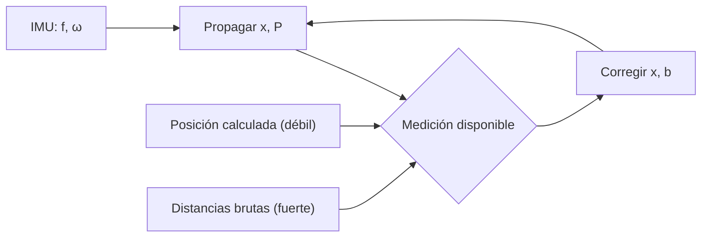

# B80-C04 — Fusión inercial con mediciones externas (acoplamiento débil y fuerte)

<!-- nav:top -->
[🏠 Programa](../../../../README.md) · [📚 Bloque B80](../../../tronco-comun/B80-navegacion-inercial-y-fusion-multisensorial.md) · [← Anterior: B80-C03 — Mecanización strapdown e integración de actitud y velocidad](../B80-C03-mecanizacion-strapdown-e-integracion-de-actitud-y-velocidad/CLASE.md) · [Siguiente: B80-C05 — Redundancia de sensores y arbitraje de mediciones →](../B80-C05-redundancia-de-sensores-y-arbitraje-de-mediciones/CLASE.md)
<!-- /nav -->

## 1. Ubicación, nivel y alcance

Clase 4 del bloque B80. Nivel N3. Sigue a [B80-C03](../B80-C03-mecanizacion-strapdown-e-integracion-de-actitud-y-velocidad/CLASE.md): la mecanización deriva; aquí la corriges con mediciones externas mediante un filtro de Kalman que estima además el sesgo del acelerómetro. Comparas el **acoplamiento débil** (la medición externa ya viene como una posición calculada) con el **fuerte** (las distancias entran directamente al filtro). Las balizas y el vehículo son sintéticos.

## 2. Por qué esta clase existe

B74-C08..C10 dan los filtros, pero ninguna clase los aplica a la unión de una IMU con una fuente externa. La decisión central: **¿en qué nivel se funden la inercia y la medición externa, y qué se pierde o se gana al elegirlo?**

## 3. Lo que podrás hacer al terminar

1. Escribir el estado de error `[x, y, vx, vy, b_x, b_y]` y su matriz de transición.
2. Aplicar la actualización de Kalman con una medición de posición (acoplamiento débil).
3. Linealizar una medición de distancia y aplicarla directamente (acoplamiento fuerte).
4. Explicar por qué el acoplamiento fuerte sigue aportando con una sola baliza visible.
5. Comparar el error de posición sin ayuda, con acoplamiento débil y fuerte con un Monte Carlo.
6. Rotular qué es sintético y qué es modelo.

La evidencia es la **ficha comparativa de acoplamiento inercial/externo** del ejercicio 12 (sección 20).

## 4. Con qué llegas y cómo comprobarlo

1. ¿Qué es una matriz de covarianza?
2. ¿Qué es la ganancia de Kalman?
3. ¿Qué es una innovación?
4. ¿Qué es linealizar?
5. ¿Qué es un Monte Carlo?

<details>
<summary>Ver respuestas</summary>

1. La matriz que describe la incertidumbre y las correlaciones de un vector de estado. 2. El factor que pondera la innovación según la relación entre la incertidumbre de estado y la de la medición. 3. La diferencia entre la medición y la predicha. 4. Aproximar una función con su derivada en el punto de operación. 5. Repetir una simulación con ruidos distintos para estimar una estadística.
</details>

Con cuatro o cinco aciertos, sigue; si no, repasa los prerrequisitos.

## 5. Un caso de contexto y casos de referencia

Un vehículo de `(2, 1) m/s` navega `300 s` con un acelerómetro de sesgo `(0,02; −0,01) m/s²`. Sin ayuda, el RMS de su error de posición en 30 corridas sintéticas es `1011,36 m` (la cota `½|b|t²` es `1006,2 m`). Con distancias a dos balizas cada `10 s` (excepto en `100–200 s`, en que solo se ve una), el acoplamiento débil deja `7,20 m` y el fuerte `5,95 m`, `1,21` veces mejor. Es el **ejemplo conductor**. Todo es **sintético**.

## 6. Vocabulario

El **acoplamiento débil** (*loosely coupled*) usa como medición una posición que otro módulo ya calculó. El **acoplamiento fuerte** (*tightly coupled*) usa las observaciones brutas (aquí, distancias). La **innovación** es la medición menos la predicha. El **filtro de Kalman extendido** linealiza la medición no lineal `r = |p − p_b|` con la matriz `H = [(p − p_b)/r, 0, 0, 0, 0]`.

## 7. Modelo mental: un caminante con podómetro y balizas



*Descripción textual:* la IMU alimenta la propagación del estado y su covarianza; una medición externa, ya procesada como posición (débil) o bruta como distancias (fuerte), corrige el estado y el sesgo, y el ciclo se repite.

Analogía: un caminante que cuenta pasos y a veces ve un hito: puede apuntar su posición solo si ve dos hitos (débil), o usar la distancia a un solo hito para recortar su incertidumbre (fuerte). Límite: el ejemplo es plano, sin actitud, y la baliza es ficticia.

## 8. La explicación, paso a paso

### 8.1 Estado y propagación

El estado es `x = [x, y, v_x, v_y, b_x, b_y]`. La aceleración usada es la medida menos el sesgo estimado: `a = f_m − b`. La matriz de transición `F` suma `v Δt` a la posición, `−½ Δt²` y `−Δt` por el sesgo, y `P ← F P Fᵀ + Q`, con `Q` del ruido del acelerómetro (`0,01 m/s²` a `1 Hz`).

### 8.2 Actualización con una medición de posición (débil)

Con `H = [I₂ 0]`: `K = P Hᵀ (H P Hᵀ + R)⁻¹`, `x ← x + K (z − H x)`, `P ← (I − KH) P (I − KH)ᵀ + K R Kᵀ`. Si `P = 25 m²` y `R = 25 m²` en un eje, `K = 0,5`: el estado se corrige a medio camino. El ajuste de posición necesita al menos **dos** distancias; con la geometría casi alineada su incertidumbre se amplifica, y la clase lo modela con un factor geométrico aproximado.

### 8.3 Actualización con una distancia (fuerte)

La distancia `r = |p − p_b|` se linealiza: `H = [(x − x_b)/r, (y − y_b)/r, 0, 0, 0, 0]`. Una sola baliza informa solo a lo largo de la línea de vista, pero con el movimiento del vehículo esa dirección cambia y el filtro acumula información sobre el sesgo. Por eso el acoplamiento fuerte no se detiene entre `100 s` y `200 s`.

### 8.4 Resultados

| modo | RMS del error de posición a 300 s (m) |
|---|---|
| sin ayuda | 1011,36 |
| acoplamiento débil | 7,20 |
| acoplamiento fuerte | 5,95 |

La cota de deriva por sesgo (`½ |b| t² = 1006,2 m`) predice el caso sin ayuda con un error de `0,5 %`. La mejora del fuerte frente al débil es `1,21` veces y depende del ruido de las distancias, de la geometría y de la aproximación del ajuste de posición.

### 8.5 Segunda vía

Las dos referencias independientes son la cota analítica del caso sin ayuda y la comparación interna entre modos con las mismas semillas. No se valida contra datos reales.

## 9. Magnitudes, símbolos y unidades

| Símbolo | Qué es | Unidad | Valor / nota |
|---|---|---|---|
| `x` | estado | m, m/s, m/s² | 6 componentes |
| `b` | sesgo de acelerómetro | m/s² | (0,02; −0,01) (sintético) |
| `σ_a` | ruido del acelerómetro | m/s² | 0,01 (sintético) |
| `σ_r` | ruido de la distancia | m | 5 (sintético) |
| `K` | ganancia de Kalman | — | según `P` y `R` |
| `H` | matriz de medición | — | ver 8.2 y 8.3 |

## 10. Convenciones y referencias

Plano local `x` (este), `y` (norte). Balizas ficticias en `(0, 0)` y `(3000, 0) m`. Medición cada `10 s`. 30 corridas con semillas `80004..80033`. Unidades SI. Python 3.12.9, solo biblioteca estándar; tolerancia: el RMS sin ayuda debe coincidir con `½|b|t²` en 15 % y el fuerte ser ≤ 1,05 × el débil.

## 11. De dónde sale lo que afirmamos

| ID | Fuente | Localizador | Respalda | Estado |
|---|---|---|---|---|
| — | Filtro de Kalman y su versión extendida; acoplamiento débil y fuerte inercial/GNSS (texto de navegación) | — | relaciones estándar que verifica el laboratorio con el caso sin ayuda y con la cota analítica | No consultada en una fuente concreta |

Límites: las balizas, el vehículo y todos los sigmas son sintéticos; no se modelan el reloj del receptor, los errores de multitrayecto ni la actitud.

## 12. Cómo ver el efecto de la corrección

| Magnitud | Valor |
|---|---|
| RMS sin ayuda | 1011,36 m |
| RMS acoplamiento débil | 7,20 m |
| RMS acoplamiento fuerte | 5,95 m |
| cota `½ |b| t²` | 1006,2 m |
| mejora fuerte/débil | 1,21 veces |

Descripción larga: la deriva libre llega a un kilómetro en cinco minutos; cualquier corrección externa la reduce más de cien veces, y la fuerte aprovecha mejor las observaciones parciales.

## 13. Ejemplo trabajado: una actualización escalar

**Paso 1 · Prior.** Incertidumbre de posición `P = 100 m²` (`10 m`).

**Paso 2 · Medición.** Distancia con `R = 25 m²` (`5 m`).

**Paso 3 · Ganancia.** `K = 100/(100 + 25) = 0,8`.

**Paso 4 · Posterior.** `P⁺ = (1 − 0,8) × 100 = 20 m²` (`4,47 m`), menor que ambas.

## 14. Distintas formas de describir la corrección de una deriva

**Por ganancia:** `K`. **Por información:** `P⁻¹ + Hᵀ R⁻¹ H`. **Por nivel de acoplamiento:** posición calculada o distancias brutas. **Por error:** RMS en Monte Carlo.

## 15. Práctica guiada

**Ejercicio 1 · con los pasos indicados.** Calcula `K` con `P = 100 m²` y `R = 25 m²`. *Pasos:* `P/(P+R)`.

<details><summary>Solución comentada</summary>

`0,8`.
</details>

**Ejercicio 2 · con una pista.** Calcula `P⁺` del ejercicio 1. *Pista:* `(1−K)P`.

<details><summary>Solución comentada</summary>

`20 m²`.
</details>

**Ejercicio 3 · casi autónomo.** ¿Por qué la cota `½ |b| t²` predice el caso sin ayuda?

<details><summary>Solución comentada</summary>

Porque sin corrección el error de posición es la doble integral del sesgo: `½ |b| t² = 0,5 × 0,02236 × 90 000 = 1006,2 m`.
</details>

## 16. Práctica autónoma, transferencia e integrador

**Ejercicio 4 · autónomo.** Calcula `|b|` de `(0,02; −0,01)`.

<details><summary>Solución comentada</summary>

`0,02236 m/s²`.
</details>

**Ejercicio 5 · autónomo.** Con `P = 25 m²` y `R = 25 m²`, ¿cuánto vale `K`?

<details><summary>Solución comentada</summary>

`0,5`.
</details>

**Ejercicio 6 · autónomo.** ¿Cuántas mediciones llegan en 300 s si hay una cada 10 s?

<details><summary>Solución comentada</summary>

`30`.
</details>

**Ejercicio 7 · autónomo.** Cociente `RMS_débil / RMS_fuerte`.

<details><summary>Solución comentada</summary>

`7,20/5,95 = 1,21`.
</details>

**Ejercicio 8 · autónomo.** Con una baliza a `5000 m` de distancia, ¿cuánta información da una medición de `σ_r = 5 m` en la línea de vista?

<details><summary>Solución comentada</summary>

`1/σ_r² = 0,04 m⁻²`, solo en esa dirección.
</details>

**Ejercicio 9 · transferencia.** **Transferencia.** El receptor externo pierde la solución cuando ve una sola baliza. ¿Qué arquitectura mantiene mediciones útiles?

<details><summary>Solución comentada</summary>

El acoplamiento fuerte: usa las observaciones brutas de una sola baliza.
</details>

**Ejercicio 10 · transferencia.** **Transferencia.** Un colega propone fijar el sesgo al valor de laboratorio y no estimarlo. ¿Qué responderías?

<details><summary>Solución comentada</summary>

Que el sesgo cambia con la temperatura y el tiempo; estimarlo en el filtro absorbe parte de esa variación.
</details>

**Ejercicio 11 · transferencia.** **Transferencia.** ¿Qué riesgo corre un filtro si el ruido de medición declarado es menor que el real?

<details><summary>Solución comentada</summary>

Sobreconfianza: la ganancia es demasiado alta y la covarianza resulta optimista; hay que comprobar la consistencia de la innovación.
</details>

**Ejercicio 12 · integrador.** **Integrador.** Elabora tu *ficha comparativa de acoplamiento*: tabla de RMS por modo, cota analítica, mejora relativa y límites de la comparación.

<details><summary>Solución comentada</summary>

Secciones 8.1–8.5 y la salida del laboratorio.
</details>

## 17. Laboratorio: Kalman inercial con acoplamiento débil y fuerte

El script [acoplamiento.py](acoplamiento.py) simula 30 corridas del vehículo, filtra con tres modos (sin ayuda, débil y fuerte) y compara el RMS del error de posición con la cota analítica (**comprueba** fuerte ≤ débil, ambos menores que el libre, libre ≈ cota).

**Datos:** todo **sintético** (semillas 80004 a 80033); balizas ficticias. **Predice antes de ejecutar:** ¿qué RMS tendrá el caso sin ayuda? (alrededor de la cota, 1006 m.) **Ejecución del 2026-11-10 (Python 3.12.9):**

```text
Python 3.12.9 (biblioteca estandar)
Datos SINTETICOS (semillas 80004..80033), balizas ficticias; vehiculo de (2, 1) m/s, 300 s, sesgo verdadero (0.02, -0.01) m/s2
modo ins   : RMS del error de posicion en t = 300 s =   1011.36 m (30 corridas)
modo debil : RMS del error de posicion en t = 300 s =      7.20 m (30 corridas)
modo fuerte: RMS del error de posicion en t = 300 s =      5.95 m (30 corridas)
Cota de la deriva por sesgo sin ayuda 0.5 |b| t^2 = 1006.2 m
Mejora del acoplamiento fuerte frente al debil: 1.21 veces
Pruebas superadas.
```

```bash
python programa/clases/B80/B80-C04-fusion-inercial-con-mediciones-externas-acoplamiento-debil-y-fuerte/acoplamiento.py
```

**Límites:** plano, sin actitud ni reloj, ajuste de posición simplificado, 30 corridas solamente.

## 18. Errores frecuentes y cómo corregirlos

**Creer que el acoplamiento débil siempre equivale al fuerte.** Se corrige con 8.3.

**No estimar el sesgo.** Se corrige con 8.1.

**Olvidar linealizar la distancia.** Se corrige con 8.3.

**Presentar el resultado como el de un sistema real.** Se corrige con la sección 10.

## 19. Cómo sabrás que vas bien

Tras 8.4: ¿qué RMS esperabas sin ayuda? Si dudas, repasa el ejemplo 13. Tras el laboratorio: ¿qué comprueba? (ver la sección 17).

## 20. Qué entregas y cómo se evalúa

El producto es tu **ficha comparativa de acoplamiento inercial/externo** (ejercicio 12).

| Criterio | Inicial | En desarrollo | Logrado | Destacado |
|---|---|---|---|---|
| Conceptos | Los confunde | Parciales | Distingue débil y fuerte | Argumenta cuándo conviene cada uno |
| Cálculo | Sin unidades | Con errores | Calcula `K` y `P` | Casos nuevos |
| Verificación | Sin comprobar | Un caso | Contraste con la cota | Interpreta las diferencias |
| Fuentes | Sin fuente | Sin fecha | Fuentes con fecha y estado | Declara lo sintético y lo no consultado |
| Límites | No los nombra | Uno | Nombra tres límites del modelo | Discute qué falta del modelo |

**Condiciones críticas (no se compensan con promedio):** rotular balizas y vehículo como sintéticos; no presentar la mejora como un resultado de misión; rotular como sintéticos o ilustrativos los datos y los parámetros; no presentar una simulación como observación; citar solo lo consultado.

## 21. Ética, seguridad y límites

Clase educativa: los modelos son simplificados y sus datos son sintéticos o ilustrativos; ningún resultado describe un vehículo real, un sensor comercial ni una misión, y nada de lo simulado debe presentarse como observado. No sustituye a la verificación, validación y certificación de un sistema de navegación de vuelo. Accesibilidad: tablas equivalentes a las gráficas, fórmulas en texto, ejercicios sin conexión.

## 22. Para cerrar y seguir

Una ayuda externa cada `10 s` reduce el error de `1011 m` a `6–7 m`, y usar las distancias brutas mejora `1,21` veces más. Queda una pregunta: ¿qué pasa cuando varios sensores miden lo mismo y alguno falla?

**Glosario español–inglés.** acoplamiento débil · *loosely coupled*; acoplamiento fuerte · *tightly coupled*; innovación · *innovation*; ganancia de Kalman · *Kalman gain*; filtro de Kalman extendido · *extended Kalman filter*.

**Continuidad.** [B80-C05](../B80-C05-redundancia-de-sensores-y-arbitraje-de-mediciones/CLASE.md) trata la redundancia de sensores y el arbitraje de mediciones.

**Referencias:** ver sección 11.

<!-- nav:bottom -->
---

[← Anterior: B80-C03 — Mecanización strapdown e integración de actitud y velocidad](../B80-C03-mecanizacion-strapdown-e-integracion-de-actitud-y-velocidad/CLASE.md) · [📚 Bloque B80](../../../tronco-comun/B80-navegacion-inercial-y-fusion-multisensorial.md) · [Siguiente: B80-C05 — Redundancia de sensores y arbitraje de mediciones →](../B80-C05-redundancia-de-sensores-y-arbitraje-de-mediciones/CLASE.md)
<!-- /nav -->
