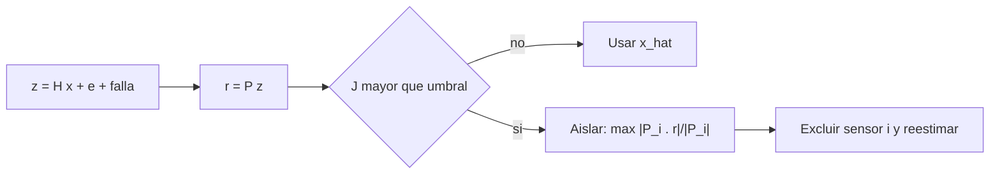

# B80-C05 — Redundancia de sensores y arbitraje de mediciones

<!-- nav:top -->
[🏠 Programa](../../../../README.md) · [📚 Bloque B80](../../../tronco-comun/B80-navegacion-inercial-y-fusion-multisensorial.md) · [← Anterior: B80-C04 — Fusión inercial con mediciones externas (acoplamiento débil y fuerte)](../B80-C04-fusion-inercial-con-mediciones-externas-acoplamiento-debil-y-fuerte/CLASE.md) · [Siguiente: B80-C06 — Fusión IMU-cámara →](../B80-C06-fusion-imu-camara/CLASE.md)
<!-- /nav -->

## 1. Ubicación, nivel y alcance

Clase 5 del bloque B80. Nivel N3. Sigue a [B80-C04](../B80-C04-fusion-inercial-con-mediciones-externas-acoplamiento-debil-y-fuerte/CLASE.md): fundir sensores supone que todos dicen la verdad. Aquí, con seis sensores de un eje que miden un vector de tres componentes, construyes el residuo de paridad, un estadístico de detección con umbral chi-cuadrado y una regla de aislamiento de la falla. Los datos son sintéticos.

## 2. Por qué esta clase existe

B88-C12 trata la detección y recuperación de fallas en general, no el arbitraje de las mediciones que alimentan la navegación. La decisión central: **¿cómo sabe el sistema que un sensor miente, y cuál es, sin una referencia externa?**

## 3. Lo que podrás hacer al terminar

1. Construir la matriz de proyección de paridad `P = I − H (HᵀH)⁻¹Hᵀ` de un conjunto redundante.
2. Explicar por qué el residuo no depende del vector medido.
3. Calcular el umbral chi-cuadrado para una tasa de falsa alarma dada.
4. Medir la probabilidad de detección según el tamaño de la falla.
5. Aislar el sensor con falla con la correlación del residuo.
6. Distinguir lo sintético de lo modelado y declarar los límites.

La evidencia es la **ficha de detección y aislamiento de fallas** del ejercicio 12 (sección 20).

## 4. Con qué llegas y cómo comprobarlo

1. ¿Qué es el rango de una matriz?
2. ¿Qué es un residuo?
3. ¿Qué es la distribución chi-cuadrado?
4. ¿Qué es la falsa alarma?
5. ¿Qué es una proyección ortogonal?

<details>
<summary>Ver respuestas</summary>

1. El número de columnas linealmente independientes. 2. La diferencia entre lo medido y lo explicado por el modelo. 3. La de la suma de cuadrados de variables normales estándar independientes. 4. Declarar falla cuando no la hay. 5. Una operación que deja la parte de un vector perpendicular a un subespacio.
</details>

Con cuatro o cinco aciertos, sigue; si no, repasa los prerrequisitos.

## 5. Un caso de contexto y casos de referencia

Seis sensores de un eje con direcciones sintéticas miden un vector de tres componentes con ruido `σ = 0,01`. Quedan `6 − 3 = 3` grados de libertad de paridad, y el umbral chi-cuadrado para una falsa alarma de `10⁻³` es `16,266`. En 20 000 ensayos sin falla se observó `0,00085`. Una falla de `10 σ` en el sensor 3 se detecta en el `100 %` de los casos y se aísla bien en el `99,4 %`; una de `2 σ` solo se detecta en el `2,2 %`. Es el **ejemplo conductor**. Todo es **sintético**.

## 6. Vocabulario

El **espacio de paridad** es el subespacio de las medidas que ningún vector de estado puede producir. El **residuo** `r = P z` vive en él. El **estadístico de detección** `J = |r|²/σ²` sigue una chi-cuadrado con `n − 3` grados de libertad sin falla. El **aislamiento** elige el sensor cuya columna de `P` está más alineada con `r`.

## 7. Modelo mental: un jurado de seis testigos



*Descripción textual:* se forma el residuo de paridad; si el estadístico supera el umbral se busca el sensor más correlacionado con el residuo, se excluye y se reestima el vector.

Analogía: seis testigos describen el mismo hecho; si uno cuenta algo que ningún relato posible explica, se detecta la contradicción, y la comparación con los demás indica cuál es. Límite: si dos fallan a la vez de forma consistente, este método puede equivocarse.

## 8. La explicación, paso a paso

### 8.1 Medición redundante

`z = H x + e`, con `H` de `6 × 3` y `x` de tres componentes. El estimador de mínimos cuadrados es `x̂ = (HᵀH)⁻¹Hᵀ z`. La traza de la proyección `P_H = H (HᵀH)⁻¹Hᵀ` es `3` (el rango del estado) y la de `I − P_H` es `n − 3 = 3`.

### 8.2 El residuo de paridad

`r = (I − H (HᵀH)⁻¹Hᵀ) z`. Como `(I − P_H) H = 0`, el residuo no depende de `x`: la diferencia máxima entre `x = 0` y `x = (50, −30, 12)` con el mismo ruido es `2,68 × 10⁻¹⁵`. La traza de la matriz de paridad vale `3,000000`.

### 8.3 Detección

Sin falla, `J = |r|²/σ² ~ χ²(3)`. Para tres grados de libertad, `F(x) = erf(√(x/2)) − √(2x/π) e^{−x/2}`. Resolviendo `F(x) = 1 − 10⁻³` se obtiene `16,266`. La falsa alarma observada fue `0,00085` en 20 000 ensayos.

### 8.4 Aislamiento y potencia

Si falla el sensor `i` en `δ`, el residuo contiene `δ` por la columna `i` de `P`. Se elige `argmax_i |P_iᵀ r|/|P_i|`.

| falla (en `σ`) | probabilidad de detección | aislamiento correcto |
|---|---|---|
| 2 | 0,022 | 0,545 |
| 5 | 0,424 | 0,958 |
| 10 | 1,000 | 0,994 |
| 20 | 1,000 | 1,000 |

Una falla de `2 σ` es indistinguible del ruido; el sistema solo es fiable ante fallas grandes en comparación con el ruido.

### 8.5 Segunda vía

La tasa de falsa alarma por Monte Carlo (`0,00085`) contrasta el umbral calculado con la fórmula cerrada, y el residuo se verifica independiente de `x` a precisión de máquina.

## 9. Magnitudes, símbolos y unidades

| Símbolo | Qué es | Unidad | Valor / nota |
|---|---|---|---|
| `H` | matriz de direcciones (6 × 3) | — | unitarias, sintéticas |
| `σ` | desviación del ruido | unidad de la medida | 0,01 (sintético) |
| `r` | residuo de paridad | unidad de la medida | vector de 6, rango 3 |
| `J` | estadístico de detección | — | chi-cuadrado, 3 gl |
| umbral | para falsa alarma 10⁻³ | — | 16,266 |
| `δ` | tamaño de la falla | múltiplos de `σ` | 2, 5, 10, 20 |

## 10. Convenciones y referencias

Los sensores son de un eje, con ruido gaussiano independiente de igual `σ`. Falla = sesgo súbito constante en un solo sensor. Semilla `80005`; 20 000 ensayos de falsa alarma y 500 por tamaño de falla. Python 3.12.9, solo biblioteca estándar; tolerancia: falsa alarma observada dentro de `10⁻³` absoluto del objetivo.

## 11. De dónde sale lo que afirmamos

| ID | Fuente | Localizador | Respalda | Estado |
|---|---|---|---|---|
| — | Método de paridad para detección y aislamiento de fallas en sensores redundantes (texto de navegación y de FDIR) | — | relación estándar que verifica el laboratorio con un Monte Carlo | No consultada en una fuente concreta |

Límites: los sensores, ruidos y fallas son sintéticos; no se modelan fallas múltiples ni ruido distinto por sensor, ni la dinámica de la falla.

## 12. Cómo ver la potencia de la detección

| Magnitud | Valor |
|---|---|
| umbral `χ²(3)` a 10⁻³ | 16,266 |
| falsa alarma observada | 0,00085 |
| detección con 5 σ | 0,424 |
| detección con 10 σ | 1,000 |
| aislamiento con 10 σ | 0,994 |

Descripción larga: el sistema casi no ve fallas de `2 σ`, ve la mitad de las de `5 σ` y todas las de `10 σ`; el aislamiento correcto es casi perfecto cuando la falla se detecta.

## 13. Ejemplo trabajado: el umbral para tres grados de libertad

**Paso 1 · Distribución.** `F(x) = erf(√(x/2)) − √(2x/π) e^{−x/2}`.

**Paso 2 · Evaluar.** En `x = 16,266`: `√(8,133) = 2,852`; `erf(2,852) = 0,99994`; el segundo término vale `√(10,355) × e^{−8,133} = 3,218 × 2,92 × 10⁻⁴ = 9,4 × 10⁻⁴`.

**Paso 3 · Resultado.** `F = 0,99994 − 0,00094 ≈ 0,99900`: la falsa alarma es `10⁻³`.

## 14. Distintas formas de describir una falla de sensor

**Por residuo:** `r = Pz`. **Por estadístico:** `J`. **Por geometría:** correlación con las columnas de `P`. **Por potencia:** probabilidad de detección según `δ/σ`.

## 15. Práctica guiada

**Ejercicio 1 · con los pasos indicados.** ¿Cuántos grados de libertad de paridad tienen `5` sensores que miden un vector de tres componentes? *Pasos:* `n − 3`.

<details><summary>Solución comentada</summary>

`2`.
</details>

**Ejercicio 2 · con una pista.** ¿Cuál es la media de `J` sin falla? *Pista:* media de una chi-cuadrado.

<details><summary>Solución comentada</summary>

Igual a los grados de libertad: `3`.
</details>

**Ejercicio 3 · casi autónomo.** ¿Por qué el residuo no depende de `x`?

<details><summary>Solución comentada</summary>

Porque `P` anula el espacio columna de `H`: `P H = 0`.
</details>

## 16. Práctica autónoma, transferencia e integrador

**Ejercicio 4 · autónomo.** ¿Cuántos grados de libertad hay con `4` sensores?

<details><summary>Solución comentada</summary>

`1`; solo permite detectar, no aislar.
</details>

**Ejercicio 5 · autónomo.** Si se acepta una falsa alarma mayor, ¿el umbral sube o baja?

<details><summary>Solución comentada</summary>

Baja: menos exigente, más detecciones y más falsas alarmas.
</details>

**Ejercicio 6 · autónomo.** Con `σ = 0,01`, ¿qué magnitud tiene una falla de `5 σ`?

<details><summary>Solución comentada</summary>

`0,05` unidades de medida.
</details>

**Ejercicio 7 · autónomo.** ¿Qué fracción de las fallas de `5 σ` detecta el sistema?

<details><summary>Solución comentada</summary>

`0,424`.
</details>

**Ejercicio 8 · autónomo.** Con la falsa alarma de la tabla, ¿cuántas alarmas falsas esperas en 10 000 muestras?

<details><summary>Solución comentada</summary>

`10 000 × 10⁻³ = 10`.
</details>

**Ejercicio 9 · transferencia.** **Transferencia.** Una falla lenta (deriva) de `0,001 σ` por muestra, ¿la detecta este método rápido?

<details><summary>Solución comentada</summary>

No de inmediato: crece hasta superar el umbral; conviene un detector acumulativo y la comparación con otras fuentes.
</details>

**Ejercicio 10 · transferencia.** **Transferencia.** ¿Cómo aplicarías la idea a tres relojes o tres receptores que miden la misma cantidad?

<details><summary>Solución comentada</summary>

Con `H = [1, 1, 1]ᵀ` hay `2` grados de libertad: se pueden detectar y aislar fallas con la diferencia entre ellos.
</details>

**Ejercicio 11 · transferencia.** **Transferencia.** Un colega dice que seis sensores permiten tolerar cinco fallas. ¿Qué respondes?

<details><summary>Solución comentada</summary>

Que el método de paridad tolera una falla simple con aislamiento; fallas múltiples requieren más sensores y no están garantizadas.
</details>

**Ejercicio 12 · integrador.** **Integrador.** Elabora tu *ficha de detección y aislamiento de fallas*: umbral, falsa alarma observada, tabla de detección y aislamiento por tamaño y límites.

<details><summary>Solución comentada</summary>

Secciones 8.1–8.5 y la salida del laboratorio.
</details>

## 17. Laboratorio: paridad, umbral chi-cuadrado y aislamiento

El script [redundancia.py](redundancia.py) forma la matriz de paridad de seis sensores, calcula el umbral, mide la falsa alarma por Monte Carlo y la potencia de detección y aislamiento (**comprueba** traza 3, falsa alarma ≈ 10⁻³, residuo independiente de `x`).

**Datos:** todo **sintético** (semilla 80005). **Predice antes de ejecutar:** ¿qué fracción de fallas de `2 σ` detectará? (muy pocas: ~2 %.) **Ejecución del 2026-11-10 (Python 3.12.9):**

```text
Python 3.12.9 (biblioteca estandar)
Datos SINTETICOS (semilla 80005): n = 6 sensores, 3 ejes -> grados de libertad de paridad = 3; traza de (I - P) = 3.000000
Umbral chi-cuadrado (3 gl, falsa alarma 1e-3) = 16.266 ; verificacion F(umbral) = 0.999000
Falsa alarma observada sin falla: 0.00085 (esperada 0.00100, 20000 ensayos)
 falla [sigma]   deteccion   aislamiento correcto (sensor 3 con falla)
           2        0.022                      0.545
           5        0.424                      0.958
          10        1.000                      0.994
          20        1.000                      1.000
Diferencia maxima del residuo entre x = 0 y x = (50, -30, 12): 2.68e-15
Pruebas superadas.
```

```bash
python programa/clases/B80/B80-C05-redundancia-de-sensores-y-arbitraje-de-mediciones/redundancia.py
```

**Límites:** sensores de un eje, ruido igual, una sola falla a la vez.

## 18. Errores frecuentes y cómo corregirlos

**Esperar que dos sensores basten para aislar.** Se corrige con el ejercicio 4.

**Fijar el umbral sin la distribución.** Se corrige con 8.3.

**Ignorar que una falla pequeña pasa inadvertida.** Se corrige con 8.4.

**Presentar el resultado como el de un sistema real.** Se corrige con la sección 10.

## 19. Cómo sabrás que vas bien

Tras 8.4: ¿qué detección esperabas con una falla de `5 σ`? Si dudas, repasa el ejemplo 13. Tras el laboratorio: ¿qué comprueba? (ver la sección 17).

## 20. Qué entregas y cómo se evalúa

El producto es tu **ficha de detección y aislamiento de fallas** (ejercicio 12).

| Criterio | Inicial | En desarrollo | Logrado | Destacado |
|---|---|---|---|---|
| Conceptos | Los confunde | Parciales | Construye el residuo y el umbral | Explica la potencia de detección |
| Cálculo | Sin unidades | Con errores | Calcula con unidades y gl | Casos nuevos |
| Verificación | Sin comprobar | Un caso | Contraste con Monte Carlo | Interpreta la potencia |
| Fuentes | Sin fuente | Sin fecha | Fuentes con fecha y estado | Declara lo sintético y lo no consultado |
| Límites | No los nombra | Uno | Nombra tres límites del modelo | Discute qué falta del modelo |

**Condiciones críticas (no se compensan con promedio):** rotular sensores y fallas como sintéticos; no afirmar tolerancia a fallas múltiples; rotular como sintéticos o ilustrativos los datos y los parámetros; no presentar una simulación como observación; citar solo lo consultado.

## 21. Ética, seguridad y límites

Clase educativa: los modelos son simplificados y sus datos son sintéticos o ilustrativos; ningún resultado describe un vehículo real, un sensor comercial ni una misión, y nada de lo simulado debe presentarse como observado. No sustituye a la verificación, validación y certificación de un sistema de navegación de vuelo. Accesibilidad: tablas equivalentes a las gráficas, fórmulas en texto, ejercicios sin conexión.

## 22. Para cerrar y seguir

Con tres grados de libertad, una falla de `10 σ` se detecta siempre y se aísla el `99,4 %` de las veces, pero una de `2 σ` pasa casi inadvertida. Queda una pregunta: ¿cómo se complementan una IMU y una cámara?

**Glosario español–inglés.** espacio de paridad · *parity space*; residuo · *residual*; detección y aislamiento de fallas · *fault detection and isolation*; falsa alarma · *false alarm*; redundancia · *redundancy*.

**Continuidad.** [B80-C06](../B80-C06-fusion-imu-camara/CLASE.md) acopla una IMU con una cámara.

**Referencias:** ver sección 11.

<!-- nav:bottom -->
---

[← Anterior: B80-C04 — Fusión inercial con mediciones externas (acoplamiento débil y fuerte)](../B80-C04-fusion-inercial-con-mediciones-externas-acoplamiento-debil-y-fuerte/CLASE.md) · [📚 Bloque B80](../../../tronco-comun/B80-navegacion-inercial-y-fusion-multisensorial.md) · [Siguiente: B80-C06 — Fusión IMU-cámara →](../B80-C06-fusion-imu-camara/CLASE.md)
<!-- /nav -->
