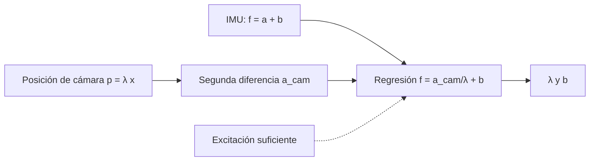

# B80-C06 — Fusión IMU-cámara

<!-- nav:top -->
[🏠 Programa](../../../../README.md) · [📚 Bloque B80](../../../tronco-comun/B80-navegacion-inercial-y-fusion-multisensorial.md) · [← Anterior: B80-C05 — Redundancia de sensores y arbitraje de mediciones](../B80-C05-redundancia-de-sensores-y-arbitraje-de-mediciones/CLASE.md) · [Siguiente: B80-C07 — Fusión radio-óptica en navegación de espacio profundo →](../B80-C07-fusion-radio-optica-en-navegacion-de-espacio-profundo/CLASE.md)
<!-- /nav -->

## 1. Ubicación, nivel y alcance

Clase 6 del bloque B80. Nivel N3. Sigue a [B80-C05](../B80-C05-redundancia-de-sensores-y-arbitraje-de-mediciones/CLASE.md). Una cámara monocular da movimiento relativo **sin escala**; una IMU da aceleración **métrica** pero deriva. Aquí, en un caso de un eje, estimas la escala de la cámara y el sesgo del acelerómetro con una regresión lineal y ves cuándo no son observables. Las posiciones de cámara son sintéticas, no hay imágenes.

## 2. Por qué esta clase existe

Ni B74 ni B87 acoplan una IMU y una cámara en una sola solución. La decisión central: **¿qué debe hacer el vehículo para que la fusión visual-inercial sea observable, y qué se pierde si va a velocidad constante?**

## 3. Lo que podrás hacer al terminar

1. Explicar por qué una cámara monocular no fija la escala y la IMU sí.
2. Escribir la regresión `f = a_cam/λ + b` y resolverla por mínimos cuadrados.
3. Elegir la separación de la segunda diferencia para limitar el ruido amplificado de la cámara.
4. Medir el indicador de excitación y relacionarlo con el error de escala.
5. Mostrar que con velocidad constante la escala no es observable.
6. Rotular los datos como sintéticos y declarar los límites del modelo de un eje.

La evidencia es la **ficha de observabilidad visual-inercial** del ejercicio 12 (sección 20).

## 4. Con qué llegas y cómo comprobarlo

1. ¿Qué es una cámara monocular?
2. ¿Qué es una segunda diferencia finita?
3. ¿Qué son los mínimos cuadrados?
4. ¿Qué es la observabilidad?
5. ¿Qué es el sesgo de un acelerómetro?

<details>
<summary>Ver respuestas</summary>

1. Una sola cámara; no mide la distancia, solo la dirección de los puntos. 2. Una aproximación de la segunda derivada: `(p₊ − 2p + p₋)/h²`. 3. El ajuste que minimiza la suma de los cuadrados de los residuos. 4. La propiedad de que un parámetro pueda deducirse de las mediciones. 5. Un error constante sumado a la medición (B80-C02).
</details>

Con cuatro o cinco aciertos, sigue; si no, repasa los prerrequisitos.

## 5. Un caso de contexto y casos de referencia

Una cámara sintética mide posiciones `p = λ x` con `λ = 0,35` desconocido y ruido `5 × 10⁻⁴`; una IMU mide `f = a + b` con `b = 0,15 m/s²` y ruido `0,05 m/s²`. Con un movimiento senoidal de `1 m` a `0,5 Hz` durante `20 s`, la regresión recupera `λ = 0,3480` (error relativo `0,58 %`) y `b = 0,1504 m/s²` (error `4 × 10⁻⁴`). A velocidad constante, el indicador de excitación cae de `2,436` a `0,124` y las estimaciones de `λ` se dispersan entre `−693` y `1881`. Es el **ejemplo conductor**. Todo es **sintético**.

## 6. Vocabulario

La **escala** `λ` convierte metros en unidades de cámara. La **observabilidad** exige que la aceleración excite la regresión. El **indicador de excitación** es la desviación típica de la aceleración de cámara. La **separación** `S` (en muestras) de la segunda diferencia equilibra sesgo de discretización y ruido amplificado.

## 7. Modelo mental: un mapa sin escala y un cuentakilómetros ruidoso



*Descripción textual:* la posición de la cámara se deriva dos veces; junto con la fuerza específica de la IMU entra en una regresión que entrega la escala y el sesgo, siempre que haya excitación.

Analogía: un mapa sin escala y un cuentakilómetros ruidoso: solo si el vehículo acelera y frena puedes calibrar el uno con el otro. Límite: el caso real es tridimensional, con rotación y calibración de la extrínseca; aquí hay un solo eje.

## 8. La explicación, paso a paso

### 8.1 Qué aporta cada sensor

La cámara da la forma de la trayectoria `p(t) = λ x(t)` sin conocer `λ`. La IMU mide `f = a + b`, en m/s² pero con sesgo y deriva. Juntas fijan la escala y estiman el sesgo.

### 8.2 La regresión

La segunda diferencia de la cámara es `a_cam = λ a`. Entonces `f_k = (1/λ) a_cam,k + b`. Las incógnitas son `u = 1/λ` y `b`. Con `m` muestras, `u = (m Σ a f − Σ a Σ f)/(m Σ a² − (Σ a)²)` y `b = (Σ a² Σ f − Σ a Σ a f)/(m Σ a² − (Σ a)²)`.

### 8.3 Ruido amplificado y separación

La segunda diferencia amplifica el ruido: `σ_a,cam = √6 σ_c / h²`. Con `h = Δt = 0,02 s` serían `3,06` unidades, mayores que la desviación de la señal (`2,44`) y producirían una escala sesgada (regresión con ruido en la variable explicativa). Con `S = 5` muestras, `h = 0,1 s` y `σ_a,cam = 0,122`, que es 20 veces menor que la señal `2,436`. El costo es una atenuación de la aceleración senoidal de unos `0,9 %` (`2(1 − cos ωh)/(ωh)²` con `ωh = 0,314`), del orden del `0,58 %` de error de escala observado.

### 8.4 Observabilidad

El indicador de excitación (desviación típica de `a_cam`) es `2,436` con el movimiento senoidal y `0,124` con velocidad constante, que es solo ruido. En el segundo caso, `u` se estima del ruido y `λ = 1/u` varía entre `−693,5` y `1881,2` (el verdadero es `0,35`). Con una amplitud de `0,02 m` en vez de `1 m`, la media de `λ` es `2,509 ± 0,146`: ya no es fiable.

| caso | excitación | `λ` estimada |
|---|---|---|
| senoidal 1 m | 2,436 | 0,3480 |
| senoidal 0,02 m | ≈ 0,05 (calculada) | 2,509 ± 0,146 |
| velocidad constante | 0,124 | −693 a 1881 |

### 8.5 Segunda vía

La verificación independiente es el valor verdadero sintético: `λ = 0,35`, `b = 0,15 m/s²`, con tolerancias de 5 % y de `0,05 m/s²`.

## 9. Magnitudes, símbolos y unidades

| Símbolo | Qué es | Unidad | Valor / nota |
|---|---|---|---|
| `λ` | escala de la cámara | unidades de cámara por metro | 0,35 (sintético) |
| `b` | sesgo del acelerómetro | m/s² | 0,15 (sintético) |
| `σ_c` | ruido de la cámara | unidades de cámara | 5 × 10⁻⁴ (sintético) |
| `σ_a` | ruido de la IMU | m/s² | 0,05 (sintético) |
| `S` | separación de la segunda diferencia | muestras | 5 |
| `h` | paso efectivo | s | 0,1 |

## 10. Convenciones y referencias

Un eje, sistema de referencia común a IMU y cámara; sin extrínseca ni desfase de reloj. Muestreo `50 Hz`, `20 s`, semilla `80006` (20 corridas). Unidades SI para la IMU y unidades de cámara para `p`. Python 3.12.9, solo biblioteca estándar; tolerancias: escala 5 %, sesgo `0,05 m/s²`.

## 11. De dónde sale lo que afirmamos

| ID | Fuente | Localizador | Respalda | Estado |
|---|---|---|---|---|
| S3 | Forster, Carlone, Dellaert y Scaramuzza, «On-Manifold Preintegration for Real-Time Visual-Inertial Odometry», arXiv:1512.02363 — https://arxiv.org/abs/1512.02363 (consultada 2026-11-10; solo la página del resumen) | resumen del artículo | la preintegración condensa las medidas inerciales de alta frecuencia entre fotogramas clave en una restricción relativa que respeta la estructura de la variedad de rotaciones; solo se consultó el resumen | Consultada (solo resumen) |
| — | Fusión visual-inercial (MSCKF, VINS, ORB-SLAM y otros) | — | no se consultaron; el laboratorio usa una regresión lineal propia | No consultada |

Límites: de S3 solo se consultó el resumen: no se reproduce ni verifica ningún resultado del artículo. La regresión de la clase es una simplificación de un eje y no es el método del artículo.

## 12. Cómo ver la observabilidad

| Magnitud | Valor |
|---|---|
| `λ` estimada (senoidal) | 0,3480 (verdadero 0,35) |
| `b` estimado | 0,1504 m/s² (verdadero 0,15) |
| excitación senoidal | 2,436 |
| excitación a velocidad constante | 0,124 |
| rango de `λ` a velocidad constante | −693 a 1881 |

Descripción larga: con aceleración, la escala y el sesgo se recuperan con menos del uno por ciento de error; sin aceleración, las estimaciones carecen de sentido.

## 13. Ejemplo trabajado: el ruido de la segunda diferencia

**Paso 1 · Ruido.** `σ_c = 5 × 10⁻⁴`; con `S = 5`, `h = 0,1 s`.

**Paso 2 · Amplificación.** `σ_a,cam = √6 × 5 × 10⁻⁴/0,1² = 2,449 × 5 × 10⁻⁴/0,01 = 0,122`.

**Paso 3 · Señal.** Amplitud `λ A ω² = 0,35 × 1 × 9,87 = 3,45`; desviación `3,45/√2 = 2,44`.

**Paso 4 · Relación.** `2,44/0,122 ≈ 20`: la regresión es fiable.

## 14. Distintas formas de describir la escala de una cámara

**Por regresión:** `f = a_cam/λ + b`. **Por excitación:** desviación de `a_cam`. **Por razón señal/ruido:** `λ A ω²/σ_a,cam`. **Por prueba extrema:** velocidad constante.

## 15. Práctica guiada

**Ejercicio 1 · con los pasos indicados.** Calcula `σ_a,cam` con `σ_c = 5 × 10⁻⁴`, `h = 0,1 s`. *Pasos:* `√6 σ_c/h²`.

<details><summary>Solución comentada</summary>

`0,122`.
</details>

**Ejercicio 2 · con una pista.** Calcula la amplitud de `a_cam` para `λ = 0,35`, `A = 1 m`, `f = 0,5 Hz`. *Pista:* `ω = π`.

<details><summary>Solución comentada</summary>

`0,35 × 9,87 = 3,45`.
</details>

**Ejercicio 3 · casi autónomo.** ¿Por qué a velocidad constante no se observa `λ`?

<details><summary>Solución comentada</summary>

Porque `a = 0`: la IMU solo mide el sesgo y no hay variación común con la cámara para ajustar la pendiente.
</details>

## 16. Práctica autónoma, transferencia e integrador

**Ejercicio 4 · autónomo.** Calcula la desviación típica de una senoide de amplitud `3,45`.

<details><summary>Solución comentada</summary>

`3,45/√2 = 2,44`.
</details>

**Ejercicio 5 · autónomo.** Si `σ_c` se duplica, ¿cómo cambia `σ_a,cam`?

<details><summary>Solución comentada</summary>

Se duplica.
</details>

**Ejercicio 6 · autónomo.** ¿Qué pasa con `σ_a,cam` si `S` pasa de 5 a 10?

<details><summary>Solución comentada</summary>

Se divide por 4 (`h²` se cuadruplica).
</details>

**Ejercicio 7 · autónomo.** Con `u = 2,857` estimado, ¿cuánto vale `λ`?

<details><summary>Solución comentada</summary>

`λ = 1/u = 0,35`.
</details>

**Ejercicio 8 · autónomo.** ¿Cuántas muestras de la regresión hay con `20 s` a `50 Hz` y `S = 5`?

<details><summary>Solución comentada</summary>

`1001 − 10 = 991`.
</details>

**Ejercicio 9 · transferencia.** **Transferencia.** Un rover avanza a velocidad casi constante por una pista recta. ¿Qué maniobra mejora la escala?

<details><summary>Solución comentada</summary>

Aceleraciones y frenadas o giros que excitan la IMU, o una referencia métrica externa.
</details>

**Ejercicio 10 · transferencia.** **Transferencia.** Un colega usa `S = 1` y obtiene una escala muy distinta de la esperada. ¿Cuál es la causa probable?

<details><summary>Solución comentada</summary>

El ruido de la cámara amplificado domina; la regresión con ruido en la variable explicativa sesga la pendiente hacia cero y por tanto `λ = 1/u` hacia valores altos.
</details>

**Ejercicio 11 · transferencia.** **Transferencia.** ¿Qué agregarías en un caso tridimensional que no está aquí?

<details><summary>Solución comentada</summary>

Rotación (gravedad, giroscopio), calibración de la posición relativa y del desfase de tiempo entre cámara e IMU.
</details>

**Ejercicio 12 · integrador.** **Integrador.** Elabora tu *ficha de observabilidad visual-inercial*: tabla de escala y sesgo estimados, indicador de excitación por caso y condiciones de observabilidad.

<details><summary>Solución comentada</summary>

Secciones 8.1–8.5 y la salida del laboratorio.
</details>

## 17. Laboratorio: escala y sesgo visual-inercial

El script [visual_inercial.py](visual_inercial.py) simula posiciones de cámara y mediciones de IMU, estima escala y sesgo por regresión en tres casos de excitación y los compara con los valores verdaderos (**comprueba** error de escala < 5 %, sesgo < 0,05 m/s² y pérdida de observabilidad).

**Datos:** todo **sintético** (semilla 80006); no hay imágenes. **Predice antes de ejecutar:** ¿qué sucede con `λ` a velocidad constante? (se vuelve inestable.) **Ejecución del 2026-11-10 (Python 3.12.9):**

```text
Python 3.12.9 (biblioteca estandar)
Datos SINTETICOS (semilla 80006): lambda verdadero = 0.35, sesgo verdadero = 0.15 m/s2, camara sigma = 0.0005, IMU sigma = 0.05 m/s2
Caso excitado (seno de 1 m a 0.5 Hz), 20 corridas: lambda = 0.3480 +- 0.0001 ; sesgo = 0.1504 +- 0.0018 m/s2 ; excitacion (desv. tipica de a_cam) = 2.436
  error relativo de escala = 0.58 % ; error de sesgo = 0.0004 m/s2
Caso de velocidad constante (a = 0): excitacion = 0.124 (sin aceleracion la escala NO es observable)
  dispersion de lambda estimado en esa condicion: min = -693.5, max = 1881.2 (verdadero 0.35)
Amplitud 0.02 m: lambda = 2.509 +- 0.146 (la dispersion crece 1805.9 veces)
Pruebas superadas.
```

```bash
python programa/clases/B80/B80-C06-fusion-imu-camara/visual_inercial.py
```

**Límites:** un eje, sin rotación, sin extrínseca, sin desfase temporal.

## 18. Errores frecuentes y cómo corregirlos

**Derivar la cámara con el paso mínimo.** Se corrige con 8.3.

**Esperar escala con velocidad constante.** Se corrige con 8.4.

**Confundir escala de cámara con factor de escala del acelerómetro.** Se corrige con la sección 6.

**Presentar las posiciones sintéticas como imágenes reales.** Se corrige con la sección 10.

## 19. Cómo sabrás que vas bien

Tras 8.4: ¿qué estimación de `λ` esperabas a velocidad constante? Si dudas, repasa el ejemplo 13. Tras el laboratorio: ¿qué comprueba? (ver la sección 17).

## 20. Qué entregas y cómo se evalúa

El producto es tu **ficha de observabilidad visual-inercial** (ejercicio 12).

| Criterio | Inicial | En desarrollo | Logrado | Destacado |
|---|---|---|---|---|
| Conceptos | Los confunde | Parciales | Explica qué aporta cada sensor | Explica la observabilidad |
| Cálculo | Sin unidades | Con errores | Resuelve la regresión | Casos nuevos |
| Verificación | Sin comprobar | Un caso | Contraste con el valor verdadero | Interpreta la pérdida de observabilidad |
| Fuentes | Sin fuente | Sin fecha | Fuentes con fecha y estado | Declara lo sintético y lo no consultado |
| Límites | No los nombra | Uno | Nombra tres límites del modelo | Discute qué falta del modelo |

**Condiciones críticas (no se compensan con promedio):** rotular las posiciones de cámara como sintéticas; no presentar la regresión como el método de un artículo; rotular como sintéticos o ilustrativos los datos y los parámetros; no presentar una simulación como observación; citar solo lo consultado.

## 21. Ética, seguridad y límites

Clase educativa: los modelos son simplificados y sus datos son sintéticos o ilustrativos; ningún resultado describe un vehículo real, un sensor comercial ni una misión, y nada de lo simulado debe presentarse como observado. No sustituye a la verificación, validación y certificación de un sistema de navegación de vuelo. Accesibilidad: tablas equivalentes a las gráficas, fórmulas en texto, ejercicios sin conexión.

## 22. Para cerrar y seguir

Con aceleración, `λ` se recupera al `0,58 %`; a velocidad constante no se recupera. Queda una pregunta: ¿cómo se combina la radio con las imágenes en el espacio profundo?

**Glosario español–inglés.** escala · *scale*; observabilidad · *observability*; odometría visual-inercial · *visual-inertial odometry*; cámara monocular · *monocular camera*; excitación · *excitation*.

**Continuidad.** [B80-C07](../B80-C07-fusion-radio-optica-en-navegacion-de-espacio-profundo/CLASE.md) combina radio y óptica en el espacio profundo.

**Referencias:** ver sección 11.

<!-- nav:bottom -->
---

[← Anterior: B80-C05 — Redundancia de sensores y arbitraje de mediciones](../B80-C05-redundancia-de-sensores-y-arbitraje-de-mediciones/CLASE.md) · [📚 Bloque B80](../../../tronco-comun/B80-navegacion-inercial-y-fusion-multisensorial.md) · [Siguiente: B80-C07 — Fusión radio-óptica en navegación de espacio profundo →](../B80-C07-fusion-radio-optica-en-navegacion-de-espacio-profundo/CLASE.md)
<!-- /nav -->
