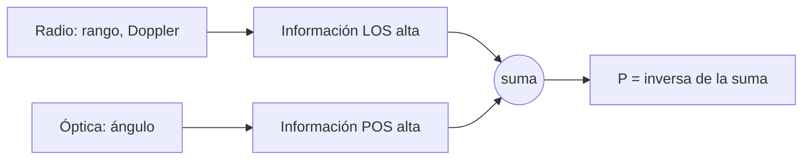

# B80-C07 — Fusión radio-óptica en navegación de espacio profundo

<!-- nav:top -->
[🏠 Programa](../../../../README.md) · [📚 Bloque B80](../../../tronco-comun/B80-navegacion-inercial-y-fusion-multisensorial.md) · [← Anterior: B80-C06 — Fusión IMU-cámara](../B80-C06-fusion-imu-camara/CLASE.md) · [Siguiente: B80-C08 — Filtrado distribuido y descentralizado →](../B80-C08-filtrado-distribuido-y-descentralizado/CLASE.md)
<!-- /nav -->

## 1. Ubicación, nivel y alcance

Clase 7 del bloque B80. Nivel N3. Sigue a [B80-C06](../B80-C06-fusion-imu-camara/CLASE.md). Un enlace de radio mide muy bien a lo largo de la línea de visión (distancia y velocidad de acercamiento) y casi nada en el plano del cielo; una imagen de la nave contra las estrellas mide muy bien en el plano del cielo y casi nada a lo largo de la visual. Aquí fundes ambas en forma de información y mides la mejora en cada eje. Todos los valores son ilustrativos.

## 2. Por qué esta clase existe

B74-C04 y B74-C13 tratan la medición radiométrica y la óptica por separado. La decisión central: **¿en qué eje aporta cada sensor y cuánto mejora la incertidumbre al combinarlos?**

## 3. Lo que podrás hacer al terminar

1. Convertir una incertidumbre angular en una incertidumbre lateral con `σ = d σ_θ`.
2. Escribir la matriz de información de cada sensor en ejes de línea de visión y plano del cielo.
3. Sumar informaciones y obtener la covarianza fusionada.
4. Comparar la covarianza fusionada con un ajuste por lotes de mínimos cuadrados ponderados.
5. Comprobar que la traza de la información no depende de la orientación.
6. Rotular los sigmas como ilustrativos, no medidos.

La evidencia es la **ficha de geometría radio-óptica** del ejercicio 12 (sección 20).

## 4. Con qué llegas y cómo comprobarlo

1. ¿Qué es la línea de visión?
2. ¿Qué es el plano del cielo?
3. ¿Qué es la matriz de información?
4. ¿Qué es un microradián?
5. ¿Qué es una rotación de ejes?

<details>
<summary>Ver respuestas</summary>

1. La recta entre el observador y la nave. 2. El plano perpendicular a la línea de visión. 3. El inverso de la covarianza. 4. Una millonésima de radián: `1 µrad` a `10⁸ km` son `100 km`. 5. Un cambio de base por un ángulo.
</details>

Con cuatro o cinco aciertos, sigue; si no, repasa los prerrequisitos.

## 5. Un caso de contexto y casos de referencia

A `1,0 × 10⁸ km`, un enlace radio con `σ = 1 km` en la línea de visión y una imagen con `σ_θ = 1 µrad` (que equivale a `100 km` en el plano del cielo) dan una incertidumbre fusionada de `1,0000 km` en la línea de visión y `99,9950 km` en el plano del cielo. La radio sola tiene `10 000 km` en el plano del cielo (mejora `100` veces con la óptica) y la óptica sola `10 000 km` en la línea de visión (mejora `10 000` veces con la radio). Es el **ejemplo conductor**. Todo es **ilustrativo**.

## 6. Vocabulario

La **incertidumbre lateral** de una medición angular es `d σ_θ`. La **forma de información** suma las informaciones de las mediciones independientes: `Λ = Σ Λ_i`, y `P = Λ⁻¹`. La **geometría** fija en qué dirección cada sensor aporta información.

## 7. Modelo mental: un guardabosque con telémetro y un fotógrafo con teleobjetivo



*Descripción textual:* la radio aporta información sobre la línea de visión, la óptica sobre el plano del cielo; las informaciones se suman y su inversa es la covarianza fusionada.

Analogía: un guardabosque con telémetro sabe a qué distancia está un ciervo pero no hacia dónde se mueve de lado; un fotógrafo con teleobjetivo sabe el ángulo pero no la distancia; juntos lo ubican. Límite: aquí se supone independencia entre sensores y modelos lineales; la navegación real involucra efemérides, tiempo de luz y sesgos sistemáticos.

## 8. La explicación, paso a paso

### 8.1 Ejes y sigmas

Se usa `u` (línea de visión, LOS) y `w` (plano del cielo, POS). Radio: `σ_u = 1 km` y, como no informa en `w`, `σ_w = 10⁴ km`. Óptica: `σ_w = d σ_θ = 10⁸ km × 10⁻⁶ = 100 km` y, como no informa en `u`, `σ_u = 10⁴ km`.

### 8.2 Información y fusión

En ejes `(u, w)`, `Λ = diag(1/σ_u², 1/σ_w²)`. En ejes inerciales, `Λ_i = Rᵀ Λ R`, con `R` la rotación por el ángulo `φ` (aquí `30°`). La suma `Λ = Λ_r + Λ_o` y la covarianza `P = Λ⁻¹`. Girada a los ejes `(u, w)`:

| sensor | `σ` LOS (km) | `σ` POS (km) |
|---|---|---|
| radio | 1,0000 | 10 000,0000 |
| óptico | 10 000,0000 | 100,0000 |
| fusión | 1,0000 | 99,9950 |

La correlación LOS–POS es del orden de `10⁻¹³` (nula): ambos sensores comparten ejes.

### 8.3 Invariantes

La traza de la información de un sensor no depende de `φ`: vale `1,000000010` (en km⁻²) con `φ = 0,3` y `1,1 rad`. La rotación mezcla los ejes pero no cambia la información total.

### 8.4 Segunda vía

Un ajuste por lotes de mínimos cuadrados ponderados con 2000 realizaciones da `σ_LOS = 0,9884 km` (teórico `1,0000`) y `σ_POS = 98,912 km` (teórico `99,995`); las diferencias de `1,2 %` y `1,1 %` son el error de muestreo de 2000 realizaciones (tolerancia 6 %).

### 8.5 Qué no cubre

En el espacio profundo real la radio también aporta información en el plano del cielo, pero lentamente, a través de la variación del Doppler a lo largo de arcos de días (esta clase no lo modela; relación de la literatura, no consultada); las imágenes dependen de las efemérides de los cuerpos de referencia.

## 9. Magnitudes, símbolos y unidades

| Símbolo | Qué es | Unidad | Valor / nota |
|---|---|---|---|
| `d` | distancia a la nave | km | 1,0 × 10⁸ (ilustrativa) |
| `σ_u` | incertidumbre en la línea de visión | km | 1 (radio) |
| `σ_θ` | incertidumbre angular de la imagen | rad | 1 × 10⁻⁶ |
| `σ_w` | incertidumbre en el plano del cielo | km | 100 (óptica) |
| `Λ` | matriz de información | km⁻² | suma de las de cada sensor |
| `φ` | ángulo de rotación de los ejes | grados | 30 |

## 10. Convenciones y referencias

Plano con ejes `u` (línea de visión) y `w` (plano del cielo); rotación de `φ = 30°` respecto de los ejes inerciales. Unidades en km; ángulos en rad. Semilla `80007`, 2000 realizaciones. Python 3.12.9, solo biblioteca estándar; tolerancia 6 % entre sigma empírico y teórico y `10⁻⁹` relativo en la invarianza de la traza.

## 11. De dónde sale lo que afirmamos

| ID | Fuente | Localizador | Respalda | Estado |
|---|---|---|---|---|
| — | Navegación de espacio profundo: radiométrica (rango, Doppler) y óptica (imágenes contra estrellas); documentos de JPL/DESCANSO y de agencias | — | no se consultaron; todos los sigmas son ilustrativos | No consultada |

Límites: todos los sigmas y la distancia son ilustrativos; no hay datos de ninguna misión ni de ningún instrumento; no se modelan efemérides, tiempo de luz ni errores sistemáticos.

## 12. Cómo ver el elipsoide de incertidumbre

| Magnitud | Valor |
|---|---|
| `σ` LOS fusionada | 1,0000 km |
| `σ` POS fusionada | 99,9950 km |
| mejora POS frente a radio sola | 100 veces |
| mejora LOS frente a óptica sola | 10 000 veces |
| Monte Carlo `σ` POS | 98,912 km (teórico 99,995) |

Descripción larga: la elipse de la radio es larga en el plano del cielo y delgada a lo largo de la visual, la de la óptica es la opuesta; la intersección de ambas es pequeña en las dos direcciones.

## 13. Ejemplo trabajado: la incertidumbre lateral fusionada

**Paso 1 · Lateral de la óptica.** `d σ_θ = 10⁸ × 10⁻⁶ = 100 km`.

**Paso 2 · Información.** `1/100² + 1/10 000² = 10⁻⁴ + 10⁻⁸`.

**Paso 3 · Inversa.** `σ = 1/√(1,0001 × 10⁻⁴) = 99,995 km`.

**Paso 4 · Lectura.** La radio apenas mejora el plano del cielo, pero fija la línea de visión.

## 14. Distintas formas de describir la geometría de la información

**Por covarianza:** elipse en `(u, w)`. **Por información:** suma de matrices. **Por ángulo:** `σ = d σ_θ`. **Por invariantes:** traza de la información.

## 15. Práctica guiada

**Ejercicio 1 · con los pasos indicados.** Calcula la incertidumbre lateral de `0,5 µrad` a `2 × 10⁸ km`. *Pasos:* `d σ_θ`.

<details><summary>Solución comentada</summary>

`2 × 10⁸ × 5 × 10⁻⁷ = 100 km`.
</details>

**Ejercicio 2 · con una pista.** Calcula la información de `σ = 100 km`. *Pista:* `1/σ²`.

<details><summary>Solución comentada</summary>

`10⁻⁴ km⁻²`.
</details>

**Ejercicio 3 · casi autónomo.** Suma las informaciones del ejercicio 2 y de `σ = 10 000 km`.

<details><summary>Solución comentada</summary>

`10⁻⁴ + 10⁻⁸ = 1,0001 × 10⁻⁴ km⁻²`.
</details>

## 16. Práctica autónoma, transferencia e integrador

**Ejercicio 4 · autónomo.** ¿Cuánto vale la incertidumbre fusionada del ejercicio 3?

<details><summary>Solución comentada</summary>

`99,995 km`.
</details>

**Ejercicio 5 · autónomo.** Si la distancia pasa a `2 × 10⁸ km` con el mismo `σ_θ`, ¿cuánto vale la lateral?

<details><summary>Solución comentada</summary>

`200 km`.
</details>

**Ejercicio 6 · autónomo.** ¿Qué `σ_θ` da `10 km` laterales a `10⁸ km`?

<details><summary>Solución comentada</summary>

`10⁻⁷ rad = 0,1 µrad`.
</details>

**Ejercicio 7 · autónomo.** ¿Cuánto vale la traza de la información de un sensor con `σ_u = 1` y `σ_w = 10⁴`?

<details><summary>Solución comentada</summary>

`1 + 10⁻⁸ ≈ 1,000000010 km⁻²`.
</details>

**Ejercicio 8 · autónomo.** Si se añade otra imagen igual (`σ_w = 100 km`), ¿cuánto mejora el plano del cielo?

<details><summary>Solución comentada</summary>

Se divide por `√2`: `70,7 km`.
</details>

**Ejercicio 9 · transferencia.** **Transferencia.** Una nave se acerca a un planeta; la imagen del limbo mide el ángulo con `σ_θ` fijo. ¿Qué ocurre con la información lateral al acercarse?

<details><summary>Solución comentada</summary>

La incertidumbre lateral `d σ_θ` disminuye con la distancia: la óptica gana importancia cerca del objetivo.
</details>

**Ejercicio 10 · transferencia.** **Transferencia.** Un colega suma las covarianzas en vez de las informaciones. ¿Qué error comete?

<details><summary>Solución comentada</summary>

Obtiene una incertidumbre mayor que cada sensor; la fusión de mediciones independientes suma la información.
</details>

**Ejercicio 11 · transferencia.** **Transferencia.** La radio y la óptica comparten un sesgo de efemérides. ¿Qué supuesto se rompe?

<details><summary>Solución comentada</summary>

La independencia: la fusión por suma de información subestimaría la incertidumbre (ver B80-C08).
</details>

**Ejercicio 12 · integrador.** **Integrador.** Elabora tu *ficha de geometría radio-óptica*: tabla de sigmas por sensor y fusionada, mejora por eje, invarianza de la traza y límites.

<details><summary>Solución comentada</summary>

Secciones 8.1–8.5 y la salida del laboratorio.
</details>

## 17. Laboratorio: fusión radio-óptica en forma de información

El script [radio_optica.py](radio_optica.py) construye las matrices de información de la radio y de la óptica, las suma y compara la covarianza con un ajuste por lotes de 2000 realizaciones (**comprueba** sigmas empíricos dentro del 6 % y traza invariante).

**Datos:** todos los sigmas y la distancia son **ilustrativos** (semilla 80007). **Predice antes de ejecutar:** ¿cuánto mejora el plano del cielo al añadir la radio? (casi nada, `99,995` frente a `100`.) **Ejecución del 2026-11-10 (Python 3.12.9):**

```text
Python 3.12.9 (biblioteca estandar)
Datos SINTETICOS: d = 1.0e8 km, sigma radio LOS 1 km, sigma optica angular 1 microrad -> 100 km en el plano del cielo (ilustrativos)
 sensor      sigma LOS [km]   sigma POS [km]   correlacion LOS-POS
radio               1.0000       10000.0000      -1.54e-13
optico          10000.0000         100.0000      -7.45e-15
fusion              1.0000          99.9950       3.70e-15
El plano del cielo (POS) mejora 100 veces frente a solo radio y el LOS 10000 veces frente a solo optica
Traza de la informacion radio para phi = 0.3 y 1.1 rad: 1.000000010e+00 y 1.000000010e+00
Monte Carlo (2000 realizaciones): sigma LOS = 0.9884 km (teorico 1.0000) ; sigma POS = 98.912 km (teorico 99.995)
Pruebas superadas.
```

```bash
python programa/clases/B80/B80-C07-fusion-radio-optica-en-navegacion-de-espacio-profundo/radio_optica.py
```

**Límites:** plano, mediciones independientes, sin efemérides, sin tiempo de luz.

## 18. Errores frecuentes y cómo corregirlos

**Sumar covarianzas en lugar de informaciones.** Se corrige con 8.2.

**Creer que la radio mejora el plano del cielo.** Se corrige con 8.5.

**Olvidar la dependencia de `d σ_θ` con la distancia.** Se corrige con el ejercicio 9.

**Presentar los sigmas como los de una misión.** Se corrige con la sección 10.

## 19. Cómo sabrás que vas bien

Tras 8.2: ¿qué incertidumbre lateral esperabas? Si dudas, repasa el ejemplo 13. Tras el laboratorio: ¿qué comprueba? (ver la sección 17).

## 20. Qué entregas y cómo se evalúa

El producto es tu **ficha de geometría radio-óptica** (ejercicio 12).

| Criterio | Inicial | En desarrollo | Logrado | Destacado |
|---|---|---|---|---|
| Conceptos | Los confunde | Parciales | Distingue línea de visión y plano del cielo | Explica la complementariedad |
| Cálculo | Sin unidades | Con errores | Suma informaciones con unidades | Casos nuevos |
| Verificación | Sin comprobar | Un caso | Contraste con el ajuste por lotes | Interpreta las diferencias |
| Fuentes | Sin fuente | Sin fecha | Fuentes con fecha y estado | Declara lo sintético y lo no consultado |
| Límites | No los nombra | Uno | Nombra tres límites del modelo | Discute qué falta del modelo |

**Condiciones críticas (no se compensan con promedio):** rotular los sigmas como ilustrativos; no atribuirlos a una misión; rotular como sintéticos o ilustrativos los datos y los parámetros; no presentar una simulación como observación; citar solo lo consultado.

## 21. Ética, seguridad y límites

Clase educativa: los modelos son simplificados y sus datos son sintéticos o ilustrativos; ningún resultado describe un vehículo real, un sensor comercial ni una misión, y nada de lo simulado debe presentarse como observado. No sustituye a la verificación, validación y certificación de un sistema de navegación de vuelo. Accesibilidad: tablas equivalentes a las gráficas, fórmulas en texto, ejercicios sin conexión.

## 22. Para cerrar y seguir

Con `1 km` en la visual y `100 km` en el cielo, cada sensor aporta lo que el otro no puede. Queda una pregunta: ¿qué ocurre si estos cálculos se reparten entre varios nodos con errores correlacionados?

**Glosario español–inglés.** línea de visión · *line of sight*; plano del cielo · *plane of the sky*; forma de información · *information form*; navegación óptica · *optical navigation*; radiométrica · *radiometric*.

**Continuidad.** [B80-C08](../B80-C08-filtrado-distribuido-y-descentralizado/CLASE.md) trata el filtrado repartido entre nodos.

**Referencias:** ver sección 11.

<!-- nav:bottom -->
---

[← Anterior: B80-C06 — Fusión IMU-cámara](../B80-C06-fusion-imu-camara/CLASE.md) · [📚 Bloque B80](../../../tronco-comun/B80-navegacion-inercial-y-fusion-multisensorial.md) · [Siguiente: B80-C08 — Filtrado distribuido y descentralizado →](../B80-C08-filtrado-distribuido-y-descentralizado/CLASE.md)
<!-- /nav -->
