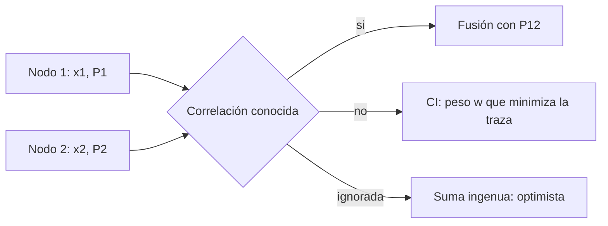

# B80-C08 — Filtrado distribuido y descentralizado

<!-- nav:top -->
[🏠 Programa](../../../../README.md) · [📚 Bloque B80](../../../tronco-comun/B80-navegacion-inercial-y-fusion-multisensorial.md) · [← Anterior: B80-C07 — Fusión radio-óptica en navegación de espacio profundo](../B80-C07-fusion-radio-optica-en-navegacion-de-espacio-profundo/CLASE.md) · [Siguiente: B80-C09 — Odometría inercial y preintegración de IMU →](../B80-C09-odometria-inercial-y-preintegracion-de-imu/CLASE.md)
<!-- /nav -->

## 1. Ubicación, nivel y alcance

Clase 8 del bloque B80. Nivel N3. Sigue a [B80-C07](../B80-C07-fusion-radio-optica-en-navegacion-de-espacio-profundo/CLASE.md). Cuando varios nodos (satélites, vehículos o módulos de software) estiman el mismo estado y se intercambian sus estimaciones, la tentación es sumar la información de cada uno. Pero si sus errores están correlacionados por haber compartido información previa, la suma cuenta dos veces lo mismo y declara una confianza que no existe. Aquí lo mides y lo corriges con la intersección de covarianzas. Los nodos son sintéticos.

## 2. Por qué esta clase existe

B74-C08..C10 tratan filtros centralizados, en los que un solo nodo ve todas las mediciones. La decisión central: **¿cómo fundir estimaciones de varios nodos sin conocer la correlación entre sus errores y sin declarar más confianza de la que se tiene?**

## 3. Lo que podrás hacer al terminar

1. Explicar por qué la suma de informaciones exige independencia.
2. Calcular la covarianza real del error fusionado con la covarianza conjunta.
3. Aplicar la intersección de covarianzas y elegir el peso que minimiza la traza.
4. Calcular el NEES (error normalizado al cuadrado) medio y juzgar la consistencia.
5. Distinguir un estimador conservador de uno optimista.
6. Rotular los nodos y las correlaciones como sintéticos.

La evidencia es la **ficha de consistencia de fusión descentralizada** del ejercicio 12 (sección 20).

## 4. Con qué llegas y cómo comprobarlo

1. ¿Qué es la correlación cruzada entre estimaciones?
2. ¿Qué es un estimador consistente?
3. ¿Qué es la forma de información?
4. ¿Qué es una matriz semidefinida positiva?
5. ¿Qué es una descomposición de Cholesky?

<details>
<summary>Ver respuestas</summary>

1. La covarianza entre el error de un nodo y el de otro. 2. Uno cuya covarianza declarada es mayor o igual que la real. 3. El inverso de la covarianza (B80-C07). 4. Una matriz simétrica con autovalores no negativos. 5. Una factorización `S = L Lᵀ` que sirve para generar vectores aleatorios correlacionados.
</details>

Con cuatro o cinco aciertos, sigue; si no, repasa los prerrequisitos.

## 5. Un caso de contexto y casos de referencia

Dos nodos estiman un estado de dos componentes con `P₁ = diag(4, 1)` y `P₂ = diag(1, 4)` y una correlación cruzada de `0,7` por componente. La suma ingenua declara una traza de `1,6`, pero la covarianza real de su error tiene traza `2,496`: es optimista, y su NEES medio es `3,109` (consistente si ≤ 2). La intersección de covarianzas con el peso `0,500` declara `3,2`, es conservadora y su NEES medio es `1,555`. Es el **ejemplo conductor**. Todo es **sintético**.

## 6. Vocabulario

La **fusión ingenua** supone errores independientes. La **intersección de covarianzas** (CI) combina `P⁻¹ = ω P₁⁻¹ + (1 − ω) P₂⁻¹` y es consistente para cualquier correlación. El **NEES** es `eᵀ P⁻¹ e`; su media debe ser ≤ la dimensión del estado si el estimador es consistente. La **consistencia** significa que `P_declarada − P_real` es semidefinida positiva.

## 7. Modelo mental: dos periodistas que citan la misma fuente



*Descripción textual:* dos estimaciones llegan a un nodo de fusión; si se conoce su correlación se usa; si no, la intersección de covarianzas con peso optimizado; si se ignora, la suma ingenua declara una confianza excesiva.

Analogía: dos periodistas que citan la misma fuente: contar sus dos notas como dos confirmaciones independientes engaña al lector. Límite: aquí el estado es de dos componentes y la correlación es estática; los sistemas reales evolucionan en el tiempo.

## 8. La explicación, paso a paso

### 8.1 Por qué falla la suma ingenua

Dos estimaciones con errores `e₁`, `e₂` y covarianza cruzada `P₁₂ ≠ 0`. La fusión con pesos `W₁ + W₂ = I` tiene error `e_f = W₁e₁ + W₂e₂` y covarianza real `P_f = W₁P₁W₁ᵀ + W₂P₂W₂ᵀ + W₁P₁₂W₂ᵀ + W₂P₁₂ᵀW₁ᵀ`. La suma ingenua usa `W_i = P_f P_i⁻¹` con `P_f = (P₁⁻¹ + P₂⁻¹)⁻¹ = diag(0,8; 0,8)` y declara traza `1,6`. Con `P₁₂ = diag(1,4; 1,4)` la covarianza real tiene traza `2,496`.

### 8.2 Intersección de covarianzas

`P_ci⁻¹ = ω P₁⁻¹ + (1 − ω) P₂⁻¹`, con `ω ∈ [0, 1]` elegido para minimizar la traza. En este caso simétrico `ω = 0,500` y `P_ci = diag(1,6; 1,6)`, traza `3,2`. La covarianza real es la misma `2,496` (los pesos de ambas fusiones resultan iguales al ser el caso simétrico), pero ahora lo declarado la **cubre**: `P_ci − P_real` es semidefinida positiva.

| método | traza declarada | traza real | mínimo autovalor (declarada − real) | consistente |
|---|---|---|---|---|
| ingenua | 1,6000 | 2,4960 | −0,4480 | no |
| CI | 3,2000 | 2,4960 | +0,3520 | sí |

### 8.3 Monte Carlo y NEES

Con 200 000 muestras de la distribución conjunta (Cholesky), el NEES medio de la ingenua es `3,109` y el de la CI `1,555` (valor esperado ideal `2`). Un NEES mayor que la dimensión delata optimismo.

### 8.4 Segunda vía

La covarianza real en forma cerrada y por Monte Carlo son independientes entre sí; ambas coinciden en que la ingenua es inconsistente y la CI conservadora. El precio de la CI es la pérdida de eficiencia: su traza declarada es el doble que la de la ingenua.

### 8.5 Arquitecturas

Una arquitectura federada comparte estimaciones locales con un filtro maestro; una descentralizada pura las intercambia entre pares. En ambas, el intercambio repetido de las mismas estimaciones genera exactamente la correlación que esta clase mide (no se consultó la literatura de estas arquitecturas).

## 9. Magnitudes, símbolos y unidades

| Símbolo | Qué es | Unidad | Valor / nota |
|---|---|---|---|
| `P₁`, `P₂` | covarianzas de los nodos | unidades² del estado | diag(4,1) y diag(1,4) |
| `P₁₂` | covarianza cruzada | unidades² | diag(1,4; 1,4) |
| `ω` | peso de la CI | — | 0,500 |
| NEES | error normalizado al cuadrado | — | 3,109 (ingenua), 1,555 (CI) |
| `n` | dimensión del estado | — | 2 |

## 10. Convenciones y referencias

Estado de dos componentes en unidades arbitrarias de posición y velocidad. Semilla `80008`, 200 000 muestras. Python 3.12.9, solo biblioteca estándar; la CI se optimiza en una rejilla de paso `0,001`. Tolerancia: NEES de la CI ≤ 2,02 y NEES ingenuo > 2,2 en este caso.

## 11. De dónde sale lo que afirmamos

| ID | Fuente | Localizador | Respalda | Estado |
|---|---|---|---|---|
| — | Intersección de covarianzas, Julier y Uhlmann (1997); filtros federados y descentralizados (literatura de estimación) | — | no se consultaron; la relación se verifica en el laboratorio contra la covarianza real | No consultada |

Límites: las covarianzas, la correlación y la dimensión son sintéticas; el caso es simétrico, estático y de dos componentes; no se prueba la optimalidad de la CI ni se modelan retardos de comunicación.

## 12. Cómo ver la consistencia

| Magnitud | Valor |
|---|---|
| traza declarada ingenua / real | 1,6000 / 2,4960 |
| traza declarada CI / real | 3,2000 / 2,4960 |
| NEES ingenuo | 3,109 |
| NEES CI | 1,555 |
| peso de la CI | 0,500 |

Descripción larga: la suma ingenua declara una covarianza menor que la real (optimista); la CI declara una mayor (conservadora).

## 13. Ejemplo trabajado: la covarianza real de la fusión ingenua

**Paso 1 · Pesos.** `W₁ = 0,8 · diag(0,25; 1) = diag(0,2; 0,8)`, `W₂ = diag(0,8; 0,2)`.

**Paso 2 · Primera componente.** `0,2² × 4 + 0,8² × 1 + 2 × 0,2 × 0,8 × 1,4 = 0,16 + 0,64 + 0,448 = 1,248`.

**Paso 3 · Segunda componente.** Por simetría, `1,248`; la traza real es `2,496`.

**Paso 4 · Declarado.** La ingenua declaró `0,8` por componente: la real es `1,56` veces mayor.

## 14. Distintas formas de describir la fusión de estimaciones correlacionadas

**Por covarianza real:** fórmula cerrada. **Por consistencia:** autovalores de la diferencia. **Por estadístico:** NEES. **Por peso:** `ω` de la CI.

## 15. Práctica guiada

**Ejercicio 1 · con los pasos indicados.** Calcula `(P₁⁻¹ + P₂⁻¹)⁻¹` componente a componente. *Pasos:* `P₁⁻¹ = diag(0,25; 1)`.

<details><summary>Solución comentada</summary>

`diag(1/1,25; 1/1,25) = diag(0,8; 0,8)`.
</details>

**Ejercicio 2 · con una pista.** Calcula la covarianza cruzada `P₁₂` con `ρ = 0,7`. *Pista:* `ρ √(4 × 1)`.

<details><summary>Solución comentada</summary>

`1,4` por componente.
</details>

**Ejercicio 3 · casi autónomo.** ¿Por qué la CI declara el doble de traza que la ingenua?

<details><summary>Solución comentada</summary>

Porque con `ω = 0,5` la información total se reduce a la mitad: `0,5(P₁⁻¹ + P₂⁻¹)`.
</details>

## 16. Práctica autónoma, transferencia e integrador

**Ejercicio 4 · autónomo.** Cociente traza real/declarada de la ingenua.

<details><summary>Solución comentada</summary>

`2,496/1,6 = 1,56`.
</details>

**Ejercicio 5 · autónomo.** Si `ρ = 0`, ¿cuál es la covarianza real de la ingenua?

<details><summary>Solución comentada</summary>

Igual a la declarada: `0,8` por componente.
</details>

**Ejercicio 6 · autónomo.** Indica el NEES medio esperado de un estimador consistente con `n = 2`.

<details><summary>Solución comentada</summary>

Un valor medio ≤ `2`.
</details>

**Ejercicio 7 · autónomo.** ¿Qué indica un NEES medio de `3,1` con `n = 2`?

<details><summary>Solución comentada</summary>

Optimismo: la covarianza declarada es demasiado pequeña.
</details>

**Ejercicio 8 · autónomo.** Si `P₂` se hace muy grande, ¿hacia dónde tiende `ω`?

<details><summary>Solución comentada</summary>

Hacia `1`: la CI confía casi solo en el nodo 1.
</details>

**Ejercicio 9 · transferencia.** **Transferencia.** Dos satélites intercambian su estimación cada minuto y cada uno la usa como si fuera una medición nueva. ¿Qué ocurre con la covarianza declarada?

<details><summary>Solución comentada</summary>

Disminuye sin que mejore el conocimiento real: se genera correlación y el filtro se vuelve optimista.
</details>

**Ejercicio 10 · transferencia.** **Transferencia.** ¿Cuándo prefieres la fusión exacta con `P₁₂` a la CI?

<details><summary>Solución comentada</summary>

Cuando se puede llevar la cuenta de la correlación (por ejemplo con un filtro federado bien diseñado): la CI pierde eficiencia.
</details>

**Ejercicio 11 · transferencia.** **Transferencia.** ¿Qué pruebas de consistencia pedirías antes de usar la solución fusionada para una maniobra?

<details><summary>Solución comentada</summary>

NEES promedio sobre muchas corridas, la prueba de innovaciones y un margen conservador de covarianza.
</details>

**Ejercicio 12 · integrador.** **Integrador.** Elabora tu *ficha de consistencia de fusión descentralizada*: tabla de trazas declaradas y reales, NEES por método y recomendación justificada.

<details><summary>Solución comentada</summary>

Secciones 8.1–8.5 y la salida del laboratorio.
</details>

## 17. Laboratorio: fusión ingenua frente a intersección de covarianzas

El script [descentralizado.py](descentralizado.py) calcula la covarianza real de dos fusiones con errores correlacionados, optimiza el peso de la CI y mide el NEES por Monte Carlo (**comprueba** ingenua inconsistente, CI consistente).

**Datos:** todo **sintético** (semilla 80008). **Predice antes de ejecutar:** ¿cuál fusión tendrá el NEES mayor que 2? (la ingenua.) **Ejecución del 2026-11-10 (Python 3.12.9):**

```text
Python 3.12.9 (biblioteca estandar)
Datos SINTETICOS (semilla 80008): P1 = diag(4,1), P2 = diag(1,4), correlacion cruzada rho = 0.7 por componente
Peso optimo de CI w = 0.500
 metodo      traza declarada   traza real (cerrada)   min autovalor (declarada - real)   consistente
ingenua             1.6000                2.4960                            -0.4480           NO
CI                  3.2000                2.4960                             0.3520           si
NEES medio de ingenua  = 3.109 (consistente si <= 2.000 = dimension)
NEES medio de CI       = 1.555 (consistente si <= 2.000 = dimension)
Pruebas superadas.
```

```bash
python programa/clases/B80/B80-C08-filtrado-distribuido-y-descentralizado/descentralizado.py
```

**Límites:** estado de dos componentes, correlación estática, caso simétrico, sin retardos.

## 18. Errores frecuentes y cómo corregirlos

**Sumar informaciones sin preguntar por la correlación.** Se corrige con 8.1.

**Confundir conservador con incorrecto.** Se corrige con 8.2: pierde eficiencia, pero es consistente.

**Juzgar la consistencia con una sola corrida.** Se corrige con 8.3.

**Presentar los nodos como los de una constelación real.** Se corrige con la sección 10.

## 19. Cómo sabrás que vas bien

Tras 8.3: ¿qué NEES esperabas para la ingenua? Si dudas, repasa el ejemplo 13. Tras el laboratorio: ¿qué comprueba? (ver la sección 17).

## 20. Qué entregas y cómo se evalúa

El producto es tu **ficha de consistencia de fusión descentralizada** (ejercicio 12).

| Criterio | Inicial | En desarrollo | Logrado | Destacado |
|---|---|---|---|---|
| Conceptos | Los confunde | Parciales | Distingue consistencia y eficiencia | Explica cuándo conviene la CI |
| Cálculo | Sin unidades | Con errores | Calcula covarianza real | Casos nuevos |
| Verificación | Sin comprobar | Un caso | Contraste con Monte Carlo | Interpreta el NEES |
| Fuentes | Sin fuente | Sin fecha | Fuentes con fecha y estado | Declara lo sintético y lo no consultado |
| Límites | No los nombra | Uno | Nombra tres límites del modelo | Discute qué falta del modelo |

**Condiciones críticas (no se compensan con promedio):** rotular los nodos y la correlación como sintéticos; no declarar consistente un estimador sin prueba; rotular como sintéticos o ilustrativos los datos y los parámetros; no presentar una simulación como observación; citar solo lo consultado.

## 21. Ética, seguridad y límites

Clase educativa: los modelos son simplificados y sus datos son sintéticos o ilustrativos; ningún resultado describe un vehículo real, un sensor comercial ni una misión, y nada de lo simulado debe presentarse como observado. No sustituye a la verificación, validación y certificación de un sistema de navegación de vuelo. Accesibilidad: tablas equivalentes a las gráficas, fórmulas en texto, ejercicios sin conexión.

## 22. Para cerrar y seguir

Ignorar una correlación de `0,7` hace que la fusión declare `1,6` cuando el error real es `2,5`; la CI declara `3,2` y se mantiene del lado seguro. Queda una pregunta: ¿cómo se integran las medidas de un robot para estimar su movimiento?

**Glosario español–inglés.** filtrado descentralizado · *decentralized filtering*; intersección de covarianzas · *covariance intersection*; consistencia · *consistency*; error normalizado al cuadrado · *normalized estimation error squared (NEES)*; correlación cruzada · *cross-correlation*.

**Continuidad.** [B80-C09](../B80-C09-odometria-inercial-y-preintegracion-de-imu/CLASE.md) integra aceleración y giro para estimar el movimiento de un robot.

**Referencias:** ver sección 11.

<!-- nav:bottom -->
---

[← Anterior: B80-C07 — Fusión radio-óptica en navegación de espacio profundo](../B80-C07-fusion-radio-optica-en-navegacion-de-espacio-profundo/CLASE.md) · [📚 Bloque B80](../../../tronco-comun/B80-navegacion-inercial-y-fusion-multisensorial.md) · [Siguiente: B80-C09 — Odometría inercial y preintegración de IMU →](../B80-C09-odometria-inercial-y-preintegracion-de-imu/CLASE.md)
<!-- /nav -->
