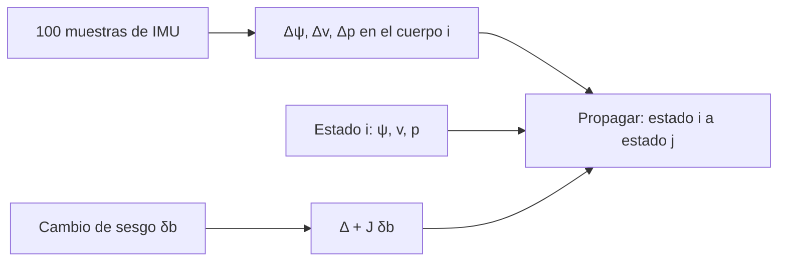

# B80-C09 — Odometría inercial y preintegración de IMU

<!-- nav:top -->
[🏠 Programa](../../../../README.md) · [📚 Bloque B80](../../../tronco-comun/B80-navegacion-inercial-y-fusion-multisensorial.md) · [← Anterior: B80-C08 — Filtrado distribuido y descentralizado](../B80-C08-filtrado-distribuido-y-descentralizado/CLASE.md) · [Siguiente: B81-C01 — Ecuaciones variacionales y matriz de transición de estados →](../../B81/B81-C01-ecuaciones-variacionales-y-matriz-de-transicion-de-estados/CLASE.md)
<!-- /nav -->

## 1. Ubicación, nivel y alcance

Clase 9 y última del bloque B80. Nivel N3. Sigue a [B80-C08](../B80-C08-filtrado-distribuido-y-descentralizado/CLASE.md). Un robot con una IMU a `100 Hz` y fotogramas clave a `1 Hz` no quiere reintegrar cien muestras cada vez que el optimizador cambia una estimación. La **preintegración** resume esas muestras en tres incrementos relativos que no dependen del estado inicial. Aquí la construyes en el plano, compruebas esa independencia y corriges por un cambio de sesgo sin reintegrar. Los datos son sintéticos.

## 2. Por qué esta clase existe

B87-C06 trata los giroscopios; falta la integración conjunta de acelerómetros y giroscopios para estimar el movimiento de un robot y su deriva. La decisión central: **¿cómo se reutiliza una integración inercial cuando cambian el estado inicial y los sesgos estimados?**

## 3. Lo que podrás hacer al terminar

1. Calcular los incrementos preintegrados `Δψ`, `Δv`, `Δp` en el cuerpo del primer fotograma.
2. Propagarlos al mundo con el estado inicial y comprobar la independencia de este.
3. Linealizar la dependencia de los incrementos respecto del sesgo con un jacobiano.
4. Medir el orden del error de la corrección lineal.
5. Estimar la deriva de una odometría inercial pura.
6. Rotular los datos como sintéticos y declarar los límites del caso plano.

La evidencia es la **ficha de preintegración inercial** del ejercicio 12 (sección 20).

## 4. Con qué llegas y cómo comprobarlo

1. ¿Qué es un fotograma clave?
2. ¿Qué es un jacobiano?
3. ¿Qué es un sesgo de giroscopio?
4. ¿Qué es una rotación plana?
5. ¿Qué es la deriva?

<details>
<summary>Ver respuestas</summary>

1. Una pose del robot elegida para el optimizador, que separa tramos de IMU. 2. La matriz de derivadas parciales de una función respecto de sus variables. 3. Un error constante en la velocidad angular medida (B80-C01). 4. Una rotación de ángulo `ψ`: matriz `R(ψ)` de 2 × 2. 5. El crecimiento del error de la solución con el tiempo.
</details>

Con cuatro o cinco aciertos, sigue; si no, repasa los prerrequisitos.

## 5. Un caso de contexto y casos de referencia

En un intervalo de `1 s` con `100` muestras sintéticas, la preintegración da `Δψ = 0,297936 rad`, `Δv = (0,476232; 0,095795) m/s` y `Δp = (0,241384; 0,035856) m`. Reusar esos incrementos con tres estados iniciales distintos coincide con reintegrar la IMU hasta `3,55 × 10⁻¹⁵`. Un cambio de sesgo de giroscopio de `0,08 rad/s` produce un cambio de `0,019221 m/s` en `Δv`; la corrección lineal lo reduce a `5,118 × 10⁻⁴` y el residuo se divide por `4` al dividir el cambio por `2`. Es el **ejemplo conductor**. Todo es **sintético**; la idea procede del resumen de Forster y colaboradores, formulada aquí en el plano.

## 6. Vocabulario

Los **incrementos preintegrados** son `Δψ = Σ(ω_k − b_g)Δt`, `Δv = Σ R(Δψ_k)(f_k − b_a)Δt` y `Δp`. Se expresan en el cuerpo del primer fotograma y no dependen de la pose inicial. La **corrección de primer orden** por sesgo usa el jacobiano `J = ∂Δ/∂b` evaluado en el sesgo de linealización. La **odometría inercial** integra solo la IMU y su error crece con el tiempo.

## 7. Modelo mental: resumir un viaje en tres cifras



*Descripción textual:* las muestras de la IMU se resumen en tres incrementos relativos; con el estado del fotograma inicial se propaga el estado del siguiente; si cambia el sesgo se corrige el resumen con el jacobiano sin reintegrar.

Analogía: resumir un viaje en tres cifras (cuánto giraste, cuánto cambió tu velocidad, cuánto avanzaste) que sirven aunque cambie el punto de partida. Límite: aquí el plano evita la geometría de las rotaciones tridimensionales y el ruido no se propaga a una covarianza.

## 8. La explicación, paso a paso

### 8.1 Incrementos relativos

Se integra en el cuerpo del primer fotograma: `Δψ_{k+1} = Δψ_k + (ω_k − b_g)Δt`, `a_k = R(Δψ_k)(f_k − b_a)`, `Δp += Δv Δt + ½ a_k Δt²`, `Δv += a_k Δt`. Los tres no involucran el estado inicial.

### 8.2 Propagación al mundo

`ψ_j = ψ_i + Δψ`, `v_j = v_i + R(ψ_i)Δv`, `p_j = p_i + v_i T + R(ψ_i)Δp` con `T = 1 s`. Se probaron tres estados iniciales (`ψ_i = 0`; `1,1`; `−2,0` rad con velocidades y posiciones diferentes): la diferencia máxima con la reintegración directa fue `3,55 × 10⁻¹⁵`. El resultado es lo que permite que un optimizador reuse el resumen cuando cambia el estado inicial.

### 8.3 Corrección por cambio de sesgo

`Δv` depende del sesgo del giroscopio de forma no lineal (cambia el ángulo con que se rota cada muestra). Con `J = ∂Δv/∂b_g = (0,059461; −0,232467) m/s por rad/s`, la corrección `Δv + J δb_g` deja un residuo cuadrático:

| `δb_g` (rad/s) | error sin corrección (m/s) | error con corrección lineal (m/s) |
|---|---|---|
| 0,08 | 0,019221 | 5,118 × 10⁻⁴ |
| 0,04 | 0,009605 | 1,279 × 10⁻⁴ |
| 0,02 | 0,004801 | 3,197 × 10⁻⁵ |

El cociente de residuos entre `0,08` y `0,04` es `4,00`: error de segundo orden. Para el sesgo del acelerómetro `Δv` es **lineal** y la corrección es exacta: con `δb_a = 0,4 m/s²` el residuo es `3,96 × 10⁻¹¹ m/s`.

### 8.4 Deriva de la odometría inercial

Con un sesgo de acelerómetro de `0,02 m/s²`, el error de posición es `½ b t² = 1,000 m` a `10 s`. El sesgo de giroscopio de `0,002 rad/s` gira la aceleración medida: para `a = 0,5 m/s²` la cota es `½ a bg t³/3 = 0,167 m`. Sin corrección externa, ambos crecen; los fotogramas clave sirven para anclarlos con otras mediciones.

### 8.5 Segunda vía

La reintegración directa es la verificación independiente de la propagación; la diferencia finita centrada (`h = 10⁻⁶`) da el jacobiano y el residuo cuadrático confirma el orden.

## 9. Magnitudes, símbolos y unidades

| Símbolo | Qué es | Unidad | Valor / nota |
|---|---|---|---|
| `Δψ` | incremento de rumbo | rad | 0,297936 |
| `Δv` | incremento de velocidad en el cuerpo | m/s | (0,476232; 0,095795) |
| `Δp` | incremento de posición en el cuerpo | m | (0,241384; 0,035856) |
| `b_g`, `b_a` | sesgos del giroscopio y del acelerómetro | rad/s, m/s² | 0,002 y (0,01; −0,02) (sintéticos) |
| `J` | jacobiano `∂Δv/∂b_g` | m/s por rad/s | (0,059461; −0,232467) |
| `T` | intervalo entre fotogramas | s | 1 |

## 10. Convenciones y referencias

Plano horizontal, gravedad ignorada, rotación plana de ángulo `ψ`. IMU a `100 Hz`, 100 muestras por intervalo, semilla `80009`. Unidades SI y radianes. Python 3.12.9, solo biblioteca estándar; tolerancias: independencia del estado `10⁻¹²`, cociente de residuos entre 3 y 5 y residuo de la corrección de `b_a` < `10⁻⁶`.

## 11. De dónde sale lo que afirmamos

| ID | Fuente | Localizador | Respalda | Estado |
|---|---|---|---|---|
| S3 | Forster, Carlone, Dellaert y Scaramuzza, «On-Manifold Preintegration for Real-Time Visual-Inertial Odometry», arXiv:1512.02363 — https://arxiv.org/abs/1512.02363 (consultada 2026-11-10; solo la página del resumen) | resumen del artículo | la preintegración condensa las medidas inerciales de alta frecuencia entre fotogramas clave en una restricción relativa que respeta la estructura de la variedad de rotaciones; solo se consultó el resumen | Consultada (solo resumen) |
| — | Preintegración tridimensional sobre la variedad de rotaciones, covarianza y jacobianos de la bibliografía de VIO | — | no se consultó el texto del artículo: la clase formula la idea en el plano y no reproduce su derivación | No consultada |

Límites: de S3 solo se consultó el resumen; no se verifican ni se reproducen sus resultados experimentales; el caso plano no incluye gravedad, rotaciones tridimensionales ni la propagación de la covarianza del ruido.

## 12. Cómo ver la reutilización

| Magnitud | Valor |
|---|---|
| diferencia reuso/reintegración | 3,55 × 10⁻¹⁵ |
| residuo de la corrección de `b_g` (0,08) | 5,118 × 10⁻⁴ m/s |
| cociente de residuos | 4,00 |
| residuo de la corrección de `b_a` | 3,96 × 10⁻¹¹ m/s |
| deriva por `b_a` a 10 s | 1,000 m |

Descripción larga: los incrementos se reutilizan sin pérdida alguna; la corrección lineal del sesgo de giroscopio tiene error cuadrático y la del acelerómetro es exacta.

## 13. Ejemplo trabajado: la propagación de un fotograma al siguiente

**Paso 1 · Estado inicial.** `ψ_i = 1,1 rad`, `v_i = (2; −1) m/s`, `p_i = (10; 5) m`.

**Paso 2 · Rumbo.** `ψ_j = 1,1 + 0,297936 = 1,397936 rad`.

**Paso 3 · Velocidad.** `R(1,1) Δv` con `cos 1,1 = 0,4536`, `sen 1,1 = 0,8912`: `(0,4536 × 0,476232 − 0,8912 × 0,095795; 0,8912 × 0,476232 + 0,4536 × 0,095795) = (0,1306; 0,4679)`; `v_j = (2,1306; −0,5321) m/s`.

**Paso 4 · Posición.** `p_j = p_i + v_i × 1 + R(1,1) Δp`, con `R(1,1) Δp = (0,0775; 0,2314)`, da `p_j = (12,0775; 4,2314) m`.

## 14. Distintas formas de describir un tramo de IMU

**Por incrementos:** `(Δψ, Δv, Δp)`. **Por muestras:** 100 lecturas. **Por Jacobiano:** respuesta al sesgo. **Por deriva:** `½ b t²`.

## 15. Práctica guiada

**Ejercicio 1 · con los pasos indicados.** Calcula `ψ_j` si `ψ_i = 0,5 rad` y `Δψ = 0,297936 rad`. *Pasos:* suma.

<details><summary>Solución comentada</summary>

`0,797936 rad`.
</details>

**Ejercicio 2 · con una pista.** ¿Cuánto vale `Δψ` con `ω = 0,3 rad/s` constante, `b_g = 0,002` y `1 s`? *Pista:* `(ω − b_g)T`.

<details><summary>Solución comentada</summary>

`0,298 rad`.
</details>

**Ejercicio 3 · casi autónomo.** ¿Por qué `Δv` no depende de `v_i`?

<details><summary>Solución comentada</summary>

Porque `Δv` suma solo `R(Δψ_k)(f_k − b_a)Δt`, que no incluye la velocidad inicial.
</details>

## 16. Práctica autónoma, transferencia e integrador

**Ejercicio 4 · autónomo.** Calcula la deriva de posición por `b_a = 0,05 m/s²` a `20 s`.

<details><summary>Solución comentada</summary>

`½ × 0,05 × 400 = 10 m`.
</details>

**Ejercicio 5 · autónomo.** Con el jacobiano de la sección 8.3, ¿cuánto cambia `Δv_x` si `b_g` crece `0,03 rad/s` (primer orden)?

<details><summary>Solución comentada</summary>

`0,059461 × 0,03 = 1,78 × 10⁻³ m/s`.
</details>

**Ejercicio 6 · autónomo.** Si `δb` se divide por 4, ¿por cuánto se divide el residuo cuadrático?

<details><summary>Solución comentada</summary>

Por `16`.
</details>

**Ejercicio 7 · autónomo.** ¿Cuántas muestras de IMU hay en 10 intervalos de 1 s a 100 Hz?

<details><summary>Solución comentada</summary>

`1000`.
</details>

**Ejercicio 8 · autónomo.** Con `R(1,1) = [[0,4536; −0,8912]; [0,8912; 0,4536]]`, rota `Δp = (0,241384; 0,035856)`.

<details><summary>Solución comentada</summary>

`(0,0775; 0,2314) m`.
</details>

**Ejercicio 9 · transferencia.** **Transferencia.** El optimizador cambia 50 veces el estado inicial del fotograma. ¿Qué ahorras con la preintegración?

<details><summary>Solución comentada</summary>

Reintegrar 100 muestras 50 veces: los incrementos se calculan una vez y se propagan con unas pocas operaciones.
</details>

**Ejercicio 10 · transferencia.** **Transferencia.** El sesgo del giroscopio estimado cambia mucho (0,5 rad/s). ¿Sigue valiendo la corrección lineal?

<details><summary>Solución comentada</summary>

No: el residuo es cuadrático, crece con el cambio; hay que repreintegrar con el nuevo sesgo.
</details>

**Ejercicio 11 · transferencia.** **Transferencia.** Un robot de interior pierde sus fotogramas clave durante 10 s. ¿Cuánto puede derivar con `b_a = 0,02 m/s²`?

<details><summary>Solución comentada</summary>

`1,0 m` por el acelerómetro (ver 8.4) más la contribución de giroscopio; excede la tolerancia de muchas tareas de interior.
</details>

**Ejercicio 12 · integrador.** **Integrador.** Elabora tu *ficha de preintegración inercial*: incrementos, prueba de independencia, tabla de corrección por sesgo con el orden observado y deriva sin ayuda.

<details><summary>Solución comentada</summary>

Secciones 8.1–8.5 y la salida del laboratorio.
</details>

## 17. Laboratorio: preintegración plana y corrección por sesgo

El script [preintegracion.py](preintegracion.py) preintegra 100 muestras, verifica la independencia del estado inicial, corrige el sesgo con un jacobiano por diferencias finitas y mide el orden del residuo (**comprueba** diferencia < 10⁻¹², cociente entre 3 y 5 y corrección exacta para `b_a`).

**Datos:** todo **sintético** (semilla 80009). **Predice antes de ejecutar:** ¿cuánto valdrá el cociente de residuos al dividir el cambio de sesgo por 2? (4.) **Ejecución del 2026-11-10 (Python 3.12.9):**

```text
Python 3.12.9 (biblioteca estandar)
Datos SINTETICOS (semilla 80009): 100 muestras a 100 Hz, intervalo de 1 s
Preintegracion (ba = (0.01, -0.02), bg = 0.002): dpsi = 0.297936 rad ; dv = (0.476232, 0.095795) m/s ; dp = (0.241384, 0.035856) m
(1) Diferencia maxima entre reutilizar la preintegracion y reintegrar con estados iniciales distintos = 3.55e-15
(2) Jacobiano d(dv)/d(bg) = (0.059461, -0.232467) m/s por rad/s
    delta bg [rad/s]   error sin correccion [m/s]   error con correccion lineal [m/s]
               0.08                     0.019221                       5.118e-04
               0.04                     0.009605                       1.279e-04
               0.02                     0.004801                       3.197e-05
    cociente de errores residuales (d = 0.08 frente a 0.04) = 4.00 (cuadratico: 4)
    Para delta ba_x = 0.4 m/s2 la correccion lineal deja un residuo de 3.96e-11 m/s (dv es lineal en ba)
(3) Con ba = 0.02 m/s2 y bg = 0.002 rad/s: deriva por acelerometro 1.000 m ; por giroscopio (cota, a = 0.5 m/s2) 0.167 m tras 10 s
Pruebas superadas.
```

```bash
python programa/clases/B80/B80-C09-odometria-inercial-y-preintegracion-de-imu/preintegracion.py
```

**Límites:** caso plano, sin gravedad ni covarianza del ruido, sin rotaciones tridimensionales.

## 18. Errores frecuentes y cómo corregirlos

**Incluir el estado inicial en los incrementos.** Se corrige con 8.1.

**Usar la corrección lineal con cambios grandes de sesgo.** Se corrige con 8.3.

**Olvidar la deriva sin fotogramas clave.** Se corrige con 8.4.

**Presentar el robot como real.** Se corrige con la sección 10.

## 19. Cómo sabrás que vas bien

Tras 8.3: ¿qué cociente esperabas? Si dudas, repasa el ejemplo 13. Tras el laboratorio: ¿qué comprueba? (ver la sección 17).

## 20. Qué entregas y cómo se evalúa

El producto es tu **ficha de preintegración inercial** (ejercicio 12).

| Criterio | Inicial | En desarrollo | Logrado | Destacado |
|---|---|---|---|---|
| Conceptos | Los confunde | Parciales | Distingue incremento y estado | Explica por qué se reutiliza |
| Cálculo | Sin unidades | Con errores | Propaga con unidades | Casos nuevos |
| Verificación | Sin comprobar | Un caso | Contraste con reintegración | Interpreta el orden del residuo |
| Fuentes | Sin fuente | Sin fecha | Fuentes con fecha y estado | Declara lo sintético y lo no consultado |
| Límites | No los nombra | Uno | Nombra tres límites del modelo | Discute qué falta del modelo |

**Condiciones críticas (no se compensan con promedio):** rotular el robot y las muestras como sintéticos; no atribuir los resultados al artículo de Forster y colaboradores; rotular como sintéticos o ilustrativos los datos y los parámetros; no presentar una simulación como observación; citar solo lo consultado.

## 21. Ética, seguridad y límites

Clase educativa: los modelos son simplificados y sus datos son sintéticos o ilustrativos; ningún resultado describe un vehículo real, un sensor comercial ni una misión, y nada de lo simulado debe presentarse como observado. No sustituye a la verificación, validación y certificación de un sistema de navegación de vuelo. Accesibilidad: tablas equivalentes a las gráficas, fórmulas en texto, ejercicios sin conexión.

## 22. Para cerrar y seguir

Cien muestras se resumen en tres incrementos que se reutilizan con error de `10⁻¹⁵`, y un cambio de sesgo se absorbe con un jacobiano a costa de un error cuadrático. Con esto se cierra el bloque: desde la deriva de una IMU hasta su integración con otros sensores.

**Glosario español–inglés.** preintegración · *preintegration*; odometría inercial · *inertial odometry*; fotograma clave · *keyframe*; jacobiano · *Jacobian*; deriva · *drift*.

**Continuidad.** Esta es la última clase del bloque B80; sigue el resto del área A06.

**Referencias:** ver sección 11.

<!-- nav:bottom -->
---

[← Anterior: B80-C08 — Filtrado distribuido y descentralizado](../B80-C08-filtrado-distribuido-y-descentralizado/CLASE.md) · [📚 Bloque B80](../../../tronco-comun/B80-navegacion-inercial-y-fusion-multisensorial.md) · [Siguiente: B81-C01 — Ecuaciones variacionales y matriz de transición de estados →](../../B81/B81-C01-ecuaciones-variacionales-y-matriz-de-transicion-de-estados/CLASE.md)
<!-- /nav -->
