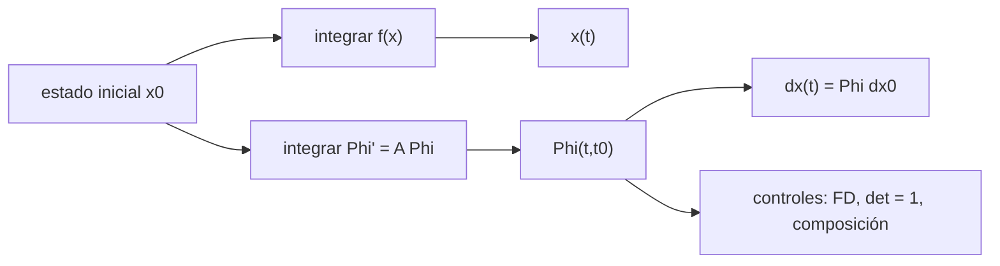

# B81-C01 — Ecuaciones variacionales y matriz de transición de estados

<!-- nav:top -->
[🏠 Programa](../../../../README.md) · [📚 Bloque B81](../../../tronco-comun/B81-optimizacion-de-trayectorias-y-diseno-robusto.md) · [← Anterior: B80-C09 — Odometría inercial y preintegración de IMU](../../../tronco-comun/B80-navegacion-inercial-y-fusion-multisensorial.md#b80-c09) · [Siguiente: B81-C02 — Método de disparo para control óptimo →](../B81-C02-metodo-de-disparo-para-control-optimo/CLASE.md)
<!-- /nav -->

## 1. Ubicación, nivel y alcance

Clase 1 del bloque B81 (área A06). Nivel N3. Antes de optimizar una trayectoria hay que saber cuánto cambia el estado final si cambia el inicial: esa respuesta es la **matriz de transición de estados** `Φ(t, t₀)`. Aquí la obtienes integrando las ecuaciones variacionales junto con el movimiento de dos cuerpos y la validas con diferencias finitas. Usas [B80](../../../tronco-comun/B80-navegacion-inercial-y-fusion-multisensorial.md) solo como contexto de por qué se necesitan sensibilidades en navegación. El estado inicial es sintético y no corresponde a ninguna nave real.

## 2. Por qué esta clase existe

Cada método de optimización y de corrección de este bloque pide derivadas: el disparo (C02) necesita `∂r_f/∂v₀`, la validación (C08) y la recuperación (C15) también. La decisión central: **¿cómo se calcula `Φ` de forma exacta y barata, y cómo se sabe que está bien?**

## 3. Lo que podrás hacer al terminar

1. Escribir la ecuación variacional `Φ' = A(t) Φ` con `A = [[0, I], [G, 0]]` y el gradiente de gravedad `G`.
2. Integrar el estado y `Φ` a la vez con un integrador de paso adaptativo.
3. Comprobar `Φ` contra diferencias finitas centrales.
4. Verificar `det Φ = 1`, la propiedad simpléctica y la composición `Φ(t₂,t₀) = Φ(t₂,t₁) Φ(t₁,t₀)`.
5. Predecir con `Φ` la dispersión final de un error inicial y medir el error de linealización.
6. Separar lo consultado (constantes) de lo ilustrativo (estado inicial).

La evidencia es la **tabla de sensibilidades de una órbita heliocéntrica** del ejercicio 12 (sección 20).

## 4. Con qué llegas y cómo comprobarlo

1. ¿Qué es un sistema de ecuaciones diferenciales de primer orden?
2. ¿Qué es la matriz jacobiana de un campo vectorial?
3. ¿Qué es el problema de dos cuerpos?
4. ¿Qué es una diferencia finita central?
5. ¿Qué es un dato sintético?

<details>
<summary>Ver respuestas</summary>

1. Un conjunto `x' = f(x, t)` con el estado `x` como incógnita. 2. La matriz de derivadas parciales de cada componente respecto de cada variable. 3. El movimiento de una masa pequeña bajo la atracción `−μ r/|r|³` de otra mayor. 4. `(f(x+h) − f(x−h))/(2h)`, una aproximación de la derivada. 5. Un dato generado para el ejemplo, no medido.
</details>

Con cuatro o cinco aciertos, sigue; si no, repasa los prerrequisitos.

## 5. Un caso de contexto y casos de referencia

Una nave en órbita heliocéntrica con excentricidad 0,1 parte de 1 UA con `v = 31,238448 km/s`. Tras 100 d, un error inicial de 100 km, −50 km, 0,1 m/s y 0,2 m/s produce `3734,256 km` de error de posición según `Φ`, frente a `3734,234 km` por integración no lineal. Es el **ejemplo conductor**. Todo es **ilustrativo**: ninguna cifra describe una misión.

## 6. Vocabulario

La **matriz de transición** `Φ(t, t₀) = ∂x(t)/∂x(t₀)` lleva una perturbación del estado inicial al estado en `t` (a primer orden). Las **ecuaciones variacionales** son `Φ' = A(t) Φ` con `Φ(t₀) = I`. El **gradiente de gravedad** es `G = μ(3 r rᵀ/|r|⁵ − I/|r|³)`. Un flujo **simpléctico** cumple `Φᵀ J Φ = J` con `J = [[0, I], [−I, 0]]`.

## 7. Modelo mental: el flujo como una goma elástica



*Descripción textual:* el estado inicial alimenta dos integraciones simultáneas, la del movimiento y la de `Φ`; con `Φ` se predice la dispersión final y se controla con tres pruebas.

Analogía: una goma elástica dibujada sobre el plano de fases; `Φ` dice cómo se estira y se gira un pequeño círculo de errores iniciales. Límite: es una descripción lineal; si el error es grande, la forma curva del flujo importa.

## 8. La explicación, paso a paso

### 8.1 Ecuaciones variacionales

Con `x = (r, v)` y `x' = f(x)`, derivar `x(t; x₀)` respecto de `x₀` da `Φ' = (∂f/∂x) Φ`. En dos cuerpos `∂f/∂x = A = [[0, I], [G, 0]]`. Se integran 6 + 36 ecuaciones juntas.

### 8.2 Tres controles

Con `GM = 132 712 440 041,279 km³/s²` y 100 d de propagación: el error relativo máximo frente a diferencias finitas centrales es `1,54 × 10⁻⁸`; `det Φ − 1 = 1,05 × 10⁻¹²`; el error simpléctico escalado es `3,47 × 10⁻²⁰`; la composición `Φ(T,40 d)Φ(40 d,0)` coincide con `Φ(T,0)` con error `1,68 × 10⁻¹³`. Las diferencias finitas usan perturbaciones de 1 km y 1e-5 km/s.

### 8.3 Predicción lineal

Un error inicial de 100 km, −50 km, 0,1 m/s y 0,2 m/s da `|δr_f| = 3734,256 km` con `Φ` y `3734,234 km` por integración no lineal: el error de la linealización es `0,0232 km`, unas 6 ppm.

### 8.4 Qué mide el bloque `Φ_rv`

El bloque de posición final frente a velocidad inicial tiene valores singulares de `5,29 × 10⁶` a `1,61 × 10⁷ km por km/s`: un error de 1 m/s al inicio produce entre 5300 y 16 100 km de error de posición a los 100 d. Este bloque es el que invierte el disparo (C02) y la corrección (C15).

## 9. Magnitudes, símbolos y unidades

| Símbolo | Qué es | Unidad | Valor / nota |
|---|---|---|---|
| `Φ` | matriz de transición | mixta (6×6) | bloques km/km, km/(km/s), (km/s)/km, adimensional |
| `GM` | parámetro gravitacional del Sol | km³/s² | 132 712 440 041,279 |
| `UA` | unidad astronómica | km | 149 597 870,7 |
| `G` | gradiente de gravedad | s⁻² | `μ(3rrᵀ/r⁵ − I/r³)` |
| `T` | tiempo de propagación | s | 100 d = 8,64 × 10⁶ s |

## 10. Convenciones y referencias

`GM` y la UA del JPL SSD (DE440). Marco inercial heliocéntrico, plano de la eclíptica como plano de la órbita, dos cuerpos sin perturbaciones. Integrador DOP853 (SciPy 1.17.1) con rtol 1e-12; NumPy 2.4.4. Estado inicial y errores ilustrativos.

## 11. De dónde sale lo que afirmamos

| ID | Fuente | Localizador | Respalda | Estado |
|---|---|---|---|---|
| S1 | NASA JPL SSD, Astrodynamic Parameters — https://ssd.jpl.nasa.gov/astro_par.html (consultada 2026-11-10) | tabla completa leída | GM del Sol = 1,32712440041279419 × 10²⁰ m³/s² (132712440041,279419 km³/s²); unidad astronómica = 149 597 870,7 km (IAU 2012 B1); GM de la Tierra = 398600,435507 km³/s²; masas planetarias de DE440 (Park et al., 2021) | Consultada |
| — | Relaciones estándar (ecuaciones variacionales, matriz de transición, propiedad simpléctica del flujo hamiltoniano) | — | las verifica el laboratorio con una segunda vía | No consultada en una fuente concreta |

Límites: el estado inicial no es de una misión; no se incluyen perturbaciones (planetas, presión de radiación); la validez de `Φ` es lineal.

## 12. Cómo ver las sensibilidades

| Magnitud | Valor |
|---|---|
| error de `Φ` frente a diferencias finitas | 1,5 × 10⁻⁸ |
| `det Φ − 1` | 1,1 × 10⁻¹² |
| composición | 1,7 × 10⁻¹³ |
| `|δr_f|` lineal / no lineal | 3734,256 / 3734,234 km |

Descripción larga: las tres pruebas de consistencia pasan con holgura y la predicción lineal acierta a seis partes por millón en este caso.

## 13. Ejemplo trabajado: el error de posición final

**Paso 1 · Dispersión inicial.** `δx₀ = (100, −50, 0, 1e-4, 2e-4, 0)` en km y km/s.

**Paso 2 · Producto.** `δx_f = Φ δx₀`.

**Paso 3 · Norma.** `|δr_f| = 3734,256 km` (lineal).

**Paso 4 · Contraste.** Integración no lineal de `x₀ + δx₀` y resta: `3734,234 km`.

## 14. Distintas formas de describir la sensibilidad de una órbita

**Por matriz:** `Φ` completa. **Por bloques:** `Φ_rr`, `Φ_rv`, `Φ_vr`, `Φ_vv`. **Por valores singulares:** amplificación máxima y mínima. **Por determinante:** conservación del volumen (`det Φ = 1`).

## 15. Práctica guiada

**Ejercicio 1 · con los pasos indicados.** Escribe la matriz `A` de las ecuaciones variacionales de dos cuerpos con sus cuatro bloques. *Pasos:* ubica `I` arriba a la derecha y `G` abajo a la izquierda.

<details><summary>Solución comentada</summary>

`A = [[0, I], [G, 0]]`; los bloques inferior derecho y superior izquierdo son nulos porque la aceleración no depende de `v`.
</details>

**Ejercicio 2 · con una pista.** Si `Φ_rv` tiene valor singular mínimo `5,29 × 10⁶ km/(km/s)`, ¿qué error de posición produce al menos 1 m/s de error de velocidad? *Pista:* 1 m/s = 10⁻³ km/s.

<details><summary>Solución comentada</summary>

`5,29 × 10⁶ × 10⁻³ = 5290 km` como mínimo (en la dirección menos amplificada).
</details>

**Ejercicio 3 · casi autónomo.** ¿Por qué `det Φ = 1` en dos cuerpos? Mira qué sistema es.

<details><summary>Solución comentada</summary>

El flujo es hamiltoniano (sin disipación) y conserva el volumen del espacio de fases; la traza de `A` es cero.
</details>

## 16. Práctica autónoma, transferencia e integrador

**Ejercicio 4 · autónomo.** `Φ(T,t_m) Φ(t_m,0)` frente a `Φ(T,0)`: ¿qué propiedad expresa?

<details><summary>Solución comentada</summary>

La propiedad de semigrupo del flujo; el laboratorio da `1,68 × 10⁻¹³`.
</details>

**Ejercicio 5 · autónomo.** ¿Cuál es el error máximo de posición a los 100 d que produce 1 m/s de error de velocidad? Usa el valor singular máximo de `Φ_rv`.

<details><summary>Solución comentada</summary>

`1,613 × 10⁷ km/(km/s) × 10⁻³ km/s = 16 130 km`.
</details>

**Ejercicio 6 · autónomo.** Estima cuántas ecuaciones diferenciales integra el laboratorio.

<details><summary>Solución comentada</summary>

6 del estado + 36 de `Φ` = 42.
</details>

**Ejercicio 7 · autónomo.** Si el paso de diferencias finitas fuera 1e3 km en posición, ¿qué esperarías del error frente a `Φ`?

<details><summary>Solución comentada</summary>

Más error de truncamiento: crece como `h²` (diferencia central) mientras el redondeo baja.
</details>

**Ejercicio 8 · autónomo.** Escribe `G` para `r = (r, 0, 0)`.

<details><summary>Solución comentada</summary>

`G = (μ/r³) diag(2, −1, −1)`.
</details>

**Ejercicio 9 · transferencia.** **Transferencia.** **Transferencia.** Un colega propone obtener `Φ` solo con diferencias finitas. ¿Qué costo y qué riesgo tiene frente a las variacionales?

<details><summary>Solución comentada</summary>

12 integraciones del flujo (6 variables × 2) y sensibilidad al paso `h`; las variacionales dan `Φ` con la misma precisión del integrador en una sola corrida.
</details>

**Ejercicio 10 · transferencia.** **Transferencia.** **Transferencia.** La dispersión es 100 veces mayor. ¿Por qué el error de linealización crece más de 100 veces?

<details><summary>Solución comentada</summary>

El residuo es de segundo orden: crece como el cuadrado de la dispersión (unas 10⁴ veces).
</details>

**Ejercicio 11 · transferencia.** **Transferencia.** **Transferencia.** ¿Qué cambiaría en `A` si se añadiera presión de radiación solar constante?

<details><summary>Solución comentada</summary>

Una aceleración que depende de la posición añade su jacobiano a `G`; si fuera constante, `A` no cambia.
</details>

**Ejercicio 12 · integrador.** **Integrador.** **Integrador.** Elabora tu *tabla de sensibilidades de una órbita heliocéntrica*: `Φ` de 100 d, sus tres controles, la predicción lineal y no lineal de una dispersión y el bloque `Φ_rv`, con lo consultado y lo ilustrativo.

<details><summary>Solución comentada</summary>

Secciones 8.1–8.4 y la salida del laboratorio.
</details>

## 17. Laboratorio: matriz de transición de una órbita heliocéntrica

El script [stm.py](stm.py) integra el estado y `Φ` con DOP853, la contrasta con diferencias finitas, verifica `det Φ = 1`, la propiedad simpléctica y la composición, y predice una dispersión (**comprueba** las tolerancias de la cabecera).

**Datos:** `GM` y UA del JPL (consultados); estado inicial y errores **ilustrativos**. **Predice antes de ejecutar:** ¿cuánto valdrá `det Φ`? (1, con error de integración.) **Ejecución del 2026-11-10 (Python 3.12.9, NumPy 2.4.4, SciPy 1.17.1):**

```text
Python 3.12.9 | NumPy 2.4.4 | SciPy 1.17.1
Estado inicial ILUSTRATIVO: r0 = 1 UA, v0 = 31.238448 km/s (e = 0.1); tiempo = 100 d
Estado final: r = (-16280307.5, 165386319.4, 0.0) km ; |v| = 28.262049 km/s
Error relativo maximo de Phi frente a diferencias finitas = 1.54e-08
det(Phi) - 1 = 1.05e-12 ; error simplectico (escalado) = 3.47e-20
Composicion Phi(T,tm) Phi(tm,0) frente a Phi(T,0): error relativo = 1.68e-13
Dispersion inicial: 100 km, -50 km, 0.1 m/s, 0.2 m/s -> |dr_f| lineal = 3734.256 km ; no lineal = 3734.234 km
Error de la prediccion lineal = 2.324e-02 km
Bloque Phi_rv (km por km/s): sigma_min = 5.294e+06 ; sigma_max = 1.613e+07
Pruebas superadas.
```

```bash
python programa/clases/B81/B81-C01-ecuaciones-variacionales-y-matriz-de-transicion-de-estados/stm.py
```

**Límites:** dos cuerpos sin perturbaciones; `Φ` es una aproximación lineal; el error de diferencias finitas depende del paso elegido.

## 18. Errores frecuentes y cómo corregirlos

**Confundir `Φ` con el flujo completo.** Se corrige con 8.3.

**Perturbar con un paso inadecuado en diferencias finitas.** Se corrige con el ejercicio 7.

**Olvidar que las unidades de `Φ` son mixtas.** Se corrige con la sección 9.

**Presentar el estado sintético como una misión.** Se corrige con la sección 10.

## 19. Cómo sabrás que vas bien

Tras la sección 8: ¿qué `det Φ` esperabas y cuál obtuviste? Si dudas, repasa 8.2. Tras el laboratorio: ¿qué comprueba cada prueba? (ver la sección 17).

## 20. Qué entregas y cómo se evalúa

El producto es tu **tabla de sensibilidades de una órbita heliocéntrica** (ejercicio 12).

| Criterio | Inicial | En desarrollo | Logrado | Destacado |
|---|---|---|---|---|
| Conceptos | Los confunde | Parciales | Escribe y valida `Φ` | Explica los límites |
| Cálculo | Sin unidades | Con errores | Tablas completas con unidades | Calcula casos nuevos |
| Numérico | Sin comprobar | Un caso | Contraste con una segunda vía | Interpreta las diferencias |
| Fuentes | Sin fuente | Sin fecha | Fuentes con fecha y estado | Declara lo ilustrativo y lo no consultado |
| Límites | No los nombra | Uno | Tres | Discute qué falta del modelo |

**Condiciones críticas (no se compensan con promedio):** rotular el estado inicial como ilustrativo; no presentar la predicción lineal como exacta; citar solo lo consultado.

## 21. Ética, seguridad y límites

Clase educativa: los modelos son simplificados y sus datos son sintéticos o ilustrativos; ningún resultado describe una misión real ni sustituye a las herramientas de diseño y a la validación de una misión. Accesibilidad: tablas equivalentes a las gráficas, fórmulas en texto, ejercicios sin conexión.

## 22. Para cerrar y seguir

Una matriz de 6×6 obtenida con 42 ecuaciones predice, a seis partes por millón, el error final de una dispersión de 100 km y 0,2 m/s. Queda una pregunta: ¿cómo usar `Φ_rv` para encontrar la velocidad que lleva a un punto dado?

**Glosario español–inglés.** matriz de transición · *state transition matrix*; ecuaciones variacionales · *variational equations*; gradiente de gravedad · *gravity gradient*; simpléctico · *symplectic*; diferencias finitas · *finite differences*.

**Continuidad.** [B81-C02](../B81-C02-metodo-de-disparo-para-control-optimo/CLASE.md) usa `Φ` en el método de disparo.

**Referencias:** ver sección 11.

<!-- nav:bottom -->
---

[← Anterior: B80-C09 — Odometría inercial y preintegración de IMU](../../../tronco-comun/B80-navegacion-inercial-y-fusion-multisensorial.md#b80-c09) · [📚 Bloque B81](../../../tronco-comun/B81-optimizacion-de-trayectorias-y-diseno-robusto.md) · [Siguiente: B81-C02 — Método de disparo para control óptimo →](../B81-C02-metodo-de-disparo-para-control-optimo/CLASE.md)
<!-- /nav -->
