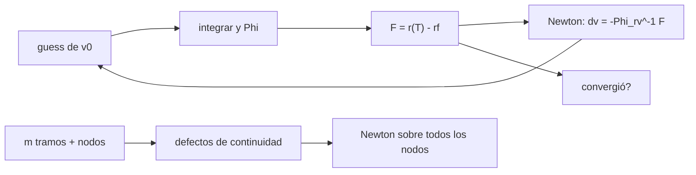

# B81-C02 — Método de disparo para control óptimo

<!-- nav:top -->
[🏠 Programa](../../../../README.md) · [📚 Bloque B81](../../../tronco-comun/B81-optimizacion-de-trayectorias-y-diseno-robusto.md) · [← Anterior: B81-C01 — Ecuaciones variacionales y matriz de transición de estados](../B81-C01-ecuaciones-variacionales-y-matriz-de-transicion-de-estados/CLASE.md) · [Siguiente: B81-C03 — Métodos directos de transcripción →](../B81-C03-metodos-directos-de-transcripcion/CLASE.md)
<!-- /nav -->

## 1. Ubicación, nivel y alcance

Clase 2 del bloque B81 (área A06). Nivel N3. Encontrar la velocidad inicial que lleva a un punto dado en un tiempo dado es un **problema de contorno**; el método de disparo lo convierte en buscar ceros de una función, con la matriz de transición de [B81-C01](../B81-C01-ecuaciones-variacionales-y-matriz-de-transicion-de-estados/CLASE.md) como jacobiano. Comparas el disparo simple con el múltiple en tres duraciones. El problema es sintético: el punto objetivo se genera con una velocidad conocida.

## 2. Por qué esta clase existe

El disparo simple falla cuando la trayectoria es muy sensible a la velocidad inicial; el múltiple reparte el problema en tramos. La decisión central: **¿cuándo basta un solo disparo y cuándo hay que dividir la trayectoria?**

## 3. Lo que podrás hacer al terminar

1. Plantear el problema de contorno como `F(v₀) = r(T; v₀) − r_f = 0`.
2. Resolverlo con Newton usando el bloque `Φ_rv` de la matriz de transición.
3. Plantear el disparo múltiple con defectos de continuidad.
4. Contar iteraciones y el número de condición (con unidades escaladas).
5. Reconocer cuándo el disparo simple no converge.
6. Rotular el problema como sintético y la semilla del disparo múltiple como conocimiento previo.

La evidencia es la **comparación de iteraciones y condicionamiento del disparo** del ejercicio 12 (sección 20).

## 4. Con qué llegas y cómo comprobarlo

1. ¿Qué es un problema de contorno?
2. ¿Qué hace el método de Newton?
3. ¿Qué es la matriz de transición?
4. ¿Qué es el número de condición?
5. ¿Qué es un dato sintético?

<details>
<summary>Ver respuestas</summary>

1. Una ecuación diferencial con condiciones en dos instantes (inicial y final). 2. Resuelve `F(x) = 0` iterando `x ← x − J⁻¹F`. 3. La derivada del estado final respecto del inicial (B81-C01). 4. El factor máximo de amplificación de errores de un sistema lineal. 5. Un dato generado para el ejemplo, no medido.
</details>

Con cuatro o cinco aciertos, sigue; si no, repasa los prerrequisitos.

## 5. Un caso de contexto y casos de referencia

El objetivo se genera propagando `v_true = (3, 31) km/s` desde 1 UA. Con 120 d el disparo simple converge en 4 iteraciones; con 250 d en 9; con 500 d no converge en 40. El disparo múltiple con 8 tramos converge en 3, 4 y 5 iteraciones, siempre que los nodos se siembren con un conocimiento previo del 3 % de error. Es el **ejemplo conductor**; es **sintético e ilustrativo**.

## 6. Vocabulario

El **disparo simple** integra desde `v₀` y corrige con Newton usando `∂r_f/∂v₀ = Φ_rv`. El **disparo múltiple** divide el tiempo en `m` tramos: las incógnitas son `v₀` y los estados de los nodos, y las ecuaciones son los **defectos de continuidad** (fin de un tramo menos inicio del siguiente) más la condición final. El **número de condición** se informa con posiciones en UA y velocidades en `v_c` para no mezclar km con km/s.

## 7. Modelo mental: tirar una cuerda frente a atar varias



*Descripción textual:* el disparo simple repite integrar, medir el error final y corregir `v₀` con Newton; el múltiple hace lo mismo sobre `v₀` y los nodos con defectos de continuidad.

Analogía: lanzar una flecha a un blanco lejano frente a tirar varias flechas cortas encadenadas; un pequeño error al inicio se amplifica menos en cada tramo. Límite: el disparo múltiple necesita estimar los nodos; con malas semillas también puede fallar.

## 8. La explicación, paso a paso

### 8.1 Disparo simple

`F(v₀) = r(T; v₀) − r_f`; el jacobiano es `Φ_rv(T, 0)`. Newton: `v₀ ← v₀ − Φ_rv⁻¹ F`. Con `T = 120 d` converge en 4 iteraciones al error `1,07 × 10⁻¹⁴ km/s`.

### 8.2 Disparo múltiple

Con `m` tramos, las incógnitas son `v₀` y los estados de los `m − 1` nodos interiores. El jacobiano tiene bloques `Φ` de cada tramo y `−I` de la continuidad; es más grande pero muy ralo.

### 8.3 Resultados

| `T` (d) | método | iteraciones | cond (escalado) |
|---|---|---|---|
| 120 | simple | 4 | 2,9 |
| 120 | múltiple `m = 4` | 3 | 6,9 |
| 120 | múltiple `m = 8` | 3 | 12,1 |
| 250 | simple | 9 | 9,6 |
| 250 | múltiple `m = 4` | 4 | 24,9 |
| 250 | múltiple `m = 8` | 4 | 37,0 |
| 500 | simple | 40, no converge | 19,3 |
| 500 | múltiple `m = 4` | 11 | 555 |
| 500 | múltiple `m = 8` | 5 | 521 |

El número de condición del sistema múltiple es mayor, pero el sistema es ralo y el problema es mucho menos no lineal.

### 8.4 Por qué falla el simple

A 500 d la dependencia de `r_f` con `v₀` es muy no lineal y el paso de Newton, calculado en el punto actual, no mejora el error en 40 iteraciones (el laboratorio no registra la causa exacta; descarta además los candidatos que pasan a menos de 0,05 UA del Sol). El múltiple acota ese crecimiento, pero **solo porque los nodos se sembraron cerca de la solución** (3 % de error): sin esa semilla también podría fallar.

## 9. Magnitudes, símbolos y unidades

| Símbolo | Qué es | Unidad | Valor / nota |
|---|---|---|---|
| `v₀` | velocidad inicial buscada | km/s | verdadera (3, 31) |
| `r_f` | posición objetivo | km | de la propagación de `v_true` |
| `Φ_rv` | bloque posición/velocidad de `Φ` | km por km/s | de B81-C01 |
| `m` | número de tramos | — | 4 y 8 |
| `T` | tiempo de vuelo | d | 120, 250, 500 |

## 10. Convenciones y referencias

`GM` del Sol y UA del JPL SSD (DE440). Plano heliocéntrico inercial; km, km/s, s. Newton sin amortiguar con tolerancia de 1e-6 km. Integrador DOP853 con rtol 1e-12 y atol 1e-9; los candidatos que pasan a menos de 0,05 UA del Sol se descartan.

## 11. De dónde sale lo que afirmamos

| ID | Fuente | Localizador | Respalda | Estado |
|---|---|---|---|---|
| S1 | NASA JPL SSD, Astrodynamic Parameters — https://ssd.jpl.nasa.gov/astro_par.html (consultada 2026-11-10) | tabla completa leída | GM del Sol = 1,32712440041279419 × 10²⁰ m³/s² (132712440041,279419 km³/s²); unidad astronómica = 149 597 870,7 km (IAU 2012 B1); GM de la Tierra = 398600,435507 km³/s²; masas planetarias de DE440 (Park et al., 2021) | Consultada |
| — | Relaciones estándar (método de Newton, método de disparo simple y múltiple, número de condición) | — | las verifica el laboratorio con una segunda vía | No consultada en una fuente concreta |

Límites: el problema es sintético, plano y de dos cuerpos; la semilla de los nodos del disparo múltiple es conocimiento previo inventado; el número de iteraciones depende del guess y no generaliza a otros problemas.

## 12. Cómo ver el disparo

| Magnitud | Valor |
|---|---|
| iteraciones simple a 120 d | 4 |
| iteraciones múltiple (8 tramos) a 500 d | 5 |
| simple a 500 d | no converge |
| error de `v₀` | ≤ 2 × 10⁻¹¹ km/s |

Descripción larga: el disparo simple se degrada al alargar el tiempo; el múltiple se mantiene, con una matriz más grande.

## 13. Ejemplo trabajado: un paso de Newton

**Paso 1 · Error final.** Con la `v₀` actual, `F = r(T) − r_f` (en km).

**Paso 2 · Jacobiano.** `Φ_rv(T,0)` de 2×2 (plano).

**Paso 3 · Corrección.** `δv = −Φ_rv⁻¹ F`.

**Paso 4 · Actualización.** `v₀ ← v₀ + δv`; se repite hasta `|F| < 10⁻⁶ km`.

## 14. Distintas formas de describir un problema de disparo

**Por incógnitas:** 2 (simple) o `2 + 4(m − 1)` (múltiple). **Por ecuaciones:** 2 o `4(m − 1) + 2`. **Por jacobiano:** denso 2×2 o ralo. **Por robustez:** el múltiple mejora la convergencia.

## 15. Práctica guiada

**Ejercicio 1 · con los pasos indicados.** ¿Cuántas incógnitas y ecuaciones tiene el disparo múltiple plano con `m = 8`? *Pasos:* `2 + 4(m−1)`.

<details><summary>Solución comentada</summary>

30 incógnitas y 30 ecuaciones.
</details>

**Ejercicio 2 · con una pista.** Si `Φ_rv` tiene valores singulares 5×10⁶ y 1,6×10⁷ km por km/s, ¿qué corrección de velocidad hace falta para un error de 1000 km? *Pista:* `δv ≈ F/σ`.

<details><summary>Solución comentada</summary>

Entre `1000/1,6×10⁷ = 6,3×10⁻⁵` y `1000/5×10⁶ = 2×10⁻⁴ km/s` (0,06 a 0,2 m/s).
</details>

**Ejercicio 3 · casi autónomo.** ¿Por qué el laboratorio descarta candidatos que pasan a menos de 0,05 UA del Sol?

<details><summary>Solución comentada</summary>

Porque la integración se vuelve rígida y el candidato no es físico en este problema; sin la guarda el cálculo puede no terminar.
</details>

## 16. Práctica autónoma, transferencia e integrador

**Ejercicio 4 · autónomo.** En la tabla, ¿cuántas veces menos iteraciones usa el múltiple de 8 tramos respecto del simple a 250 d?

<details><summary>Solución comentada</summary>

4 frente a 9: algo más de 2 veces menos.
</details>

**Ejercicio 5 · autónomo.** ¿Por qué el número de condición del múltiple es mayor?

<details><summary>Solución comentada</summary>

El sistema es más grande y mezcla posiciones y velocidades de varios tramos; aun así es más fácil de resolver porque cada tramo es poco no lineal.
</details>

**Ejercicio 6 · autónomo.** Un error de 1 % en la semilla de los nodos en lugar de 3 %, ¿qué esperarías?

<details><summary>Solución comentada</summary>

Menos iteraciones o igual; no hay garantía formal, se prueba.
</details>

**Ejercicio 7 · autónomo.** ¿Qué haría el disparo simple con `T = 120 d` si el guess fuera `(0, 0)`?

<details><summary>Solución comentada</summary>

Fallaría: velocidad cero lanza la nave hacia el Sol; el Jacobiano mide mal la dirección.
</details>

**Ejercicio 8 · autónomo.** ¿Cuál es la condición de parada y qué significa 1e-6 km?

<details><summary>Solución comentada</summary>

`|F| < 10⁻⁶ km`: un milímetro de error de posición final; es una tolerancia numérica, no de misión.
</details>

**Ejercicio 9 · transferencia.** **Transferencia.** **Transferencia.** Un colega quiere resolver una transferencia de varios años con disparo simple. ¿Qué sugiere esta clase?

<details><summary>Solución comentada</summary>

Dividir en tramos y sembrar los nodos con una solución aproximada (por ejemplo de una cónica empalmada).
</details>

**Ejercicio 10 · transferencia.** **Transferencia.** **Transferencia.** ¿Qué diferencia hay entre usar `Φ` analítico y diferencias finitas en el Newton?

<details><summary>Solución comentada</summary>

Con diferencias finitas cuesta más y limita la precisión del jacobiano; con variacionales, la convergencia cuadrática se mantiene.
</details>

**Ejercicio 11 · transferencia.** **Transferencia.** **Transferencia.** El disparo múltiple converge pero la trayectoria pasa muy cerca del Sol. ¿Qué falta?

<details><summary>Solución comentada</summary>

Restricciones de trayectoria (distancia mínima); el disparo resuelve solo el contorno.
</details>

**Ejercicio 12 · integrador.** **Integrador.** **Integrador.** Elabora tu *comparación de iteraciones y condicionamiento*: tabla de las tres duraciones y los tres métodos, condiciones de la semilla y límites.

<details><summary>Solución comentada</summary>

Secciones 8.1–8.4 y la salida del laboratorio.
</details>

## 17. Laboratorio: disparo simple y múltiple en un problema de contorno

El script [disparo.py](disparo.py) genera un objetivo con una velocidad conocida y resuelve con Newton el disparo simple y el múltiple de 4 y 8 tramos para 120, 250 y 500 d (**comprueba** que el error de `v₀` sea menor que 10⁻⁹ km/s en los casos que convergen).

**Datos:** `GM` y UA del JPL (consultados); `v_true`, tiempos y semilla de los nodos **sintéticos**. **Predice antes de ejecutar:** ¿qué caso no convergerá con el disparo simple? (el de 500 d.) **Ejecución del 2026-11-10 (Python 3.12.9, NumPy 2.4.4, SciPy 1.17.1):**

```text
Python 3.12.9 | NumPy 2.4.4 | SciPy 1.17.1
Problema SINTETICO: v_true = [3.0, 31.0] km/s ; guess = (0, 29.7847) km/s
 T [d]  metodo            iter  cond(J)      error v0 [km/s]  convergio
   120  disparo simple       4   2.91e+00        1.070e-14   si
   120  multiple m=4         3   6.90e+00        5.881e-13   si
   120  multiple m=8         3   1.21e+01        5.882e-13   si
   250  disparo simple       9   9.58e+00        2.161e-14   si
   250  multiple m=4         4   2.49e+01        1.011e-12   si
   250  multiple m=8         4   3.70e+01        1.411e-12   si
   500  disparo simple      40   1.93e+01              nan   no
   500  multiple m=4        11   5.55e+02        1.297e-11   si
   500  multiple m=8         5   5.21e+02        1.914e-11   si
Pruebas superadas.
```

```bash
python programa/clases/B81/B81-C02-metodo-de-disparo-para-control-optimo/disparo.py
```

**Límites:** plano, dos cuerpos, Newton sin amortiguar; la semilla de los nodos es conocimiento previo inventado; la guarda de 0,05 UA es una decisión del laboratorio.

## 18. Errores frecuentes y cómo corregirlos

**Atribuir el éxito del múltiple solo a los tramos.** Se corrige con 8.4.

**Comparar números de condición sin escalar unidades.** Se corrige con la sección 6.

**Olvidar la guarda contra trayectorias degeneradas.** Se corrige con el ejercicio 3.

**Presentar el problema sintético como una misión.** Se corrige con la sección 10.

## 19. Cómo sabrás que vas bien

Tras la sección 8: ¿qué caso esperabas que fallara y cuál falló? Si dudas, repasa 8.4. Tras el laboratorio: ¿qué comprueba? (ver la sección 17).

## 20. Qué entregas y cómo se evalúa

El producto es tu **comparación de iteraciones y condicionamiento del disparo** (ejercicio 12).

| Criterio | Inicial | En desarrollo | Logrado | Destacado |
|---|---|---|---|---|
| Conceptos | Los confunde | Parciales | Plantea y resuelve el disparo | Explica los límites |
| Cálculo | Sin unidades | Con errores | Tablas completas con unidades | Calcula casos nuevos |
| Numérico | Sin comprobar | Un caso | Contraste con una segunda vía | Interpreta las diferencias |
| Fuentes | Sin fuente | Sin fecha | Fuentes con fecha y estado | Declara lo ilustrativo y lo no consultado |
| Límites | No los nombra | Uno | Tres | Discute qué falta del modelo |

**Condiciones críticas (no se compensan con promedio):** rotular el problema y la semilla como sintéticos; no atribuir la convergencia del múltiple a los tramos solos; citar solo lo consultado.

## 21. Ética, seguridad y límites

Clase educativa: los modelos son simplificados y sus datos son sintéticos o ilustrativos; ningún resultado describe una misión real ni sustituye a las herramientas de diseño y a la validación de una misión. Accesibilidad: tablas equivalentes a las gráficas, fórmulas en texto, ejercicios sin conexión.

## 22. Para cerrar y seguir

El disparo simple converge en 4 iteraciones a 120 d y no converge a 500 d; con 8 tramos y buenos nodos converge en 5. Queda una pregunta: ¿se puede evitar el cálculo de jacobianos y resolver todo como un problema grande?

**Glosario español–inglés.** método de disparo · *shooting method*; problema de contorno · *boundary value problem*; defecto de continuidad · *continuity defect*; número de condición · *condition number*; método de Newton · *Newton's method*.

**Continuidad.** [B81-C03](../B81-C03-metodos-directos-de-transcripcion/CLASE.md) estudia los métodos directos.

**Referencias:** ver sección 11.

<!-- nav:bottom -->
---

[← Anterior: B81-C01 — Ecuaciones variacionales y matriz de transición de estados](../B81-C01-ecuaciones-variacionales-y-matriz-de-transicion-de-estados/CLASE.md) · [📚 Bloque B81](../../../tronco-comun/B81-optimizacion-de-trayectorias-y-diseno-robusto.md) · [Siguiente: B81-C03 — Métodos directos de transcripción →](../B81-C03-metodos-directos-de-transcripcion/CLASE.md)
<!-- /nav -->
