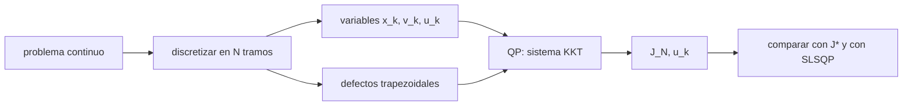

# B81-C03 — Métodos directos de transcripción

<!-- nav:top -->
[🏠 Programa](../../../../README.md) · [📚 Bloque B81](../../../tronco-comun/B81-optimizacion-de-trayectorias-y-diseno-robusto.md) · [← Anterior: B81-C02 — Método de disparo para control óptimo](../B81-C02-metodo-de-disparo-para-control-optimo/CLASE.md) · [Siguiente: B81-C04 — Trayectorias espirales de bajo empuje →](../B81-C04-trayectorias-espirales-de-bajo-empuje/CLASE.md)
<!-- /nav -->

## 1. Ubicación, nivel y alcance

Clase 3 del bloque B81 (área A06). Nivel N3. Un problema de control óptimo tiene infinitas incógnitas (una función del tiempo); un **método directo** lo convierte en un problema de dimensión finita: se discretiza el tiempo, las restricciones dinámicas pasan a ser ecuaciones y se resuelve con programación no lineal. Aquí lo haces con un problema adimensional cuya solución exacta conoces, y mides cuánto se acerca la solución discreta. Es sintético y no describe ninguna nave.

## 2. Por qué esta clase existe

Los métodos directos son los más usados cuando no se tiene un buen punto de partida y hay muchas restricciones. La decisión central: **¿cuántos nodos hacen falta y a qué velocidad converge el coste discreto al continuo?**

## 3. Lo que podrás hacer al terminar

1. Plantear un problema de control de mínimo esfuerzo con doble integrador.
2. Discretizar con defectos trapezoidales y escribir el problema como QP con restricciones lineales.
3. Resolver el sistema KKT y comparar con la solución analítica.
4. Medir el orden de convergencia del coste.
5. Contrastar con un segundo solucionador (SLSQP).
6. Contar variables y restricciones y decir cómo crecen con `N`.

La evidencia es la **ficha de convergencia de la colocación** del ejercicio 12 (sección 20).

## 4. Con qué llegas y cómo comprobarlo

1. ¿Qué es un control óptimo?
2. ¿Qué es una restricción de igualdad lineal?
3. ¿Qué es la regla del trapecio?
4. ¿Qué es el orden de convergencia?
5. ¿Qué es un dato sintético?

<details>
<summary>Ver respuestas</summary>

1. Una función `u(t)` que minimiza un coste sujeta a una dinámica. 2. Una ecuación `A z = b` lineal en las incógnitas. 3. Aproxima `∫f` con `h (f_k + f_{k+1})/2` en cada tramo. 4. El exponente `p` tal que el error cae como `h^p`. 5. Un dato generado para el ejemplo, no medido.
</details>

Con cuatro o cinco aciertos, sigue; si no, repasa los prerrequisitos.

## 5. Un caso de contexto y casos de referencia

Un doble integrador `x' = v`, `v' = u` debe pasar en `t ∈ [0, 1]` de reposo en `x = 0` a reposo en `x = 1` gastando `J = ∫ u² dt` mínimo. La solución exacta es `u* = 6 − 12 t` con `J* = 12`. Con 8 tramos trapezoidales el coste discreto vale `12,7205`; con 128, `12,0029`. Es el **ejemplo conductor**; es **adimensional e ilustrativo**.

## 6. Vocabulario

La **colocación trapezoidal** impone en cada tramo `x_{k+1} − x_k = h(v_k + v_{k+1})/2` y la ecuación análoga para `v`. El **defecto** es el residuo de esa ecuación. Las **condiciones KKT** de un QP con restricciones de igualdad `A z = b` y coste `½ zᵀHz` son `H z + Aᵀλ = 0` y `A z = b`. El **orden** de un método es el exponente de `h` en su error.

## 7. Modelo mental: un hilo dividido en cuentas



*Descripción textual:* el problema continuo se discretiza en variables y defectos; con ellos se arma el QP, se resuelve el sistema KKT y se compara con la solución exacta y con otro solucionador.

Analogía: cambiar una curva por una poligonal de `N` lados; cuantos más lados, mejor el ajuste. Límite: aquí el problema es lineal–cuadrático; con dinámica no lineal el QP se vuelve un problema no lineal que se resuelve de forma iterativa.

## 8. La explicación, paso a paso

### 8.1 Variables y restricciones

Con `N` tramos hay `3(N+1)` variables (`x`, `v`, `u` en cada nodo) y `2N + 4` restricciones (dos defectos por tramo más las cuatro condiciones de contorno). Para `N = 64`: 195 variables y 132 restricciones.

### 8.2 Resolver el QP

El coste discreto es `J_N = Σ h (u_k² + u_{k+1}²)/2` con pesos trapezoidales. El sistema KKT `[[H, Aᵀ],[A, 0]] [z; λ] = [0; b]` es lineal y se resuelve de una vez; `H` es singular en `x` y `v`, pero el sistema completo no lo es.

### 8.3 Convergencia

| `N` | `J_N` | error de `J` | orden |
|---|---|---|---|
| 4 | 15,058824 | 3,059 | — |
| 8 | 12,720497 | 0,7205 | 2,09 |
| 16 | 12,181413 | 0,1814 | 1,99 |
| 32 | 12,045952 | 0,04595 | 1,98 |
| 64 | 12,011593 | 0,01159 | 1,99 |
| 128 | 12,002913 | 0,002913 | 1,99 |

El error cae como `h²`, el orden de la regla del trapecio.

### 8.4 Segunda vía

Con `N = 8`, SLSQP de SciPy da `12,720496894` y el sistema KKT `12,720496894`; la diferencia es `3,6 × 10⁻¹⁵`: coinciden porque resuelven el mismo QP, de modo que la comprobación valida el código, no la discretización.

## 9. Magnitudes, símbolos y unidades

| Símbolo | Qué es | Unidad | Valor / nota |
|---|---|---|---|
| `N` | número de tramos | — | 4 a 128 |
| `h` | paso | — | `1/N` (adimensional) |
| `J` | coste `∫u²dt` | — | `J* = 12` |
| `x, v, u` | posición, velocidad y control | adimensionales | doble integrador |
| `p` | orden observado | — | 1,99 |

## 10. Convenciones y referencias

Problema adimensional con `T = 1`, sin sistema de referencia físico. NumPy 2.4.4 para el sistema KKT y SciPy 1.17.1 para SLSQP (`ftol` 1e-14). Todo es sintético; la solución analítica `u* = 6 − 12 t` es la derivada en la clase.

## 11. De dónde sale lo que afirmamos

| ID | Fuente | Localizador | Respalda | Estado |
|---|---|---|---|---|
| — | Relaciones estándar (colocación trapezoidal, sistema de Karush–Kuhn–Tucker para programación cuadrática con restricciones lineales, orden de convergencia) | — | las verifica el laboratorio con una segunda vía | No consultada en una fuente concreta |

Límites: el problema es adimensional y lineal–cuadrático; no incluye restricciones no lineales ni una dinámica orbital; la comparación con SLSQP no es una validación independiente de la discretización.

## 12. Cómo ver la convergencia

| Magnitud | Valor |
|---|---|
| `J_8` | 12,7205 |
| `J_128` | 12,0029 |
| orden observado | 1,99 |
| KKT frente a SLSQP | 3,6 × 10⁻¹⁵ |

Descripción larga: el coste discreto desciende hacia 12 con error proporcional a `1/N²`.

## 13. Ejemplo trabajado: el error esperado en N = 64

**Paso 1 · Orden.** El error del trapecio es `C h²`.

**Paso 2 · Constante.** Con `N = 128`: `C = 0,002913 × 128² = 47,7`.

**Paso 3 · Predicción.** Para `N = 64`: `47,7/64² ≈ 0,0116`.

**Paso 4 · Contraste.** El laboratorio da `0,01159`.

## 14. Distintas formas de describir un problema discretizado

**Por variables:** `3(N+1)`. **Por restricciones:** `2N + 4`. **Por sistema:** KKT de `(5N+7)` filas. **Por error:** `C/N²`.

## 15. Práctica guiada

**Ejercicio 1 · con los pasos indicados.** ¿Cuántas variables y restricciones tiene el problema con `N = 16`? *Pasos:* aplica `3(N+1)` y `2N + 4`.

<details><summary>Solución comentada</summary>

51 variables y 36 restricciones.
</details>

**Ejercicio 2 · con una pista.** Estima el error de `J` para `N = 256` a partir de `N = 128`. *Pista:* orden 2.

<details><summary>Solución comentada</summary>

Se divide por 4: `0,002913/4 ≈ 7,3 × 10⁻⁴`.
</details>

**Ejercicio 3 · casi autónomo.** Si `J_N` bajara a la mitad del error al duplicar `N`, ¿qué orden tendría?

<details><summary>Solución comentada</summary>

Orden 1 (`log₂ 2`); el laboratorio da orden 2.
</details>

## 16. Práctica autónoma, transferencia e integrador

**Ejercicio 4 · autónomo.** Calcula el orden entre `N = 16` y `N = 32` con `log₂(e₁₆/e₃₂)`.

<details><summary>Solución comentada</summary>

`log₂(0,1814/0,04595) = 1,98`.
</details>

**Ejercicio 5 · autónomo.** ¿Qué `N` hace falta para error menor que `10⁻⁴` si `e ≈ 47,7/N²`?

<details><summary>Solución comentada</summary>

`N ≥ √(47,7/10⁻⁴) ≈ 691`.
</details>

**Ejercicio 6 · autónomo.** ¿Qué tamaño tiene la matriz KKT para `N = 64`?

<details><summary>Solución comentada</summary>

`195 + 132 = 327` filas y columnas.
</details>

**Ejercicio 7 · autónomo.** ¿Por qué el sistema KKT es regular aunque `H` sea singular?

<details><summary>Solución comentada</summary>

Porque `A` fija `x` y `v` a partir de `u` y las condiciones de contorno; el núcleo de `H` no intersecta el de `A`.
</details>

**Ejercicio 8 · autónomo.** Con control constante en cada tramo en lugar de lineal, ¿cambiaría el orden?

<details><summary>Solución comentada</summary>

Sí: el control seccionalmente constante limita la aproximación a orden 1 para `u`.
</details>

**Ejercicio 9 · transferencia.** **Transferencia.** **Transferencia.** Un problema de transferencia orbital con dinámica no lineal se discretiza igual. ¿Qué cambia en el sistema a resolver?

<details><summary>Solución comentada</summary>

Los defectos dejan de ser lineales: el problema es un NLP que se resuelve iterando con un QP por paso (SQP) y jacobianos.
</details>

**Ejercicio 10 · transferencia.** **Transferencia.** **Transferencia.** Un colega afirma que SLSQP "valida" la discretización. ¿Qué responderías?

<details><summary>Solución comentada</summary>

Resuelve el mismo problema discreto; valida el solucionador, no el error de discretización. Esa se mide contra la solución exacta o con refinamiento de malla.
</details>

**Ejercicio 11 · transferencia.** **Transferencia.** **Transferencia.** ¿Qué ventaja tiene un método directo frente a uno indirecto cuando no se conocen las ecuaciones adjuntas?

<details><summary>Solución comentada</summary>

No requiere derivar ni adivinar adjuntos y admite restricciones; a cambio tiene más variables.
</details>

**Ejercicio 12 · integrador.** **Integrador.** **Integrador.** Elabora tu *ficha de convergencia de la colocación*: tabla de `J_N`, errores y órdenes, tamaño del problema, la comparación con SLSQP y lo que valida y no valida.

<details><summary>Solución comentada</summary>

Secciones 8.1–8.4 y la salida del laboratorio.
</details>

## 17. Laboratorio: colocación trapezoidal de un problema de mínimo esfuerzo

El script [colocacion.py](colocacion.py) arma las restricciones, resuelve el sistema KKT para `N` de 4 a 128, mide el orden y contrasta con SLSQP (**comprueba** órdenes entre 1,8 y 2,2 y la diferencia con SLSQP).

**Datos:** problema **sintético adimensional**; sin datos externos. **Predice antes de ejecutar:** ¿qué orden observarás? (2, el del trapecio.) **Ejecución del 2026-11-10 (Python 3.12.9, NumPy 2.4.4, SciPy 1.17.1):**

```text
Python 3.12.9 | NumPy 2.4.4 | SciPy 1.17.1
Problema SINTETICO adimensional: minimizar integral de u^2, J* = 12 (analitico)
   N     J_N        error J     orden   max|u - u*|
   4   15.058824   3.059e+00           7.647e-01
   8   12.720497   7.205e-01    2.09   4.348e-01
  16   12.181413   1.814e-01    1.99   2.900e-01
  32   12.045952   4.595e-02    1.98   1.652e-01
  64   12.011593   1.159e-02    1.99   8.804e-02
 128   12.002913   2.913e-03    1.99   4.543e-02
N = 8: J (KKT) = 12.720496894 ; J (SLSQP) = 12.720496894 ; diferencia = 3.55e-15
Tamano del problema N = 64: 195 variables y 132 restricciones
Pruebas superadas.
```

```bash
python programa/clases/B81/B81-C03-metodos-directos-de-transcripcion/colocacion.py
```

**Límites:** un solo problema lineal–cuadrático; la discretización del control es lineal a trozos; SLSQP resuelve el mismo QP.

## 18. Errores frecuentes y cómo corregirlos

**Tomar la coincidencia con SLSQP como prueba de exactitud.** Se corrige con 8.4.

**Olvidar las condiciones de contorno al contar restricciones.** Se corrige con 8.1.

**Esperar orden 2 con controles seccionalmente constantes.** Se corrige con el ejercicio 8.

**Presentar el problema adimensional como una trayectoria real.** Se corrige con la sección 10.

## 19. Cómo sabrás que vas bien

Tras la sección 8: ¿qué orden esperabas y cuál obtuviste? Si dudas, repasa 8.3. Tras el laboratorio: ¿qué comprueba? (ver la sección 17).

## 20. Qué entregas y cómo se evalúa

El producto es tu **ficha de convergencia de la colocación** (ejercicio 12).

| Criterio | Inicial | En desarrollo | Logrado | Destacado |
|---|---|---|---|---|
| Conceptos | Los confunde | Parciales | Plantea y resuelve el QP | Explica los límites |
| Cálculo | Sin unidades | Con errores | Tablas completas con unidades | Calcula casos nuevos |
| Numérico | Sin comprobar | Un caso | Contraste con una segunda vía | Interpreta las diferencias |
| Fuentes | Sin fuente | Sin fecha | Fuentes con fecha y estado | Declara lo ilustrativo y lo no consultado |
| Límites | No los nombra | Uno | Tres | Discute qué falta del modelo |

**Condiciones críticas (no se compensan con promedio):** rotular el problema como sintético; no tomar la coincidencia con SLSQP como validación de la discretización; citar solo lo consultado.

## 21. Ética, seguridad y límites

Clase educativa: los modelos son simplificados y sus datos son sintéticos o ilustrativos; ningún resultado describe una misión real ni sustituye a las herramientas de diseño y a la validación de una misión. Accesibilidad: tablas equivalentes a las gráficas, fórmulas en texto, ejercicios sin conexión.

## 22. Para cerrar y seguir

Con 8 tramos el coste discreto es 12,72 y con 128 llega a 12,003: el error cae como `1/N²`. Queda una pregunta: ¿qué pasa si el control no puede superar un valor máximo?

**Glosario español–inglés.** método directo · *direct method*; colocación · *collocation*; defecto · *defect*; programación cuadrática · *quadratic programming*; orden de convergencia · *order of convergence*.

**Continuidad.** [B81-C04](../B81-C04-trayectorias-espirales-de-bajo-empuje/CLASE.md) estudia las espirales de bajo empuje.

**Referencias:** ver sección 11.

<!-- nav:bottom -->
---

[← Anterior: B81-C02 — Método de disparo para control óptimo](../B81-C02-metodo-de-disparo-para-control-optimo/CLASE.md) · [📚 Bloque B81](../../../tronco-comun/B81-optimizacion-de-trayectorias-y-diseno-robusto.md) · [Siguiente: B81-C04 — Trayectorias espirales de bajo empuje →](../B81-C04-trayectorias-espirales-de-bajo-empuje/CLASE.md)
<!-- /nav -->
