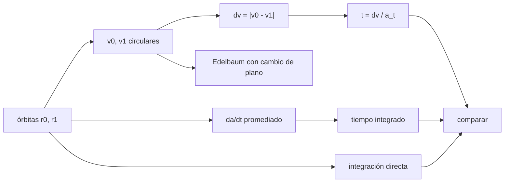

# B81-C04 — Trayectorias espirales de bajo empuje

<!-- nav:top -->
[🏠 Programa](../../../../README.md) · [📚 Bloque B81](../../../tronco-comun/B81-optimizacion-de-trayectorias-y-diseno-robusto.md) · [← Anterior: B81-C03 — Métodos directos de transcripción](../B81-C03-metodos-directos-de-transcripcion/CLASE.md) · [Siguiente: B81-C05 — Limitaciones de potencia en propulsión eléctrica →](../B81-C05-limitaciones-de-potencia-en-propulsion-electrica/CLASE.md)
<!-- /nav -->

## 1. Ubicación, nivel y alcance

Clase 4 del bloque B81 (área A06). Nivel N3. Con empuje pequeño y continuo, la nave no salta de una órbita a otra: **sube en espiral**, dando cientos de vueltas. Aquí calculas el `Δv` y el tiempo de una espiral tangencial entre dos órbitas circulares, añades el cambio de plano con la fórmula de Edelbaum y comparas el cálculo promediado con la integración directa. Usas [B81-C03](../B81-C03-metodos-directos-de-transcripcion/CLASE.md) solo como contexto de cómo se optimiza. Las órbitas y la aceleración son ilustrativas.

## 2. Por qué esta clase existe

Una espiral de bajo empuje cuesta más `Δv` que un impulso (Hohmann) pero ahorra propelente por su alto `Isp`. La decisión central: **¿cuánto `Δv` y cuánto tiempo cuesta pasar de una órbita circular a otra, y cuánto más si además hay que cambiar el plano?**

## 3. Lo que podrás hacer al terminar

1. Calcular `Δv = |v₀ − v₁|` para una espiral coplanar entre órbitas circulares.
2. Calcular el tiempo `t = Δv/a_t` con aceleración tangencial constante.
3. Añadir el cambio de plano con la fórmula de Edelbaum.
4. Integrar la ecuación promediada `da/dt = 2 a_t √(a³/μ)`.
5. Comparar con la integración directa de dos cuerpos con empuje.
6. Separar lo consultado (`GM` de la Tierra) de lo ilustrativo (órbitas y aceleración).

La evidencia es la **ficha de una espiral de escape o captura** del ejercicio 12 (sección 20).

## 4. Con qué llegas y cómo comprobarlo

1. ¿Qué es la velocidad circular?
2. ¿Qué es la aceleración de empuje?
3. ¿Qué es la excentricidad?
4. ¿Qué es un promediado?
5. ¿Qué es un dato ilustrativo?

<details>
<summary>Ver respuestas</summary>

1. `v = √(μ/r)`, la velocidad de una órbita circular de radio `r`. 2. El empuje dividido por la masa, en m/s². 3. El parámetro que mide cuánto se aleja una órbita de un círculo (0 = círculo). 4. Reemplazar el efecto de una vuelta por su valor medio. 5. Un valor elegido para el ejemplo, no medido ni consultado.
</details>

Con cuatro o cinco aciertos, sigue; si no, repasa los prerrequisitos.

## 5. Un caso de contexto y casos de referencia

Una nave pasa de una órbita de radio 7000 km a otra de 42 164 km con empuje tangencial de `1 × 10⁻³ m/s²`. El `Δv` es `4471,39 m/s`, el tiempo `51,752 d` y la integración directa da `51,7514 d` tras unas 315 revoluciones. Con un cambio de plano de 28,5° el `Δv` sube a `5783,75 m/s` (+29,4 %). Es el **ejemplo conductor**. Todo es **ilustrativo**: ninguna cifra describe una misión.

## 6. Vocabulario

La **espiral tangencial** mantiene el empuje en la dirección de la velocidad. La **fórmula de Edelbaum** da el `Δv` mínimo de una espiral con cambio de inclinación `Δi`: `Δv = √(v₀² − 2 v₀ v₁ cos(π/2 · Δi) + v₁²)`. La **ecuación promediada** `da/dt = 2 a_t √(a³/μ)` describe el semieje mayor de una órbita casi circular.

## 7. Modelo mental: una escalera sin peldaños



*Descripción textual:* de las órbitas inicial y final salen las velocidades circulares y de ahí el `Δv` y el tiempo; la ecuación promediada y la integración directa dan otras dos vías que se comparan.

Analogía: subir una rampa en lugar de una escalera; el esfuerzo total es la suma de pequeños empujes. Límite: la fórmula `Δv = |v₀ − v₁|` vale con aceleración pequeña frente a la gravedad; con aceleración alta aparece la desviación vista en la integración directa.

## 8. La explicación, paso a paso

### 8.1 Δv y tiempo

Con `μ = 398 600,435507 km³/s²` (JPL SSD), `v₀ = 7,5461 km/s` y `v₁ = 3,0747 km/s`, `Δv = 4471,39 m/s` y `t = Δv/a_t = 51,752 d` con `a_t = 10⁻³ m/s²`.

### 8.2 Cambio de plano

Con `Δi = 28,5°` la fórmula de Edelbaum da `5783,75 m/s`: 29,4 % más que el caso coplanar, con un tiempo de `66,942 d`. El cambio de plano es caro porque se hace en cada vuelta con la nave a gran velocidad.

### 8.3 Ecuación promediada

La integración de `da/dt = 2 a_t √(a³/μ)` desde 7000 km hasta 42 164 km da `51,7522 d`, con diferencia relativa `2,4 × 10⁻¹³` frente a `Δv/a_t`: es el mismo resultado escrito de otra forma, de modo que la comprobación valida el código, no la física.

### 8.4 Integración directa

Con dos cuerpos más empuje tangencial a la velocidad (DOP853, rtol 1e-10), la nave llega al semieje de 42 164 km a los `51,7514 d`, con `Δv = a_t t = 4471,32 m/s`, excentricidad final `0,0089` y unas 315 revoluciones. La diferencia con el promediado es `1,6 × 10⁻⁵`: este sí es un contraste independiente, porque no usa la aproximación de órbita circular.

## 9. Magnitudes, símbolos y unidades

| Símbolo | Qué es | Unidad | Valor / nota |
|---|---|---|---|
| `μ` | GM de la Tierra | km³/s² | 398 600,435507 |
| `r₀, r₁` | radios inicial y final | km | 7000; 42 164 (ilustrativos) |
| `a_t` | aceleración tangencial | m/s² | `1 × 10⁻³` (ilustrativa) |
| `Δv` | incremento de velocidad | m/s | 4471,39 |
| `Δi` | cambio de inclinación | grados | 28,5 (ilustrativo) |

## 10. Convenciones y referencias

`GM` de la Tierra del JPL SSD (DE440). Marco inercial geocéntrico, plano, dos cuerpos, sin achatamiento ni atmósfera ni eclipses. Aceleración constante (masa constante). Integrador DOP853 (SciPy 1.17.1) con rtol 1e-10 y atol 1e-12.

## 11. De dónde sale lo que afirmamos

| ID | Fuente | Localizador | Respalda | Estado |
|---|---|---|---|---|
| S1 | NASA JPL SSD, Astrodynamic Parameters — https://ssd.jpl.nasa.gov/astro_par.html (consultada 2026-11-10) | tabla completa leída | GM del Sol = 1,32712440041279419 × 10²⁰ m³/s² (132712440041,279419 km³/s²); unidad astronómica = 149 597 870,7 km (IAU 2012 B1); GM de la Tierra = 398600,435507 km³/s²; masas planetarias de DE440 (Park et al., 2021) | Consultada |
| — | Relaciones estándar (velocidad circular, fórmula de Edelbaum, promediado de la ecuación de Gauss para empuje tangencial) | — | las verifica el laboratorio con una segunda vía | No consultada en una fuente concreta |

Límites: no se incluyen perturbaciones (J2, eclipses, radiación); la masa se toma constante; la fórmula de Edelbaum supone aceleración constante y control óptimo del ángulo de empuje, no se verificó el óptimo con la integración directa.

## 12. Cómo ver una espiral

| Magnitud | Valor |
|---|---|
| `Δv` coplanar | 4471,39 m/s |
| `Δv` con 28,5° | 5783,75 m/s |
| tiempo coplanar | 51,752 d |
| tiempo directo | 51,7514 d |
| revoluciones | ≈ 315 |

Descripción larga: el cambio de plano añade casi un tercio al `Δv`; el cálculo promediado y la integración directa difieren en 16 partes por millón.

## 13. Ejemplo trabajado: el tiempo de la espiral coplanar

**Paso 1 · Velocidades.** `v₀ = √(398600,4/7000) = 7,5461 km/s`; `v₁ = √(398600,4/42164) = 3,0747 km/s`.

**Paso 2 · Δv.** `7,5461 − 3,0747 = 4,4714 km/s = 4471,4 m/s`.

**Paso 3 · Tiempo.** `4471,4 / 10⁻³ = 4,4714 × 10⁶ s = 51,75 d`.

**Paso 4 · Contraste.** La integración directa da `51,7514 d`.

## 14. Distintas formas de describir una espiral

**Por Δv:** `|v₀ − v₁|`. **Por tiempo:** `Δv/a_t`. **Por semieje:** `a(t)` de la ecuación promediada. **Por vueltas:** unas 315. **Por plano:** Edelbaum.

## 15. Práctica guiada

**Ejercicio 1 · con los pasos indicados.** Calcula `v₀` y `v₁` para 7000 y 42 164 km. *Pasos:* `v = √(μ/r)`.

<details><summary>Solución comentada</summary>

`7,5461 km/s` y `3,0747 km/s`.
</details>

**Ejercicio 2 · con una pista.** Calcula el tiempo con `a_t = 5 × 10⁻⁴ m/s²`. *Pista:* `t = Δv/a_t`.

<details><summary>Solución comentada</summary>

`4471,4/5×10⁻⁴ = 8,94 × 10⁶ s = 103,5 d`; el doble.
</details>

**Ejercicio 3 · casi autónomo.** ¿Por qué el `Δv` de la espiral es mayor que el de un impulso de Hohmann entre las mismas órbitas?

<details><summary>Solución comentada</summary>

El Hohmann entre estas órbitas cuesta `3,771 km/s` (calculado con la ecuación vis-viva), menos que `4,471 km/s`, porque aplica los impulsos en perigeo y apogeo, donde son más eficientes (efecto Oberth); la espiral los reparte por toda la órbita y paga con tiempo y `Δv` el empuje bajo.
</details>

## 16. Práctica autónoma, transferencia e integrador

**Ejercicio 4 · autónomo.** Calcula el `Δv` de Edelbaum para `Δi = 10°` con `v₀ = 7,5461` y `v₁ = 3,0747 km/s`.

<details><summary>Solución comentada</summary>

`√(7,5461² + 3,0747² − 2·7,5461·3,0747·cos(15°)) = 4,6347 km/s` (≈ 3,7 % más que el caso coplanar).
</details>

**Ejercicio 5 · autónomo.** ¿Cuántas revoluciones aproximadas harías si la aceleración fuera diez veces mayor?

<details><summary>Solución comentada</summary>

El tiempo baja diez veces y las vueltas también: unas 31.
</details>

**Ejercicio 6 · autónomo.** ¿Qué dice la ecuación promediada sobre la rapidez de crecimiento de `a` con `a`?

<details><summary>Solución comentada</summary>

`da/dt ∝ a^{3/2}`: crece más rápido a mayor radio.
</details>

**Ejercicio 7 · autónomo.** Con la aceleración y el `Δv` del ejemplo, ¿cuánta masa de propelente gasta una nave de 1000 kg con `Isp = 3000 s`?

<details><summary>Solución comentada</summary>

`m₀(1 − e^{−Δv/(g₀ Isp)}) = 1000(1 − e^{−4471,4/29420}) = 141,0 kg`.
</details>

**Ejercicio 8 · autónomo.** ¿Por qué la excentricidad final es 0,0089 y no 0?

<details><summary>Solución comentada</summary>

El empuje tangencial a la velocidad no mantiene la órbita exactamente circular; con aceleración pequeña la excentricidad queda pequeña.
</details>

**Ejercicio 9 · transferencia.** **Transferencia.** **Transferencia.** Una nave de 28,5° de inclinación sube a GEO. ¿Conviene repartir el cambio de plano a lo largo de toda la espiral?

<details><summary>Solución comentada</summary>

Sí: Edelbaum reparte el cambio de plano con un ángulo de guiado que varía; hacerlo en cada vuelta es más barato que al final.
</details>

**Ejercicio 10 · transferencia.** **Transferencia.** **Transferencia.** Un colega usa la ecuación promediada para validar el código y dice que "coincide con la física". ¿Qué respondes?

<details><summary>Solución comentada</summary>

Coincide con `Δv/a_t`, que es la misma ecuación integrada; el contraste independiente es la integración directa (8.4).
</details>

**Ejercicio 11 · transferencia.** **Transferencia.** **Transferencia.** La espiral atraviesa la sombra de la Tierra. ¿Qué cambia en el modelo?

<details><summary>Solución comentada</summary>

El empuje se interrumpe en eclipse (potencia solar nula): el tiempo crece y la espiral deja de ser continua.
</details>

**Ejercicio 12 · integrador.** **Integrador.** **Integrador.** Elabora tu *ficha de una espiral de escape o captura*: `Δv` y tiempo coplanar y con plano, ecuación promediada e integración directa, vueltas y lo consultado frente a lo ilustrativo.

<details><summary>Solución comentada</summary>

Secciones 8.1–8.4 y la salida del laboratorio.
</details>

## 17. Laboratorio: espiral tangencial de 7000 a 42 164 km

El script [espiral.py](espiral.py) calcula el `Δv` coplanar y con plano, integra la ecuación promediada e integra el movimiento de dos cuerpos con empuje tangencial hasta alcanzar el semieje final (**comprueba** las tolerancias de la cabecera).

**Datos:** `GM` de la Tierra del JPL (consultado); radios, aceleración e inclinación **ilustrativos**. **Predice antes de ejecutar:** ¿cuántos días tarda la espiral coplanar? (51,75 d.) **Ejecución del 2026-11-10 (Python 3.12.9, NumPy 2.4.4, SciPy 1.17.1):**

```text
Python 3.12.9 | NumPy 2.4.4 | SciPy 1.17.1
Orbitas ILUSTRATIVAS: r0 = 7000 km (v = 7.5461 km/s), r1 = 42164 km (v = 3.0747 km/s) ; a_t = 1.0e-03 m/s^2
dv coplanar (|v0 - v1|) = 4471.39 m/s ; tiempo = dv/a_t = 51.752 d
dv de Edelbaum con cambio de plano de 28,5 grados = 5783.75 m/s (+29.4 % ) ; tiempo = 66.942 d
Promediado: tiempo para a = r1 = 51.7522 d ; diferencia relativa con dv/a_t = 2.37e-13
Directo: tiempo = 51.7514 d ; dv = a_t t = 4471.32 m/s ; excentricidad final = 0.0089
Diferencia directo frente a promediado = 1.56e-05 ; revoluciones aprox. = 315
Pruebas superadas.
```

```bash
python programa/clases/B81/B81-C04-trayectorias-espirales-de-bajo-empuje/espiral.py
```

**Límites:** dos cuerpos sin perturbaciones ni eclipses; la fórmula de Edelbaum es una predicción, no se optimizó el guiado; el cálculo promediado reproduce `Δv/a_t` por construcción.

## 18. Errores frecuentes y cómo corregirlos

**Tomar el promediado como una validación independiente.** Se corrige con 8.3.

**Usar `Δv` impulsivo como si fuera el de la espiral.** Se corrige con 8.1.

**Olvidar el costo del cambio de plano.** Se corrige con 8.2.

**Presentar las órbitas ilustrativas como una misión.** Se corrige con la sección 10.

## 19. Cómo sabrás que vas bien

Tras la sección 8: ¿qué tiempo esperabas y cuál obtuviste? Si dudas, repasa 8.1. Tras el laboratorio: ¿qué comprueba? (ver la sección 17).

## 20. Qué entregas y cómo se evalúa

El producto es tu **ficha de una espiral de escape o captura** (ejercicio 12).

| Criterio | Inicial | En desarrollo | Logrado | Destacado |
|---|---|---|---|---|
| Conceptos | Los confunde | Parciales | Calcula `Δv` y tiempo de la espiral | Explica los límites |
| Cálculo | Sin unidades | Con errores | Tablas completas con unidades | Calcula casos nuevos |
| Numérico | Sin comprobar | Un caso | Contraste con una segunda vía | Interpreta las diferencias |
| Fuentes | Sin fuente | Sin fecha | Fuentes con fecha y estado | Declara lo ilustrativo y lo no consultado |
| Límites | No los nombra | Uno | Tres | Discute qué falta del modelo |

**Condiciones críticas (no se compensan con promedio):** rotular órbitas y aceleración como ilustrativas; no presentar el promediado como validación independiente; citar solo lo consultado.

## 21. Ética, seguridad y límites

Clase educativa: los modelos son simplificados y sus datos son sintéticos o ilustrativos; ningún resultado describe una misión real ni sustituye a las herramientas de diseño y a la validación de una misión. Accesibilidad: tablas equivalentes a las gráficas, fórmulas en texto, ejercicios sin conexión.

## 22. Para cerrar y seguir

Una espiral de 315 vueltas lleva de 7000 a 42 164 km con `4471 m/s` en `51,75 d`, y el cambio de plano de 28,5° cuesta casi un tercio más. Queda una pregunta: ¿cuánto empuje hay realmente disponible lejos del Sol?

**Glosario español–inglés.** espiral de bajo empuje · *low-thrust spiral*; fórmula de Edelbaum · *Edelbaum formula*; semieje mayor · *semi-major axis*; empuje tangencial · *tangential thrust*; promediado · *averaging*.

**Continuidad.** [B81-C05](../B81-C05-limitaciones-de-potencia-en-propulsion-electrica/CLASE.md) estudia las limitaciones de potencia.

**Referencias:** ver sección 11.

<!-- nav:bottom -->
---

[← Anterior: B81-C03 — Métodos directos de transcripción](../B81-C03-metodos-directos-de-transcripcion/CLASE.md) · [📚 Bloque B81](../../../tronco-comun/B81-optimizacion-de-trayectorias-y-diseno-robusto.md) · [Siguiente: B81-C05 — Limitaciones de potencia en propulsión eléctrica →](../B81-C05-limitaciones-de-potencia-en-propulsion-electrica/CLASE.md)
<!-- /nav -->
