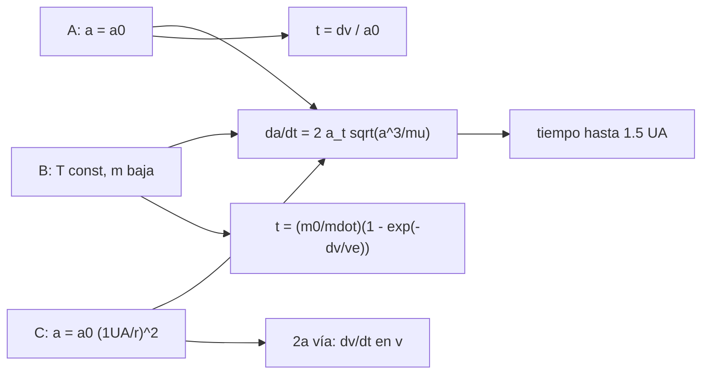

# B81-C07 — Modelos de aceleración para bajo empuje

<!-- nav:top -->
[🏠 Programa](../../../../README.md) · [📚 Bloque B81](../../../tronco-comun/B81-optimizacion-de-trayectorias-y-diseno-robusto.md) · [← Anterior: B81-C06 — Restricciones de orientación del empuje](../B81-C06-restricciones-de-orientacion-del-empuje/CLASE.md) · [Siguiente: B81-C08 — Validación de trayectorias de empuje continuo →](../B81-C08-validacion-de-trayectorias-de-empuje-continuo/CLASE.md)
<!-- /nav -->

## 1. Ubicación, nivel y alcance

Clase 7 del bloque B81 (área A06). Nivel N3. Para integrar una trayectoria de empuje continuo hay que decidir cómo se comporta la aceleración: ¿constante?, ¿con empuje constante y masa que baja?, ¿ligada a la potencia solar? Aquí comparas tres modelos para una transferencia circular coplanar de 1,0 a 1,5 UA y verificas dos de ellos con fórmulas cerradas. Usas [B81-C05](../B81-C05-limitaciones-de-potencia-en-propulsion-electrica/CLASE.md) para la ley `1/r²`. La nave y el radio final son ilustrativos.

## 2. Por qué esta clase existe

El modelo de aceleración cambia el tiempo de vuelo en decenas de por ciento. La decisión central: **¿cuánto se equivoca el tiempo de vuelo si se usa un modelo más simple que el real?**

## 3. Lo que podrás hacer al terminar

1. Escribir los tres modelos: aceleración constante, empuje constante con masa variable y aceleración `∝ 1/r²`.
2. Integrar el semieje con la ecuación promediada para cada modelo.
3. Verificar A y B con sus fórmulas cerradas.
4. Verificar C con una segunda integración en velocidad.
5. Calcular el propelente con la ecuación del cohete.
6. Separar lo consultado (`GM`, UA) de lo ilustrativo (aceleración, masa, `Isp`).

La evidencia es la **tabla comparativa de tres modelos de aceleración** del ejercicio 12 (sección 20).

## 4. Con qué llegas y cómo comprobarlo

1. ¿Qué es la ecuación del cohete?
2. ¿Qué es una órbita circular?
3. ¿Qué es el flujo de masa de un propulsor?
4. ¿Qué es una ecuación promediada?
5. ¿Qué es un dato ilustrativo?

<details>
<summary>Ver respuestas</summary>

1. `Δv = v_e ln(m₀/m_f)` con `v_e = g₀ Isp`. 2. Una órbita de radio constante con velocidad `√(μ/r)`. 3. `ṁ = T/(g₀ Isp)`, la masa que gasta por segundo. 4. Una ecuación que reemplaza el efecto de una vuelta por su valor medio. 5. Un valor elegido para el ejemplo, no medido ni consultado.
</details>

Con cuatro o cinco aciertos, sigue; si no, repasa los prerrequisitos.

## 5. Un caso de contexto y casos de referencia

Para ir de 1,0 a 1,5 UA con `Δv = 5465,59 m/s` y una aceleración de `2 × 10⁻⁴ m/s²` a 1 UA, el modelo A (aceleración constante) tarda `316,3 d`; el B (empuje constante, masa que baja, `Isp = 3000 s`) `288,7 d` y gasta `169,5 kg`; el C (potencia solar, `a ∝ 1/r²`) `481,0 d`. Es el **ejemplo conductor**; los parámetros son **ilustrativos**.

## 6. Vocabulario

El **modelo A** usa `a_t = a₀`. El **modelo B** usa `T` constante y `m(t) = m₀ − ṁ t`, de modo que `a_t = T/m` crece. El **modelo C** usa `a_t = a₀ (1 UA/r)²` con masa constante. La velocidad de escape efectiva es `v_e = g₀ Isp`.

## 7. Modelo mental: tres maneras de pisar el acelerador



*Descripción textual:* los tres modelos alimentan la misma ecuación promediada del semieje; A y B se comparan con fórmulas cerradas y C con una segunda integración en velocidad.

Analogía: tres coches subiendo la misma cuesta: uno con aceleración fija, otro que se aligera al gastar combustible y otro cuyo motor pierde fuerza con la altura. Límite: se usa la ecuación promediada de órbitas casi circulares; no se integra una trayectoria completa.

## 8. La explicación, paso a paso

### 8.1 Δv ideal

Con `GM = 132 712 440 041,279 km³/s²` y UA del JPL SSD: `v₀ = 29 784,69 m/s`, `v₁ = 24 319,10 m/s` y `Δv = 5465,59 m/s`.

### 8.2 Modelo A

`da/dt = 2 a₀ √(a³/μ)` integra `v` hasta el `Δv` y da `t = Δv/a₀ = 316,296 d`. La diferencia relativa con la fórmula es `2,5 × 10⁻¹²`.

### 8.3 Modelo B

Con `ṁ = a₀ m₀/(g₀ Isp)`, `t = (m₀/ṁ)(1 − e^{−Δv/v_e}) = 288,653 d` (diferencia relativa `2,2 × 10⁻¹²`) y el propelente es `m₀(1 − e^{−Δv/v_e}) = 169,54 kg`. Es 8,7 % más rápido que A porque la nave se aligera.

### 8.4 Modelo C

Con `a ∝ 1/r²` la aceleración baja a `2 × 10⁻⁴/2,25 = 8,9 × 10⁻⁵ m/s²` a 1,5 UA y el tiempo sube a `480,966 d` (1,52 veces el de A). La segunda integración (en velocidad, con `r = μ/v²`) da el mismo valor con diferencia `4,7 × 10⁻¹³`. La diferencia entre A y C es de 52 %: usar aceleración constante para una nave solar-eléctrica subestima el tiempo en un tercio.

## 9. Magnitudes, símbolos y unidades

| Símbolo | Qué es | Unidad | Valor / nota |
|---|---|---|---|
| `a₀` | aceleración a 1 UA | m/s² | `2 × 10⁻⁴` (ilustrativa) |
| `m₀` | masa inicial | kg | 1000 (ilustrativa) |
| `Isp` | impulso específico | s | 3000 (ilustrativo) |
| `Δv` | incremento ideal | m/s | 5465,59 |
| `t_A, t_B, t_C` | tiempos de los modelos | d | 316,3; 288,7; 481,0 |

## 10. Convenciones y referencias

`GM` del Sol y UA del JPL SSD (DE440); `g₀ = 9,80665 m/s²` es el valor convencional y no se consultó. Órbitas circulares coplanares de 1,0 a 1,5 UA (radio final ilustrativo, no un planeta). Empuje tangencial, ecuación promediada, sin eclipses ni perturbaciones. Integrador DOP853 (SciPy 1.17.1) con rtol 1e-12.

## 11. De dónde sale lo que afirmamos

| ID | Fuente | Localizador | Respalda | Estado |
|---|---|---|---|---|
| S1 | NASA JPL SSD, Astrodynamic Parameters — https://ssd.jpl.nasa.gov/astro_par.html (consultada 2026-11-10) | tabla completa leída | GM del Sol = 1,32712440041279419 × 10²⁰ m³/s² (132712440041,279419 km³/s²); unidad astronómica = 149 597 870,7 km (IAU 2012 B1); GM de la Tierra = 398600,435507 km³/s²; masas planetarias de DE440 (Park et al., 2021) | Consultada |
| — | Relaciones estándar (ecuación del cohete de Tsiolkovsky, promediado de Gauss para empuje tangencial, velocidad circular) | — | las verifica el laboratorio con una segunda vía | No consultada en una fuente concreta |

Límites: el radio final de 1,5 UA es ilustrativo; la aceleración, la masa y el `Isp` son ilustrativos; el modelo promediado ignora la excentricidad intermedia de una trayectoria real; el modelo C no incluye saturación (B81-C05).

## 12. Cómo ver la comparación

| Modelo | Tiempo (d) | Masa final (kg) |
|---|---|---|
| A aceleración constante | 316,296 | 1000 (sin gasto) |
| B empuje constante | 288,653 | 830,5 |
| C potencia solar | 480,966 | 1000 (sin gasto) |

Descripción larga: el modelo con masa decreciente es el más rápido y el solar el más lento, con diferencias de 9 % y 52 % respecto de A.

## 13. Ejemplo trabajado: el propelente del modelo B

**Paso 1 · Escape.** `v_e = 9,80665 · 3000 = 29 419,95 m/s`.

**Paso 2 · Fracción.** `Δv/v_e = 5465,59/29 419,95 = 0,18578`.

**Paso 3 · Propelente.** `1000 (1 − e^{−0,18578}) = 169,5 kg`.

**Paso 4 · Contraste.** El laboratorio da `169,54 kg`.

## 14. Distintas formas de describir un modelo de aceleración

**Por ley:** constante, `T/m`, `a₀/r²`. **Por tiempo:** `Δv/a₀`, cerrado en B, numérico en C. **Por masa:** constante en A y C, decreciente en B. **Por contraste:** fórmula cerrada o segunda integración.

## 15. Práctica guiada

**Ejercicio 1 · con los pasos indicados.** Calcula la fracción de propelente de B con la ecuación del cohete. *Pasos:* `1 − e^{−Δv/v_e}`.

<details><summary>Solución comentada</summary>

`1 − e^{−0,18578} = 0,1695` (169,5 kg de 1000).
</details>

**Ejercicio 2 · con una pista.** Estima `t_A` con `Δv = 5465,59 m/s` y `a₀ = 2 × 10⁻⁴ m/s²`. *Pista:* `t = Δv/a`.

<details><summary>Solución comentada</summary>

`2,733 × 10⁷ s = 316,3 d`.
</details>

**Ejercicio 3 · casi autónomo.** ¿Por qué B es más rápido que A?

<details><summary>Solución comentada</summary>

El empuje es el mismo pero la masa baja: la aceleración crece con el tiempo.
</details>

## 16. Práctica autónoma, transferencia e integrador

**Ejercicio 4 · autónomo.** ¿Cuánta aceleración tendría C a 1,5 UA?

<details><summary>Solución comentada</summary>

`2×10⁻⁴/1,5² = 8,9 × 10⁻⁵ m/s²`.
</details>

**Ejercicio 5 · autónomo.** Si `Isp = 6000 s`, ¿cómo cambia el propelente de B?

<details><summary>Solución comentada</summary>

`v_e = 58 840 m/s`; fracción `1 − e^{−0,0929} = 0,0887` (88,7 kg).
</details>

**Ejercicio 6 · autónomo.** ¿Qué diferencia relativa hay entre `t_C` y `t_A`?

<details><summary>Solución comentada</summary>

`481/316,3 − 1 = 52 %`.
</details>

**Ejercicio 7 · autónomo.** ¿Por qué la ecuación promediada no basta para una trayectoria elíptica?

<details><summary>Solución comentada</summary>

Supone órbitas casi circulares; en una elíptica el empuje tangencial cambia también la excentricidad.
</details>

**Ejercicio 8 · autónomo.** ¿Qué modelo usarías para una nave nuclear-eléctrica con potencia constante?

<details><summary>Solución comentada</summary>

Potencia constante: `a = 2ηP/(m g₀ Isp)` con masa decreciente, una variante de B sin la dependencia de `r`.
</details>

**Ejercicio 9 · transferencia.** **Transferencia.** **Transferencia.** Un colega usa A para una misión solar-eléctrica a Marte. ¿Qué error de tiempo comete, cualitativamente?

<details><summary>Solución comentada</summary>

Subestima el tiempo, pues la potencia baja con la distancia (C > A).
</details>

**Ejercicio 10 · transferencia.** **Transferencia.** **Transferencia.** ¿Cómo combinarías B y C?

<details><summary>Solución comentada</summary>

Con masa decreciente y `a_t = T(r)/m(t)` donde `T(r)` sigue la curva de potencia de B81-C05.
</details>

**Ejercicio 11 · transferencia.** **Transferencia.** **Transferencia.** Una fórmula cerrada y una integración numérica coinciden a 10⁻¹². ¿Es una prueba de la física?

<details><summary>Solución comentada</summary>

No: valida el código y la integración; la física depende de las hipótesis del promediado.
</details>

**Ejercicio 12 · integrador.** **Integrador.** **Integrador.** Elabora tu *tabla comparativa de tres modelos de aceleración*: tiempo, propelente, fórmulas cerradas y segunda vía, y lo consultado frente a lo ilustrativo.

<details><summary>Solución comentada</summary>

Secciones 8.1–8.4 y la salida del laboratorio.
</details>

## 17. Laboratorio: tres modelos de aceleración entre 1,0 y 1,5 UA

El script [modelos.py](modelos.py) integra la ecuación promediada del semieje para los tres modelos y los contrasta con fórmulas cerradas (A y B) y con una segunda integración (C) (**comprueba** diferencias relativas menores que 1e-6).

**Datos:** `GM` y UA del JPL (consultados); aceleración, masa, `Isp` y radio final **ilustrativos**. **Predice antes de ejecutar:** ¿cuál modelo tardará más? (el C, de potencia solar.) **Ejecución del 2026-11-10 (Python 3.12.9, NumPy 2.4.4, SciPy 1.17.1):**

```text
Python 3.12.9 | NumPy 2.4.4 | SciPy 1.17.1
Orbitas circulares 1,0 -> 1,5 UA ; v0 = 29784.69 m/s, v1 = 24319.10 m/s ; dv ideal = 5465.59 m/s
Parametros ILUSTRATIVOS: a0 = 2.0e-04 m/s^2 a 1 UA, m0 = 1000 kg, Isp = 3000 s
 modelo                 tiempo [d]   analitico [d]   dif. relativa   masa final [kg]
 A aceleracion const.      316.296        316.296       2.47e-12     1000.0
 B empuje const.           288.653        288.653       2.15e-12      830.5
 C potencia solar 1/r^2    480.966   (2a via 480.966)       4.74e-13     1000.0
Propelente consumido en B = 169.54 kg ; con la ecuacion del cohete: 169.54 kg
Cociente t_C/t_A = 1.521 ; t_B/t_A = 0.913
Pruebas superadas.
```

```bash
python programa/clases/B81/B81-C07-modelos-de-aceleracion-para-bajo-empuje/modelos.py
```

**Límites:** promediado para órbitas casi circulares; las fórmulas cerradas de A y B son la misma ecuación integrada; no hay saturación ni eclipses.

## 18. Errores frecuentes y cómo corregirlos

**Usar aceleración constante en una nave solar-eléctrica.** Se corrige con 8.4.

**Olvidar que la masa baja en B.** Se corrige con 8.3.

**Tomar las fórmulas cerradas como validación independiente.** Se corrige con el ejercicio 11.

**Presentar la nave ilustrativa como una misión.** Se corrige con la sección 10.

## 19. Cómo sabrás que vas bien

Tras la sección 8: ¿qué modelo esperabas más lento y cuál lo fue? Si dudas, repasa 8.4. Tras el laboratorio: ¿qué comprueba? (ver la sección 17).

## 20. Qué entregas y cómo se evalúa

El producto es tu **tabla comparativa de tres modelos de aceleración** (ejercicio 12).

| Criterio | Inicial | En desarrollo | Logrado | Destacado |
|---|---|---|---|---|
| Conceptos | Los confunde | Parciales | Calcula tiempo y propelente por modelo | Explica los límites |
| Cálculo | Sin unidades | Con errores | Tablas completas con unidades | Calcula casos nuevos |
| Numérico | Sin comprobar | Un caso | Contraste con una segunda vía | Interpreta las diferencias |
| Fuentes | Sin fuente | Sin fecha | Fuentes con fecha y estado | Declara lo ilustrativo y lo no consultado |
| Límites | No los nombra | Uno | Tres | Discute qué falta del modelo |

**Condiciones críticas (no se compensan con promedio):** rotular parámetros y radio final como ilustrativos; no tomar las fórmulas cerradas como validación de la física; citar solo lo consultado.

## 21. Ética, seguridad y límites

Clase educativa: los modelos son simplificados y sus datos son sintéticos o ilustrativos; ningún resultado describe una misión real ni sustituye a las herramientas de diseño y a la validación de una misión. Accesibilidad: tablas equivalentes a las gráficas, fórmulas en texto, ejercicios sin conexión.

## 22. Para cerrar y seguir

Para ir de 1,0 a 1,5 UA, la aceleración constante da 316 d, el empuje constante con masa decreciente 289 d y la potencia solar 481 d. Queda una pregunta: ¿cómo se sabe que una trayectoria así calculada es correcta?

**Glosario español–inglés.** modelo de aceleración · *acceleration model*; ecuación del cohete · *rocket equation*; flujo de masa · *mass flow rate*; velocidad de escape efectiva · *effective exhaust velocity*; empuje tangencial · *tangential thrust*.

**Continuidad.** [B81-C08](../B81-C08-validacion-de-trayectorias-de-empuje-continuo/CLASE.md) valida una trayectoria de empuje continuo.

**Referencias:** ver sección 11.

<!-- nav:bottom -->
---

[← Anterior: B81-C06 — Restricciones de orientación del empuje](../B81-C06-restricciones-de-orientacion-del-empuje/CLASE.md) · [📚 Bloque B81](../../../tronco-comun/B81-optimizacion-de-trayectorias-y-diseno-robusto.md) · [Siguiente: B81-C08 — Validación de trayectorias de empuje continuo →](../B81-C08-validacion-de-trayectorias-de-empuje-continuo/CLASE.md)
<!-- /nav -->
