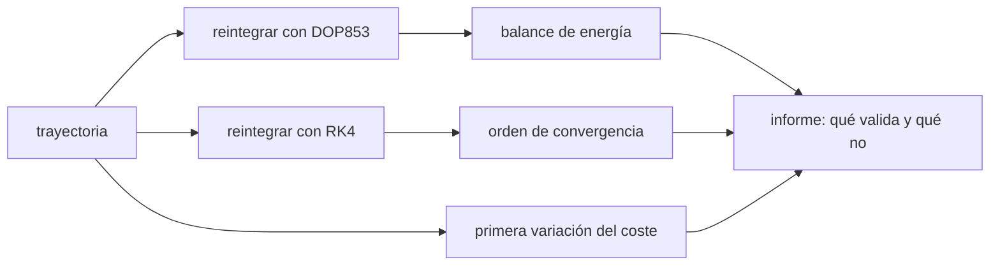

# B81-C08 — Validación de trayectorias de empuje continuo

<!-- nav:top -->
[🏠 Programa](../../../../README.md) · [📚 Bloque B81](../../../tronco-comun/B81-optimizacion-de-trayectorias-y-diseno-robusto.md) · [← Anterior: B81-C07 — Modelos de aceleración para bajo empuje](../B81-C07-modelos-de-aceleracion-para-bajo-empuje/CLASE.md) · [Siguiente: B81-C09 — Variables de diseño orbital →](../B81-C09-variables-de-diseno-orbital/CLASE.md)
<!-- /nav -->

## 1. Ubicación, nivel y alcance

Clase 8 del bloque B81 (área A06). Nivel N3. Una trayectoria de empuje continuo que sale de un optimizador no está validada hasta que se la **reintegra** con otro método y se comprueban sus invariantes y su optimalidad. Aquí validas una trayectoria heliocéntrica con tres chequeos —balance de energía, convergencia de un integrador de paso fijo y primera variación de un coste— y rotulas qué comprueba cada uno. Usas [B81-C07](../B81-C07-modelos-de-aceleracion-para-bajo-empuje/CLASE.md) para el modelo de aceleración. La trayectoria es ilustrativa.

## 2. Por qué esta clase existe

Un resultado que solo se ha verificado con el mismo código no está validado. La decisión central: **¿qué chequeos independientes demuestran que una trayectoria de empuje continuo es correcta y que es un óptimo local?**

## 3. Lo que podrás hacer al terminar

1. Reintegrar una trayectoria con dos integradores distintos.
2. Comprobar el balance de energía `ΔE = ∫ a·v dt`.
3. Medir el orden de convergencia de Runge–Kutta de cuarto orden.
4. Verificar que la primera variación del coste es nula en el óptimo.
5. Comprobar que variaciones admisibles aumentan el coste.
6. Redactar qué comprueba cada chequeo y qué no.

La evidencia es la **informe de validación de una trayectoria** del ejercicio 12 (sección 20).

## 4. Con qué llegas y cómo comprobarlo

1. ¿Qué es la energía específica orbital?
2. ¿Qué es un integrador de Runge–Kutta de cuarto orden?
3. ¿Qué es la primera variación de un funcional?
4. ¿Qué es una variación admisible?
5. ¿Qué es un dato ilustrativo?

<details>
<summary>Ver respuestas</summary>

1. `E = v²/2 − μ/r`. 2. Un método de paso fijo con error global `O(h⁴)`. 3. Su derivada direccional; es nula en un extremo. 4. Un cambio del control que respeta las condiciones de contorno. 5. Un valor elegido para el ejemplo, no medido ni consultado.
</details>

Con cuatro o cinco aciertos, sigue; si no, repasa los prerrequisitos.

## 5. Un caso de contexto y casos de referencia

Una nave con aceleración `2 × 10⁻⁴ m/s² (1 UA/r)²` empuja tangencialmente 200 d desde una órbita circular de 1 UA. El cambio de energía es `89,55465 km²/s²` y la integral del trabajo `89,55465 km²/s²` (diferencia `1,9 × 10⁻¹²`). RK4 con pasos de 1, ½ y ¼ de día reduce el error 16,2 y 16,0 veces. Es el **ejemplo conductor**; los parámetros son **ilustrativos**.

## 6. Vocabulario

El **trabajo del empuje** por unidad de masa es `a·v`; su integral es `ΔE`. El **orden** de RK4 es 4 en el paso local y 4 en el error global. La **primera variación** `δJ = dJ(u + εη)/dε` en `ε = 0`. Una variación **admisible** `η` conserva las condiciones de contorno.

## 7. Modelo mental: un contador y un notario



*Descripción textual:* la trayectoria se reintegra con dos métodos, se verifica el balance de energía y la convergencia, se comprueba la primera variación del coste y todo se resume en un informe.

Analogía: auditar unas cuentas con tres controles —recontar con otra calculadora, comprobar que el saldo cuadra y verificar que no hay mejor opción vecina—; ninguno basta solo. Límite: cada control prueba un aspecto, no la corrección del modelo físico.

## 8. La explicación, paso a paso

### 8.1 Balance de energía

Con `GM = 132 712 440 041,279 km³/s²` y UA del JPL SSD, la solución de DOP853 (rtol 1e-12) a 200 d da `r_f = 1,242207 UA`. La energía específica cambia `ΔE = 89,55465 km²/s²`; la integral del trabajo `a·v` por Simpson sobre 4001 puntos de la salida densa da el mismo valor con diferencia relativa `1,9 × 10⁻¹²`.

### 8.2 Convergencia de RK4

Contra la solución de referencia, el error de posición vale `1,261 km` con paso de 86 400 s, `0,0778 km` con 43 200 s y `0,00485 km` con 21 600 s. Las razones son `16,2` y `16,0`: orden 4. Con pasos menores el error baja al nivel del redondeo (≈ 3 × 10⁻⁵ km, observado en una ejecución previa con pasos de 3600 y 1800 s) y la razón deja de ser informativa.

### 8.3 Primera variación

Con el problema adimensional de B81-C03 (`u* = 6 − 12 t`, `J* = 12`), una variación `η` que conserva las condiciones de contorno (`∫η = 0`, `∫(1 − t)η = 0`) da `dJ/dε = −8,9 × 10⁻¹²` en `ε = 0` y `J(0,1) − J* = 0,005000 = ε² ∫η²`: el coste crece como una parábola.

### 8.4 Qué valida cada chequeo

El balance de energía valida la integración numérica; la convergencia de RK4 valida el orden del integrador; la primera variación valida que el control es un punto estacionario. Ninguno valida el modelo físico (dos cuerpos, aceleración ideal) ni que sea un mínimo global.

## 9. Magnitudes, símbolos y unidades

| Símbolo | Qué es | Unidad | Valor / nota |
|---|---|---|---|
| `ΔE` | cambio de energía específica | km²/s² | 89,55465 |
| `a₀` | aceleración a 1 UA | km/s² | `2 × 10⁻⁷` (ilustrativa) |
| `h` | paso de RK4 | s | 86 400; 43 200; 21 600 |
| `ε` | amplitud de la variación | — | 0,1 |
| `J` | coste del problema adimensional | — | 12 |

## 10. Convenciones y referencias

`GM` y UA del JPL SSD (DE440). Plano heliocéntrico inercial, dos cuerpos, empuje tangencial a la velocidad con `a₀ (UA/r)²`; km, km/s, s. DOP853 con rtol 1e-12 y atol 1e-9 como referencia; RK4 de paso fijo. Parte 2 adimensional.

## 11. De dónde sale lo que afirmamos

| ID | Fuente | Localizador | Respalda | Estado |
|---|---|---|---|---|
| S1 | NASA JPL SSD, Astrodynamic Parameters — https://ssd.jpl.nasa.gov/astro_par.html (consultada 2026-11-10) | tabla completa leída | GM del Sol = 1,32712440041279419 × 10²⁰ m³/s² (132712440041,279419 km³/s²); unidad astronómica = 149 597 870,7 km (IAU 2012 B1); GM de la Tierra = 398600,435507 km³/s²; masas planetarias de DE440 (Park et al., 2021) | Consultada |
| — | Relaciones estándar (balance de energía con trabajo del empuje, orden de convergencia de Runge–Kutta, primera variación del coste) | — | las verifica el laboratorio con una segunda vía | No consultada en una fuente concreta |

Límites: la trayectoria no está optimizada; el problema de optimalidad es el adimensional de B81-C03; no se valida contra datos de una misión.

## 12. Cómo ver la validación

| Chequeo | Resultado |
|---|---|
| balance de energía | diferencia relativa 1,9 × 10⁻¹² |
| razones de error de RK4 | 16,2 y 16,0 |
| `dJ/dε` en el óptimo | −8,9 × 10⁻¹² |
| `J(0,1) − J*` | 0,005 |

Descripción larga: los tres chequeos pasan y cada uno comprueba una cosa distinta.

## 13. Ejemplo trabajado: la razón de errores de RK4

**Paso 1 · Errores.** `1,261`, `0,07778` y `0,004853 km`.

**Paso 2 · Razón.** `1,261/0,07778 = 16,2`.

**Paso 3 · Orden.** `log₂ 16,2 = 4,02`.

**Paso 4 · Conclusión.** El integrador es de cuarto orden en este régimen.

## 14. Distintas formas de describir una validación

**Por energía:** `ΔE = ∫ a·v dt`. **Por convergencia:** razón 16. **Por optimalidad:** `δJ = 0`. **Por independencia:** qué parte del código no se reutiliza.

## 15. Práctica guiada

**Ejercicio 1 · con los pasos indicados.** Calcula `log₂` de la razón 16,2 para obtener el orden. *Pasos:* `log₂ 16,2`.

<details><summary>Solución comentada</summary>

`4,02`: cuarto orden.
</details>

**Ejercicio 2 · con una pista.** Estima el error de RK4 con paso de 10 800 s a partir de 21 600 s. *Pista:* divide por 16.

<details><summary>Solución comentada</summary>

`0,004853/16 = 3,0 × 10⁻⁴ km`.
</details>

**Ejercicio 3 · casi autónomo.** ¿Por qué `δJ = 0` no basta para un mínimo? Responde con un caso.

<details><summary>Solución comentada</summary>

Un punto estacionario puede ser máximo o silla; hay que mirar la segunda variación (aquí `ε² ∫η² > 0`, mínimo).
</details>

## 16. Práctica autónoma, transferencia e integrador

**Ejercicio 4 · autónomo.** ¿Qué valida el balance de energía y qué no?

<details><summary>Solución comentada</summary>

Valida que la integración conserva `ΔE = ∫ a·v dt`; no valida el modelo de aceleración.
</details>

**Ejercicio 5 · autónomo.** ¿Por qué el error de RK4 deja de bajar al reducir el paso?

<details><summary>Solución comentada</summary>

Llega al ruido de redondeo (≈ 3 × 10⁻⁵ km a 1,5 × 10⁸ km de distancia).
</details>

**Ejercicio 6 · autónomo.** Si `η` no conserva `∫η = 0`, ¿qué ocurre con las condiciones de contorno?

<details><summary>Solución comentada</summary>

La velocidad final deja de ser nula: la variación no es admisible.
</details>

**Ejercicio 7 · autónomo.** Una referencia con rtol 1e-6 en lugar de 1e-12, ¿qué consecuencia tiene para medir el orden?

<details><summary>Solución comentada</summary>

El error de referencia domina para los pasos pequeños y la razón de errores se desvía de 16.
</details>

**Ejercicio 8 · autónomo.** ¿Qué reintegrarías para validar un control de un optimizador?

<details><summary>Solución comentada</summary>

El control tabulado en la dinámica completa con un integrador independiente y compararías el estado final con el del optimizador.
</details>

**Ejercicio 9 · transferencia.** **Transferencia.** **Transferencia.** Un optimizador reporta defectos de 10⁻⁹ en sus nodos. ¿Basta?

<details><summary>Solución comentada</summary>

Valida el cumplimiento de su propia discretización; la reintegración independiente puede mostrar un error mayor entre nodos.
</details>

**Ejercicio 10 · transferencia.** **Transferencia.** **Transferencia.** ¿Cómo adaptarías el chequeo de energía si hay eclipses?

<details><summary>Solución comentada</summary>

El trabajo del empuje es cero en eclipse; la integral debe reflejarlo (aceleración nula en esos tramos).
</details>

**Ejercicio 11 · transferencia.** **Transferencia.** **Transferencia.** ¿Qué chequeo añadirías para empuje con restricciones de potencia (B81-C05)?

<details><summary>Solución comentada</summary>

Comprobar que el empuje nunca excede `T(r)` tabulado en cada instante.
</details>

**Ejercicio 12 · integrador.** **Integrador.** **Integrador.** Elabora tu *informe de validación de una trayectoria*: balance de energía, convergencia, primera variación y una columna «qué no valida» para cada chequeo.

<details><summary>Solución comentada</summary>

Secciones 8.1–8.4 y la salida del laboratorio.
</details>

## 17. Laboratorio: reintegración y chequeos de optimalidad

El script [validacion.py](validacion.py) reintegra con DOP853 y con RK4 (tres pasos), verifica el balance de energía y mide las razones de error; en la parte 2 comprueba la primera variación de un coste adimensional (**comprueba** las tolerancias de la cabecera).

**Datos:** `GM` y UA del JPL (consultados); aceleración, tiempo y problema adimensional **ilustrativos**. **Predice antes de ejecutar:** ¿qué razón de errores esperas? (≈ 16.) **Ejecución del 2026-11-10 (Python 3.12.9, NumPy 2.4.4, SciPy 1.17.1):**

```text
Python 3.12.9 | NumPy 2.4.4 | SciPy 1.17.1
Parte 1 (ILUSTRATIVA): 200 d, a0 = 2.0e-04 m/s^2 a 1 UA ; r_f = 1.242207 UA
Delta E = 8.955465e+01 km^2/s^2 ; integral a.v dt = 8.955465e+01 ; diferencia relativa = 1.92e-12
RK4 h =  86400 s: error de posicion = 1.261e+00 km
RK4 h =  43200 s: error de posicion = 7.778e-02 km
RK4 h =  21600 s: error de posicion = 4.853e-03 km
Razones de errores RK4 (h -> h/2) = 16.2 y 16.0 (teorico 16)
Variacion admisible: integral eta = 2.8e-17, integral (1-t) eta = 0.0e+00
J* = 12.000000 ; dJ/de en e = 0: -8.88e-12 ; J(0,1) - J* = 0.005000 ; e^2 int eta^2 = 0.005000
Pruebas superadas.
```

```bash
python programa/clases/B81/B81-C08-validacion-de-trayectorias-de-empuje-continuo/validacion.py
```

**Límites:** la referencia de RK4 es DOP853, de la misma biblioteca; no se valida el modelo físico; la parte 2 es un problema adimensional distinto de la parte 1.

## 18. Errores frecuentes y cómo corregirlos

**Dar por válida una trayectoria que solo cierra con su propio código.** Se corrige con 8.4.

**Medir el orden por debajo del nivel de redondeo.** Se corrige con 8.2.

**Confundir punto estacionario con mínimo.** Se corrige con el ejercicio 3.

**Presentar la trayectoria ilustrativa como una misión.** Se corrige con la sección 10.

## 19. Cómo sabrás que vas bien

Tras la sección 8: ¿qué razón esperabas y cuál obtuviste? Si dudas, repasa 8.2. Tras el laboratorio: ¿qué comprueba cada chequeo? (ver la sección 17).

## 20. Qué entregas y cómo se evalúa

El producto es tu **informe de validación de una trayectoria** (ejercicio 12).

| Criterio | Inicial | En desarrollo | Logrado | Destacado |
|---|---|---|---|---|
| Conceptos | Los confunde | Parciales | Aplica los tres chequeos | Explica los límites |
| Cálculo | Sin unidades | Con errores | Tablas completas con unidades | Calcula casos nuevos |
| Numérico | Sin comprobar | Un caso | Contraste con una segunda vía | Interpreta las diferencias |
| Fuentes | Sin fuente | Sin fecha | Fuentes con fecha y estado | Declara lo ilustrativo y lo no consultado |
| Límites | No los nombra | Uno | Tres | Discute qué falta del modelo |

**Condiciones críticas (no se compensan con promedio):** rotular la trayectoria como ilustrativa; no dar por validado el modelo físico; citar solo lo consultado.

## 21. Ética, seguridad y límites

Clase educativa: los modelos son simplificados y sus datos son sintéticos o ilustrativos; ningún resultado describe una misión real ni sustituye a las herramientas de diseño y a la validación de una misión. Accesibilidad: tablas equivalentes a las gráficas, fórmulas en texto, ejercicios sin conexión.

## 22. Para cerrar y seguir

El balance de energía cierra a `10⁻¹²`, RK4 muestra orden 4 y la primera variación se anula: tres chequeos independientes entre sí. Queda una pregunta: ¿cómo se eligen las variables de diseño antes de optimizar?

**Glosario español–inglés.** reintegración · *re-propagation*; balance de energía · *energy balance*; primera variación · *first variation*; variación admisible · *admissible variation*; orden de convergencia · *order of convergence*.

**Continuidad.** [B81-C09](../B81-C09-variables-de-diseno-orbital/CLASE.md) estudia las variables de diseño.

**Referencias:** ver sección 11.

<!-- nav:bottom -->
---

[← Anterior: B81-C07 — Modelos de aceleración para bajo empuje](../B81-C07-modelos-de-aceleracion-para-bajo-empuje/CLASE.md) · [📚 Bloque B81](../../../tronco-comun/B81-optimizacion-de-trayectorias-y-diseno-robusto.md) · [Siguiente: B81-C09 — Variables de diseño orbital →](../B81-C09-variables-de-diseno-orbital/CLASE.md)
<!-- /nav -->
