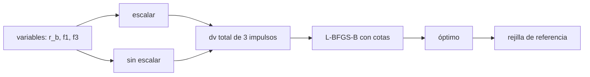

# B81-C09 — Variables de diseño orbital

<!-- nav:top -->
[🏠 Programa](../../../../README.md) · [📚 Bloque B81](../../../tronco-comun/B81-optimizacion-de-trayectorias-y-diseno-robusto.md) · [← Anterior: B81-C08 — Validación de trayectorias de empuje continuo](../B81-C08-validacion-de-trayectorias-de-empuje-continuo/CLASE.md) · [Siguiente: B81-C10 — Funciones objetivo de diseño de trayectorias →](../B81-C10-funciones-objetivo-de-diseno-de-trayectorias/CLASE.md)
<!-- /nav -->

## 1. Ubicación, nivel y alcance

Clase 9 del bloque B81 (área A06). Nivel N3. Antes de optimizar hay que decidir **qué se optimiza**: qué variables, con qué cotas y en qué unidades. Un mismo problema puede resolverse bien o mal según cómo se parametrice. Aquí diseñas una transferencia de tres impulsos con cambio de plano entre órbitas circulares de 1 y 8 UA, y comparas el optimizador con las variables sin escalar (radio en km) y escaladas (radio en UA). Usas [B81-C08](../B81-C08-validacion-de-trayectorias-de-empuje-continuo/CLASE.md) para la idea de validar con una segunda vía. El problema es sintético.

## 2. Por qué esta clase existe

Un optimizador que se detiene a la primera iteración no ha encontrado nada: puede ser un problema de escala y no de física. La decisión central: **¿qué variables elegir y cómo escalarlas para que el optimizador haga su trabajo?**

## 3. Lo que podrás hacer al terminar

1. Elegir variables de diseño: radio del apoastro intermedio y fracciones del cambio de plano en cada impulso.
2. Escribir el `Δv` de un impulso con cambio de plano.
3. Imponer cotas y la restricción `f₁ + f₃ ≤ 1`.
4. Optimizar con L-BFGS-B con y sin escalado.
5. Contrastar con una rejilla gruesa.
6. Explicar por qué las variables sin escalar pueden detener al optimizador.

La evidencia es la **comparación con y sin escalado de las variables de diseño** del ejercicio 12 (sección 20).

## 4. Con qué llegas y cómo comprobarlo

1. ¿Qué es el apoastro?
2. ¿Qué hace un impulso con cambio de plano?
3. ¿Qué es un gradiente?
4. ¿Qué es un escalado de variables?
5. ¿Qué es un dato sintético?

<details>
<summary>Ver respuestas</summary>

1. El punto de una órbita más lejano del cuerpo central. 2. Cambia a la vez la velocidad y el plano; su `Δv` sigue la ley de cosenos. 3. El vector de derivadas parciales de la función objetivo. 4. Un cambio de unidades para que todas sean del mismo orden de magnitud. 5. Un dato generado para el ejemplo, no medido.
</details>

Con cuatro o cinco aciertos, sigue; si no, repasa los prerrequisitos.

## 5. Un caso de contexto y casos de referencia

Entre 1 UA y 8 UA, con 30° de cambio de plano repartidos en tres impulsos, el Hohmann coplanar costaría `15,4946 km/s`. El optimizador escalado encuentra `16,5743 km/s` con `r_b = 8 UA` (una transferencia tipo Hohmann, no bieliptica), `f₁ = 0,06` y `f₃ = 0`: casi todo el cambio de plano en el segundo impulso. Sin escalar, se detiene en `16,6952 km/s` casi donde empezó. Es el **ejemplo conductor**; es **sintético**.

## 6. Vocabulario

Las **variables de diseño** son `r_b` (radio del apoastro intermedio, km o UA) y las fracciones `f₁`, `f₃` del cambio de plano en el primer y tercer impulso (`f₂ = 1 − f₁ − f₃`). El `Δv` de un impulso entre velocidades `v_a` y `v_b` con un giro `θ` es `√(v_a² + v_b² − 2 v_a v_b cos θ)`. El **escalado** divide cada variable por un valor típico. **L-BFGS-B** es un método cuasi-Newton con cotas.

## 7. Modelo mental: afinar un instrumento con perillas de distinto rango



*Descripción textual:* las variables pueden pasar al optimizador tal cual o escaladas; el `Δv` total se minimiza con L-BFGS-B y se compara con una rejilla.

Analogía: una radio con una perilla que gira entre 0 y 1 y otra entre 0 y 10⁹; la segunda apenas se mueve con el mismo gesto. Límite: otros optimizadores (con derivadas analíticas) son menos sensibles al escalado, aunque nunca indiferentes.

## 8. La explicación, paso a paso

### 8.1 El problema

Con `GM = 132 712 440 041,279 km³/s²` y UA del JPL SSD: tres impulsos, el primero en 1 UA, el segundo en el apoastro `r_b` y el tercero en 8 UA, con giros `f₁ θ`, `f₂ θ`, `f₃ θ` y `θ = 30°`.

### 8.2 Referencia

El Hohmann coplanar entre 1 y 8 UA cuesta `15,4946 km/s`; el cambio de plano añade el resto.

### 8.3 Resultados

| Parametrización | `Δv` (km/s) | `r_b` | `f₁`, `f₃` | iteraciones | evaluaciones |
|---|---|---|---|---|---|
| sin escalar (`r_b` en km) | 16,6952 | 12,0 UA | 0,041; 0,039 | 8 | 40 |
| escalada (`r_b` en UA) | 16,5743 | 8,0 UA (cota) | 0,061; 0,000 | 21 | 292 |
| rejilla gruesa 60×21×21 | 16,5761 | 8,0 UA | 0,05; 0,00 | — | — |

El óptimo escalado supera a la rejilla (que es gruesa) y queda en la cota `r_b ≥ r₂`: la solución es una transferencia tipo Hohmann con casi todo el giro en el apoastro.

### 8.4 Por qué se detiene el sin escalar

Una explicación probable, que el laboratorio no verifica por separado: la derivada por diferencias finitas usa un paso absoluto pequeño; para `r_b ≈ 10⁹ km` el cambio de la función es del orden del redondeo y el gradiente se ve casi nulo, de modo que L-BFGS-B declara convergencia casi sin moverse. Escalar `r_b` a UA evita el problema. La diferencia entre las dos parametrizaciones es `0,121 km/s`.

## 9. Magnitudes, símbolos y unidades

| Símbolo | Qué es | Unidad | Valor / nota |
|---|---|---|---|
| `r_b` | apoastro intermedio | km o UA | 8 UA (óptimo, en la cota) |
| `f₁, f₃` | fracciones del giro | — | 0,061; 0 |
| `θ` | cambio de plano total | grados | 30 (ilustrativo) |
| `Δv` | costo total | km/s | 16,5743 |
| `r₁, r₂` | radios inicial y final | UA | 1; 8 (ilustrativos) |

## 10. Convenciones y referencias

`GM` y UA del JPL SSD (DE440). Órbitas circulares coplanares de 1 y 8 UA (ilustrativas), impulsos instantáneos, dos cuerpos. L-BFGS-B de SciPy 1.17.1 con cotas, `ftol` 1e-14, `gtol` 1e-10, derivadas por diferencias finitas del optimizador; penalización cuadrática para `f₁ + f₃ ≤ 1`.

## 11. De dónde sale lo que afirmamos

| ID | Fuente | Localizador | Respalda | Estado |
|---|---|---|---|---|
| S1 | NASA JPL SSD, Astrodynamic Parameters — https://ssd.jpl.nasa.gov/astro_par.html (consultada 2026-11-10) | tabla completa leída | GM del Sol = 1,32712440041279419 × 10²⁰ m³/s² (132712440041,279419 km³/s²); unidad astronómica = 149 597 870,7 km (IAU 2012 B1); GM de la Tierra = 398600,435507 km³/s²; masas planetarias de DE440 (Park et al., 2021) | Consultada |
| — | Relaciones estándar (velocidad circular, vis-viva, ley de cosenos para un impulso con cambio de plano, método L-BFGS-B) | — | las verifica el laboratorio con una segunda vía | No consultada en una fuente concreta |

Límites: el problema es sintético; solo se estudia la influencia del escalado en un optimizador y un problema; la rejilla es gruesa y no prueba optimalidad global; los giros se suponen perfectamente compatibles con las geometrías de los impulsos.

## 12. Cómo ver el efecto del escalado

| Magnitud | Valor |
|---|---|
| Hohmann coplanar | 15,4946 km/s |
| óptimo escalado | 16,5743 km/s |
| sin escalar | 16,6952 km/s |
| diferencia | 0,121 km/s |

Descripción larga: el óptimo con giro cuesta 1,08 km/s más que el Hohmann coplanar y el optimizador sin escalar se queda 0,12 km/s por encima.

## 13. Ejemplo trabajado: un impulso con cambio de plano

**Paso 1 · Velocidades.** `v_a` y `v_b` de las dos órbitas en el punto del impulso.

**Paso 2 · Giro.** `θ = f · 30°`.

**Paso 3 · Ley de cosenos.** `Δv = √(v_a² + v_b² − 2 v_a v_b cos θ)`.

**Paso 4 · Suma.** El total es la suma de los tres impulsos.

## 14. Distintas formas de describir un problema de diseño

**Por variables:** `(r_b, f₁, f₃)`. **Por cotas:** `r_b ≥ r₂`, `0 ≤ f ≤ 1`. **Por escala:** UA frente a km. **Por referencia:** rejilla.

## 15. Práctica guiada

**Ejercicio 1 · con los pasos indicados.** Escribe `f₂` en función de `f₁` y `f₃`. *Pasos:* la suma de fracciones es 1.

<details><summary>Solución comentada</summary>

`f₂ = 1 − f₁ − f₃`.
</details>

**Ejercicio 2 · con una pista.** Con `v_a = v_b = 10 km/s` y `θ = 30°`, ¿cuánto cuesta un impulso puro de giro? *Pista:* `√(2v²(1 − cos θ))`.

<details><summary>Solución comentada</summary>

`2 · 10 · sin 15° = 5,176 km/s`.
</details>

**Ejercicio 3 · casi autónomo.** ¿Por qué conviene hacer el giro en el apoastro?

<details><summary>Solución comentada</summary>

Allí la velocidad es la menor y el costo `2 v sin(θ/2)` es proporcional a `v`.
</details>

## 16. Práctica autónoma, transferencia e integrador

**Ejercicio 4 · autónomo.** Si el óptimo está en la cota `r_b = r₂`, ¿qué transferencia es?

<details><summary>Solución comentada</summary>

Una transferencia de Hohmann con el giro repartido (casi todo en el apoastro).
</details>

**Ejercicio 5 · autónomo.** ¿Qué escala usarías para `f₁`, `f₃` y por qué?

<details><summary>Solución comentada</summary>

Ninguna: ya son del orden 1.
</details>

**Ejercicio 6 · autónomo.** ¿Cómo detectarías que el optimizador no se movió?

<details><summary>Solución comentada</summary>

Comparando el punto final con el inicial y revisando iteraciones y evaluaciones; el gradiente en el punto inicial era casi nulo.
</details>

**Ejercicio 7 · autónomo.** ¿Qué penalización se usa para `f₁ + f₃ ≤ 1` y qué riesgo tiene?

<details><summary>Solución comentada</summary>

Un término cuadrático con peso 10³; si el peso es pequeño se viola la restricción y si es grande empeora el condicionamiento.
</details>

**Ejercicio 8 · autónomo.** ¿Qué otra variable de diseño añadirías en un problema real?

<details><summary>Solución comentada</summary>

Fechas de salida y llegada, o el ángulo de fase.
</details>

**Ejercicio 9 · transferencia.** **Transferencia.** **Transferencia.** Un colega usa km en un problema interplanetario con L-BFGS-B y dice que «convergió». ¿Qué le pides?

<details><summary>Solución comentada</summary>

Que escale las variables y compare el punto final con el inicial y con una segunda vía.
</details>

**Ejercicio 10 · transferencia.** **Transferencia.** **Transferencia.** ¿Qué escalado usarías para un problema de bajo empuje con masa y tiempo como variables?

<details><summary>Solución comentada</summary>

Dividir el tiempo por la duración típica y la masa por la masa inicial.
</details>

**Ejercicio 11 · transferencia.** **Transferencia.** **Transferencia.** ¿Basta la rejilla como prueba de optimalidad global?

<details><summary>Solución comentada</summary>

No; es una referencia gruesa. Vale como contraste, no como prueba.
</details>

**Ejercicio 12 · integrador.** **Integrador.** **Integrador.** Elabora tu *comparación con y sin escalado*: el problema, la tabla de 8.3, la explicación de 8.4 y los límites.

<details><summary>Solución comentada</summary>

Secciones 8.1–8.4 y la salida del laboratorio.
</details>

## 17. Laboratorio: variables de diseño y escalado en una transferencia de tres impulsos

El script [variables.py](variables.py) optimiza el `Δv` con L-BFGS-B con y sin escalado y lo contrasta con una rejilla gruesa (**comprueba** que el óptimo escalado quede a menos de 1e-3 km/s de la rejilla o por debajo).

**Datos:** `GM` y UA del JPL (consultados); radios, giro y puntos iniciales **ilustrativos**. **Predice antes de ejecutar:** ¿cuál parametrización se detendrá casi sin moverse? (la de `r_b` en km.) **Ejecución del 2026-11-10 (Python 3.12.9, NumPy 2.4.4, SciPy 1.17.1):**

```text
Python 3.12.9 | NumPy 2.4.4 | SciPy 1.17.1
Problema SINTETICO: r1 = 1 UA, r2 = 8 UA, cambio de plano 30 grados en tres impulsos ; dv Hohmann coplanar (referencia) = 15.4946 km/s
sin escalar (r_b en km)   : dv = 16.695179 km/s ; r_b =      12.00 UA ; f1 = 0.0411, f3 = 0.0393 ; iter =   8, evaluaciones =   40
escalado (r_b en UA)      : dv = 16.574255 km/s ; r_b =       8.00 UA ; f1 = 0.0605, f3 = 0.0000 ; iter =  21, evaluaciones =  292
Rejilla gruesa (60x21x21): dv minimo = 16.576087 km/s en r_b = 8.0 UA, f1 = 0.05, f3 = 0.00
Diferencia entre las dos parametrizaciones: 0.120924 km/s (positivo = la escalada llega mas abajo)
Pruebas superadas.
```

```bash
python programa/clases/B81/B81-C09-variables-de-diseno-orbital/variables.py
```

**Límites:** un solo optimizador y un solo problema; no se exigió convergencia a la versión sin escalar; la rejilla es gruesa.

## 18. Errores frecuentes y cómo corregirlos

**Declarar convergencia sin comparar con el punto inicial.** Se corrige con 8.4.

**Usar unidades con órdenes de magnitud muy distintos.** Se corrige con la sección 6.

**Tomar la rejilla como prueba global.** Se corrige con el ejercicio 11.

**Presentar el problema sintético como una misión.** Se corrige con la sección 10.

## 19. Cómo sabrás que vas bien

Tras la sección 8: ¿cuál parametrización esperabas peor y cuánto? Si dudas, repasa 8.4. Tras el laboratorio: ¿qué comprueba? (ver la sección 17).

## 20. Qué entregas y cómo se evalúa

El producto es tu **comparación con y sin escalado de las variables de diseño** (ejercicio 12).

| Criterio | Inicial | En desarrollo | Logrado | Destacado |
|---|---|---|---|---|
| Conceptos | Los confunde | Parciales | Define variables y escalado | Explica los límites |
| Cálculo | Sin unidades | Con errores | Tablas completas con unidades | Calcula casos nuevos |
| Numérico | Sin comprobar | Un caso | Contraste con una segunda vía | Interpreta las diferencias |
| Fuentes | Sin fuente | Sin fecha | Fuentes con fecha y estado | Declara lo ilustrativo y lo no consultado |
| Límites | No los nombra | Uno | Tres | Discute qué falta del modelo |

**Condiciones críticas (no se compensan con promedio):** rotular el problema como sintético; no declarar convergencia sin contrastar; citar solo lo consultado.

## 21. Ética, seguridad y límites

Clase educativa: los modelos son simplificados y sus datos son sintéticos o ilustrativos; ningún resultado describe una misión real ni sustituye a las herramientas de diseño y a la validación de una misión. Accesibilidad: tablas equivalentes a las gráficas, fórmulas en texto, ejercicios sin conexión.

## 22. Para cerrar y seguir

Pasar el radio de km a UA convierte un optimizador atascado en uno que encuentra una transferencia que cuesta 0,12 km/s menos. Queda una pregunta: ¿qué se minimiza exactamente, el `Δv`, el tiempo, la masa o un coste combinado?

**Glosario español–inglés.** variable de diseño · *design variable*; escalado · *scaling*; cuasi-Newton · *quasi-Newton*; cota · *bound*; apoastro · *apoapsis*.

**Continuidad.** [B81-C10](../B81-C10-funciones-objetivo-de-diseno-de-trayectorias/CLASE.md) estudia las funciones objetivo.

**Referencias:** ver sección 11.

<!-- nav:bottom -->
---

[← Anterior: B81-C08 — Validación de trayectorias de empuje continuo](../B81-C08-validacion-de-trayectorias-de-empuje-continuo/CLASE.md) · [📚 Bloque B81](../../../tronco-comun/B81-optimizacion-de-trayectorias-y-diseno-robusto.md) · [Siguiente: B81-C10 — Funciones objetivo de diseño de trayectorias →](../B81-C10-funciones-objetivo-de-diseno-de-trayectorias/CLASE.md)
<!-- /nav -->
