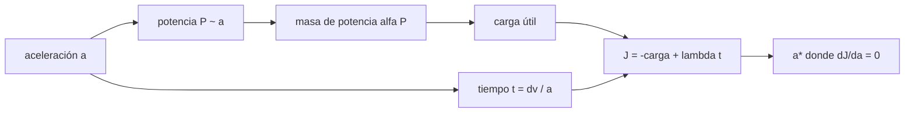

# B81-C10 — Funciones objetivo de diseño de trayectorias

<!-- nav:top -->
[🏠 Programa](../../../../README.md) · [📚 Bloque B81](../../../tronco-comun/B81-optimizacion-de-trayectorias-y-diseno-robusto.md) · [← Anterior: B81-C09 — Variables de diseño orbital](../B81-C09-variables-de-diseno-orbital/CLASE.md) · [Siguiente: B81-C11 — Optimización multicriterio y frentes de Pareto →](../B81-C11-optimizacion-multicriterio-y-frentes-de-pareto/CLASE.md)
<!-- /nav -->

## 1. Ubicación, nivel y alcance

Clase 10 del bloque B81 (área A06). Nivel N3. Una función objetivo traduce lo que quiere la misión en un número; cambiar el objetivo cambia el diseño óptimo. Aquí diseñas la aceleración de una espiral de bajo empuje con un objetivo que combina la carga útil y el tiempo, lo resuelves de forma analítica y numérica y ves cómo se mueve el óptimo con el peso del tiempo. Usas [B81-C09](../B81-C09-variables-de-diseno-orbital/CLASE.md) para la idea de variable de diseño. Todo es sintético; no se usaron fuentes externas salvo `g₀` convencional.

## 2. Por qué esta clase existe

Optimizar mal es optimizar el objetivo equivocado: mínimo `Δv` no es mínimo costo ni mínimo tiempo. La decisión central: **¿qué objetivo refleja lo que la misión valora y cómo cambia el diseño al cambiar sus pesos?**

## 3. Lo que podrás hacer al terminar

1. Escribir la carga útil como masa final menos masa del sistema de potencia.
2. Formar un objetivo compuesto `J = −carga útil + λ·t`.
3. Hallar el óptimo analítico `a*`.
4. Verificarlo con búsqueda por sección áurea.
5. Ver cómo se mueve el óptimo con `λ`.
6. Reconocer que todos los coeficientes son sintéticos.

La evidencia es la **tabla de óptimos por objetivo** del ejercicio 12 (sección 20).

## 4. Con qué llegas y cómo comprobarlo

1. ¿Qué es una función objetivo?
2. ¿Qué es la masa específica de un sistema de potencia?
3. ¿Qué dice la ecuación del cohete?
4. ¿Qué condición cumple un mínimo interior?
5. ¿Qué es un dato sintético?

<details>
<summary>Ver respuestas</summary>

1. La cantidad que se minimiza o maximiza en un problema de optimización. 2. Los kg de equipo por kW de potencia. 3. `m_f = m₀ e^{−Δv/v_e}`. 4. La derivada primera se anula y la segunda es positiva. 5. Un dato generado para el ejemplo, no medido.
</details>

Con cuatro o cinco aciertos, sigue; si no, repasa los prerrequisitos.

## 5. Un caso de contexto y casos de referencia

Una nave de 1000 kg debe aportar `Δv = 4000 m/s` con propulsión eléctrica de `Isp = 3000 s`. Si el objetivo es `J = −carga útil + 0,5 kg/día × tiempo`, el óptimo es una aceleración de `1,943 × 10⁻⁴ m/s²`: 238,2 d, 4,76 kW y 753,8 kg de carga útil. Es el **ejemplo conductor**; los coeficientes son **sintéticos**.

## 6. Vocabulario

La **carga útil** es `m₀ e^{−Δv/v_e} − α P`, con `P = m₀ a v_e/(2η)` la potencia y `α` la masa específica. El **tiempo** es `t = Δv/a`. El **objetivo compuesto** `J(a) = −carga útil + λ t` convierte tiempo en kilos equivalentes con el peso `λ`. El **óptimo** `a*` anula `dJ/da`.

## 7. Modelo mental: comprar tiempo con kilos



*Descripción textual:* la aceleración fija la potencia (y con ella la masa del sistema) y el tiempo; ambos entran en un objetivo compuesto cuyo mínimo es el diseño óptimo.

Analogía: elegir un motor de bote; uno más potente llega antes pero pesa más y deja menos espacio para carga. Límite: aquí el tiempo se aproxima como `Δv/a` con aceleración constante y la masa de propelente no altera la aceleración.

## 8. La explicación, paso a paso

### 8.1 Carga útil y tiempo

Con `m₀ = 1000 kg`, `Δv = 4000 m/s`, `Isp = 3000 s` (`v_e = 29 419,95 m/s`), `η = 0,6` y `α = 25 kg/kW`: la fracción de propelente es `0,1271` y la masa final sin sistema de potencia `872,88 kg`. La carga útil es `872,88 − 0,025 P[W]`.

### 8.2 Barrido

| `a` (m/s²) | `t` (d) | `P` (kW) | carga útil (kg) | `J` (kg) |
|---|---|---|---|---|
| 1 × 10⁻⁴ | 463,0 | 2,45 | 811,58 | −580,10 |
| 3 × 10⁻⁴ | 154,3 | 7,35 | 689,00 | −611,84 |
| 1 × 10⁻³ | 46,3 | 24,52 | 259,96 | −236,81 |
| 3 × 10⁻³ | 15,4 | 73,55 | −965,87 | 973,59 |

Con aceleraciones altas la carga útil se vuelve negativa: el sistema de potencia no cabe.

### 8.3 Óptimo

`J(a) = const + α m₀ v_e a/(2η) + λ' Δv/a` (con `λ' = λ/86 400`) tiene mínimo en `a* = √(2η λ' Δv/(α m₀ v_e)) = 1,943380 × 10⁻⁴ m/s²`. La sección áurea da el mismo valor con diferencia relativa `7,5 × 10⁻¹¹`. Resultado: `t = 238,2 d`, `P = 4,76 kW`, carga útil `753,76 kg`.

### 8.4 Otros objetivos y pesos

| `λ` (kg/día) | `a*` (m/s²) | `t*` (d) | carga útil (kg) |
|---|---|---|---|
| 0,1 | 8,69 × 10⁻⁵ | 532,7 | 819,61 |
| 0,5 | 1,94 × 10⁻⁴ | 238,2 | 753,76 |
| 2,0 | 3,89 × 10⁻⁴ | 119,1 | 634,65 |

Si el único criterio fuera el tiempo con tope de potencia de 5 kW, `a = 2,04 × 10⁻⁴`, `t = 227,0 d` y 747,88 kg. Maximizar la carga útil sola llevaría `a → 0` y `t → ∞`: el objetivo fija el diseño.

## 9. Magnitudes, símbolos y unidades

| Símbolo | Qué es | Unidad | Valor / nota |
|---|---|---|---|
| `a` | aceleración (variable de diseño) | m/s² | 10⁻⁴ a 10⁻² |
| `α` | masa específica de potencia | kg/kW | 25 (sintética) |
| `λ` | peso del tiempo | kg/día | 0,5 (sintético) |
| `η` | eficiencia del propulsor | — | 0,6 (sintética) |
| `a*` | óptimo | m/s² | 1,943 × 10⁻⁴ |

## 10. Convenciones y referencias

`g₀ = 9,80665 m/s²` (valor convencional; no consultado en esta sesión). Todos los demás coeficientes son sintéticos. Aceleración constante, masa de propelente despreciada en el tiempo, potencia dimensionada con la masa inicial. Sin sistema de referencia: es un problema de diseño de sistema.

## 11. De dónde sale lo que afirmamos

| ID | Fuente | Localizador | Respalda | Estado |
|---|---|---|---|---|
| — | Relaciones estándar (ecuación del cohete, relación potencia–empuje, condición de óptimo `dJ/da = 0`, búsqueda por sección áurea) | — | las verifica el laboratorio con una segunda vía | No consultada en una fuente concreta |

Límites: no se consultó ninguna fuente para esta clase; los coeficientes (`α`, `λ`, `η`) son inventados; el modelo del tiempo y de la masa es muy simplificado.

## 12. Cómo ver el óptimo

| Magnitud | Valor |
|---|---|
| `a*` | 1,943 × 10⁻⁴ m/s² |
| `t*` | 238,2 d |
| carga útil | 753,76 kg |
| analítico frente a numérico | 7,5 × 10⁻¹¹ |

Descripción larga: el objetivo compuesto tiene un mínimo interior en la aceleración, que se desplaza hacia valores mayores cuando el tiempo pesa más.

## 13. Ejemplo trabajado: el óptimo para λ = 2 kg/día

**Paso 1 · Peso.** `λ' = 2/86 400 = 2,315 × 10⁻⁵ kg/s`.

**Paso 2 · Fórmula.** `a* = √(2·0,6·2,315×10⁻⁵ ·4000/(0,025 ·1000 ·29 419,95))`.

**Paso 3 · Resultado.** `a* = 3,887 × 10⁻⁴ m/s²`.

**Paso 4 · Tiempo.** `t* = 4000/3,887×10⁻⁴ = 1,029 × 10⁷ s = 119,1 d`.

## 14. Distintas formas de describir un objetivo de diseño

**Por carga útil:** `m₀ e^{−Δv/v_e} − αP`. **Por tiempo:** `Δv/a`. **Por compuesto:** `−carga + λt`. **Por peso:** `a* ∝ √λ`.

## 15. Práctica guiada

**Ejercicio 1 · con los pasos indicados.** Calcula la fracción de propelente con `Δv = 4000` y `v_e = 29 419,95`. *Pasos:* `1 − e^{−Δv/v_e}`.

<details><summary>Solución comentada</summary>

`1 − e^{−0,13596} = 0,1271`.
</details>

**Ejercicio 2 · con una pista.** Calcula la potencia que corresponde a `a = 10⁻³ m/s²`. *Pista:* `P = m₀ a v_e/(2η)`.

<details><summary>Solución comentada</summary>

`1000 · 10⁻³ · 29 419,95/1,2 = 24,52 kW`.
</details>

**Ejercicio 3 · casi autónomo.** ¿Por qué `a* ∝ √λ`?

<details><summary>Solución comentada</summary>

Del mínimo de `A a + B/a`: `a* = √(B/A)`, y `B ∝ λ`.
</details>

## 16. Práctica autónoma, transferencia e integrador

**Ejercicio 4 · autónomo.** Calcula el tiempo de `a = 3 × 10⁻⁴` para `Δv = 4000`.

<details><summary>Solución comentada</summary>

`4000/3×10⁻⁴ = 1,333 × 10⁷ s = 154,3 d`.
</details>

**Ejercicio 5 · autónomo.** ¿A partir de qué aceleración la carga útil es cero?

<details><summary>Solución comentada</summary>

`a = 1,424 × 10⁻³ m/s²` (laboratorio).
</details>

**Ejercicio 6 · autónomo.** ¿Qué pasa con el óptimo si `α` se reduce a la mitad?

<details><summary>Solución comentada</summary>

`a*` crece por `√2`.
</details>

**Ejercicio 7 · autónomo.** Con `λ = 0,1 kg/día`, ¿cuánto tarda y qué carga útil se obtiene?

<details><summary>Solución comentada</summary>

`532,7 d` y `819,61 kg`.
</details>

**Ejercicio 8 · autónomo.** ¿Por qué «maximizar la carga útil» sin más no es un buen objetivo?

<details><summary>Solución comentada</summary>

Lleva a `a → 0`, es decir, un tiempo infinito.
</details>

**Ejercicio 9 · transferencia.** **Transferencia.** **Transferencia.** Una agencia valora más la fecha de llegada que la masa de carga. ¿Qué cambia?

<details><summary>Solución comentada</summary>

Se aumenta `λ`; el óptimo se mueve a mayor aceleración y menor carga útil.
</details>

**Ejercicio 10 · transferencia.** **Transferencia.** **Transferencia.** ¿Qué pasa si el objetivo incluye el costo por kilo lanzado?

<details><summary>Solución comentada</summary>

La masa inicial pasa a ser variable de diseño y el problema crece en dimensión.
</details>

**Ejercicio 11 · transferencia.** **Transferencia.** **Transferencia.** Un colega afirma que `a*` es el diseño óptimo de la misión. ¿Qué responde esta clase?

<details><summary>Solución comentada</summary>

Es el óptimo de un modelo con coeficientes sintéticos; solo es útil como método, no como diseño.
</details>

**Ejercicio 12 · integrador.** **Integrador.** **Integrador.** Elabora tu *tabla de óptimos por objetivo*: barrido de `a`, óptimo analítico y numérico, tabla de pesos `λ`, y qué coeficientes son sintéticos.

<details><summary>Solución comentada</summary>

Secciones 8.1–8.4 y la salida del laboratorio.
</details>

## 17. Laboratorio: objetivo compuesto de carga útil y tiempo

El script [objetivos.py](objetivos.py) calcula carga útil, tiempo y objetivo en un barrido, el óptimo analítico y por sección áurea y los óptimos para varios pesos (**comprueba** que `a*` numérico coincida con el analítico a 1e-6).

**Datos:** `g₀` convencional; todos los demás coeficientes **sintéticos**. **Predice antes de ejecutar:** ¿el óptimo se moverá a mayor o menor aceleración al subir `λ`? (mayor.) **Ejecución del 2026-11-10 (Python 3.12.9):**

```text
Python 3.12.9 (biblioteca estandar)
Datos SINTETICOS: m0 = 1000 kg, dv = 4000 m/s, Isp = 3000 s, eta = 0.6, alfa = 25 kg/kW, lambda = 0.5 kg/dia
Fraccion de propelente = 0.1271 ; masa final sin sistema de potencia = 872.88 kg
  a [m/s^2]    t [d]    P [kW]   carga util [kg]   J [kg]
    1.0e-04     463.0     2.45          811.58    -580.10
    3.0e-04     154.3     7.35          689.00    -611.84
    1.0e-03      46.3    24.52          259.96    -236.81
    3.0e-03      15.4    73.55         -965.87     973.59
    1.0e-02       4.6   245.17        -5256.28    5258.60
Optimo del objetivo compuesto: a* analitico = 1.943380e-04 m/s^2 ; numerico = 1.943380e-04 ; diferencia relativa = 7.5e-11
  -> t = 238.2 d ; carga util = 753.76 kg ; P = 4.76 kW
Tiempo minimo con P <= 5000 W: a = 2.039e-04 m/s^2, t = 227.0 d, carga util = 747.88 kg
Carga util nula en a = 1.424e-03 m/s^2 ; maxima carga util cuando a -> 0 (872.88 kg), pero t -> infinito
  lambda = 0.1 kg/dia -> a* = 8.691e-05 m/s^2, t* =   532.7 d, carga util =  819.61 kg
  lambda = 0.5 kg/dia -> a* = 1.943e-04 m/s^2, t* =   238.2 d, carga util =  753.76 kg
  lambda = 2.0 kg/dia -> a* = 3.887e-04 m/s^2, t* =   119.1 d, carga util =  634.65 kg
Pruebas superadas.
```

```bash
python programa/clases/B81/B81-C10-funciones-objetivo-de-diseno-de-trayectorias/objetivos.py
```

**Límites:** modelo simplificado; no hay datos reales; el tiempo ignora la variación de masa.

## 18. Errores frecuentes y cómo corregirlos

**Optimizar solo `Δv` y creer que es lo mejor.** Se corrige con 8.4.

**Olvidar la masa del sistema de potencia.** Se corrige con 8.1.

**Usar pesos sin justificar.** Se corrige con el ejercicio 11.

**Presentar los coeficientes sintéticos como datos de una nave.** Se corrige con la sección 10.

## 19. Cómo sabrás que vas bien

Tras la sección 8: ¿hacia dónde se movía el óptimo con `λ` y cuánto? Si dudas, repasa 8.4. Tras el laboratorio: ¿qué comprueba? (ver la sección 17).

## 20. Qué entregas y cómo se evalúa

El producto es tu **tabla de óptimos por objetivo** (ejercicio 12).

| Criterio | Inicial | En desarrollo | Logrado | Destacado |
|---|---|---|---|---|
| Conceptos | Los confunde | Parciales | Formula y resuelve el objetivo | Explica los límites |
| Cálculo | Sin unidades | Con errores | Tablas completas con unidades | Calcula casos nuevos |
| Numérico | Sin comprobar | Un caso | Contraste con una segunda vía | Interpreta las diferencias |
| Fuentes | Sin fuente | Sin fecha | Fuentes con fecha y estado | Declara lo ilustrativo y lo no consultado |
| Límites | No los nombra | Uno | Tres | Discute qué falta del modelo |

**Condiciones críticas (no se compensan con promedio):** rotular todos los coeficientes como sintéticos; no presentar el óptimo como diseño real; citar solo lo consultado.

## 21. Ética, seguridad y límites

Clase educativa: los modelos son simplificados y sus datos son sintéticos o ilustrativos; ningún resultado describe una misión real ni sustituye a las herramientas de diseño y a la validación de una misión. Accesibilidad: tablas equivalentes a las gráficas, fórmulas en texto, ejercicios sin conexión.

## 22. Para cerrar y seguir

Con un peso de 0,5 kg por día de misión, el óptimo es 238 d y 754 kg de carga útil; con 2 kg por día baja a 119 d y 635 kg. Queda una pregunta: ¿qué hacer cuando hay dos objetivos que no se pueden pesar de antemano?

**Glosario español–inglés.** función objetivo · *objective function*; carga útil · *payload*; masa específica · *specific mass*; compromiso · *trade-off*; peso · *weight*.

**Continuidad.** [B81-C11](../B81-C11-optimizacion-multicriterio-y-frentes-de-pareto/CLASE.md) estudia el frente de Pareto.

**Referencias:** ver sección 11.

<!-- nav:bottom -->
---

[← Anterior: B81-C09 — Variables de diseño orbital](../B81-C09-variables-de-diseno-orbital/CLASE.md) · [📚 Bloque B81](../../../tronco-comun/B81-optimizacion-de-trayectorias-y-diseno-robusto.md) · [Siguiente: B81-C11 — Optimización multicriterio y frentes de Pareto →](../B81-C11-optimizacion-multicriterio-y-frentes-de-pareto/CLASE.md)
<!-- /nav -->
