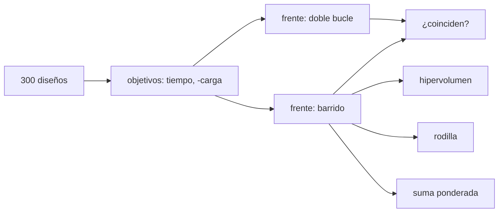

# B81-C11 — Optimización multicriterio y frentes de Pareto

<!-- nav:top -->
[🏠 Programa](../../../../README.md) · [📚 Bloque B81](../../../tronco-comun/B81-optimizacion-de-trayectorias-y-diseno-robusto.md) · [← Anterior: B81-C10 — Funciones objetivo de diseño de trayectorias](../B81-C10-funciones-objetivo-de-diseno-de-trayectorias/CLASE.md) · [Siguiente: B81-C12 — Restricciones dinámicas en optimización →](../B81-C12-restricciones-dinamicas-en-optimizacion/CLASE.md)
<!-- /nav -->

## 1. Ubicación, nivel y alcance

Clase 11 del bloque B81 (área A06). Nivel N3. Cuando dos objetivos chocan —llegar antes y llevar más carga— no existe un único óptimo, sino un **frente de Pareto** de diseños que no se pueden mejorar en uno sin empeorar el otro. Aquí generas 300 diseños sintéticos de una espiral de bajo empuje, extraes el frente por dos métodos, calculas su hipervolumen y eliges un punto de compromiso. Usas [B81-C10](../B81-C10-funciones-objetivo-de-diseno-de-trayectorias/CLASE.md) para el modelo de carga útil y tiempo. Todo es sintético.

## 2. Por qué esta clase existe

Un peso único esconde la decisión; un frente la muestra completa. La decisión central: **¿cuáles diseños son eficientes y cuál se elige si no se conocen de antemano los pesos?**

## 3. Lo que podrás hacer al terminar

1. Definir la dominancia entre dos diseños.
2. Extraer el frente con un doble bucle y con un barrido ordenado.
3. Calcular el hipervolumen exacto y por Monte Carlo.
4. Hallar el punto de rodilla.
5. Ver qué diseño elige una suma ponderada según el peso.
6. Reconocer que la muestra es sintética.

La evidencia es la **frente de Pareto y punto de compromiso** del ejercicio 12 (sección 20).

## 4. Con qué llegas y cómo comprobarlo

1. ¿Qué es un objetivo a minimizar?
2. ¿Qué significa que A domina a B?
3. ¿Qué es una distribución log-uniforme?
4. ¿Qué es un Monte Carlo?
5. ¿Qué es un dato sintético?

<details>
<summary>Ver respuestas</summary>

1. Una cantidad cuyo valor menor es mejor. 2. A es al menos tan bueno como B en todos los objetivos y mejor en uno. 3. Una en que el logaritmo de la variable es uniforme. 4. Estimar una integral con muestras aleatorias. 5. Un dato generado para el ejemplo, no medido.
</details>

Con cuatro o cinco aciertos, sigue; si no, repasa los prerrequisitos.

## 5. Un caso de contexto y casos de referencia

Con 300 diseños de aceleración, `Isp` y masa específica sorteados con semilla fija, el frente de Pareto (tiempo, carga útil) tiene 33 puntos: desde `16,1 d` con `174,7 kg` hasta `424,4 d` con `841,2 kg`. El punto de rodilla es `97,9 d` con `696,5 kg`. Es el **ejemplo conductor**; es **sintético**.

## 6. Vocabulario

Un diseño **domina** a otro si su tiempo es menor o igual y su carga útil es mayor o igual, con una desigualdad estricta. El **frente de Pareto** es el conjunto de diseños no dominados. El **hipervolumen** es el área dominada por el frente respecto de un punto de referencia. La **rodilla** es el punto del frente más alejado, hacia el óptimo, de la recta que une los extremos (objetivos normalizados).

## 7. Modelo mental: un mercado con dos precios



*Descripción textual:* la muestra de diseños se evalúa en dos objetivos; el frente se obtiene con dos algoritmos que deben coincidir, y de él salen el hipervolumen, la rodilla y las elecciones por pesos.

Analogía: comparar coches por precio y consumo: los que no tienen otro más barato y más económico forman el frente. Límite: el frente depende de la muestra; con otros 300 diseños puede cambiar.

## 8. La explicación, paso a paso

### 8.1 Muestra

Con el modelo de B81-C10 (`m₀ = 1000 kg`, `Δv = 4000 m/s`, `η = 0,6`): `a` log-uniforme en [10⁻⁴, 5 × 10⁻³], `Isp` en {1500, 2500, 3500} s y `α` en [15, 40] kg/kW. Se descartan los diseños con carga útil negativa. Semilla `20260810`.

### 8.2 Frente por dos métodos

El doble bucle (cada punto contra todos) y el barrido (ordenar por tiempo y conservar los que mejoran la carga) dan el mismo frente de 33 puntos: `True`.

### 8.3 Hipervolumen

Con referencia `(2000 d, 0 kg)`: exacto `1 625 931,4 d·kg`; Monte Carlo con 400 000 muestras `1 625 886,9`; diferencia relativa `2,7 × 10⁻⁵`. El hipervolumen compara frentes: uno que domine a otro tiene mayor hipervolumen.

### 8.4 Rodilla y pesos

| Peso del tiempo `w` | tiempo (d) | carga (kg) |
|---|---|---|
| 0,1 | 336,0 | 830,5 |
| 0,3 | 182,2 | 772,2 |
| 0,5 | 97,9 | 696,5 |
| 0,7 | 49,4 | 580,2 |
| 0,9 | 27,2 | 414,1 |

Con `w = 0,5` la suma ponderada coincide con la rodilla. Un cambio pequeño de `w` mueve mucho el diseño: por eso conviene ver el frente completo.

## 9. Magnitudes, símbolos y unidades

| Símbolo | Qué es | Unidad | Valor / nota |
|---|---|---|---|
| `t` | tiempo de vuelo | d | 16,1 a 424,4 (frente) |
| `c` | carga útil | kg | 174,7 a 841,2 (frente) |
| `HV` | hipervolumen | d·kg | 1 625 931,4 |
| `w` | peso del tiempo | — | 0,1 a 0,9 |
| `n` | tamaño de la muestra | — | 300 |

## 10. Convenciones y referencias

Todos los diseños son sintéticos (semilla 20260810 para la muestra y 7 para el Monte Carlo); `g₀ = 9,80665 m/s²` convencional, no consultado. Objetivos normalizados con los extremos del frente. Referencia del hipervolumen: 2000 d y 0 kg.

## 11. De dónde sale lo que afirmamos

| ID | Fuente | Localizador | Respalda | Estado |
|---|---|---|---|---|
| — | Relaciones estándar (dominancia de Pareto, hipervolumen en dos dimensiones, punto de compromiso (rodilla)) | — | las verifica el laboratorio con una segunda vía | No consultada en una fuente concreta |

Límites: no se consultó ninguna fuente; el modelo es el simplificado de B81-C10; el frente depende de la muestra; la normalización con los extremos del frente cambia la rodilla si cambian los extremos.

## 12. Cómo ver el frente

| Magnitud | Valor |
|---|---|
| puntos del frente | 33 de 300 |
| extremo rápido | 16,1 d, 174,7 kg |
| extremo de carga | 424,4 d, 841,2 kg |
| rodilla | 97,9 d, 696,5 kg |

Descripción larga: la carga útil crece rápido al principio y se aplana: con ambos objetivos a minimizar el frente es convexo y la rodilla queda cerca de los 100 d.

## 13. Ejemplo trabajado: comprobar una dominancia

**Paso 1 · Dos diseños.** A: 100 d, 690 kg. B: 120 d, 650 kg.

**Paso 2 · Comparación.** A tarda menos y lleva más carga.

**Paso 3 · Conclusión.** A domina a B: B no está en el frente.

**Paso 4 · Contraste.** Un C de 90 d y 600 kg no es dominado por A (más rápido) ni lo domina (menos carga).

## 14. Distintas formas de describir un conjunto de diseños

**Por dominancia:** quién gana a quién. **Por frente:** los no dominados. **Por área:** hipervolumen. **Por compromiso:** rodilla. **Por pesos:** la suma ponderada.

## 15. Práctica guiada

**Ejercicio 1 · con los pasos indicados.** ¿Domina A (100 d, 690 kg) a B (120 d, 650 kg)? *Pasos:* compara los dos objetivos.

<details><summary>Solución comentada</summary>

Sí: menor tiempo y mayor carga.
</details>

**Ejercicio 2 · con una pista.** ¿Y C (90 d, 600 kg) a A? *Pista:* compara.

<details><summary>Solución comentada</summary>

No: C es más rápido pero lleva menos; ninguno domina.
</details>

**Ejercicio 3 · casi autónomo.** ¿Cuántos diseños de la muestra forman el frente y qué fracción es?

<details><summary>Solución comentada</summary>

33 de 300: 11 %.
</details>

## 16. Práctica autónoma, transferencia e integrador

**Ejercicio 4 · autónomo.** ¿Por qué dos algoritmos distintos deben dar el mismo frente?

<details><summary>Solución comentada</summary>

Porque ambos aplican la misma definición; si difieren, hay un error en uno.
</details>

**Ejercicio 5 · autónomo.** ¿Qué mide el hipervolumen si el frente mejora?

<details><summary>Solución comentada</summary>

Crece: se domina más área respecto de la referencia.
</details>

**Ejercicio 6 · autónomo.** Un Monte Carlo de 400 000 puntos dio una diferencia de 2,7 × 10⁻⁵. ¿Qué orden de error esperarías con 100 veces menos?

<details><summary>Solución comentada</summary>

Unas 10 veces más: el error de Monte Carlo cae como `1/√N`.
</details>

**Ejercicio 7 · autónomo.** ¿Qué diseño elige `w = 0,9` y qué significa?

<details><summary>Solución comentada</summary>

27,2 d y 414,1 kg: se prioriza el tiempo.
</details>

**Ejercicio 8 · autónomo.** ¿Qué limitación tiene la suma ponderada en un frente no convexo?

<details><summary>Solución comentada</summary>

Una suma ponderada solo alcanza puntos convexos del frente; en frentes no convexos hay diseños que ningún peso elige.
</details>

**Ejercicio 9 · transferencia.** **Transferencia.** **Transferencia.** Una agencia fija un plazo máximo de 150 d. ¿Cómo lo usas en el frente?

<details><summary>Solución comentada</summary>

Se descartan los puntos de más de 150 d y se escoge el de mayor carga entre los restantes; de los puntos de la tabla 8.4, el de 97,9 d (696,5 kg) cumple y el de 182,2 d no, pero el mejor exacto está entre ambos y exige mirar el frente completo.
</details>

**Ejercicio 10 · transferencia.** **Transferencia.** **Transferencia.** Se añade un tercer objetivo (riesgo). ¿Qué cambia?

<details><summary>Solución comentada</summary>

El frente es una superficie; el hipervolumen es 3D y la rodilla se define con otra medida.
</details>

**Ejercicio 11 · transferencia.** **Transferencia.** **Transferencia.** ¿Por qué no basta un solo peso?

<details><summary>Solución comentada</summary>

Un peso esconde el compromiso y su elección es subjetiva; el frente deja la decisión explícita.
</details>

**Ejercicio 12 · integrador.** **Integrador.** **Integrador.** Elabora tu *frente de Pareto y punto de compromiso*: muestra, frente por dos métodos, hipervolumen, rodilla y tabla de pesos, rotulando lo sintético.

<details><summary>Solución comentada</summary>

Secciones 8.1–8.4 y la salida del laboratorio.
</details>

## 17. Laboratorio: frente de Pareto entre tiempo y carga útil

El script [pareto.py](pareto.py) genera 300 diseños, extrae el frente por dos métodos, calcula el hipervolumen exacto y por Monte Carlo, la rodilla y las elecciones por pesos (**comprueba** que los frentes coincidan y que el hipervolumen MC quede a menos de 2 %).

**Datos:** todo **sintético**; `g₀` convencional. **Predice antes de ejecutar:** ¿cuántos diseños de 300 formarán el frente? (unas decenas, 33.) **Ejecución del 2026-11-10 (Python 3.12.9):**

```text
Python 3.12.9 (biblioteca estandar)
Muestra SINTETICA: 300 disenos (semilla 20260810) ; frente doble bucle = 33 puntos ; frente por barrido = 33 puntos ; coinciden: True
Hipervolumen exacto = 1625931.4 d kg ; Monte Carlo (400000 muestras) = 1625886.9 ; diferencia relativa = 2.74e-05
Extremo rapido: t = 16.1 d, carga = 174.7 kg ; extremo de carga: t = 424.4 d, carga = 841.2 kg
Punto de rodilla: t = 97.9 d, carga = 696.5 kg (a = 4.73e-04 m/s^2, Isp = 2500 s, alfa = 15.8 kg/kW)
Suma ponderada J = w t_norm + (1-w) (perdida de carga util normalizada): diseno elegido segun el peso w
  w = 0.1: t =   336.0 d, carga =   830.5 kg
  w = 0.3: t =   182.2 d, carga =   772.2 kg
  w = 0.5: t =    97.9 d, carga =   696.5 kg
  w = 0.7: t =    49.4 d, carga =   580.2 kg
  w = 0.9: t =    27.2 d, carga =   414.1 kg
Pruebas superadas.
```

```bash
python programa/clases/B81/B81-C11-optimizacion-multicriterio-y-frentes-de-pareto/pareto.py
```

**Límites:** un modelo simple; muestra aleatoria de una sola semilla; la rodilla depende de la normalización.

## 18. Errores frecuentes y cómo corregirlos

**Confundir frente con óptimo único.** Se corrige con 8.4.

**Elegir pesos sin ver el frente.** Se corrige con el ejercicio 11.

**Creer que una suma ponderada alcanza todo el frente.** Se corrige con el ejercicio 8.

**Presentar la muestra sintética como diseños reales.** Se corrige con la sección 10.

## 19. Cómo sabrás que vas bien

Tras la sección 8: ¿cuántos puntos esperabas en el frente y cuántos hubo? Si dudas, repasa 8.2. Tras el laboratorio: ¿qué comprueba? (ver la sección 17).

## 20. Qué entregas y cómo se evalúa

El producto es tu **frente de Pareto y punto de compromiso** (ejercicio 12).

| Criterio | Inicial | En desarrollo | Logrado | Destacado |
|---|---|---|---|---|
| Conceptos | Los confunde | Parciales | Construye el frente y la rodilla | Explica los límites |
| Cálculo | Sin unidades | Con errores | Tablas completas con unidades | Calcula casos nuevos |
| Numérico | Sin comprobar | Un caso | Contraste con una segunda vía | Interpreta las diferencias |
| Fuentes | Sin fuente | Sin fecha | Fuentes con fecha y estado | Declara lo ilustrativo y lo no consultado |
| Límites | No los nombra | Uno | Tres | Discute qué falta del modelo |

**Condiciones críticas (no se compensan con promedio):** rotular la muestra como sintética; no presentar la rodilla como el diseño óptimo único; citar solo lo consultado.

## 21. Ética, seguridad y límites

Clase educativa: los modelos son simplificados y sus datos son sintéticos o ilustrativos; ningún resultado describe una misión real ni sustituye a las herramientas de diseño y a la validación de una misión. Accesibilidad: tablas equivalentes a las gráficas, fórmulas en texto, ejercicios sin conexión.

## 22. Para cerrar y seguir

De 300 diseños, 33 son eficientes; una rodilla en 98 d y 697 kg resume el compromiso, y un cambio de peso de 0,5 a 0,7 mueve el diseño de 98 a 49 d. Queda una pregunta: ¿cómo se imponen límites a la trayectoria, como un empuje máximo?

**Glosario español–inglés.** frente de Pareto · *Pareto front*; dominancia · *dominance*; hipervolumen · *hypervolume*; punto de rodilla · *knee point*; suma ponderada · *weighted sum*.

**Continuidad.** [B81-C12](../B81-C12-restricciones-dinamicas-en-optimizacion/CLASE.md) estudia las restricciones dinámicas.

**Referencias:** ver sección 11.

<!-- nav:bottom -->
---

[← Anterior: B81-C10 — Funciones objetivo de diseño de trayectorias](../B81-C10-funciones-objetivo-de-diseno-de-trayectorias/CLASE.md) · [📚 Bloque B81](../../../tronco-comun/B81-optimizacion-de-trayectorias-y-diseno-robusto.md) · [Siguiente: B81-C12 — Restricciones dinámicas en optimización →](../B81-C12-restricciones-dinamicas-en-optimizacion/CLASE.md)
<!-- /nav -->
