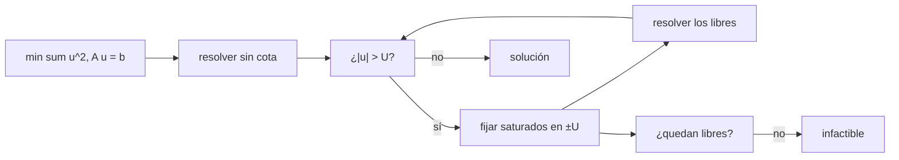

# B81-C12 — Restricciones dinámicas en optimización

<!-- nav:top -->
[🏠 Programa](../../../../README.md) · [📚 Bloque B81](../../../tronco-comun/B81-optimizacion-de-trayectorias-y-diseno-robusto.md) · [← Anterior: B81-C11 — Optimización multicriterio y frentes de Pareto](../B81-C11-optimizacion-multicriterio-y-frentes-de-pareto/CLASE.md) · [Siguiente: B81-C13 — Optimización heurística (algoritmos genéticos y enjambres) →](../B81-C13-optimizacion-heuristica-algoritmos-geneticos-y-enjambres/CLASE.md)
<!-- /nav -->

## 1. Ubicación, nivel y alcance

Clase 12 del bloque B81 (área A06). Nivel N3. Los motores tienen un empuje máximo, las naves una distancia mínima a un cuerpo, los paneles una orientación admisible: las **restricciones de trayectoria** acotan el control o el estado en todo instante. Aquí añades una cota `|u| ≤ U` al problema de mínimo esfuerzo de [B81-C03](../B81-C03-metodos-directos-de-transcripcion/CLASE.md), lo resuelves por conjunto activo y ves cómo crece el coste hasta que el problema se vuelve inviable. Es adimensional y sintético; no se usaron fuentes externas.

## 2. Por qué esta clase existe

Ignorar una cota produce un control irrealizable; imponerla mal produce un problema sin solución. La decisión central: **¿cuánto cuesta una cota de control y cuál es el mínimo valor para el que el problema aún tiene solución?**

## 3. Lo que podrás hacer al terminar

1. Plantear el mínimo esfuerzo con cota de control como un QP con cotas.
2. Resolverlo por conjunto activo.
3. Identificar los tramos saturados y la forma de la solución.
4. Hallar la cota mínima factible con el tiempo mínimo bang-bang.
5. Contrastar con SLSQP.
6. Reconocer el problema como sintético y adimensional.

La evidencia es la **ficha de restricciones activas** del ejercicio 12 (sección 20).

## 4. Con qué llegas y cómo comprobarlo

1. ¿Qué es una restricción de desigualdad?
2. ¿Qué es un conjunto activo?
3. ¿Qué es un control bang-bang?
4. ¿Qué es la factibilidad?
5. ¿Qué es un dato sintético?

<details>
<summary>Ver respuestas</summary>

1. Una condición del tipo `g(x) ≤ 0`. 2. Las restricciones que se cumplen con igualdad en el óptimo. 3. Uno que toma solo sus valores extremos. 4. Que exista al menos un punto que cumpla todas las restricciones. 5. Un dato generado para el ejemplo, no medido.
</details>

Con cuatro o cinco aciertos, sigue; si no, repasa los prerrequisitos.

## 5. Un caso de contexto y casos de referencia

El problema de B81-C03 (mover `x` de 0 a 1 en `T = 1` partiendo y llegando en reposo, con `J = ∫u²`) tiene `J* = 12` y `|u|_max = 6` sin cota. Con `U = 5` el coste sube a `12,0903` (46 de 200 tramos saturados); con `U = 4,2` a `13,1955`; con `U = 4` es bang-bang y vale `16`; con `U < 4` es inviable. Es el **ejemplo conductor**; es **adimensional y sintético**.

## 6. Vocabulario

Con control constante a trozos en `N` tramos, el estado final es lineal en `u`: `v(T) = Σ h u_k` y `x(T) = Σ h (T − t_k) u_k`. La **cota** es `|u_k| ≤ U`. El **conjunto activo** es el de los tramos con `|u_k| = U`. El **tiempo mínimo** con cota `U` para recorrer `d` en reposo es `T_min = 2√(d/U)`.

## 7. Modelo mental: un acelerador con tope



*Descripción textual:* se resuelve el problema sin cota; si algún control la excede, esos tramos se fijan en el tope y se resuelve el resto; se repite hasta que nadie excede o ya no quedan controles libres (inviable).

Analogía: repartir una carga entre trabajadores que no pueden levantar más de un tope; los más cargados llegan al tope y el resto absorbe lo demás. Límite: este método funciona porque el problema es convexo; con restricciones no convexas puede fallar.

## 8. La explicación, paso a paso

### 8.1 Sin cota

Con 200 tramos el coste es `12,0003` (la discretización agrega `3 × 10⁻⁴`) y el control máximo `5,9701`. Para `U ≥ 6` la cota no se activa: ninguna fila saturada.

### 8.2 Con cota

| `U` | `J` | `max|u|` | tramos saturados | iteraciones |
|---|---|---|---|---|
| 100 | 12,0003 | 5,9701 | 0 | 1 |
| 6 | 12,0003 | 5,9701 | 0 | 1 |
| 5 | 12,0903 | 5,0000 | 46 | 4 |
| 4,5 | 12,4561 | 4,5000 | 84 | 4 |
| 4,2 | 13,1955 | 4,2000 | 124 | 5 |
| 4 | 16,0000 | 4,0000 | 200 | 12 |
| 3 | inviable | — | — | — |

El coste crece despacio y luego se dispara al acercarse a la cota mínima.

### 8.3 La cota mínima factible

Con control `±U` (primera mitad `+U`, segunda `−U`) se alcanza `d = U T²/4`. Para `d = 1`, `T = 1`: `U_min = 4` y `J = U² T = 16`. Con `U = 4,0001` el laboratorio da `J = 15,9308`: apenas por encima del bang-bang. Para `U = 2`, `T_min = 2√(1/2) = 1,414 > 1`: inviable.

### 8.4 Segunda vía

Con `N = 40` y `U = 5`: conjunto activo `12,096774194`, SLSQP `12,096774194`; diferencia relativa `1 × 10⁻¹⁴`. Ambos resuelven el mismo QP, así que la comparación valida el código, no la formulación.

## 9. Magnitudes, símbolos y unidades

| Símbolo | Qué es | Unidad | Valor / nota |
|---|---|---|---|
| `U` | cota del control | adimensional | 100 a 4 |
| `J` | coste `∫u²` | adimensional | 12 a 16 |
| `N` | tramos | — | 200 (40 en la segunda vía) |
| `T_min` | tiempo mínimo con cota | adimensional | `2√(d/U)` |
| `h` | paso | adimensional | `1/N` |

## 10. Convenciones y referencias

Problema adimensional con `T = 1` y `d = 1`; control constante a trozos; NumPy 2.4.4 para el sistema reducido y SciPy 1.17.1 (SLSQP, `ftol` 1e-14). Sin fuentes externas. El método de conjunto activo implementado fija en `±U` los tramos que exceden la cota y resuelve el resto.

## 11. De dónde sale lo que afirmamos

| ID | Fuente | Localizador | Respalda | Estado |
|---|---|---|---|---|
| — | Relaciones estándar (condiciones KKT con cotas, método de conjunto activo, tiempo mínimo bang-bang del doble integrador) | — | las verifica el laboratorio con una segunda vía | No consultada en una fuente concreta |

Límites: no se consultó ninguna fuente; es un QP convexo, de modo que el conjunto activo converge; las restricciones de estado (por ejemplo distancia mínima) no se tratan.

## 12. Cómo ver las restricciones activas

| Magnitud | Valor |
|---|---|
| `J` sin cota | 12,0003 |
| `J` con `U = 5` | 12,0903 |
| `J` con `U = 4` | 16,0 |
| cota mínima factible | `U = 4` |

Descripción larga: el coste sube apenas con cotas holgadas y se multiplica por 1,33 en la cota mínima.

## 13. Ejemplo trabajado: la cota mínima factible

**Paso 1 · Control bang-bang.** `u = +U` en `[0, T/2]` y `−U` en `[T/2, T]`.

**Paso 2 · Distancia.** `x(T) = U T²/4`.

**Paso 3 · Cota mínima.** `U_min = 4 d/T² = 4`.

**Paso 4 · Coste.** `J = U² T = 16`.

## 14. Distintas formas de describir un problema con cotas

**Por coste:** `J(U)`. **Por saturación:** tramos en `±U`. **Por factibilidad:** `U ≥ 4 d/T²`. **Por método:** conjunto activo o SLSQP.

## 15. Práctica guiada

**Ejercicio 1 · con los pasos indicados.** Calcula `U_min` para `d = 2` y `T = 1`. *Pasos:* `4d/T²`.

<details><summary>Solución comentada</summary>

`8`.
</details>

**Ejercicio 2 · con una pista.** Calcula el `J` del bang-bang con `U = 4`. *Pista:* `U² T`.

<details><summary>Solución comentada</summary>

`16`.
</details>

**Ejercicio 3 · casi autónomo.** ¿Cuántos tramos están saturados con `U = 5` de 200?

<details><summary>Solución comentada</summary>

46 (23 %).
</details>

## 16. Práctica autónoma, transferencia e integrador

**Ejercicio 4 · autónomo.** ¿Por qué el coste con `U = 100` es igual al de `U = 6`?

<details><summary>Solución comentada</summary>

La cota no se activa: el control sin cota ya cumple `|u| ≤ 6`.
</details>

**Ejercicio 5 · autónomo.** ¿Qué pasa si `T` se duplica con `U = 4`?

<details><summary>Solución comentada</summary>

`U_min = 1`, la cota deja de activarse: `J` baja (el óptimo libre tendría `|u|max = 1,5`) y el problema se vuelve holgado.
</details>

**Ejercicio 6 · autónomo.** ¿Cuál es `T_min` con `U = 5`?

<details><summary>Solución comentada</summary>

`2√(1/5) = 0,894 < 1`: factible.
</details>

**Ejercicio 7 · autónomo.** ¿Por qué se necesitan 12 iteraciones con `U = 4` y solo 4 con `U = 5`?

<details><summary>Solución comentada</summary>

Cerca de la cota mínima casi todos los tramos acaban saturados y el conjunto activo cambia más veces.
</details>

**Ejercicio 8 · autónomo.** ¿Qué significa que el multiplicador de un tramo saturado sea no nulo?

<details><summary>Solución comentada</summary>

Que relajar esa cota reduciría el coste: es la sensibilidad del coste a `U`.
</details>

**Ejercicio 9 · transferencia.** **Transferencia.** **Transferencia.** Un motor tiene empuje máximo de 100 mN y el diseño pide 120 mN en un tramo. ¿Qué haces?

<details><summary>Solución comentada</summary>

Imponer la cota en el optimizador y resolver; el coste sube y, si no hay solución, alargar el tiempo.
</details>

**Ejercicio 10 · transferencia.** **Transferencia.** **Transferencia.** ¿Qué diferencia hay entre una restricción de control y una de estado (distancia mínima)?

<details><summary>Solución comentada</summary>

La de control acota `u(t)` directamente; la de estado se impone sobre `x(t)` y se discretiza como restricción en cada nodo.
</details>

**Ejercicio 11 · transferencia.** **Transferencia.** **Transferencia.** Un colega penaliza la violación en lugar de imponer la cota. ¿Qué riesgo corre?

<details><summary>Solución comentada</summary>

La cota puede no cumplirse con exactitud y el peso de la penalización empeora el condicionamiento.
</details>

**Ejercicio 12 · integrador.** **Integrador.** **Integrador.** Elabora tu *ficha de restricciones activas*: tabla de `J(U)`, saturación, cota mínima factible y segunda vía.

<details><summary>Solución comentada</summary>

Secciones 8.1–8.4 y la salida del laboratorio.
</details>

## 17. Laboratorio: cota de control por conjunto activo

El script [restricciones.py](restricciones.py) resuelve el mínimo esfuerzo con cotas decrecientes, detecta la inviabilidad, calcula la cota mínima y contrasta con SLSQP (**comprueba** que `J` sin cota sea 12 con error menor que 1e-3 y que el conjunto activo coincida con SLSQP a 1e-6).

**Datos:** problema **sintético adimensional**; sin datos externos. **Predice antes de ejecutar:** ¿desde qué cota es inviable el problema? (por debajo de `U = 4`.) **Ejecución del 2026-11-10 (Python 3.12.9, NumPy 2.4.4, SciPy 1.17.1):**

```text
Python 3.12.9 | NumPy 2.4.4 | SciPy 1.17.1
Problema SINTETICO adimensional: minimo esfuerzo con |u| <= U (T = 1, d = 1) ; sin cota: J* = 12, max|u| = 6
    U     J        max|u|   saturados   iteraciones
100.00   12.0003   5.9701          0       1
  6.00   12.0003   5.9701          0       1
  5.00   12.0903   5.0000         46       4
  4.50   12.4561   4.5000         84       4
  4.20   13.1955   4.2000        124       5
  4.00   16.0000   4.0000        200      12
  3.00   infactible (T < T_min)
  2.00   infactible
  1.90   infactible
Tiempo minimo T_min = 2 sqrt(d/U): U = 4 -> 1.0000 ; U = 2,5 -> 1.2649 ; U = 2 -> 1.4142 (mayor que T = 1: infactible)
Con T = 1 la cota minima factible es U = 4 d/T^2 = 4,0 (bang-bang, J = 16)
Con U = 4,0001: J = 15.9308 ; max|u| = 4.0001
N = 40, U = 5: J (conjunto activo) = 12.096774194 ; J (SLSQP) = 12.096774194 ; diferencia relativa = 1.0e-14
Pruebas superadas.
```

```bash
python programa/clases/B81/B81-C12-restricciones-dinamicas-en-optimizacion/restricciones.py
```

**Límites:** un QP convexo; control constante a trozos; el valor `U = 4,0001` solo muestra la cercanía al bang-bang, no una verificación independiente.

## 18. Errores frecuentes y cómo corregirlos

**Pensar que una cota holgada cambia el coste.** Se corrige con 8.2.

**Pedir una cota menor que la mínima factible.** Se corrige con 8.3.

**Tomar la coincidencia con SLSQP como validación de la formulación.** Se corrige con 8.4.

**Presentar el problema adimensional como una nave.** Se corrige con la sección 10.

## 19. Cómo sabrás que vas bien

Tras la sección 8: ¿qué cota mínima esperabas y qué obtuviste? Si dudas, repasa 8.3. Tras el laboratorio: ¿qué comprueba? (ver la sección 17).

## 20. Qué entregas y cómo se evalúa

El producto es tu **ficha de restricciones activas** (ejercicio 12).

| Criterio | Inicial | En desarrollo | Logrado | Destacado |
|---|---|---|---|---|
| Conceptos | Los confunde | Parciales | Resuelve el problema con cotas | Explica los límites |
| Cálculo | Sin unidades | Con errores | Tablas completas con unidades | Calcula casos nuevos |
| Numérico | Sin comprobar | Un caso | Contraste con una segunda vía | Interpreta las diferencias |
| Fuentes | Sin fuente | Sin fecha | Fuentes con fecha y estado | Declara lo ilustrativo y lo no consultado |
| Límites | No los nombra | Uno | Tres | Discute qué falta del modelo |

**Condiciones críticas (no se compensan con promedio):** rotular el problema como sintético; no pedir cotas por debajo de la mínima; citar solo lo consultado.

## 21. Ética, seguridad y límites

Clase educativa: los modelos son simplificados y sus datos son sintéticos o ilustrativos; ningún resultado describe una misión real ni sustituye a las herramientas de diseño y a la validación de una misión. Accesibilidad: tablas equivalentes a las gráficas, fórmulas en texto, ejercicios sin conexión.

## 22. Para cerrar y seguir

Una cota de 5 sobre un control que pedía 6 cuesta 0,7 % más; una de 4 lo lleva a bang-bang con 33 % más, y por debajo el problema no tiene solución. Queda una pregunta: ¿qué hacer cuando el espacio de diseño tiene muchos mínimos locales?

**Glosario español–inglés.** restricción de trayectoria · *path constraint*; conjunto activo · *active set*; bang-bang · *bang-bang*; factibilidad · *feasibility*; cota · *bound*.

**Continuidad.** [B81-C13](../B81-C13-optimizacion-heuristica-algoritmos-geneticos-y-enjambres/CLASE.md) estudia la optimización heurística.

**Referencias:** ver sección 11.

<!-- nav:bottom -->
---

[← Anterior: B81-C11 — Optimización multicriterio y frentes de Pareto](../B81-C11-optimizacion-multicriterio-y-frentes-de-pareto/CLASE.md) · [📚 Bloque B81](../../../tronco-comun/B81-optimizacion-de-trayectorias-y-diseno-robusto.md) · [Siguiente: B81-C13 — Optimización heurística (algoritmos genéticos y enjambres) →](../B81-C13-optimizacion-heuristica-algoritmos-geneticos-y-enjambres/CLASE.md)
<!-- /nav -->
