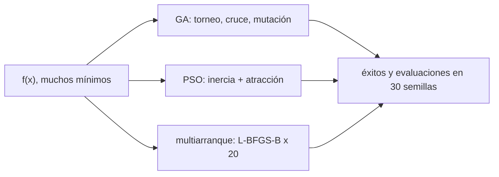

# B81-C13 — Optimización heurística (algoritmos genéticos y enjambres)

<!-- nav:top -->
[🏠 Programa](../../../../README.md) · [📚 Bloque B81](../../../tronco-comun/B81-optimizacion-de-trayectorias-y-diseno-robusto.md) · [← Anterior: B81-C12 — Restricciones dinámicas en optimización](../B81-C12-restricciones-dinamicas-en-optimizacion/CLASE.md) · [Siguiente: B81-C14 — Presupuestos de maniobras de corrección →](../B81-C14-presupuestos-de-maniobras-de-correccion/CLASE.md)
<!-- /nav -->

## 1. Ubicación, nivel y alcance

Clase 13 del bloque B81 (área A06). Nivel N3. En el diseño interplanetario la superficie de `Δv` frente a fecha de salida y tiempo de vuelo tiene muchos mínimos locales; un método local converge al más cercano. Los **métodos heurísticos globales** (algoritmo genético, enjambre de partículas) exploran con poblaciones. Aquí los comparas con un arranque múltiple local sobre una función sintética con mínimo global conocido. Usas [B81-C11](../B81-C11-optimizacion-multicriterio-y-frentes-de-pareto/CLASE.md) solo para la idea de muestra y comparación. No se usaron fuentes externas.

## 2. Por qué esta clase existe

Un método heurístico no garantiza el óptimo, pero puede evitar los mínimos locales. La decisión central: **¿qué método global elegir y cuántas evaluaciones se gastan para una tasa de éxito dada?**

## 3. Lo que podrás hacer al terminar

1. Describir un algoritmo genético y un enjambre de partículas.
2. Implementarlos con semilla fija.
3. Medir la tasa de éxito en 30 repeticiones.
4. Contar las evaluaciones de la función.
5. Compararlos con arranque múltiple de un método local.
6. Decir por qué los resultados no generalizan a otros problemas.

La evidencia es la **tabla de evaluaciones y tasas de éxito** del ejercicio 12 (sección 20).

## 4. Con qué llegas y cómo comprobarlo

1. ¿Qué es un mínimo local?
2. ¿Qué es una semilla de un generador aleatorio?
3. ¿Qué es una población en un algoritmo evolutivo?
4. ¿Qué es una evaluación de la función?
5. ¿Qué es un dato sintético?

<details>
<summary>Ver respuestas</summary>

1. Un punto mejor que sus vecinos pero no necesariamente el mejor global. 2. El valor inicial que hace repetible la secuencia. 3. Un conjunto de candidatos que evoluciona. 4. Una llamada al cálculo del objetivo, que suele ser lo más caro. 5. Un dato generado para el ejemplo, no medido.
</details>

Con cuatro o cinco aciertos, sigue; si no, repasa los prerrequisitos.

## 5. Un caso de contexto y casos de referencia

Sobre la función de Rastrigin en dos variables (mínimo global `f = 0` en el origen y mínimos locales en los enteros), con 30 repeticiones: el enjambre acierta 30 de 30 con 2430 evaluaciones; el genético 24 de 30 con 2440; el arranque múltiple de 20 inicios locales solo 5 de 30 con 792; un solo arranque local, 0 de 30. Es el **ejemplo conductor**; la función es **sintética**: no es un `Δv`.

## 6. Vocabulario

El **algoritmo genético** evoluciona una población por selección (torneo), cruce (promedio ponderado), mutación (ruido gaussiano) y elitismo. El **enjambre de partículas** mueve partículas con inercia y atracción hacia su mejor posición y la mejor global. El **arranque múltiple** ejecuta un método local (L-BFGS-B) desde varios puntos. El **éxito** es un mejor valor menor que `10⁻³`.

## 7. Modelo mental: exploradores en un terreno con muchos valles



*Descripción textual:* la misma función se resuelve con tres métodos, cada uno repetido con 30 semillas; se comparan la tasa de éxito y las evaluaciones.

Analogía: soltar muchos senderistas en la montaña para encontrar el valle más profundo; unos se comunican, otros no. Límite: el resultado depende de la función y de los parámetros del algoritmo.

## 8. La explicación, paso a paso

### 8.1 La función

`f(x) = 20 + Σ (xᵢ² − 10 cos 2π xᵢ)` en `[−5,12; 5,12]²`. Mínimo global `f(0,0) = 0`; hay mínimos locales en cada entero, con valores crecientes. Imita la presencia de muchos mínimos de un `Δv`, pero no es un problema orbital.

### 8.2 Parámetros

GA: población 40, 60 generaciones, torneo de 3, cruce con probabilidad 0,9, mutación gaussiana (`σ = 0,3`, probabilidad 0,2), elitismo 2. PSO: 30 partículas, 80 iteraciones, `w = 0,72`, `c₁ = c₂ = 1,49`. Multiarranque: 20 inicios.

### 8.3 Resultados (semillas 0 a 29)

| Método | éxitos / 30 | evaluaciones medias | mejor valor medio |
|---|---|---|---|
| GA | 24 | 2440 | 0,1990 |
| PSO | 30 | 2430 | 0,0000 |
| Multiarranque (20) | 5 | 792 | 0,9618 |
| Un arranque local | 0 | — | — |

### 8.4 Lectura

Los tres usan evaluaciones del mismo orden (≈ 2400 los heurísticos, ≈ 800 el multiarranque), pero el enjambre acierta siempre en esta función y el multiarranque rara vez: los inicios locales caen en mínimos vecinos. Esto **no** significa que el enjambre sea mejor en general: con otra función, otros parámetros o más dimensiones el orden puede cambiar. Además, un método heurístico no entrega una prueba de optimalidad global.

## 9. Magnitudes, símbolos y unidades

| Símbolo | Qué es | Unidad | Valor / nota |
|---|---|---|---|
| `f` | función de Rastrigin 2D | adimensional | mínimo 0 en (0, 0) |
| `n_pob` | tamaño de población / partículas | — | 40 / 30 |
| `n_gen` | generaciones / iteraciones | — | 60 / 80 |
| éxito | mejor valor `< 10⁻³` | — | — |
| evaluaciones | llamadas a `f` | — | ≈ 2400 |

## 10. Convenciones y referencias

Función sintética adimensional; dominio `[−5,12; 5,12]²`. Generador `random.Random(seed)` con semillas 0 a 29 por método; L-BFGS-B de SciPy 1.17.1 para el arranque múltiple, con puntos iniciales sorteados con la misma semilla. NumPy 2.4.4 instalado pero no usado por los heurísticos.

## 11. De dónde sale lo que afirmamos

| ID | Fuente | Localizador | Respalda | Estado |
|---|---|---|---|---|
| — | Relaciones estándar (algoritmo genético (selección por torneo, cruce aritmético, mutación gaussiana, elitismo), enjambre de partículas, función de Rastrigin) | — | las verifica el laboratorio con una segunda vía | No consultada en una fuente concreta |

Límites: no se consultó ninguna fuente; es una sola función, dos variables y 30 semillas; no se ajustaron los parámetros de los algoritmos; los números no generalizan.

## 12. Cómo ver la comparación

| Método | éxitos / 30 | evaluaciones |
|---|---|---|
| PSO | 30 | 2430 |
| GA | 24 | 2440 |
| Multiarranque | 5 | 792 |
| Un arranque | 0 | — |

Descripción larga: con presupuestos de evaluaciones parecidos, los heurísticos superan al arranque múltiple local en esta función multimodal.

## 13. Ejemplo trabajado: la tasa de éxito del GA

**Paso 1 · Conteo.** 24 de 30 repeticiones con mejor valor menor que `10⁻³`.

**Paso 2 · Tasa.** `24/30 = 80 %`.

**Paso 3 · Incertidumbre.** Un intervalo binomial aproximado de 95 % es `0,80 ± 1,96 √(0,8·0,2/30) = ±0,14`.

**Paso 4 · Lectura.** La diferencia entre el PSO (100 %) y el GA (80 %) supera ese intervalo, pero depende de los parámetros sin ajustar.

## 14. Distintas formas de describir un método global

**Por éxito:** fracción que alcanza el mínimo. **Por costo:** evaluaciones. **Por aleatoriedad:** semilla. **Por garantía:** ninguna.

## 15. Práctica guiada

**Ejercicio 1 · con los pasos indicados.** ¿Cuál es el valor de `f(1, 0)`? *Pasos:* `20 + (1 − 10) + (0 − 10)`.

<details><summary>Solución comentada</summary>

`20 − 9 − 10 = 1`: un mínimo local.
</details>

**Ejercicio 2 · con una pista.** ¿Cuántas evaluaciones usa el GA con población 40 y 60 generaciones? *Pista:* `n + n·gen`.

<details><summary>Solución comentada</summary>

`40 + 40·60 = 2440`.
</details>

**Ejercicio 3 · casi autónomo.** ¿Y el PSO con 30 partículas y 80 iteraciones?

<details><summary>Solución comentada</summary>

`30 + 30·80 = 2430`.
</details>

## 16. Práctica autónoma, transferencia e integrador

**Ejercicio 4 · autónomo.** Calcula la tasa de éxito del multiarranque y su intervalo aproximado de 95 %.

<details><summary>Solución comentada</summary>

`5/30 = 0,167`; `±1,96√(0,167·0,833/30) = ±0,13`.
</details>

**Ejercicio 5 · autónomo.** ¿Por qué se fija la semilla?

<details><summary>Solución comentada</summary>

Para que el resultado sea repetible y verificable.
</details>

**Ejercicio 6 · autónomo.** ¿Por qué el arranque único local fracasa siempre aquí?

<details><summary>Solución comentada</summary>

Cae en el mínimo local más cercano al punto inicial; la función tiene muchos.
</details>

**Ejercicio 7 · autónomo.** Si doblas las generaciones del GA, ¿qué esperarías?

<details><summary>Solución comentada</summary>

Más evaluaciones y probablemente más éxitos, sin garantía.
</details>

**Ejercicio 8 · autónomo.** ¿Qué es el elitismo y para qué sirve?

<details><summary>Solución comentada</summary>

Copiar los mejores individuos a la siguiente generación para no perder la mejor solución.
</details>

**Ejercicio 9 · transferencia.** **Transferencia.** **Transferencia.** Un colega afirma que el PSO es mejor que el GA porque acertó 30 de 30. ¿Qué respondes?

<details><summary>Solución comentada</summary>

Es una función, 30 semillas y parámetros sin ajustar; no generaliza.
</details>

**Ejercicio 10 · transferencia.** **Transferencia.** **Transferencia.** ¿Cómo combinarías un heurístico con un método local?

<details><summary>Solución comentada</summary>

Usar el heurístico para localizar la región y pulir con un método local desde su mejor candidato.
</details>

**Ejercicio 11 · transferencia.** **Transferencia.** **Transferencia.** El problema real tiene 10 variables y cada evaluación cuesta 1 s. ¿Qué cambia?

<details><summary>Solución comentada</summary>

El presupuesto de evaluaciones manda; hay que ajustar población e iteraciones y posiblemente usar sustitutos.
</details>

**Ejercicio 12 · integrador.** **Integrador.** **Integrador.** Elabora tu *tabla de evaluaciones y tasas de éxito*: los tres métodos, el conteo con intervalo, la lectura y los límites de la comparación.

<details><summary>Solución comentada</summary>

Secciones 8.1–8.4 y la salida del laboratorio.
</details>

## 17. Laboratorio: algoritmo genético, enjambre y multiarranque sobre una función multimodal

El script [heuristica.py](heuristica.py) ejecuta 30 repeticiones de cada método sobre la función de Rastrigin y cuenta éxitos y evaluaciones (**comprueba** que `f(0, 0) = 0`).

**Datos:** función **sintética adimensional**; sin datos externos. **Predice antes de ejecutar:** ¿cuál método tendrá la mayor tasa de éxito? (el enjambre, en esta función.) **Ejecución del 2026-11-10 (Python 3.12.9, NumPy 2.4.4, SciPy 1.17.1):**

```text
Python 3.12.9 | NumPy 2.4.4 | SciPy 1.17.1
Funcion SINTETICA (Rastrigin 2D): minimo global f = 0 en (0,0) ; dominio [-5,12; 5,12]^2 ; 30 repeticiones (semillas 0..29)
f(0,0) = 0.0
 metodo               exitos/30   evaluaciones medias   mejor valor medio
 GA (40 x 60)             24                2440             0.1990
 PSO (30 x 80)            30                2430             0.0000
 Multiarranque (20)        5                 792             0.9618
 Un arranque local         0                  (referencia)
Pruebas superadas.
```

```bash
python programa/clases/B81/B81-C13-optimizacion-heuristica-algoritmos-geneticos-y-enjambres/heuristica.py
```

**Límites:** una función de dos variables; parámetros sin ajustar; 30 semillas por método; los resultados no generalizan.

## 18. Errores frecuentes y cómo corregirlos

**Generalizar de una función a todos los problemas.** Se corrige con 8.4.

**Olvidar contar las evaluaciones.** Se corrige con el ejercicio 2.

**No fijar la semilla.** Se corrige con el ejercicio 5.

**Presentar la función sintética como un `Δv` real.** Se corrige con la sección 10.

## 19. Cómo sabrás que vas bien

Tras la sección 8: ¿qué método esperabas mejor y por qué? Si dudas, repasa 8.4. Tras el laboratorio: ¿qué comprueba? (ver la sección 17).

## 20. Qué entregas y cómo se evalúa

El producto es tu **tabla de evaluaciones y tasas de éxito** (ejercicio 12).

| Criterio | Inicial | En desarrollo | Logrado | Destacado |
|---|---|---|---|---|
| Conceptos | Los confunde | Parciales | Describe y compara los métodos | Explica los límites |
| Cálculo | Sin unidades | Con errores | Tablas completas con unidades | Calcula casos nuevos |
| Numérico | Sin comprobar | Un caso | Contraste con una segunda vía | Interpreta las diferencias |
| Fuentes | Sin fuente | Sin fecha | Fuentes con fecha y estado | Declara lo ilustrativo y lo no consultado |
| Límites | No los nombra | Uno | Tres | Discute qué falta del modelo |

**Condiciones críticas (no se compensan con promedio):** rotular la función como sintética; no generalizar los resultados; citar solo lo consultado.

## 21. Ética, seguridad y límites

Clase educativa: los modelos son simplificados y sus datos son sintéticos o ilustrativos; ningún resultado describe una misión real ni sustituye a las herramientas de diseño y a la validación de una misión. Accesibilidad: tablas equivalentes a las gráficas, fórmulas en texto, ejercicios sin conexión.

## 22. Para cerrar y seguir

Con unas 2400 evaluaciones, el enjambre acierta 30 de 30 y el genético 24 de 30 en una función con muchos mínimos, mientras 20 arranques locales aciertan 5; no es una prueba de que ganen en general. Queda una pregunta: ¿cuánto `Δv` hay que reservar para corregir los errores de la trayectoria?

**Glosario español–inglés.** algoritmo genético · *genetic algorithm*; enjambre de partículas · *particle swarm*; arranque múltiple · *multistart*; mínimo local · *local minimum*; semilla · *seed*.

**Continuidad.** [B81-C14](../B81-C14-presupuestos-de-maniobras-de-correccion/CLASE.md) estudia los presupuestos de corrección.

**Referencias:** ver sección 11.

<!-- nav:bottom -->
---

[← Anterior: B81-C12 — Restricciones dinámicas en optimización](../B81-C12-restricciones-dinamicas-en-optimizacion/CLASE.md) · [📚 Bloque B81](../../../tronco-comun/B81-optimizacion-de-trayectorias-y-diseno-robusto.md) · [Siguiente: B81-C14 — Presupuestos de maniobras de corrección →](../B81-C14-presupuestos-de-maniobras-de-correccion/CLASE.md)
<!-- /nav -->
