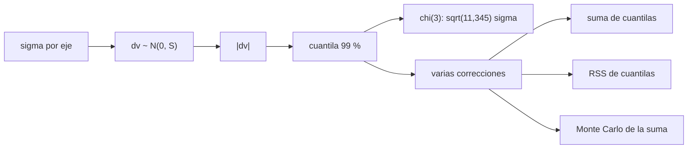

# B81-C14 — Presupuestos de maniobras de corrección

<!-- nav:top -->
[🏠 Programa](../../../../README.md) · [📚 Bloque B81](../../../tronco-comun/B81-optimizacion-de-trayectorias-y-diseno-robusto.md) · [← Anterior: B81-C13 — Optimización heurística (algoritmos genéticos y enjambres)](../B81-C13-optimizacion-heuristica-algoritmos-geneticos-y-enjambres/CLASE.md) · [Siguiente: B81-C15 — Robustez de trayectoria ante fallas →](../B81-C15-robustez-de-trayectoria-ante-fallas/CLASE.md)
<!-- /nav -->

## 1. Ubicación, nivel y alcance

Clase 14 del bloque B81 (área A06). Nivel N3. Ninguna trayectoria sale perfecta: los errores de navegación y de ejecución exigen **maniobras de corrección** cuyo `Δv` es aleatorio. Un presupuesto se fija con una cuantila (por ejemplo, la que cubre el 99 % de los casos). Aquí estimas esa cuantila por Monte Carlo, la comparas con la fórmula de la distribución chi para el caso isótropo y estudias cómo se suman varias correcciones. Todas las desviaciones son sintéticas; no se usaron fuentes externas.

## 2. Por qué esta clase existe

Un presupuesto muy bajo deja a la nave sin propelente; uno muy alto la lastra. La decisión central: **¿qué cuantila de `Δv` reservar para una o varias correcciones, y cómo se combinan?**

## 3. Lo que podrás hacer al terminar

1. Modelar el `Δv` de corrección como un vector gaussiano en 3D.
2. Estimar la cuantila del 99 % por Monte Carlo.
3. Compararla con la fórmula chi para el caso isótropo.
4. Tratar el caso anisótropo con dos semillas.
5. Combinar varias correcciones: suma de cuantilas, raíz de la suma de cuadrados y Monte Carlo de la suma.
6. Reconocer que las desviaciones son sintéticas.

La evidencia es la **presupuesto de corrección al 99 %** del ejercicio 12 (sección 20).

## 4. Con qué llegas y cómo comprobarlo

1. ¿Qué es una cuantila al 99 %?
2. ¿Qué es un vector gaussiano?
3. ¿Qué es la magnitud de un vector?
4. ¿Qué es el método de Monte Carlo?
5. ¿Qué es un dato sintético?

<details>
<summary>Ver respuestas</summary>

1. El valor que no se supera en el 99 % de los casos. 2. Un vector cuyas componentes son normales. 3. Su norma euclídea. 4. Estimar con muestras aleatorias. 5. Un dato generado para el ejemplo, no medido.
</details>

Con cuatro o cinco aciertos, sigue; si no, repasa los prerrequisitos.

## 5. Un caso de contexto y casos de referencia

Con `σ = 1 m/s` por eje, la magnitud de un `Δv` gaussiano 3D tiene cuantila al 99 % de `3,3680 m/s` por Monte Carlo y `3,3682` por la distribución chi. Con `σ = (1,0; 0,5; 0,2) m/s` baja a `2,64 m/s`. Cinco correcciones independientes necesitan `8,19 m/s` (la suma de cuantilas sería `13,20`). Es el **ejemplo conductor**; las desviaciones son **sintéticas**.

## 6. Vocabulario

El **`Δv` de corrección** es un vector `dv ~ N(0, Σ)`. Su **magnitud** `|dv|` sigue, en el caso isótropo, una distribución chi con 3 grados de libertad escalada por `σ`. El **presupuesto al 99 %** es la cuantila `q₀,₉₉`. La **suma de cuantilas** es conservadora; la **raíz de la suma de cuadrados** (RSS) es optimista para sumar magnitudes.

## 7. Modelo mental: una bolsa de dardos



*Descripción textual:* la desviación por eje define un `Δv` gaussiano; la cuantila de su magnitud se compara con la fórmula chi y con las reglas de combinación para varias correcciones.

Analogía: lanzar dardos a un blanco y preguntar a qué radio cae el 99 %; con varios lanzamientos, las distancias se acumulan. Límite: aquí las correcciones son independientes y gaussianas; en una misión real las covarianzas dependen de la navegación.

## 8. La explicación, paso a paso

### 8.1 Caso isótropo

Con `σ = 1 m/s`, 2 × 10⁶ muestras (semilla 20260811): media de `|dv|` `1,5963` (teórico `2√(2/π) = 1,5958`); cuantila 99 % `3,3680`; la fórmula `√χ²₀,₉₉(3) = 3,3682`; diferencia relativa `6,1 × 10⁻⁵`.

### 8.2 Caso anisótropo

Con `σ = (1,0; 0,5; 0,2) m/s` no hay fórmula simple en la clase. Con dos semillas independientes: `2,6394` y `2,6400 m/s` (diferencia `2,2 × 10⁻⁴`). Usar la cuantila isótropa del eje mayor (3,3682) sería conservador en un 28 %.

### 8.3 Varias correcciones

| `k` | suma de cuantilas | RSS de cuantilas | cuantila 99 % de la suma (MC) |
|---|---|---|---|
| 1 | 2,6394 | 2,6394 | 2,6401 |
| 2 | 5,2788 | 3,7327 | 4,1615 |
| 3 | 7,9182 | 4,5716 | 5,5701 |
| 4 | 10,5576 | 5,2788 | 6,9023 |
| 5 | 13,1971 | 5,9019 | 8,1923 |

La cuantila de la suma queda entre el RSS y la suma de cuantilas. Sumar cuantilas sobredimensiona el presupuesto; el RSS lo subdimensiona porque las magnitudes se suman, no sus cuadrados.

### 8.4 Qué decide el presupuesto

La elección entre estas reglas es de ingeniería: el MC de la suma es la estimación más cercana a «99 % de probabilidad de cubrir las cinco correcciones», pero depende de los supuestos (independencia, gaussianidad) que aquí son sintéticos.

## 9. Magnitudes, símbolos y unidades

| Símbolo | Qué es | Unidad | Valor / nota |
|---|---|---|---|
| `σ` | desviación por eje | m/s | 1,0; 0,5; 0,2 (sintéticas) |
| `q₀,₉₉` | cuantila al 99 % de `|dv|` | m/s | 3,368 (isótropo); 2,64 (anisótropo) |
| `k` | número de correcciones | — | 1 a 5 |
| `n` | muestras de Monte Carlo | — | 2 × 10⁶ y 5 × 10⁵ |
| `χ` | distribución chi (3 g.l.) | — | cuantila 99 %: 3,3682 |

## 10. Convenciones y referencias

Todo sintético; semilla 20260811 para el isótropo, 1 y 2 para el anisótropo y 5 para la suma. NumPy 2.4.4 y SciPy 1.17.1 (`scipy.stats.chi`). Correcciones independientes con `Δv` gaussiano centrado. No se separan error de ejecución y de navegación.

## 11. De dónde sale lo que afirmamos

| ID | Fuente | Localizador | Respalda | Estado |
|---|---|---|---|---|
| — | Relaciones estándar (distribución chi con tres grados de libertad, cuantilas y Monte Carlo, suma de variables aleatorias) | — | las verifica el laboratorio con una segunda vía | No consultada en una fuente concreta |

Límites: no se consultó ninguna fuente; las desviaciones y la independencia son supuestos; no se modela la dependencia del `Δv` con el tiempo hasta la llegada (ver C15).

## 12. Cómo ver el presupuesto

| Magnitud | Valor |
|---|---|
| cuantila isótropa MC / chi | 3,3680 / 3,3682 m/s |
| cuantila anisótropa | 2,64 m/s |
| 5 correcciones (MC) | 8,19 m/s |
| 5 correcciones (suma de cuantilas) | 13,20 m/s |

Descripción larga: el Monte Carlo reproduce la fórmula y muestra que sumar cuantilas es 61 % más caro que la cuantila de la suma para cinco correcciones.

## 13. Ejemplo trabajado: la cuantila isótropa

**Paso 1 · Cuantila de χ²₃.** El percentil 99 de una chi-cuadrado con 3 grados de libertad es `11,345`.

**Paso 2 · Raíz.** `√11,345 = 3,3682`.

**Paso 3 · Escala.** Con `σ = 1 m/s`: `q₀,₉₉ = 3,3682 m/s`.

**Paso 4 · Contraste.** El Monte Carlo da `3,3680`.

## 14. Distintas formas de describir un presupuesto estadístico

**Por cuantila:** 99 %. **Por distribución:** chi (isótropo) o Monte Carlo. **Por combinación:** suma, RSS o Monte Carlo de la suma. **Por riesgo:** probabilidad de agotar el propelente.

## 15. Práctica guiada

**Ejercicio 1 · con los pasos indicados.** Calcula la cuantila al 99 % del `Δv` isótropo con `σ = 0,3 m/s`. *Pasos:* `3,3682 σ`.

<details><summary>Solución comentada</summary>

`1,01 m/s`.
</details>

**Ejercicio 2 · con una pista.** Calcula la media teórica de `|dv|` con `σ = 2 m/s`. *Pista:* `2√(2/π) σ`.

<details><summary>Solución comentada</summary>

`3,19 m/s`.
</details>

**Ejercicio 3 · casi autónomo.** ¿Qué fracción de ahorro da el MC de la suma frente a la suma de cuantilas para `k = 3`?

<details><summary>Solución comentada</summary>

`1 − 5,5701/7,9182 = 29,7 %`.
</details>

## 16. Práctica autónoma, transferencia e integrador

**Ejercicio 4 · autónomo.** ¿Por qué el RSS subestima la cuantila de la suma?

<details><summary>Solución comentada</summary>

Combina magnitudes como si fueran independientes en cuadratura (vectores) y no las suma como escalares positivos.
</details>

**Ejercicio 5 · autónomo.** Con `σ = (1,0; 0,5; 0,2)`, ¿qué eje domina el presupuesto?

<details><summary>Solución comentada</summary>

El de `σ = 1,0`: aporta más de la mitad de la varianza total.
</details>

**Ejercicio 6 · autónomo.** ¿Cuántas muestras de MC hacen falta para estimar el percentil 99 con buena precisión?

<details><summary>Solución comentada</summary>

Muchas (cientos de miles): solo el 1 % cae en la cola; con 2 × 10⁶ hay 20 000 muestras en la cola.
</details>

**Ejercicio 7 · autónomo.** Si el propelente cubre exactamente la cuantila al 99 %, ¿qué probabilidad hay de quedarse corto?

<details><summary>Solución comentada</summary>

1 %.
</details>

**Ejercicio 8 · autónomo.** ¿Qué supuesto sería dudoso en una misión real?

<details><summary>Solución comentada</summary>

La independencia de las correcciones y la gaussianidad de los errores.
</details>

**Ejercicio 9 · transferencia.** **Transferencia.** **Transferencia.** Una misión tiene 8 correcciones planificadas. ¿Qué regla usarías para reservar `Δv`?

<details><summary>Solución comentada</summary>

El Monte Carlo de la suma con las covarianzas reales, y como cota superior la suma de cuantilas.
</details>

**Ejercicio 10 · transferencia.** **Transferencia.** **Transferencia.** El equipo de navegación mejora su conocimiento a la mitad de `σ`. ¿Cómo cambia el presupuesto?

<details><summary>Solución comentada</summary>

La cuantila se divide por 2 (escala lineal con `σ`).
</details>

**Ejercicio 11 · transferencia.** **Transferencia.** **Transferencia.** ¿Por qué un presupuesto al 99 % no es lo mismo que un presupuesto «sin riesgo»?

<details><summary>Solución comentada</summary>

Deja un 1 % de casos en que se agota; el nivel debe fijarlo el análisis de riesgo de la misión.
</details>

**Ejercicio 12 · integrador.** **Integrador.** **Integrador.** Elabora tu *presupuesto de corrección al 99 %*: cuantila isótropa y anisótropa, tabla de varias correcciones y el supuesto que más pesa.

<details><summary>Solución comentada</summary>

Secciones 8.1–8.4 y la salida del laboratorio.
</details>

## 17. Laboratorio: presupuesto estadístico de correcciones

El script [presupuesto.py](presupuesto.py) estima por Monte Carlo la cuantila al 99 % del `Δv` isótropo y anisótropo, la compara con la distribución chi y combina varias correcciones (**comprueba** que MC e isótropo coincidan a menos del 0,5 %).

**Datos:** desviaciones **sintéticas**; sin datos externos. **Predice antes de ejecutar:** ¿qué cuantila isótropa esperas con `σ = 1`? (≈ 3,37 m/s.) **Ejecución del 2026-11-10 (Python 3.12.9, NumPy 2.4.4, SciPy 1.17.1):**

```text
Python 3.12.9 | NumPy 2.4.4 | SciPy 1.17.1
Isotropo sigma = 1 m/s: media |dv| MC = 1.5963 (teorico 2 sqrt(2/pi) = 1.5958) ; cuantila 99 % MC = 3.3680 ; chi(3) = 3.3682 ; dif. = 6.10e-05
Anisotropo sigma = (1,0; 0,5; 0,2) m/s: cuantila 99 % = 2.6394 y 2.6400 (dos semillas) ; dif. = 2.18e-04
  cota con la cuantila isotropa del eje mayor: 3.3682 m/s (conservadora)
Varias correcciones independientes (anisotropas, mismas sigma):
  k   suma de cuantilas   RSS de cuantilas   cuantila 99 % MC de la suma
  1            2.6394             2.6394                 2.6401
  2            5.2788             3.7327                 4.1615
  3            7.9182             4.5716                 5.5701
  4           10.5576             5.2788                 6.9023
  5           13.1971             5.9019                 8.1923
  (en esta muestra la cuantila de la suma queda entre el RSS y la suma de cuantilas: sumar cuantilas es conservador y el RSS es optimista porque las magnitudes se suman, no sus cuadrados)
Pruebas superadas.
```

```bash
python programa/clases/B81/B81-C14-presupuestos-de-maniobras-de-correccion/presupuesto.py
```

**Límites:** correcciones independientes y gaussianas; sin dependencia temporal; Monte Carlo con semilla fija.

## 18. Errores frecuentes y cómo corregirlos

**Sumar cuantilas como si fueran de la suma.** Se corrige con 8.3.

**Usar la media en lugar de la cuantila.** Se corrige con 8.1.

**Olvidar que 99 % deja un 1 % de riesgo.** Se corrige con el ejercicio 11.

**Presentar las desviaciones sintéticas como datos de navegación.** Se corrige con la sección 10.

## 19. Cómo sabrás que vas bien

Tras la sección 8: ¿qué cuantila esperabas y cuál obtuviste? Si dudas, repasa 8.1. Tras el laboratorio: ¿qué comprueba? (ver la sección 17).

## 20. Qué entregas y cómo se evalúa

El producto es tu **presupuesto de corrección al 99 %** (ejercicio 12).

| Criterio | Inicial | En desarrollo | Logrado | Destacado |
|---|---|---|---|---|
| Conceptos | Los confunde | Parciales | Estima cuantilas y las combina | Explica los límites |
| Cálculo | Sin unidades | Con errores | Tablas completas con unidades | Calcula casos nuevos |
| Numérico | Sin comprobar | Un caso | Contraste con una segunda vía | Interpreta las diferencias |
| Fuentes | Sin fuente | Sin fecha | Fuentes con fecha y estado | Declara lo ilustrativo y lo no consultado |
| Límites | No los nombra | Uno | Tres | Discute qué falta del modelo |

**Condiciones críticas (no se compensan con promedio):** rotular las desviaciones como sintéticas; no confundir presupuesto al 99 % con ausencia de riesgo; citar solo lo consultado.

## 21. Ética, seguridad y límites

Clase educativa: los modelos son simplificados y sus datos son sintéticos o ilustrativos; ningún resultado describe una misión real ni sustituye a las herramientas de diseño y a la validación de una misión. Accesibilidad: tablas equivalentes a las gráficas, fórmulas en texto, ejercicios sin conexión.

## 22. Para cerrar y seguir

Una corrección con `σ = 1 m/s` necesita 3,37 m/s al 99 % y cinco correcciones independientes 8,19 m/s en lugar de 13,20 si se suman cuantilas. Queda una pregunta: ¿qué pasa si una corrección falla y hay que repetirla más tarde?

**Glosario español–inglés.** presupuesto de delta-v · *delta-v budget*; cuantila · *quantile*; Monte Carlo · *Monte Carlo*; maniobra de corrección · *trajectory correction maneuver*; distribución chi · *chi distribution*.

**Continuidad.** [B81-C15](../B81-C15-robustez-de-trayectoria-ante-fallas/CLASE.md) estudia la robustez ante fallas.

**Referencias:** ver sección 11.

<!-- nav:bottom -->
---

[← Anterior: B81-C13 — Optimización heurística (algoritmos genéticos y enjambres)](../B81-C13-optimizacion-heuristica-algoritmos-geneticos-y-enjambres/CLASE.md) · [📚 Bloque B81](../../../tronco-comun/B81-optimizacion-de-trayectorias-y-diseno-robusto.md) · [Siguiente: B81-C15 — Robustez de trayectoria ante fallas →](../B81-C15-robustez-de-trayectoria-ante-fallas/CLASE.md)
<!-- /nav -->
