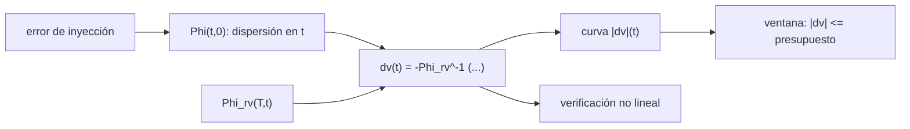

# B81-C15 — Robustez de trayectoria ante fallas

<!-- nav:top -->
[🏠 Programa](../../../../README.md) · [📚 Bloque B81](../../../tronco-comun/B81-optimizacion-de-trayectorias-y-diseno-robusto.md) · [← Anterior: B81-C14 — Presupuestos de maniobras de corrección](../B81-C14-presupuestos-de-maniobras-de-correccion/CLASE.md) · [Siguiente: B82-C01 — Lambert de arco corto →](../../../tronco-comun/B82-problema-de-lambert-y-transferencias-de-dos-puntos.md#b82-c01)
<!-- /nav -->

## 1. Ubicación, nivel y alcance

Clase 15 del bloque B81 (área A06). Nivel N3. Si la maniobra de corrección planeada falla, ¿hasta cuándo se puede reintentar sin gastar más propelente del reservado? La respuesta usa la matriz de transición de [B81-C01](../B81-C01-ecuaciones-variacionales-y-matriz-de-transicion-de-estados/CLASE.md): el `Δv` necesario crece a medida que se acerca la llegada porque la «palanca» `Φ_rv` se debilita. Calculas esa curva en un arco sintético y deduces la ventana admisible. Todo es ilustrativo.

## 2. Por qué esta clase existe

Una falla no es solo perder una maniobra: es perder la oportunidad barata. La decisión central: **¿hasta qué instante sigue siendo recuperable la trayectoria con el propelente de reserva?**

## 3. Lo que podrás hacer al terminar

1. Propagar con `Φ` una dispersión inicial hasta el instante de corrección.
2. Calcular el `Δv` que anula el error de posición en la llegada: `dv = −Φ_rv⁻¹ (Φ_rr δr + Φ_rv δv)`.
3. Construir la curva `|dv|(t)`.
4. Hallar el último reintento admisible para un presupuesto dado.
5. Verificar con una integración no lineal el residuo tras la corrección.
6. Reconocer el arco y los errores como sintéticos.

La evidencia es la **ventana de recuperación** del ejercicio 12 (sección 20).

## 4. Con qué llegas y cómo comprobarlo

1. ¿Qué es un instante de corrección?
2. ¿Qué es el error de posición en la llegada?
3. ¿Qué es la matriz de transición?
4. ¿Qué es un presupuesto de recuperación?
5. ¿Qué es un dato sintético?

<details>
<summary>Ver respuestas</summary>

1. El momento en que se aplica una maniobra para cambiar la trayectoria. 2. La distancia entre la posición predicha y la objetivo. 3. La derivada del estado final respecto del inicial (B81-C01). 4. El `Δv` reservado para una maniobra de reparación. 5. Un dato generado para el ejemplo, no medido.
</details>

Con cuatro o cinco aciertos, sigue; si no, repasa los prerrequisitos.

## 5. Un caso de contexto y casos de referencia

Un arco heliocéntrico sintético de 250 d con un error de inyección de 500 km, −300 km, 0,5 m/s y 0,3 m/s llegaría con `43 568,9 km` de error. Corregirlo cuesta `0,74 m/s` a los 10 d, `3,21 m/s` a los 120 d, `25,3 m/s` a los 230 d y `100,9 m/s` a los 245 d. Con un presupuesto de recuperación de 3 m/s, el último reintento es a los 113 d. Es el **ejemplo conductor**; es **sintético e ilustrativo**.

## 6. Vocabulario

La **corrección** en el instante `t` es `dv(t) = −Φ_rv(T,t)⁻¹ [Φ_rr(T,t) δr(t) + Φ_rv(T,t) δv(t)]`. La **ventana de recuperación** es el conjunto de instantes donde `|dv| ≤ presupuesto`. La **palanca** `Φ_rv` mide cuánta posición final cambia por unidad de velocidad: cae al acercarse la llegada.

## 7. Modelo mental: correr para parar un tren



*Descripción textual:* el error inicial se propaga hasta el instante de corrección, se calcula el `Δv` que lo anula en la llegada con la palanca restante, se construye la curva en el tiempo y se obtiene la ventana donde cabe en el presupuesto.

Analogía: frenar un tren; cuanto más cerca de la estación, más fuerte hay que frenar. Límite: la corrección anula solo la posición en la llegada, no el riesgo en el camino; y los errores de ejecución no se modelan aquí.

## 8. La explicación, paso a paso

### 8.1 El arco

Con `GM = 132 712 440 041,279 km³/s²` y UA del JPL SSD: salida desde `r = 1 UA`, `v = (3, 31) km/s`, llegada a 250 d. La matriz de transición de todo el arco amplifica el error inicial de (500 km, −300 km, 0,5 m/s, 0,3 m/s) hasta `43 568,9 km` en la llegada.

### 8.2 Curva de corrección

| `t` (d) | tiempo restante (d) | `|dv|` (m/s) | residuo no lineal (km) |
|---|---|---|---|
| 5 | 245 | 0,68 | 0,026 |
| 10 | 240 | 0,74 | 0,046 |
| 40 | 210 | 1,18 | 0,236 |
| 120 | 130 | 3,21 | 0,577 |
| 200 | 50 | 10,14 | 0,723 |
| 230 | 20 | 25,35 | 0,202 |
| 245 | 5 | 100,90 | 0,016 |

El `Δv` crece de forma monótona (las pruebas del laboratorio exigen que crezca de 80 d en adelante) y se multiplica por 136 entre los 10 y los 245 d.

### 8.3 Ventana

Con un presupuesto de recuperación de 3 m/s (ilustrativo), el último reintento admisible en la malla de 4 d es a los **113 d**: después de ese instante la reparación excede lo reservado. Un fallo en la maniobra de los 10 d deja una ventana de 103 d.

### 8.4 Verificación no lineal

Aplicando el `Δv` al estado perturbado y reintegrando con el modelo no lineal, el error de posición en la llegada queda en menos de 1 km (máximo 0,97 km a los 160 d) sobre 43 569 km sin corregir: menos del 0,01 %. La linealización es suficiente para dimensionar el presupuesto.

## 9. Magnitudes, símbolos y unidades

| Símbolo | Qué es | Unidad | Valor / nota |
|---|---|---|---|
| `T` | duración del arco | d | 250 |
| `δr, δv` | error de inyección | km y m/s | 500, −300; 0,5, 0,3 (sintéticos) |
| `dv(t)` | corrección necesaria | m/s | 0,68 a 100,9 |
| presupuesto | `Δv` de reserva | m/s | 3 (ilustrativo) |
| `t_límite` | último reintento | d | 113 |

## 10. Convenciones y referencias

`GM` y UA del JPL SSD (DE440). Plano heliocéntrico inercial, dos cuerpos; DOP853 con rtol 1e-12 y atol 1e-9. Dispersión lineal con `Φ` de B81-C01; la corrección anula la posición (2 componentes) con 2 componentes de `Δv` en el plano. Arco y errores sintéticos.

## 11. De dónde sale lo que afirmamos

| ID | Fuente | Localizador | Respalda | Estado |
|---|---|---|---|---|
| S1 | NASA JPL SSD, Astrodynamic Parameters — https://ssd.jpl.nasa.gov/astro_par.html (consultada 2026-11-10) | tabla completa leída | GM del Sol = 1,32712440041279419 × 10²⁰ m³/s² (132712440041,279419 km³/s²); unidad astronómica = 149 597 870,7 km (IAU 2012 B1); GM de la Tierra = 398600,435507 km³/s²; masas planetarias de DE440 (Park et al., 2021) | Consultada |
| — | Relaciones estándar (propagación lineal de dispersiones con la matriz de transición, corrección de una maniobra por inversión de `Φ_rv`) | — | las verifica el laboratorio con una segunda vía | No consultada en una fuente concreta |

Límites: el arco, los errores y el presupuesto son sintéticos; no se modela el error de ejecución ni de navegación al reintentar; la corrección anula solo la posición final, no es óptima.

## 12. Cómo ver la ventana de recuperación

| Magnitud | Valor |
|---|---|
| `|dv|` a 10 d | 0,74 m/s |
| `|dv|` a 245 d | 100,9 m/s |
| cociente | 135,9 |
| último reintento con 3 m/s | 113 d |

Descripción larga: la corrección es barata al principio y se encarece sin límite al aproximarse la llegada.

## 13. Ejemplo trabajado: la corrección a los 120 d

**Paso 1 · Dispersión en t.** `d(t) = Φ(t,0) δx₀`.

**Paso 2 · Error en la llegada.** `e_T = Φ_rr(T,t) δr + Φ_rv(T,t) δv`.

**Paso 3 · Corrección.** `dv = −Φ_rv(T,t)⁻¹ e_T` y `|dv| = 3,21 m/s`.

**Paso 4 · Comparación.** `3,21 m/s > 3 m/s`: a los 120 d ya no cabe en el presupuesto.

## 14. Distintas formas de describir una ventana de recuperación

**Por curva:** `|dv|(t)`. **Por presupuesto:** `|dv| ≤ B`. **Por palanca:** `σ(Φ_rv)`. **Por residuo:** reintegración no lineal.

## 15. Práctica guiada

**Ejercicio 1 · con los pasos indicados.** ¿A cuántos días de la llegada está la corrección de 120 d? *Pasos:* `250 − 120`.

<details><summary>Solución comentada</summary>

130 d.
</details>

**Ejercicio 2 · con una pista.** Si el presupuesto fuera 10 m/s, ¿hasta cuándo se podría reintentar según la tabla? *Pista:* mira la columna `|dv|`.

<details><summary>Solución comentada</summary>

Hasta cerca de los 200 d (10,14 m/s ya lo excede; el límite exacto está algo antes).
</details>

**Ejercicio 3 · casi autónomo.** ¿Cuántas veces se encarece la corrección de 10 d a 245 d?

<details><summary>Solución comentada</summary>

`100,9/0,74 = 135,9`.
</details>

## 16. Práctica autónoma, transferencia e integrador

**Ejercicio 4 · autónomo.** ¿Por qué la curva `|dv|(t)` crece?

<details><summary>Solución comentada</summary>

Porque `Φ_rv(T,t)` se debilita al reducirse el tiempo restante: se necesita más velocidad para mover la misma posición.
</details>

**Ejercicio 5 · autónomo.** ¿Qué mide el «residuo no lineal»?

<details><summary>Solución comentada</summary>

La distancia final tras aplicar `dv` calculado en el modelo lineal; la no linealidad impide anular el error exactamente.
</details>

**Ejercicio 6 · autónomo.** Un fallo ocurre a los 40 d (`1,18 m/s`). ¿Cabe en 3 m/s y cuánto margen queda?

<details><summary>Solución comentada</summary>

Sí; sobran `3 − 1,18 = 1,82 m/s` si se reintenta de inmediato.
</details>

**Ejercicio 7 · autónomo.** ¿Qué pasa si el error de inyección se duplica?

<details><summary>Solución comentada</summary>

A primer orden el `Δv` se duplica; la ventana se acorta.
</details>

**Ejercicio 8 · autónomo.** ¿Por qué el residuo baja otra vez a los 245 d?

<details><summary>Solución comentada</summary>

Porque la corrección es corta en el tiempo y el error por no linealidad tiene poco tiempo para crecer.
</details>

**Ejercicio 9 · transferencia.** **Transferencia.** **Transferencia.** Una nave pierde una maniobra y quiere reintentar «mañana». ¿Qué mirarías?

<details><summary>Solución comentada</summary>

La curva `|dv|(t)` del plan y el presupuesto restante.
</details>

**Ejercicio 10 · transferencia.** **Transferencia.** **Transferencia.** ¿Cómo podrías agrandar la ventana desde el diseño?

<details><summary>Solución comentada</summary>

Reservando más `Δv`, mejorando la inyección o incluyendo maniobras intermedias previstas.
</details>

**Ejercicio 11 · transferencia.** **Transferencia.** **Transferencia.** ¿Qué falta para usar esta curva en una misión real?

<details><summary>Solución comentada</summary>

Errores de ejecución y navegación del reintento, covarianzas reales y un modelo completo de fuerzas.
</details>

**Ejercicio 12 · integrador.** **Integrador.** **Integrador.** Elabora tu *ventana de recuperación*: curva `|dv|(t)`, el último reintento admisible para un presupuesto, la verificación no lineal y los supuestos sintéticos.

<details><summary>Solución comentada</summary>

Secciones 8.1–8.4 y la salida del laboratorio.
</details>

## 17. Laboratorio: curva de corrección y ventana de recuperación

El script [ventana.py](ventana.py) calcula con `Φ` el `Δv` de corrección en varios instantes, lo verifica con una reintegración no lineal y halla el último reintento admisible (**comprueba** que `|dv|` crezca desde los 80 d y que los residuos sean menores que el 1 % del error sin corregir).

**Datos:** `GM` y UA del JPL (consultados); arco, error y presupuesto **sintéticos**. **Predice antes de ejecutar:** ¿cuántas veces más cuesta corregir a 245 d que a 10 d? (más de cien veces.) **Ejecución del 2026-11-10 (Python 3.12.9, NumPy 2.4.4, SciPy 1.17.1):**

```text
Python 3.12.9 | NumPy 2.4.4 | SciPy 1.17.1
Arco SINTETICO de 250 d ; error de inyeccion ILUSTRATIVO: 500 km, -300 km, 0,5 m/s, 0,3 m/s ; error de posicion final sin corregir = 43568.9 km
  t [d]   tiempo restante [d]   |dv| necesario [m/s]   residuo no lineal [km]
      5            245                  0.6823              0.0256
     10            240                  0.7425              0.0463
     20            230                  0.8747              0.1010
     40            210                  1.1817              0.2356
     80            170                  1.9905              0.2922
    120            130                  3.2142              0.5771
    160             90                  5.3135              0.9651
    200             50                 10.1434              0.7226
    230             20                 25.3466              0.2015
    245              5                100.9035              0.0163
Presupuesto de recuperacion ILUSTRATIVO = 3.0 m/s -> ultimo reintento admisible (malla de 4 d): t = 113 d
Cociente |dv|(245 d)/|dv|(10 d) = 135.9 (la palanca Phi_rv se debilita al acercarse la llegada)
Prueba: todos los residuos no lineales son menores que 1 % de 43568.9 km
Pruebas superadas.
```

```bash
python programa/clases/B81/B81-C15-robustez-de-trayectoria-ante-fallas/ventana.py
```

**Límites:** plano, dos cuerpos, errores sintéticos; la corrección anula la posición y no es óptima; sin error de ejecución en el reintento.

## 18. Errores frecuentes y cómo corregirlos

**Pensar que un reintento tardío cuesta lo mismo.** Se corrige con 8.2.

**Olvidar el presupuesto al calcular la ventana.** Se corrige con 8.3.

**Confundir el residuo no lineal con el error de ejecución.** Se corrige con 8.4.

**Presentar el arco sintético como una misión.** Se corrige con la sección 10.

## 19. Cómo sabrás que vas bien

Tras la sección 8: ¿cuándo esperabas que se agotara la ventana y cuándo ocurrió? Si dudas, repasa 8.3. Tras el laboratorio: ¿qué comprueba? (ver la sección 17).

## 20. Qué entregas y cómo se evalúa

El producto es tu **ventana de recuperación** (ejercicio 12).

| Criterio | Inicial | En desarrollo | Logrado | Destacado |
|---|---|---|---|---|
| Conceptos | Los confunde | Parciales | Construye la curva y la ventana | Explica los límites |
| Cálculo | Sin unidades | Con errores | Tablas completas con unidades | Calcula casos nuevos |
| Numérico | Sin comprobar | Un caso | Contraste con una segunda vía | Interpreta las diferencias |
| Fuentes | Sin fuente | Sin fecha | Fuentes con fecha y estado | Declara lo ilustrativo y lo no consultado |
| Límites | No los nombra | Uno | Tres | Discute qué falta del modelo |

**Condiciones críticas (no se compensan con promedio):** rotular arco, error y presupuesto como sintéticos; no presentar la ventana como un resultado de misión; citar solo lo consultado.

## 21. Ética, seguridad y límites

Clase educativa: los modelos son simplificados y sus datos son sintéticos o ilustrativos; ningún resultado describe una misión real ni sustituye a las herramientas de diseño y a la validación de una misión. Accesibilidad: tablas equivalentes a las gráficas, fórmulas en texto, ejercicios sin conexión.

## 22. Para cerrar y seguir

Corregir a los 10 d cuesta 0,74 m/s y a los 245 d, 100,9 m/s; con 3 m/s de reserva el último reintento es a los 113 d. Esta clase cierra el bloque B81: de las sensibilidades de la matriz de transición a la ventana donde una falla aún se repara.

**Glosario español–inglés.** ventana de recuperación · *recovery window*; maniobra de corrección · *correction maneuver*; palanca de la corrección · *correction leverage*; dispersión · *dispersion*; presupuesto · *budget*.

**Continuidad.** Esta es la última clase de B81. El bloque siguiente es [B82](../../../tronco-comun/B82-problema-de-lambert-y-transferencias-de-dos-puntos.md).

**Referencias:** ver sección 11.

<!-- nav:bottom -->
---

[← Anterior: B81-C14 — Presupuestos de maniobras de corrección](../B81-C14-presupuestos-de-maniobras-de-correccion/CLASE.md) · [📚 Bloque B81](../../../tronco-comun/B81-optimizacion-de-trayectorias-y-diseno-robusto.md) · [Siguiente: B82-C01 — Lambert de arco corto →](../../../tronco-comun/B82-problema-de-lambert-y-transferencias-de-dos-puntos.md#b82-c01)
<!-- /nav -->
