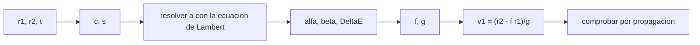

# B82-C01 — Lambert de arco corto

<!-- nav:top -->
[🏠 Programa](../../../../README.md) · [📚 Bloque B82](../../../tronco-comun/B82-problema-de-lambert-y-transferencias-de-dos-puntos.md) · [← Anterior: B81-C15 — Robustez de trayectoria ante fallas](../../B81/B81-C15-robustez-de-trayectoria-ante-fallas/CLASE.md) · [Siguiente: B82-C02 — Lambert de arco largo →](../B82-C02-lambert-de-arco-largo/CLASE.md)
<!-- /nav -->

## 1. Ubicación, nivel y alcance

Clase 1 del bloque B82. Nivel N3. El problema de Lambert pide la órbita kepleriana que une dos posiciones `r1` y `r2` en un tiempo de vuelo dado. Aquí resuelves el caso más simple, el de **arco corto** (el ángulo recorrido `θ` es menor que 180°), con el teorema de Lambert y los coeficientes de Lagrange. Usas la órbita de dos cuerpos de la mecánica kepleriana; la ecuación de Lambert solo se enuncia en B75-C04 y aquí se resuelve. Todos los datos son sintéticos: dos órbitas circulares de ejemplo (1 UA y 1,524 UA) en un plano de referencia, que no representan efemérides reales.

## 2. Por qué esta clase existe

Un diseñador de trayectorias conoce dónde está la nave y dónde debe estar, y cuánto tiempo tiene; no conoce la velocidad con que debe salir. La decisión central: **¿qué semieje y qué velocidad inicial hacen que la nave pase por `r2` exactamente a los `t` días?** Y una pregunta previa: ¿existe una elipse con ese tiempo, o hace falta una hipérbola?

## 3. Lo que podrás hacer al terminar

1. Calcular la cuerda `c`, el semiperímetro `s` y el semieje de mínima energía `a_m = s/2`.
2. Calcular el tiempo de mínima energía y el tiempo parabólico (Euler) de una transferencia.
3. Resolver el semieje `a` por bisección con la ecuación de Lambert y elegir la rama corta o larga.
4. Obtener `v1` con los coeficientes de Lagrange `f` y `g`.
5. Verificar la solución propagando `r1`, `v1` hasta `r2` con un propagador independiente.
6. Separar lo consultado (`GM` del Sol, UA) de lo sintético (posiciones y tiempos).

La evidencia es la **ficha de una transferencia de arco corto verificada por propagación** del ejercicio 12 (sección 20).

## 4. Con qué llegas y cómo comprobarlo

1. ¿Qué es el semieje mayor de una elipse y qué relación tiene con la energía `ε = −μ/(2a)`?
2. ¿Qué es el ángulo `θ` entre `r1` y `r2` y cómo se obtiene del producto escalar?
3. ¿Qué es la anomalía excéntrica `E` y cómo se relaciona con el tiempo (ecuación de Kepler)?
4. ¿Qué es una unidad canónica (`μ = 1`)?
5. ¿Qué es una verificación por segunda vía?

<details>
<summary>Ver respuestas</summary>

1. La mitad del eje mayor; `ε = −μ/(2a)`. 2. El ángulo entre los vectores: `cos θ = r1·r2/(r1 r2)`. 3. El ángulo auxiliar con que se parametriza la elipse; `M = E − e sin E` da el tiempo. 4. Un sistema donde la unidad de longitud y la de tiempo hacen `μ = 1` (aquí 1 UA y 58,13244 d). 5. Calcular lo mismo con otro método y comparar.
</details>

Con cuatro o cinco aciertos, sigue; si no, repasa los prerrequisitos.

## 5. Un caso de contexto y casos de referencia

Sea `r1 = (1; 0; 0) UA` y `r2 = 1,524·(cos 100°; sin 100°; 0) UA`, con un tiempo de vuelo de `200 d`. Es el **ejemplo conductor** de las clases C01–C03. Su cuerda es `c = 1,962614 UA`, su semiperímetro `s = 2,243307 UA`; la solución tiene `a = 1,124315 UA`, `e = 0,3988` y sale con `|v1| = 31,3882 km/s`. Todo es **sintético**: las órbitas circulares y el ángulo son de ejemplo, no efemérides de planetas reales.

## 6. Vocabulario

La **cuerda** `c = |r2 − r1|`. El **semiperímetro** del triángulo `s = (r1 + r2 + c)/2`. El **teorema de Lambert** dice que el tiempo de vuelo depende solo de `a`, `s` y `c` (no de la forma exacta de la elipse). Los ángulos de Lagrange: `sin(α/2) = √(s/2a)` y `sin(β/2) = √((s−c)/2a)`. El **tiempo de mínima energía** corresponde a `a = s/2`. El **tiempo parabólico** `t_p = (√2/3)(s^(3/2) − (s−c)^(3/2))` separa elipses de hipérbolas para `θ < 180°`. Los **coeficientes de Lagrange** `f` y `g` dan `v1 = (r2 − f r1)/g`.

## 7. Modelo mental: un triángulo que fija el tiempo



*Descripción textual:* de las dos posiciones salen la cuerda y el semiperímetro; la ecuación de Lambert da el semieje; los ángulos dan la diferencia de anomalía excéntrica, de la que salen `f`, `g` y la velocidad, que se comprueba por propagación.

Analogía: el triángulo formado por el foco, `r1` y `r2` fija el tiempo de vuelo igual que dos clavos y un hilo fijan una elipse: muchas elipses pasan por los dos puntos, pero solo una tarda `t`. Límite: la analogía no dice cuál de las dos ramas (corta o larga) corresponde; eso lo decide el tiempo de mínima energía.

## 8. La explicación, paso a paso

### 8.1 La geometría

Con `r1 = 1 UA`, `r2 = 1,524 UA` y `θ = 100°`: `c = 1,962614 UA`, `s = 2,243307 UA` y `a_m = s/2 = 1,121654 UA`. Con `μ = 1` y la unidad de tiempo `TU = 58,13244 d`, el tiempo de mínima energía vale `212,709 d` y el parabólico `88,000 d`.

### 8.2 La ecuación de Lambert para el semieje

Para una elipse y `θ < 180°`:
`t = √(a³/μ)·[(α − sin α) − (β − sin β)]`, con `sin(α/2) = √(s/2a)` y `sin(β/2) = √((s−c)/2a)`.
Si `t` es menor que el tiempo de mínima energía se usa `α = α₀` (rama corta); si es mayor, `α = 2π − α₀` (rama larga). Se resuelve `a` por bisección entre `s/2` y un valor grande. Para `t = 200 d` (menor que 212,709 d) se obtiene `a = 1,124315 UA` en la rama corta.

### 8.3 La velocidad

La diferencia de anomalía excéntrica es `ΔE = α − β`. Los coeficientes son `f = 1 − (a/r1)(1 − cos ΔE)` y `g = t − √(a³/μ)(ΔE − sin ΔE)`. Entonces `v1 = (r2 − f r1)/g`. Resulta `v1 = (12,1006; 28,9619) km/s`, `|v1| = 31,3882 km/s` (1,0538 veces la velocidad circular de 1 UA, `29,7847 km/s`) y `e = 0,398785`.

### 8.4 Cómo varía con el tiempo

| `t` (d) | `a` (UA) | Rama | módulo de `v1` (km/s) |
|---|---|---|---|
| 110 | 2,05642 | corta | 36,6451 |
| 130 | 1,43489 | corta | 34,0000 |
| 160 | 1,19449 | corta | 32,1181 |
| 200 | 1,12432 | corta | 31,3882 |
| 260 | 1,14495 | larga | 31,6138 |
| 330 | 1,22046 | larga | 32,3632 |
| 450 | 1,38039 | larga | 33,6391 |

El semieje es mínimo en `a = s/2` (cerca de 212,7 d): hay dos elipses con el mismo `a` y tiempos distintos. Para `t ≤ 88 d` no hay elipse (ver C03).

## 9. Magnitudes, símbolos y unidades

| Símbolo | Qué es | Unidad | Valor / nota |
|---|---|---|---|
| `c` | cuerda | UA | 1,962614 |
| `s` | semiperímetro | UA | 2,243307 |
| `a` | semieje mayor | UA | 1,124315 (a 200 d) |
| `t` | tiempo de vuelo | d (o TU) | 200 d = 3,4403 TU |
| `f`, `g` | coeficientes de Lagrange | —, TU | — |
| `v1` | velocidad inicial | km/s | 31,3882 |

## 10. Convenciones y referencias

`GM` del Sol de DE440 y UA de la página del JPL (S1). Unidades canónicas: `μ = 1`, longitud en UA, `TU = √(UA³/GM) = 58,13244 d`, `VU = 29,7847 km/s`. Sistema de referencia: inercial heliocéntrico **de ejemplo** con plano `z = 0` y movimiento antihorario. Modelo de dos cuerpos, sin perturbaciones. Tolerancias: residuo de propagación `< 10⁻¹⁰ UA`, velocidad frente a Izzo `< 10⁻⁹`. Posiciones y tiempos sintéticos.

## 11. De dónde sale lo que afirmamos

| ID | Fuente | Localizador | Respalda | Estado |
|---|---|---|---|---|
| S1 | NASA/JPL Solar System Dynamics, Astrodynamic Parameters — https://ssd.jpl.nasa.gov/astro_par.html (consultada 2026-11-10) | página de parámetros | `GM` del Sol = 1,32712440041279419 × 10²⁰ m³/s² (DE440, Park et al. 2021 según la página) y 1 UA = 149 597 870,7 km | Consultada |
| S2 | D. Izzo, «Revisiting Lambert's Problem», arXiv:1403.2705 (2014) — https://arxiv.org/abs/1403.2705 (consultada 2026-11-10) | solo la página de resumen | reformulación de Lancaster–Blanchard con una variable nueva e iteración de Householder; precisión comparable a Gooding con menor costo | Consultada (solo el resumen) |
| — | Relaciones estándar de la mecánica kepleriana (teorema de Lambert, coeficientes de Lagrange, funciones de Stumpff, ecuación de Kepler universal) | — | las verifica el laboratorio propagando la órbita con un propagador independiente | No consultada en una fuente concreta |
| — | Gooding (1990) y libros de texto de astrodinámica | — | — | No consultada |

Límites: las relaciones de Lambert y Lagrange no se consultaron en una fuente concreta; las valida el laboratorio por propagación. No se infiere nada de una misión real.

## 12. Cómo ver la familia de transferencias

| Magnitud | Valor |
|---|---|
| `t_min-energía` | 212,709 d |
| `t_parabólico` | 88,000 d |
| `a` a 200 d | 1,124315 UA |
| residuo | 2,8 × 10⁻¹⁴ UA |

Descripción larga: el semieje baja desde el infinito (parábola a 88 d) hasta un mínimo en 212,7 d y vuelve a subir en la rama larga.

## 13. Ejemplo trabajado: el semieje a 200 d

**Paso 1 · Geometría.** `c = 1,962614`, `s = 2,243307`, `t = 200 d = 3,4403 TU`.

**Paso 2 · Rama.** `200 < 212,709`: rama corta, `α = α₀`.

**Paso 3 · Bisección.** El semieje que cumple la ecuación es `a = 1,124315 UA`.

**Paso 4 · Velocidad.** `ΔE = α − β`, `f`, `g` y `v1 = (r2 − f r1)/g = (12,1006; 28,9619) km/s`.

**Paso 5 · Comprobación.** Propagar `r1`, `v1` por 200 d reproduce `r2` con un residuo de `2,8 × 10⁻¹⁴ UA`.

## 14. Distintas formas de describir la solución de Lambert

**Por el semieje:** bisección sobre la ecuación de Lambert (esta clase). **Por la anomalía:** variables universales (C03). **Por la variable `x`:** Lancaster–Blanchard (C06). El laboratorio compara con el solucionador de Izzo: la diferencia de velocidad es `3 × 10⁻¹⁵` en unidades canónicas.

## 15. Práctica guiada

**Ejercicio 1 · con los pasos indicados.** Calcula `c` y `s` para `r1 = 1`, `r2 = 1,524` UA y `θ = 100°`. *Pasos:* componentes de `r2`, diferencia, norma, suma.

<details><summary>Solución comentada</summary>

`r2 = (−0,2646; 1,5009)`; `c = √(1,2646² + 1,5009²) = 1,9626`; `s = (1 + 1,524 + 1,9626)/2 = 2,2433` UA.
</details>

**Ejercicio 2 · con una pista.** Halla el semieje de mínima energía. *Pista:* `a_m = s/2`.

<details><summary>Solución comentada</summary>

`a_m = 1,1217 UA`.
</details>

**Ejercicio 3 · casi autónomo.** Con `t_m = 212,7 d`, ¿qué rama corresponde a `t = 200 d`?

<details><summary>Solución comentada</summary>

Como `200 < 212,7`, la rama corta (`α < π`); ver 8.2.
</details>

## 16. Práctica autónoma, transferencia e integrador

**Ejercicio 4 · autónomo.** Calcula la energía específica en km²/s² para `a = 1,124315 UA`.

<details><summary>Solución comentada</summary>

`ε = −1/(2a) = −0,44472` canónico; por `VU² = 887,13` da `−394,5 km²/s²`.
</details>

**Ejercicio 5 · autónomo.** Calcula `|v1|/v_circular` para la transferencia de 200 d.

<details><summary>Solución comentada</summary>

`31,3882/29,7847 = 1,0538`.
</details>

**Ejercicio 6 · autónomo.** Calcula el tiempo parabólico con `s = 2,243307` y `c = 1,962614`.

<details><summary>Solución comentada</summary>

`s^1,5 = 3,3600`, `(s−c)^1,5 = 0,1487`; `t_p = 0,4714 × 3,2113 = 1,5138 TU = 88,0 d`.
</details>

**Ejercicio 7 · autónomo.** ¿Por qué existen dos transferencias con el mismo `a` y tiempos distintos?

<details><summary>Solución comentada</summary>

Porque `t(a)` tiene un mínimo de `a` en `s/2`: a cada `a > s/2` le corresponden la rama corta y la larga (8.4).
</details>

**Ejercicio 8 · autónomo.** Si `t = 88 d`, ¿qué pasa con `a`?

<details><summary>Solución comentada</summary>

Tiende a infinito: es la parábola; con menos tiempo la cónica es una hipérbola (C03).
</details>

**Ejercicio 9 · transferencia.** **Transferencia.** Un colega dice que `v1` de una transferencia a Marte sale de esta ficha. ¿Es válido?

<details><summary>Solución comentada</summary>

No: las posiciones son órbitas circulares de ejemplo, no efemérides; no se infiere una misión real.
</details>

**Ejercicio 10 · transferencia.** **Transferencia.** ¿Qué cambia si `r2` se reemplaza por un punto con `z ≠ 0`?

<details><summary>Solución comentada</summary>

El plano de la transferencia se inclina; la ecuación de Lambert y el semieje no cambian, solo la dirección de `v1` (C02).
</details>

**Ejercicio 11 · transferencia.** **Transferencia.** ¿Por qué la bisección sobre `a` no sirve directamente para `θ > 180°`?

<details><summary>Solución comentada</summary>

Porque `β` cambia de signo y la geometría de las ramas cambia (C02).
</details>

**Ejercicio 12 · integrador.** **Integrador.** Elabora tu *ficha de una transferencia de arco corto*: `c`, `s`, `t_m`, `t_p`, `a`, `e`, `v1`, residuo y lista de qué es consultado y sintético.

<details><summary>Solución comentada</summary>

Secciones 8.1–8.4 y la salida del laboratorio.
</details>

## 17. Laboratorio: transferencia de arco corto por el teorema de Lambert

El script [arco_corto.py](arco_corto.py) resuelve el semieje por bisección, calcula `v1` con `f` y `g`, la compara con el solucionador de Izzo y la propaga (**comprueba** residuo `< 10⁻¹⁰` UA, velocidad `< 10⁻⁹` y energía `= −1/(2a)`). Usa la biblioteca común [lambert_comun.py](../lambert_comun.py) del bloque.

**Datos:** constantes del JPL (consultadas el 2026-11-10); posiciones y tiempos de vuelo **sintéticos** (órbitas circulares de ejemplo, no son efemérides). **Predice antes de ejecutar:** ¿qué rama usará la transferencia de 200 d? (la corta, porque 200 d < 212,7 d.) **Ejecución del 2026-11-10 (Python 3.12.9, numpy 2.4.4):**

```text
Python 3.12.9 | numpy 2.4.4
Datos SINTETICOS: r1 = 1 UA, r2 = 1.524 UA, theta = 100 deg; TU = 58.13244 d; VU = 29.7847 km/s
c = 1.962614  s = 2.243307  a_min = s/2 = 1.121654 UA
t_min-energia = 212.709 d ; t_parabolico = 88.000 d
Transferencia de 200 d: a = 1.124315 UA, rama corta
  e = 0.398785 ; v1 = [12.1006, 28.9619] km/s ; |v1| = 31.3882 km/s
  energia = -0.44471519 ; -1/(2a) = -0.44471519
  residuo de propagacion = 2.85e-14 UA ; |v1 - v1(Izzo)| = 3.14e-15
t [d]   a [UA]   rama   |v1| [km/s]  residuo [UA]
  110   2.05642  corta     36.6451  3.1e-15
  130   1.43489  corta     34.0000  3.1e-16
  160   1.19449  corta     32.1181  6.8e-16
  200   1.12432  corta     31.3882  2.8e-14
  260   1.14495  larga     31.6138  8.8e-15
  330   1.22046  larga     32.3632  6.3e-15
  450   1.38039  larga     33.6391  2.3e-14
Pruebas superadas.
```

```bash
python programa/clases/B82/B82-C01-lambert-de-arco-corto/arco_corto.py
```

**Límites:** solo elipse, `θ < 180°` y `M = 0`; la bisección no cubre la hipérbola; el propagador comparte las mismas constantes.

## 18. Errores frecuentes y cómo corregirlos

**Confundir las ramas.** Compara `t` con el tiempo de mínima energía (8.2)

**Usar `θ ≥ 180°` con estas fórmulas.** Pasa a C02

**Presentar el ejemplo como una misión.** Revisa la sección 10

## 19. Cómo sabrás que vas bien

Tras la sección 8: ¿qué semieje y rama esperabas a 200 d? Si dudas, repasa el ejemplo 13. Tras el laboratorio: ¿qué comprueba? (ver sección 17).

## 20. Qué entregas y cómo se evalúa

El producto es tu **ficha de una transferencia de arco corto verificada por propagación** (ejercicio 12).

| Criterio | Inicial | En desarrollo | Logrado | Destacado |
|---|---|---|---|---|
| Conceptos | Los confunde | Parciales | Explica el método y su dominio | Explica los límites y las alternativas |
| Cálculo | Sin unidades | Con errores | Resultados con unidades y comprobados | Resuelve casos nuevos |
| Numérico | Sin comprobar | Un caso | Verifica por propagación en varios casos | Interpreta las diferencias y los fallos |
| Fuentes | Sin fuente | Sin fecha | Fuentes con fecha y estado | Declara lo sintético y lo no consultado |
| Límites | No los nombra | Uno | Tres | Discute qué falta del modelo |

**Condiciones críticas (no se compensan con promedio):** rotular los datos como sintéticos; verificar cada solución por propagación; citar solo lo consultado.

## 21. Ética, seguridad y límites

Clase educativa: los modelos son de dos cuerpos y los datos son sintéticos; ningún resultado describe una misión real ni sustituye el diseño de trayectorias con herramientas validadas y revisión de especialistas. Accesibilidad: tablas equivalentes a las gráficas, fórmulas en texto, ejercicios sin conexión.

## 22. Para cerrar y seguir

Con `r1`, `r2` y 200 d, el semieje es 1,124315 UA y la velocidad inicial 31,3882 km/s; la propagación lo confirma con `10⁻¹⁴ UA`. Queda una pregunta: ¿qué cambia cuando el arco pasa de 180°?

**Glosario español–inglés.** cuerda · *chord*; semiperímetro · *semiperimeter*; teorema de Lambert · *Lambert's theorem*; tiempo de vuelo · *time of flight*; coeficientes de Lagrange · *Lagrange coefficients*; rama · *branch*.

**Continuidad.** [B82-C02](../B82-C02-lambert-de-arco-largo/CLASE.md) trata el arco largo y la orientación del plano.

**Referencias:** ver sección 11.

<!-- nav:bottom -->
---

[← Anterior: B81-C15 — Robustez de trayectoria ante fallas](../../B81/B81-C15-robustez-de-trayectoria-ante-fallas/CLASE.md) · [📚 Bloque B82](../../../tronco-comun/B82-problema-de-lambert-y-transferencias-de-dos-puntos.md) · [Siguiente: B82-C02 — Lambert de arco largo →](../B82-C02-lambert-de-arco-largo/CLASE.md)
<!-- /nav -->
