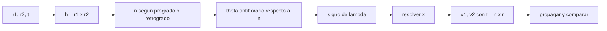

# B82-C02 — Lambert de arco largo

<!-- nav:top -->
[🏠 Programa](../../../../README.md) · [📚 Bloque B82](../../../tronco-comun/B82-problema-de-lambert-y-transferencias-de-dos-puntos.md) · [← Anterior: B82-C01 — Lambert de arco corto](../B82-C01-lambert-de-arco-corto/CLASE.md) · [Siguiente: B82-C03 — Formulación de variables universales →](../B82-C03-formulacion-de-variables-universales/CLASE.md)
<!-- /nav -->

## 1. Ubicación, nivel y alcance

Clase 2 del bloque B82. Nivel N3. En [C01](../B82-C01-lambert-de-arco-corto/CLASE.md) resolviste `θ < 180°`. Aquí el ángulo recorrido supera 180° y debes decidir **en qué sentido** gira la nave y **cuál es la normal del plano**. Usas la misma ecuación de Lambert con un parámetro `λ` que cambia de signo. Los datos son sintéticos: el mismo par de órbitas circulares de ejemplo (1 y 1,524 UA) y un tiempo de vuelo de 300 d.

## 2. Por qué esta clase existe

Dos puntos no determinan un sentido de giro: se puede ir de `r1` a `r2` recorriendo `θ` en sentido antihorario o `2π − θ` en horario. La decisión central: **¿en qué sentido y por qué plano se ejecuta la transferencia, y cómo lo codifica el algoritmo?**

## 3. Lo que podrás hacer al terminar

1. Definir `θ` respecto a la normal `n` del movimiento y decidir si el arco es corto o largo.
2. Asignar el signo de `λ = ±√(1 − c/s)` según `θ`.
3. Construir la normal del plano con `r1 × r2` y el sentido prógrado o retrógrado.
4. Resolver una transferencia de más de 180° y verificarla por propagación.
5. Comparar la solución prógrada y la retrógrada del mismo par.
6. Tratar un caso tridimensional y reportar la inclinación.

La evidencia es la **comparación prograda frente a retrógrada para un mismo par de posiciones** del ejercicio 12 (sección 20).

## 4. Con qué llegas y cómo comprobarlo

1. ¿Cómo se define el producto vectorial y qué dirección tiene `r1 × r2`?
2. ¿Qué es una órbita prógrada y una retrógrada?
3. ¿Qué es el momento angular específico `h = r × v`?
4. ¿Cuál es el resultado de C01 para el semieje a 200 d?
5. ¿Por qué hay que verificar por propagación?

<details>
<summary>Ver respuestas</summary>

1. Es perpendicular a ambos; su sentido sigue la regla de la mano derecha. 2. Prógrada: gira como el sentido de referencia (`h_z > 0`); retrógrada: al contrario. 3. `h = r × v`, perpendicular al plano orbital. 4. `a = 1,124315 UA` en la rama corta. 5. Porque el propagador independiente comprueba que la velocidad lleva realmente a `r2`.
</details>

Con cuatro o cinco aciertos, sigue; si no, repasa los prerrequisitos.

## 5. Un caso de contexto y casos de referencia

Con `r1 = (1; 0; 0) UA` y `r2` a `260°` antihorario con radio `1,524 UA`, y `t = 300 d`: la lectura **prógrada** recorre `θ = 260°` (arco largo, `λ = −0,3537`, `h_z = +1,0351`, `|v1| = 31,9316 km/s`); la **retrógrada** recorre `100°` en sentido horario (`λ = +0,3537`, `h_z = −0,8749`, `|v1| = 32,0245 km/s`). Es el **ejemplo conductor**; todo es sintético.

## 6. Vocabulario

La **normal de movimiento** `n` es el eje alrededor del cual la nave gira en sentido antihorario; `θ ∈ (0, 2π)` se mide así. El parámetro `λ = ±√(1 − c/s)` es positivo si `θ < π` y negativo si `θ > π`. Una transferencia es **prógrada** si `n` apunta hacia el eje de referencia `+z` (`h_z > 0`) y **retrógrada** si apunta hacia `−z`. La dirección **tangencial** `t̂ = n × r̂` da el sentido del movimiento en cada extremo.

## 7. Modelo mental: un camino en dos sentidos



*Descripción textual:* de `r1 × r2` y del sentido elegido sale la normal; respecto a ella se mide `θ`, que fija el signo de `λ`; se resuelve para `x` y las velocidades se orientan con `n × r̂`; se comprueba por propagación.

Analogía: ir de una esquina de una plaza circular a otra puede hacerse por la derecha o por la izquierda, y el tiempo disponible exige el sentido que sea más corto o más largo. Límite: aquí el tiempo es el mismo en ambos sentidos y lo que cambia son la velocidad y el plano.

## 8. La explicación, paso a paso

### 8.1 Definir θ y λ

Con `n = +z` (prógrada), si `n·(r1 × r2) ≥ 0` el arco es corto (`θ < π`) y `λ = +√(1 − c/s)`; si es negativo, `θ > π` y `λ = −√(1 − c/s)`. Para el par a 260° `c = 1,9626 UA` y `s = 2,2433 UA` dan `|λ| = 0,3537`, con signo menos en la lectura prógrada y más en la retrógrada (porque su `n = −z`).

### 8.2 Resolver y orientar

Se resuelve `T(x, λ) = T` (clase C06) y las velocidades se componen con la dirección radial `r̂` y la tangencial `n × r̂`. Con `t = 300 d`: prógrada `x = −0,21417` y retrógrada `x = −0,23105`, ambas en 3 iteraciones y con residuo `10⁻¹⁵ UA`.

### 8.3 Barrido de θ

| `θ` | `λ` | módulo de `v1` (km/s) | energía (canónica) |
|---|---|---|---|
| 60° | +0,5532 | 31,2976 | −0,44791 |
| 120° | +0,2612 | 32,3612 | −0,40976 |
| 170° | +0,0427 | 32,8427 | −0,39206 |
| 190° | −0,0427 | 32,8426 | −0,39206 |
| 230° | −0,2164 | 32,4891 | −0,40508 |
| 270° | −0,4016 | 31,6939 | −0,43385 |
| 320° | −0,6595 | 30,1631 | −0,48721 |
| 350° | −0,7959 | 29,2281 | −0,51851 |

La solución es continua al cruzar 180° (170° y 190° casi coinciden): el signo de `λ` no introduce un salto cuando el plano está bien definido.

### 8.4 Caso tridimensional

Con `r2 = (1,2; 0,9; 0,15) UA` la normal sale de `r1 × r2`: la lectura prógrada da una inclinación de `9,462°` y la retrógrada `170,538°`, ambas con residuo `10⁻¹⁵ UA`.

## 9. Magnitudes, símbolos y unidades

| Símbolo | Qué es | Unidad | Valor / nota |
|---|---|---|---|
| `n` | normal de movimiento | — | ±z o ±(r1 × r2) normalizado |
| `θ` | ángulo recorrido | grados | 100° o 260° |
| `λ` | parámetro de forma | — | ±0,3537 |
| `x` | variable de Lancaster–Blanchard | — | −0,21417 |
| `h` | momento angular específico | UA²/TU | 1,0351 (z) |
| `t` | tiempo de vuelo | d | 300 |

## 10. Convenciones y referencias

Constantes de S1; unidades canónicas como en C01. Sistema de referencia inercial heliocéntrico **de ejemplo**, referencia `+z`. `θ` antihorario alrededor de `n`. Modelo de dos cuerpos, `M = 0`. Tolerancias: residuo `< 10⁻¹⁰ UA`; universal frente a Izzo `< 10⁻⁸`. Datos sintéticos.

## 11. De dónde sale lo que afirmamos

| ID | Fuente | Localizador | Respalda | Estado |
|---|---|---|---|---|
| S1 | NASA/JPL Solar System Dynamics, Astrodynamic Parameters — https://ssd.jpl.nasa.gov/astro_par.html (consultada 2026-11-10) | página de parámetros | `GM` del Sol = 1,32712440041279419 × 10²⁰ m³/s² (DE440, Park et al. 2021 según la página) y 1 UA = 149 597 870,7 km | Consultada |
| S2 | D. Izzo, «Revisiting Lambert's Problem», arXiv:1403.2705 (2014) — https://arxiv.org/abs/1403.2705 (consultada 2026-11-10) | solo la página de resumen | reformulación de Lancaster–Blanchard con una variable nueva e iteración de Householder; precisión comparable a Gooding con menor costo | Consultada (solo el resumen) |
| — | Relaciones estándar de la mecánica kepleriana (teorema de Lambert, coeficientes de Lagrange, funciones de Stumpff, ecuación de Kepler universal) | — | las verifica el laboratorio propagando la órbita con un propagador independiente | No consultada en una fuente concreta |
| — | Gooding (1990) y libros de texto de astrodinámica | — | — | No consultada |

Límites: la formulación `λ`–`x` de S2 se consultó solo en su resumen; las fórmulas de velocidad se validan por propagación. No se infiere nada de una misión real.

## 12. Cómo ver el barrido del ángulo

| Magnitud | Valor |
|---|---|
| `λ` prógrada (260°) | −0,3537 |
| `λ` retrógrada (100° horario) | +0,3537 |
| inclinación 3D | 9,462° / 170,538° |
| universal − Izzo | 2,6 × 10⁻¹⁴ |

Descripción larga: `|v1|` baja de 32,84 a 29,23 km/s al pasar de 170° a 350°, sin saltos al cruzar 180°.

## 13. Ejemplo trabajado: el mismo par en dos sentidos

**Paso 1.** `c = 1,9626`, `s = 2,2433`, `|λ| = 0,3537`.

**Paso 2 · Prógrada.** `n·(r1 × r2) < 0` para 260°: `λ = −0,3537`, `x = −0,21417`, `|v1| = 31,9316 km/s`, `h_z > 0`.

**Paso 3 · Retrógrada.** `n = −z`: `λ = +0,3537`, `x = −0,23105`, `|v1| = 32,0245 km/s`, `h_z < 0`.

**Paso 4.** Ambas propagadas llegan a `r2` con `10⁻¹⁵ UA`.

## 14. Distintas formas de describir un arco largo

**Por `λ` y `x`:** el método de la clase. **Por variables universales:** `Δθ = 2π − arccos(...)` (C03); la diferencia de velocidad entre los dos es `2,6 × 10⁻¹⁴`. **Por inclinación:** útil en 3D.

## 15. Práctica guiada

**Ejercicio 1 · con los pasos indicados.** Calcula `|λ|` para `c = 1,9626` y `s = 2,2433`. *Pasos:* `c/s`, `1 − c/s`, raíz.

<details><summary>Solución comentada</summary>

`c/s = 0,8749`; `1 − 0,8749 = 0,1251`; `|λ| = 0,3537`.
</details>

**Ejercicio 2 · con una pista.** ¿Qué ángulo recorre la lectura retrógrada del par a 260° antihorario? *Pista:* `360° − 260°`.

<details><summary>Solución comentada</summary>

`100°` en sentido horario.
</details>

**Ejercicio 3 · casi autónomo.** ¿Qué signo tiene `h_z` en una transferencia prógrada?

<details><summary>Solución comentada</summary>

Positivo (8.1).
</details>

## 16. Práctica autónoma, transferencia e integrador

**Ejercicio 4 · autónomo.** ¿Qué signo tiene `λ` para `θ = 190°`?

<details><summary>Solución comentada</summary>

Negativo: `−0,0427` (8.3).
</details>

**Ejercicio 5 · autónomo.** ¿Qué ángulo del barrido da la menor `|v1|` entre 60° y 350°?

<details><summary>Solución comentada</summary>

350°, con `29,2281 km/s` (8.3).
</details>

**Ejercicio 6 · autónomo.** ¿Cuál es el valor límite de `|λ|` cuando `θ → 360°` con estos radios?

<details><summary>Solución comentada</summary>

`c → 0,524`, `s → 1,524`; `|λ| → √(1 − 0,3438) = 0,810`.
</details>

**Ejercicio 7 · autónomo.** ¿Qué relación hay entre las inclinaciones prógrada y retrógrada del caso 3D?

<details><summary>Solución comentada</summary>

Suman 180°: `9,462° + 170,538°`.
</details>

**Ejercicio 8 · autónomo.** Si el signo de `λ` estuviera mal, ¿qué detectaría el script?

<details><summary>Solución comentada</summary>

El residuo de propagación sería grande y la prueba fallaría.
</details>

**Ejercicio 9 · transferencia.** **Transferencia.** ¿Cuál sentido conviene a una misión?

<details><summary>Solución comentada</summary>

No se decide solo con la velocidad (aquí 31,93 frente a 32,02 km/s): intervienen la inclinación final, el plano y las restricciones de misión.
</details>

**Ejercicio 10 · transferencia.** **Transferencia.** Un compañero usa `arccos` y siempre obtiene `θ < 180°`. ¿Qué pierde?

<details><summary>Solución comentada</summary>

El arco largo: hace falta el signo de `n·(r1 × r2)` para saber si `θ > π`.
</details>

**Ejercicio 11 · transferencia.** **Transferencia.** ¿Por qué `λ` no cambia el tiempo de vuelo, solo la solución?

<details><summary>Solución comentada</summary>

`T(x, λ)` es la misma curva reflejada: el tiempo es dato; `λ` selecciona el lado del plano desde el que se mide `θ`.
</details>

**Ejercicio 12 · integrador.** **Integrador.** Elabora tu *comparación prograda frente a retrógrada*: tabla de `λ`, `x`, `h_z`, `|v1|`, residuo para el par a 260° y barrido de `θ`.

<details><summary>Solución comentada</summary>

Secciones 8.1–8.4 y la salida del laboratorio.
</details>

## 17. Laboratorio: arco largo y sentido de giro

El script [arco_largo.py](arco_largo.py) resuelve el par a 260° en las dos lecturas, compara con variables universales, barre `θ` y trata un caso 3D (**comprueba** residuo `< 10⁻¹⁰` UA, signo de `h_z` y acuerdo universal–Izzo `< 10⁻⁸`). Usa la biblioteca común [lambert_comun.py](../lambert_comun.py) del bloque.

**Datos:** constantes del JPL (consultadas el 2026-11-10); posiciones y tiempos de vuelo **sintéticos** (órbitas circulares de ejemplo, no son efemérides). **Predice antes de ejecutar:** ¿qué signo tendrá `h_z` en la lectura retrógrada? (negativo.) **Ejecución del 2026-11-10 (Python 3.12.9, numpy 2.4.4):**

```text
Python 3.12.9 | numpy 2.4.4
Datos SINTETICOS: r1 = 1 UA, r2 = 1.524 UA, tof = 300 d
Mismo par (r1, r2 a 260 deg antihorario), tres lecturas:
  prograda (theta = 260 deg): lambda = -0.3537, h_z = +1.0351, |v1| = 31.9316 km/s, x = -0.21417, iter = 3, residuo = 1.2e-15
  retrograda (theta = 100 deg horario): lambda = +0.3537, h_z = -0.8749, |v1| = 32.0245 km/s, x = -0.23105, iter = 3, residuo = 1.1e-15
Prograda: |v1(universal) - v1(Izzo)| = 2.64e-14
Barrido de theta (prograda, tof 300 d): theta, lambda, |v1| [km/s], energia, residuo
    60  +0.5532    31.2976  -0.44791  2.5e-15
   120  +0.2612    32.3612  -0.40976  6.2e-15
   170  +0.0427    32.8427  -0.39206  1.7e-14
   190  -0.0427    32.8426  -0.39206  5.9e-15
   230  -0.2164    32.4891  -0.40508  2.0e-15
   270  -0.4016    31.6939  -0.43385  1.9e-15
   320  -0.6595    30.1631  -0.48721  2.7e-15
   350  -0.7959    29.2281  -0.51851  8.9e-16
Caso 3D (r2 con z = +0.15 UA, SINTETICO): la normal sale de r1 x r2
  prograda=True: inclinacion = 9.462 deg, residuo = 5.4e-15
  prograda=False: inclinacion = 170.538 deg, residuo = 2.5e-15
Pruebas superadas.
```

```bash
python programa/clases/B82/B82-C02-lambert-de-arco-largo/arco_largo.py
```

**Límites:** solo `M = 0`; el tiempo es el mismo en ambos sentidos; no se optimiza ninguna maniobra.

## 18. Errores frecuentes y cómo corregirlos

**Medir `θ` siempre menor que 180°.** Usa el signo de `n·(r1 × r2)` (8.1)

**Mezclar `n = +z` con la normal de `r1 × r2` sin ajustar `λ`.** Revisa 8.1

**Tomar el sentido por la velocidad más baja.** Considera el plano y la misión (ejercicio 9)

## 19. Cómo sabrás que vas bien

Tras la sección 8: ¿qué signo de `λ` esperabas en 260° prógrado y cuál obtuviste? Si dudas, repasa el ejemplo 13. Tras el laboratorio: ¿qué comprueba el signo de `h_z`? (ver sección 17).

## 20. Qué entregas y cómo se evalúa

El producto es tu **comparación prograda frente a retrógrada para un mismo par de posiciones** (ejercicio 12).

| Criterio | Inicial | En desarrollo | Logrado | Destacado |
|---|---|---|---|---|
| Conceptos | Los confunde | Parciales | Explica el método y su dominio | Explica los límites y las alternativas |
| Cálculo | Sin unidades | Con errores | Resultados con unidades y comprobados | Resuelve casos nuevos |
| Numérico | Sin comprobar | Un caso | Verifica por propagación en varios casos | Interpreta las diferencias y los fallos |
| Fuentes | Sin fuente | Sin fecha | Fuentes con fecha y estado | Declara lo sintético y lo no consultado |
| Límites | No los nombra | Uno | Tres | Discute qué falta del modelo |

**Condiciones críticas (no se compensan con promedio):** rotular los datos como sintéticos; verificar cada solución por propagación; citar solo lo consultado.

## 21. Ética, seguridad y límites

Clase educativa: los modelos son de dos cuerpos y los datos son sintéticos; ningún resultado describe una misión real ni sustituye el diseño de trayectorias con herramientas validadas y revisión de especialistas. Accesibilidad: tablas equivalentes a las gráficas, fórmulas en texto, ejercicios sin conexión.

## 22. Para cerrar y seguir

El mismo par de posiciones admite una lectura prógrada de 260° y una retrógrada de 100° con velocidades de `31,93` y `32,02 km/s`, ambas verificadas. Queda una pregunta: ¿cómo se unifican elipse, parábola e hipérbola en una sola formulación?

**Glosario español–inglés.** arco largo · *long way*; arco corto · *short way*; prógrada · *prograde*; retrógrada · *retrograde*; normal del plano · *plane normal*.

**Continuidad.** [B82-C03](../B82-C03-formulacion-de-variables-universales/CLASE.md) formula Lambert con variables universales.

**Referencias:** ver sección 11.

<!-- nav:bottom -->
---

[← Anterior: B82-C01 — Lambert de arco corto](../B82-C01-lambert-de-arco-corto/CLASE.md) · [📚 Bloque B82](../../../tronco-comun/B82-problema-de-lambert-y-transferencias-de-dos-puntos.md) · [Siguiente: B82-C03 — Formulación de variables universales →](../B82-C03-formulacion-de-variables-universales/CLASE.md)
<!-- /nav -->
