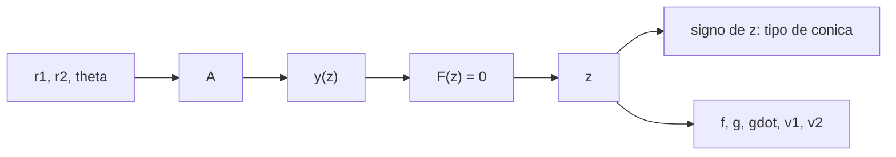

# B82-C03 — Formulación de variables universales

<!-- nav:top -->
[🏠 Programa](../../../../README.md) · [📚 Bloque B82](../../../tronco-comun/B82-problema-de-lambert-y-transferencias-de-dos-puntos.md) · [← Anterior: B82-C02 — Lambert de arco largo](../B82-C02-lambert-de-arco-largo/CLASE.md) · [Siguiente: B82-C04 — Lambert multirrevolución →](../B82-C04-lambert-multirrevolucion/CLASE.md)
<!-- /nav -->

## 1. Ubicación, nivel y alcance

Clase 3 del bloque B82. Nivel N3. En C01 y C02 asumiste una elipse. Aquí usas **variables universales** para resolver Lambert sin saber de antemano si la cónica es una elipse, una parábola o una hipérbola: una sola variable `z` y las funciones de Stumpff cubren los tres casos. Los datos son sintéticos: el ejemplo conductor de C01 (1 y 1,524 UA, `θ = 100°`) con tiempos entre 40 y 800 d.

## 2. Por qué esta clase existe

El tiempo de vuelo decide el tipo de cónica: si es corto, la nave necesita energía positiva. La decisión central: **¿cómo se resuelve Lambert con una sola ecuación que funcione para cualquier tiempo de vuelo, y qué dice el signo de `z`?**

## 3. Lo que podrás hacer al terminar

1. Definir `z = α χ²` y las funciones de Stumpff `C(z)` y `S(z)`.
2. Plantear `F(z) = (y/C)^(3/2) S + A√y − √μ t = 0`.
3. Resolver `z` por bisección y por Newton con salvaguarda.
4. Clasificar la cónica por el signo de `z` y reconocer el tiempo parabólico.
5. Obtener `v1` y `v2` con `f`, `g` y `ġ`.
6. Verificar con la fórmula de Euler y por propagación.

La evidencia es la **barrido del tiempo de vuelo con el tipo de cónica** del ejercicio 12 (sección 20).

## 4. Con qué llegas y cómo comprobarlo

1. ¿Qué tipos de cónica existen según la energía?
2. ¿Qué es el tiempo de vuelo de una parábola (Euler)?
3. ¿Qué es una función con dos ramas analíticas (por ejemplo `cos √z` y `cosh √−z`)?
4. ¿Qué es el método de bisección?
5. ¿Qué dice C01 sobre `t_p` en el ejemplo?

<details>
<summary>Ver respuestas</summary>

1. Elipse (`ε < 0`), parábola (`ε = 0`), hipérbola (`ε > 0`). 2. `t_p = (√2/3)(s^(3/2) − (s−c)^(3/2))` para `θ < 180°`. 3. Permiten unificar elipse e hipérbola en una sola expresión. 4. Reducir un intervalo a la mitad conservando la raíz. 5. `t_p = 88,000 d`.
</details>

Con cuatro o cinco aciertos, sigue; si no, repasa los prerrequisitos.

## 5. Un caso de contexto y casos de referencia

Con `r1 = 1 UA`, `r2 = 1,524 UA` y `θ = 100°`, el ejemplo de C01: a `40 d` el barrido da `z = −2,9797` (hipérbola, `|v1| = 85,0791 km/s`); a `88 d`, `z ≈ 0` (parábola); a `200 d`, `z = +5,3918` (elipse, `31,3882 km/s`); a `800 d`, `z = +15,5518`. Es el **ejemplo conductor**; todo es sintético.

## 6. Vocabulario

La **variable universal** `χ` y `z = α χ²` con `α = 1/a`: `z > 0` elipse, `z = 0` parábola, `z < 0` hipérbola. Las **funciones de Stumpff** son `C(z) = (1 − cos √z)/z` y `S(z) = (√z − sin √z)/√z³` (con las formas hiperbólicas para `z < 0`). La constante geométrica `A = sin Δθ √(r1 r2/(1 − cos Δθ))` y `y(z) = r1 + r2 + A (z S − 1)/√C`. Los coeficientes son `f = 1 − y/r1`, `g = A√(y/μ)`, `ġ = 1 − y/r2`.

## 7. Modelo mental: un solo dial para todas las cónicas



*Descripción textual:* de la geometría salen `A` e `y(z)`; se resuelve `F(z) = 0`; el signo de `z` clasifica la cónica y de `z` salen `f`, `g`, `ġ` y las velocidades.

Analogía: un dial que va de negativo a positivo pasa de hipérbola a elipse sin cambiar de fórmula, como un termostato continuo. Límite: `F(z)` solo está definida donde `y(z) > 0`, y esta versión no cubre revoluciones completas.

## 8. La explicación, paso a paso

### 8.1 Funciones de Stumpff

Para `z > 0`, `C = (1 − cos √z)/z` y `S = (√z − sin √z)/√z³`; para `z < 0` se usan `cosh` y `sinh`; en `z = 0`, `C = 1/2` y `S = 1/6`. El laboratorio comprueba `C(π²) = 2/π² = 0,20264237` y los valores `C(−1) = 0,54308063`, `S(−1) = 0,17520119`.

### 8.2 La ecuación de Lambert universal

Con `A` e `y(z)`, el tiempo de vuelo es `√μ t = (y/C)^(3/2) S + A√y`. Se resuelve `F(z) = 0` en el intervalo donde `y > 0`: por bisección (46 iteraciones para `10⁻¹²`) o por Newton con salvaguarda (4 a 17 iteraciones). La velocidad sale de `v1 = (r2 − f r1)/g` y `v2 = (ġ r2 − r1)/g`.

### 8.3 El barrido del tiempo de vuelo

| `t` (d) | `z` | Tipo | módulo de `v1` (km/s) |
|---|---|---|---|
| 40 | −2,9797 | hipérbola | 85,0791 |
| 70 | −1,1218 | hipérbola | 50,4383 |
| 88,00 | ≈ 0 | parábola | 42,1219 |
| 120 | +1,8295 | elipse | 35,1265 |
| 200 | +5,3918 | elipse | 31,3882 |
| 400 | +10,6054 | elipse | 33,1369 |
| 800 | +15,5518 | elipse | 35,9976 |

### 8.4 La parábola como frontera

Con `t = t_p` de Euler (88,0005 d) el laboratorio obtiene `z = −8 × 10⁻¹⁴`: la formulación universal reproduce, sin pasar por la fórmula de Euler, la frontera entre elipse e hipérbola. Los tiempos más cortos exigen más velocidad: 85 km/s a 40 d.

## 9. Magnitudes, símbolos y unidades

| Símbolo | Qué es | Unidad | Valor / nota |
|---|---|---|---|
| `z` | variable universal | — | −2,98 a +15,55 |
| `C(z)`, `S(z)` | funciones de Stumpff | — | 0,5 y 1/6 en 0 |
| `A` | constante geométrica | UA^(1/2)·… | de `r1`, `r2`, `Δθ` |
| `y(z)` | radio auxiliar | UA | > 0 |
| `f`, `g`, `ġ` | coeficientes de Lagrange | —, TU, — | — |
| `t_p` | tiempo parabólico | d | 88,0005 |

## 10. Convenciones y referencias

Constantes de S1; unidades canónicas; `θ` según C02; plano `z = 0` de ejemplo. Intervalo de `z`: `(−4π², 4π²)`. Tolerancias: bisección y Newton coinciden en `z` a `10⁻⁸`, residuo `< 10⁻⁹ UA`, `|z| < 10⁻⁹` en `t_p`. Datos sintéticos.

## 11. De dónde sale lo que afirmamos

| ID | Fuente | Localizador | Respalda | Estado |
|---|---|---|---|---|
| S1 | NASA/JPL Solar System Dynamics, Astrodynamic Parameters — https://ssd.jpl.nasa.gov/astro_par.html (consultada 2026-11-10) | página de parámetros | `GM` del Sol = 1,32712440041279419 × 10²⁰ m³/s² (DE440, Park et al. 2021 según la página) y 1 UA = 149 597 870,7 km | Consultada |
| S2 | D. Izzo, «Revisiting Lambert's Problem», arXiv:1403.2705 (2014) — https://arxiv.org/abs/1403.2705 (consultada 2026-11-10) | solo la página de resumen | reformulación de Lancaster–Blanchard con una variable nueva e iteración de Householder; precisión comparable a Gooding con menor costo | Consultada (solo el resumen) |
| — | Relaciones estándar de la mecánica kepleriana (teorema de Lambert, coeficientes de Lagrange, funciones de Stumpff, ecuación de Kepler universal) | — | las verifica el laboratorio propagando la órbita con un propagador independiente | No consultada en una fuente concreta |
| — | Gooding (1990) y libros de texto de astrodinámica | — | — | No consultada |

Límites: la formulación universal es una relación estándar no consultada en una fuente concreta; el laboratorio la valida con la fórmula de Euler y por propagación.

## 12. Cómo ver el tipo de cónica

| Magnitud | Valor |
|---|---|
| `t_p` | 88,0005 d |
| `z(t_p)` | −8 × 10⁻¹⁴ |
| iteraciones (bisección) | 46 |
| residuo máximo | 1,0 × 10⁻¹² UA |

Descripción larga: `z` crece con el tiempo de vuelo, cruza cero en 88 d y sube hasta 15,55 a 800 d.

## 13. Ejemplo trabajado: la frontera parabólica

**Paso 1.** `s^(3/2) = 3,3600`, `(s−c)^(3/2) = 0,1487`.

**Paso 2.** `t_p = 0,47140 × 3,2113 = 1,5138 TU = 88,0 d`.

**Paso 3.** El solucionador universal con `t = t_p` devuelve `z ≈ 0`.

**Paso 4.** Para `t > t_p`, `z > 0` (elipse); para `t < t_p`, `z < 0` (hipérbola).

## 14. Distintas formas de describir la solución según el método

**Bisección:** robusta, 46 iteraciones. **Newton con salvaguarda:** 4 a 17 iteraciones, usa la derivada de `F`. **Por `x`:** C06. En ambos, el residuo es del orden `10⁻¹³ UA` o menor.

## 15. Práctica guiada

**Ejercicio 1 · con los pasos indicados.** Calcula `C(0)` y `S(0)`. *Pasos:* límites de las series.

<details><summary>Solución comentada</summary>

`C(0) = 1/2`, `S(0) = 1/6`.
</details>

**Ejercicio 2 · con una pista.** ¿Qué signo de `z` corresponde a una hipérbola? *Pista:* `z = α χ²`, `α = 1/a`.

<details><summary>Solución comentada</summary>

Negativo, porque `a < 0` en la hipérbola.
</details>

**Ejercicio 3 · casi autónomo.** ¿Qué tipo de cónica da `z = +5,3918`?

<details><summary>Solución comentada</summary>

Elipse (8.3).
</details>

## 16. Práctica autónoma, transferencia e integrador

**Ejercicio 4 · autónomo.** Calcula el tiempo parabólico con `s = 2,243307`, `c = 1,962614` en TU.

<details><summary>Solución comentada</summary>

`1,5138 TU`, es decir `88,0 d`.
</details>

**Ejercicio 5 · autónomo.** ¿Cuántas iteraciones necesita Newton a 200 d y cuántas la bisección?

<details><summary>Solución comentada</summary>

6 y 46.
</details>

**Ejercicio 6 · autónomo.** ¿Qué le pasa a `|v1|` cuando `t` baja de 70 a 40 d?

<details><summary>Solución comentada</summary>

Sube de 50,44 a 85,08 km/s.
</details>

**Ejercicio 7 · autónomo.** Comprueba `C(π²) = 2/π²`.

<details><summary>Solución comentada</summary>

`C = (1 − cos π)/π² = 2/π² = 0,20264`.
</details>

**Ejercicio 8 · autónomo.** ¿Por qué `F(z)` solo se evalúa donde `y(z) > 0`?

<details><summary>Solución comentada</summary>

Porque `√y` y `√(1/C)` no están definidas para `y < 0` (8.2).
</details>

**Ejercicio 9 · transferencia.** **Transferencia.** Un algoritmo solo elíptico, ¿qué falla a 40 d?

<details><summary>Solución comentada</summary>

No hay elipse: la energía es positiva y `z < 0`.
</details>

**Ejercicio 10 · transferencia.** **Transferencia.** ¿Por qué la formulación universal no cubre `M ≥ 1`?

<details><summary>Solución comentada</summary>

Cada `z` da una sola solución de `F(z) = 0`; las vueltas completas añaden `2π` al ángulo (C04).
</details>

**Ejercicio 11 · transferencia.** **Transferencia.** ¿Qué problema hay cuando `Δθ = π`?

<details><summary>Solución comentada</summary>

`A = 0` y `g` se anula: la fórmula de `v1` se vuelve singular (C05).
</details>

**Ejercicio 12 · integrador.** **Integrador.** Elabora tu *barrido del tiempo de vuelo con el tipo de cónica*: tabla de `t`, `z`, tipo, `|v1|`, iteraciones y residuo.

<details><summary>Solución comentada</summary>

Secciones 8.3–8.4 y la salida del laboratorio.
</details>

## 17. Laboratorio: variables universales para elipse, parábola e hipérbola

El script [universales.py](universales.py) resuelve Lambert por bisección y por Newton con salvaguarda, clasifica la cónica por el signo de `z` y compara con la fórmula de Euler (**comprueba** `|z| < 10⁻⁹` en `t_p`, `C(π²) = 2/π²`, acuerdo bisección–Newton `< 10⁻⁸` y residuo `< 10⁻⁹` UA). Usa la biblioteca común [lambert_comun.py](../lambert_comun.py) del bloque.

**Datos:** constantes del JPL (consultadas el 2026-11-10); posiciones y tiempos de vuelo **sintéticos** (órbitas circulares de ejemplo, no son efemérides). **Predice antes de ejecutar:** ¿qué signo tendrá `z` a 40 d? (negativo: hipérbola.) **Ejecución del 2026-11-10 (Python 3.12.9, numpy 2.4.4):**

```text
Python 3.12.9 | numpy 2.4.4
Datos SINTETICOS: r1 = 1 UA, r2 = 1.524 UA, theta = 100 deg
t_parabolico (Euler) = 88.0005 d
  z en t = t_p: -8.118e-14 (esperado 0)
Stumpff: C(z), S(z) en z = -1, 0, 1 y pi^2:
  z = -1.0000: C = 0.54308063, S = 0.17520119
  z = +0.0000: C = 0.50000000, S = 0.16666667
  z = +1.0000: C = 0.45969769, S = 0.15852902
  z = +9.8696: C = 0.20264237, S = 0.10132118
t [d]     z       tipo        |v1| [km/s]  iter(bis) iter(Newton)  residuo [UA]
  40.00   -2.9797  hiperbola     85.0791      46         5     4.1e-13
  70.00   -1.1218  hiperbola     50.4383      46         4     3.5e-14
  88.00   -0.0000  parabola      42.1219      46        17     2.6e-14
 120.00   +1.8295  elipse        35.1265      46         5     2.6e-14
 200.00   +5.3918  elipse        31.3882      46         6     2.1e-14
 400.00  +10.6054  elipse        33.1369      46         8     5.0e-14
 800.00  +15.5518  elipse        35.9976      46         7     1.0e-12
Pruebas superadas.
```

```bash
python programa/clases/B82/B82-C03-formulacion-de-variables-universales/universales.py
```

**Límites:** solo `M = 0`; `|z| < 4π²`; no trata `Δθ = π`; el propagador comparte las funciones de Stumpff con el solucionador.

## 18. Errores frecuentes y cómo corregirlos

**Usar `z > 0` siempre.** Revisa 8.1 y 8.3

**Evaluar `F(z)` donde `y < 0`.** Restringe el intervalo (8.2)

**Creer que `z = 0` es un punto singular.** Las series de Stumpff lo manejan (8.1)

## 19. Cómo sabrás que vas bien

Tras la sección 8: ¿qué signo de `z` esperabas a 120 d? Si dudas, repasa el ejemplo 13. Tras el laboratorio: ¿qué comprueba la parábola? (ver sección 17).

## 20. Qué entregas y cómo se evalúa

El producto es tu **barrido del tiempo de vuelo con el tipo de cónica** (ejercicio 12).

| Criterio | Inicial | En desarrollo | Logrado | Destacado |
|---|---|---|---|---|
| Conceptos | Los confunde | Parciales | Explica el método y su dominio | Explica los límites y las alternativas |
| Cálculo | Sin unidades | Con errores | Resultados con unidades y comprobados | Resuelve casos nuevos |
| Numérico | Sin comprobar | Un caso | Verifica por propagación en varios casos | Interpreta las diferencias y los fallos |
| Fuentes | Sin fuente | Sin fecha | Fuentes con fecha y estado | Declara lo sintético y lo no consultado |
| Límites | No los nombra | Uno | Tres | Discute qué falta del modelo |

**Condiciones críticas (no se compensan con promedio):** rotular los datos como sintéticos; verificar cada solución por propagación; citar solo lo consultado.

## 21. Ética, seguridad y límites

Clase educativa: los modelos son de dos cuerpos y los datos son sintéticos; ningún resultado describe una misión real ni sustituye el diseño de trayectorias con herramientas validadas y revisión de especialistas. Accesibilidad: tablas equivalentes a las gráficas, fórmulas en texto, ejercicios sin conexión.

## 22. Para cerrar y seguir

Una sola ecuación cubre de 40 a 800 d, de hipérbola a elipse, con residuo de `10⁻¹²` o menor y la frontera parabólica en `88,0 d`. Queda una pregunta: ¿qué ocurre si la nave da vueltas completas antes de llegar?

**Glosario español–inglés.** variable universal · *universal variable*; funciones de Stumpff · *Stumpff functions*; parábola · *parabola*; hipérbola · *hyperbola*; bisección · *bisection*.

**Continuidad.** [B82-C04](../B82-C04-lambert-multirrevolucion/CLASE.md) trata las soluciones con revoluciones completas.

**Referencias:** ver sección 11.

<!-- nav:bottom -->
---

[← Anterior: B82-C02 — Lambert de arco largo](../B82-C02-lambert-de-arco-largo/CLASE.md) · [📚 Bloque B82](../../../tronco-comun/B82-problema-de-lambert-y-transferencias-de-dos-puntos.md) · [Siguiente: B82-C04 — Lambert multirrevolución →](../B82-C04-lambert-multirrevolucion/CLASE.md)
<!-- /nav -->
