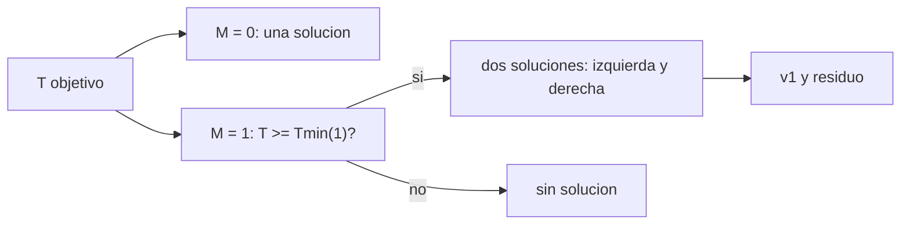

# B82-C04 — Lambert multirrevolución

<!-- nav:top -->
[🏠 Programa](../../../../README.md) · [📚 Bloque B82](../../../tronco-comun/B82-problema-de-lambert-y-transferencias-de-dos-puntos.md) · [← Anterior: B82-C03 — Formulación de variables universales](../B82-C03-formulacion-de-variables-universales/CLASE.md) · [Siguiente: B82-C05 — Singularidades del problema de Lambert →](../B82-C05-singularidades-del-problema-de-lambert/CLASE.md)
<!-- /nav -->

## 1. Ubicación, nivel y alcance

Clase 4 del bloque B82. Nivel N3. Hasta C03 la nave llegaba a `r2` sin completar vueltas. Aquí permites **`M` revoluciones completas** antes de llegar: con tiempos de vuelo largos aparecen varias órbitas válidas. Usas la variable `x` de Lancaster–Blanchard (la que emplea Izzo, S2). Los datos son sintéticos: el ejemplo conductor de C01 (1 y 1,524 UA, `θ = 100°`) con tiempos de 300 a 1500 d.

## 2. Por qué esta clase existe

Si hay tiempo de sobra, la nave puede dar una o más vueltas. La decisión central: **¿cuántas soluciones hay para un tiempo dado, existe alguna, y cuál se elige?**

## 3. Lo que podrás hacer al terminar

1. Incluir `M` en el tiempo de vuelo adimensional `T(x, λ, M)`.
2. Hallar el tiempo mínimo `T_min(M)` y su `x_min`.
3. Decidir si existen soluciones para un `T` y `M` dados.
4. Distinguir la rama izquierda (`x < x_min`) y la derecha (`x > x_min`).
5. Calcular `a`, `|v1|` y verificar por propagación cada solución.
6. Reconocer que el residuo de propagación no cuenta las vueltas.

La evidencia es la **tabla de soluciones por M y rama** del ejercicio 12 (sección 20).

## 4. Con qué llegas y cómo comprobarlo

1. ¿Qué es el periodo de una órbita elíptica?
2. ¿Qué es `T(x)` en la formulación de C06 (idea general)?
3. ¿Qué es un mínimo de una función y cómo se halla?
4. ¿Qué dice C03 sobre `M = 0`?
5. ¿Qué es un residuo de propagación?

<details>
<summary>Ver respuestas</summary>

1. `P = 2π √(a³/μ)`. 2. El tiempo de vuelo adimensional en función de la variable `x`. 3. Un punto donde la derivada se anula; se halla con Newton o Halley sobre `T'(x) = 0`. 4. Cada `z` da una sola solución sin vueltas completas. 5. La distancia entre `r2` y la posición propagada desde `(r1, v1)`.
</details>

Con cuatro o cinco aciertos, sigue; si no, repasa los prerrequisitos.

## 5. Un caso de contexto y casos de referencia

Para `r1 = 1 UA`, `r2 = 1,524 UA` (`θ = 100°`): `λ = 0,35373`, y una unidad de `T` adimensional equivale a `138,114 d`. Con `M = 1` el tiempo mínimo es `626,483 d`. A `300 d` solo hay la solución `M = 0`; a `1000 d` hay tres (`M = 0` y dos con `M = 1`); a `1500 d` hay cinco. Es el **ejemplo conductor**; todo es sintético.

## 6. Vocabulario

El **tiempo de vuelo adimensional** `T = t √(2μ/s³)`. Con `M` vueltas, `T(x, λ, M)` suma `Mπ` al ángulo `ψ`. El **tiempo mínimo** `T_min(M)` es el mínimo de esa curva, en `x = x_min`. La **rama izquierda** (`x < x_min`) corresponde a más energía en la dirección larga; la **derecha** (`x > x_min`), a la otra. `M = 0` tiene una única solución para cada `T`.

## 7. Modelo mental: una curva con un valle por cada M



*Descripción textual:* para cada `M ≥ 1` se compara `T` con `T_min(M)`: si es menor no hay solución; si es mayor hay dos, una por rama; para `M = 0` siempre hay una.

Analogía: la curva `T(x)` es un valle para cada `M`: una pelota que baja a una altura dada toca el valle en dos puntos si el nivel supera el fondo. Límite: el fondo cambia con la geometría (`λ`).

## 8. La explicación, paso a paso

### 8.1 El tiempo mínimo por M

| `M` | `x_min` | `T_min` (d) |
|---|---|---|
| 1 | +0,145959 | 626,483 |
| 2 | +0,085810 | 1068,659 |
| 3 | +0,060964 | 1505,982 |
| 4 | +0,047312 | 1941,763 |

Se halla con Halley sobre `T'(x) = 0`. El laboratorio lo contrasta con un barrido fino de `T(x)`: los mínimos coinciden a `10⁻²` en `x`.

### 8.2 Contar soluciones

Para `t = 300 d`: solo `M = 0`. Para `700 d`: `M = 0` y dos de `M = 1`. Para `1000 d`: igual que 700 d (`M = 2` exige `≥ 1068,66 d`). Para `1500 d`: `M = 0`, dos de `M = 1` y dos de `M = 2`.

### 8.3 Las soluciones a 1000 y 1500 d

| `t` (d) | `M` | Rama | `x` | `a` (UA) | módulo de `v1` (km/s) |
|---|---|---|---|---|---|
| 1000 | 0 | — | −0,68395 | 2,1075 | 36,7875 |
| 1000 | 1 | izquierda | −0,41081 | 1,3494 | 33,4189 |
| 1000 | 1 | derecha | +0,61496 | 1,8038 | 35,8113 |
| 1500 | 2 | izquierda | −0,38181 | 1,3131 | 33,1458 |
| 1500 | 2 | derecha | +0,51406 | 1,5245 | 34,5304 |

Todas pasan por `r2` con un residuo menor que `3 × 10⁻¹⁴ UA`. Las soluciones con vueltas completas tienen menor `a` que la de `M = 0`: dan vueltas en una órbita más pequeña.

### 8.4 Lo que el residuo no cuenta

El propagador devuelve la posición tras `t`, pero no cuenta cuántas veces pasó por `r2`. Una solución con `M = 1` y otra con `M = 0` pueden tener ambas residuo `10⁻¹⁵` y ser diferentes. El número de revoluciones lo fija el algoritmo, no la propagación.

## 9. Magnitudes, símbolos y unidades

| Símbolo | Qué es | Unidad | Valor / nota |
|---|---|---|---|
| `M` | revoluciones completas | — | 0 a 2 |
| `x` | variable de Lancaster–Blanchard | — | −0,76 a +0,74 |
| `T` | tiempo adimensional | — | 1 unidad = 138,114 d |
| `T_min(M)` | tiempo mínimo | d | 626,483 (M=1) |
| `a` | semieje | UA | 1,31 a 2,69 |
| `λ` | parámetro de forma | — | 0,35373 |

## 10. Convenciones y referencias

Constantes de S1; unidades canónicas; plano `z = 0` de ejemplo; prógrada. `T = t√(2μ/s³)`. Tolerancias: `x_min` Halley frente a barrido `10⁻²`; residuo `< 10⁻⁹ UA`. Datos sintéticos.

## 11. De dónde sale lo que afirmamos

| ID | Fuente | Localizador | Respalda | Estado |
|---|---|---|---|---|
| S1 | NASA/JPL Solar System Dynamics, Astrodynamic Parameters — https://ssd.jpl.nasa.gov/astro_par.html (consultada 2026-11-10) | página de parámetros | `GM` del Sol = 1,32712440041279419 × 10²⁰ m³/s² (DE440, Park et al. 2021 según la página) y 1 UA = 149 597 870,7 km | Consultada |
| S2 | D. Izzo, «Revisiting Lambert's Problem», arXiv:1403.2705 (2014) — https://arxiv.org/abs/1403.2705 (consultada 2026-11-10) | solo la página de resumen | reformulación de Lancaster–Blanchard con una variable nueva e iteración de Householder; precisión comparable a Gooding con menor costo | Consultada (solo el resumen) |
| — | Relaciones estándar de la mecánica kepleriana (teorema de Lambert, coeficientes de Lagrange, funciones de Stumpff, ecuación de Kepler universal) | — | las verifica el laboratorio propagando la órbita con un propagador independiente | No consultada en una fuente concreta |
| — | Gooding (1990) y libros de texto de astrodinámica | — | — | No consultada |

Límites: la formulación multirrevolución de S2 se consultó solo en su resumen; las soluciones se validan por propagación. No se infiere nada de una misión real.

## 12. Cómo ver las soluciones por tiempo de vuelo

| `t` (d) | Soluciones |
|---|---|
| 300 | 1 (M=0) |
| 700 | 3 (M=0; M=1 ×2) |
| 1000 | 3 |
| 1500 | 5 |

Descripción larga: cada `M` nuevo exige 437–443 d más y añade dos soluciones.

## 13. Ejemplo trabajado: contar y elegir a 1500 d

**Paso 1.** `T_min(2) = 1068,659 d < 1500 d`: existen dos soluciones con `M = 2`.

**Paso 2.** `T_min(3) = 1505,982 d > 1500 d`: no hay `M = 3`.

**Paso 3.** Se calculan las cinco: `M = 0` (38,0058 km/s), `M = 1` (35,4108 y 37,5653) y `M = 2` (33,1458 y 34,5304).

**Paso 4.** Todas se verifican por propagación.

## 14. Distintas formas de describir la selección de rama

**Por velocidad:** la de menor módulo de `v1` es `M = 2` izquierda (33,1458 km/s). **Por semieje:** menor `a` implica órbita más pequeña. **Por misión:** las restricciones reales deciden; no se resuelve aquí.

## 15. Práctica guiada

**Ejercicio 1 · con los pasos indicados.** Convierte `T = 4,5` a días con 1 unidad = 138,114 d. *Pasos:* multiplica.

<details><summary>Solución comentada</summary>

`4,5 × 138,114 = 621,5 d`.
</details>

**Ejercicio 2 · con una pista.** ¿Existe solución con `M = 1` a 500 d? *Pista:* compara con `T_min(1)`.

<details><summary>Solución comentada</summary>

No: `500 < 626,483` (8.1).
</details>

**Ejercicio 3 · casi autónomo.** ¿Cuántas soluciones hay a 1000 d?

<details><summary>Solución comentada</summary>

Tres (8.2).
</details>

## 16. Práctica autónoma, transferencia e integrador

**Ejercicio 4 · autónomo.** ¿Cuántas hay a 1500 d?

<details><summary>Solución comentada</summary>

Cinco: `M = 0`, dos de `M = 1` y dos de `M = 2`.
</details>

**Ejercicio 5 · autónomo.** ¿Por qué el tiempo mínimo crece con `M`?

<details><summary>Solución comentada</summary>

Porque cada vuelta completa añade un periodo (≈ 437–443 d aquí) (8.1).
</details>

**Ejercicio 6 · autónomo.** ¿Cuál solución de 1500 d tiene el menor `|v1|`?

<details><summary>Solución comentada</summary>

`M = 2` izquierda, 33,1458 km/s (8.3).
</details>

**Ejercicio 7 · autónomo.** ¿Qué signo tiene `x` en la rama izquierda y en la derecha?

<details><summary>Solución comentada</summary>

La izquierda tiene `x < x_min` (−0,41081 < 0,146) y la derecha `x > x_min` (+0,61496).
</details>

**Ejercicio 8 · autónomo.** Calcula la diferencia `T_min(2) − T_min(1)` en días.

<details><summary>Solución comentada</summary>

`1068,659 − 626,483 = 442,176 d`.
</details>

**Ejercicio 9 · transferencia.** **Transferencia.** ¿Por qué el residuo de propagación no distingue `M`?

<details><summary>Solución comentada</summary>

Porque solo mide la posición final, no el número de pasos por `r2` (8.4).
</details>

**Ejercicio 10 · transferencia.** **Transferencia.** Un planificador necesita llegar en 800 d sin vueltas extra. ¿Qué elige?

<details><summary>Solución comentada</summary>

`M = 0` o `M = 1`, según velocidad y misión; hay tres soluciones.
</details>

**Ejercicio 11 · transferencia.** **Transferencia.** ¿Qué falla si se aplica el algoritmo de C03 a 1500 d y se espera `M = 2`?

<details><summary>Solución comentada</summary>

C03 solo da `M = 0`; no encuentra las soluciones con vueltas completas.
</details>

**Ejercicio 12 · integrador.** **Integrador.** Elabora tu *tabla de soluciones por M y rama*: `T_min(M)`, número de soluciones por tiempo y `x`, `a`, `|v1|`, residuo de cada una.

<details><summary>Solución comentada</summary>

Secciones 8.1–8.3 y la salida del laboratorio.
</details>

## 17. Laboratorio: soluciones con M revoluciones

El script [multirrevolucion.py](multirrevolucion.py) calcula `T_min(M)` con Halley y un barrido de control, y resuelve las ramas izquierda y derecha para cuatro tiempos (**comprueba** `x_min` frente al barrido, residuo `< 10⁻⁹` UA y la ausencia de solución bajo `T_min`). Usa la biblioteca común [lambert_comun.py](../lambert_comun.py) del bloque.

**Datos:** constantes del JPL (consultadas el 2026-11-10); posiciones y tiempos de vuelo **sintéticos** (órbitas circulares de ejemplo, no son efemérides). **Predice antes de ejecutar:** ¿cuántas soluciones habrá a 1500 d? (cinco.) **Ejecución del 2026-11-10 (Python 3.12.9, numpy 2.4.4):**

```text
Python 3.12.9 | numpy 2.4.4
Datos SINTETICOS: r1 = 1 UA, r2 = 1.524 UA, theta = 100 deg
lambda = 0.35373 ; 1 unidad de T adimensional = 138.114 d
M   x_min      T_min [d]   (barrido x_min)
1  +0.145959     626.483   (+0.1459)
2  +0.085810    1068.659   (+0.0857)
3  +0.060964    1505.982   (+0.0609)
4  +0.047312    1941.763   (+0.0474)
Soluciones por tiempo de vuelo (prograda):
tof [d]   M  rama       x        a [UA]  |v1| [km/s]  residuo [UA]
   300   0  derecha   -0.23105   1.1849    32.0245   1.1e-15
   300   1  izquierda  sin solucion (T < T_min)
   300   1  derecha    sin solucion (T < T_min)
   300   2  izquierda  sin solucion (T < T_min)
   300   2  derecha    sin solucion (T < T_min)
   700   0  derecha   -0.59060   1.7225    35.4856   5.0e-15
   700   1  izquierda -0.12964   1.1408    31.5696   1.8e-14
   700   1  derecha   +0.39765   1.3323    33.2927   1.1e-14
   700   2  izquierda  sin solucion (T < T_min)
   700   2  derecha    sin solucion (T < T_min)
  1000   0  derecha   -0.68395   2.1075    36.7875   1.1e-14
  1000   1  izquierda -0.41081   1.3494    33.4189   8.0e-15
  1000   1  derecha   +0.61496   1.8038    35.8113   1.4e-14
  1000   2  izquierda  sin solucion (T < T_min)
  1000   2  derecha    sin solucion (T < T_min)
  1500   0  derecha   -0.76354   2.6898    38.0058   5.9e-14
  1500   1  izquierda -0.58490   1.7049    35.4108   1.1e-14
  1500   1  derecha   +0.73546   2.4432    37.5653   2.0e-14
  1500   2  izquierda -0.38181   1.3131    33.1458   1.1e-14
  1500   2  derecha   +0.51406   1.5245    34.5304   1.6e-14
Pruebas superadas.
```

```bash
python programa/clases/B82/B82-C04-lambert-multirrevolucion/multirrevolucion.py
```

**Límites:** solo prógrada, plano `z = 0`; no hay selección óptima de rama; el propagador no cuenta las vueltas.

## 18. Errores frecuentes y cómo corregirlos

**Esperar una única solución.** Cuenta con 8.2

**Resolver `M ≥ 1` por debajo de `T_min`.** No existe solución (8.1)

**Tomar el residuo como prueba del número de vueltas.** Revisa 8.4

## 19. Cómo sabrás que vas bien

Tras la sección 8: ¿cuántas soluciones esperabas a 1000 d? Si dudas, repasa el ejemplo 13. Tras el laboratorio: ¿qué comprueba el barrido? (ver sección 17).

## 20. Qué entregas y cómo se evalúa

El producto es tu **tabla de soluciones por M y rama** (ejercicio 12).

| Criterio | Inicial | En desarrollo | Logrado | Destacado |
|---|---|---|---|---|
| Conceptos | Los confunde | Parciales | Explica el método y su dominio | Explica los límites y las alternativas |
| Cálculo | Sin unidades | Con errores | Resultados con unidades y comprobados | Resuelve casos nuevos |
| Numérico | Sin comprobar | Un caso | Verifica por propagación en varios casos | Interpreta las diferencias y los fallos |
| Fuentes | Sin fuente | Sin fecha | Fuentes con fecha y estado | Declara lo sintético y lo no consultado |
| Límites | No los nombra | Uno | Tres | Discute qué falta del modelo |

**Condiciones críticas (no se compensan con promedio):** rotular los datos como sintéticos; verificar cada solución por propagación; citar solo lo consultado.

## 21. Ética, seguridad y límites

Clase educativa: los modelos son de dos cuerpos y los datos son sintéticos; ningún resultado describe una misión real ni sustituye el diseño de trayectorias con herramientas validadas y revisión de especialistas. Accesibilidad: tablas equivalentes a las gráficas, fórmulas en texto, ejercicios sin conexión.

## 22. Para cerrar y seguir

Con tiempo suficiente aparecen pares de soluciones por cada `M`: a 1500 d hay cinco, entre 33,15 y 38,01 km/s. Queda una pregunta: ¿dónde se degenera el problema, en 0° y 180°?

**Glosario español–inglés.** multirrevolución · *multi-revolution*; rama izquierda · *left branch*; rama derecha · *right branch*; tiempo mínimo · *minimum time of flight*.

**Continuidad.** [B82-C05](../B82-C05-singularidades-del-problema-de-lambert/CLASE.md) trata las singularidades.

**Referencias:** ver sección 11.

<!-- nav:bottom -->
---

[← Anterior: B82-C03 — Formulación de variables universales](../B82-C03-formulacion-de-variables-universales/CLASE.md) · [📚 Bloque B82](../../../tronco-comun/B82-problema-de-lambert-y-transferencias-de-dos-puntos.md) · [Siguiente: B82-C05 — Singularidades del problema de Lambert →](../B82-C05-singularidades-del-problema-de-lambert/CLASE.md)
<!-- /nav -->
