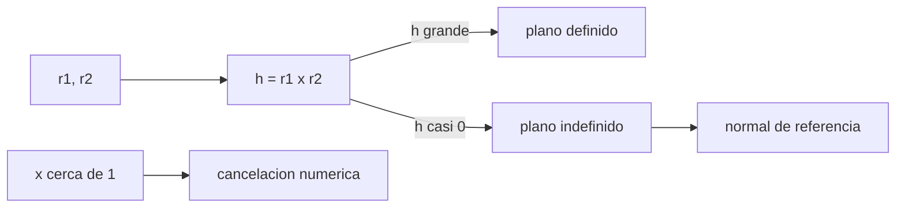

# B82-C05 — Singularidades del problema de Lambert

<!-- nav:top -->
[🏠 Programa](../../../../README.md) · [📚 Bloque B82](../../../tronco-comun/B82-problema-de-lambert-y-transferencias-de-dos-puntos.md) · [← Anterior: B82-C04 — Lambert multirrevolución](../B82-C04-lambert-multirrevolucion/CLASE.md) · [Siguiente: B82-C06 — Algoritmos iterativos para Lambert (Gooding, Izzo) →](../B82-C06-algoritmos-iterativos-para-lambert-gooding-izzo/CLASE.md)
<!-- /nav -->

## 1. Ubicación, nivel y alcance

Clase 5 del bloque B82. Nivel N3. Los métodos de C01–C04 fallan o se vuelven poco fiables en dos lugares: cuando `r1` y `r2` están alineados (**0° y 180°**, donde el plano de la transferencia no queda definido) y cuando la solución está cerca de la parábola (`x ≈ 1`), donde se pierde precisión. Los datos son sintéticos: `r1 = (1; 0; 0) UA`, `|r2| = 1,524 UA`, `t = 250 d`.

## 2. Por qué esta clase existe

Un solucionador que funciona en 99 % de los casos puede dar una respuesta absurda en el 1 % que importa. La decisión central: **¿qué hace el problema cuando la geometría es degenerada y cómo se protege el cálculo?**

## 3. Lo que podrás hacer al terminar

1. Explicar por qué `r1 × r2 = 0` deja indefinido el plano.
2. Calcular la inclinación del plano cerca de 180° como `atan(|ε|/δ)`.
3. Resolver el caso exacto de 180° con una normal de referencia.
4. Medir la pérdida de precisión de `T(x)` cerca de `x = 1`.
5. Reconocer que el módulo de la velocidad cambia poco aunque el plano cambie mucho.
6. Decidir una estrategia de protección (normal de referencia, otra forma de `T`).

La evidencia es la **mapa de sensibilidad del plano cerca de 180°** del ejercicio 12 (sección 20).

## 4. Con qué llegas y cómo comprobarlo

1. ¿Qué es el producto vectorial y cuándo se anula?
2. ¿Qué es la inclinación de un plano respecto al plano de referencia?
3. ¿Qué es la cancelación numérica?
4. ¿Qué dice C04 sobre `T(x)`?
5. ¿Qué es una segunda diferencia?

<details>
<summary>Ver respuestas</summary>

1. Un vector perpendicular a ambos; se anula si son paralelos o antiparalelos. 2. El ángulo entre la normal del plano y el eje de referencia. 3. La pérdida de cifras al restar números casi iguales. 4. Que `T` depende de `x`, `λ` y `M`. 5. Una estimación de la segunda derivada: `(f(x+d) + f(x−d) − 2f(x))/d²`.
</details>

Con cuatro o cinco aciertos, sigue; si no, repasa los prerrequisitos.

## 5. Un caso de contexto y casos de referencia

Con `r2 = 1,524 (−1; δ; ε)/norma` y `t = 250 d`, el módulo de `v1` es `32,7391 km/s` para todos los casos, pero la inclinación del plano es `atan(|ε|/δ)`: `0°` si `ε = 0`, `45°` si `ε = δ` (incluso para `10⁻⁶`), `89,9427°` si `δ = 10⁻⁹` y `ε = 10⁻⁶`. Es el **ejemplo conductor**; todo es sintético.

## 6. Vocabulario

La **singularidad de 180°**: `r1 × r2 → 0` y la normal `h = r1 × r2/|r1 × r2|` queda indeterminada. La **normal de referencia** es un vector que el usuario fija para romper la ambigüedad. La **cancelación** en `T(x)` cerca de `x = 1` aparece porque los términos `1/(1 − x²)` y el numerador se anulan a la vez. El **tiempo parabólico** (`x = 1`) se calcula aparte: `T(1) = (2/3)(1 − λ³)`.

## 7. Modelo mental: un compás que no sabe hacia dónde apuntar



*Descripción textual:* si `|r1 × r2|` es grande el plano queda definido; si es casi cero el plano es indefinido y se pasa una normal de referencia; cerca de `x = 1` aparece cancelación numérica.

Analogía: dos puntos opuestos de un círculo no determinan el plano que los contiene, como dos polos no determinan un meridiano. Límite: el módulo de la velocidad sí está bien definido.

## 8. La explicación, paso a paso

### 8.1 Plano y desviación

Con `r1 = (1; 0; 0)` y `r2 ∝ (−1; δ; ε)`, `h ∝ (0; −ε; δ)`: la inclinación del plano es `atan(|ε|/δ)`, sin importar cuán pequeños sean `δ` y `ε`.

| `δ` | `ε` | Inclinación (°) | Esperada (°) | módulo de `v1` (km/s) |
|---|---|---|---|---|
| 1e-2 | 0 | 0,00000 | 0,00000 | 32,7391 |
| 1e-2 | 1e-4 | 0,57294 | 0,57294 | 32,7391 |
| 1e-2 | 1e-2 | 45,00000 | 45,00000 | 32,7390 |
| 1e-2 | 1e-1 | 84,28941 | 84,28941 | 32,7323 |
| 1e-6 | ±1e-6 | 45,00000 | 45,00000 | 32,7391 |
| 1e-9 | 1e-6 | 89,94270 | 89,94270 | 32,7391 |

Un error de `10⁻⁶` (rad) en la posición cambia el plano en decenas de grados. El módulo de la velocidad casi no cambia, pero su dirección sí: `v1_z` pasa de `0` a `32,7307 km/s`.

### 8.2 Exactamente 180°

Con `r2 = −1,524 x̂` hay que fijar la normal. Tres normales de referencia dan tres soluciones con el mismo `|v1| = 32,7391 km/s` y residuo `4 × 10⁻¹⁶ UA`: la elección es del diseñador (por ejemplo, la normal de la órbita de la nave).

### 8.3 Residuo y precisión

Con `δ = 10⁻⁶` el residuo de propagación sube a `6 × 10⁻¹⁰ UA` (frente a `10⁻¹⁴`): hay pérdida de cifras en la geometría casi degenerada.

### 8.4 Cerca de la parábola

La segunda diferencia `(T(1+d) + T(1−d) − 2T(1))/d²` debe aproximar una constante (≈ 0,4630 para `λ = 0,5`). La forma de Lancaster–Blanchard la da hasta `d = 10⁻³` y falla desde `10⁻⁴` (0,1201); la forma de Lagrange la da hasta `10⁻⁴` (0,4630) y falla desde `10⁻⁵` (0,4345). Ambas son inutilizables en `x = 1` a precisión de máquina: se necesita una serie en `x = 1` para esa franja.

## 9. Magnitudes, símbolos y unidades

| Símbolo | Qué es | Unidad | Valor / nota |
|---|---|---|---|
| `δ` | desviación en el plano | — | 1e-2 a 1e-9 |
| `ε` | desviación fuera del plano | — | 0 a 1e-1 |
| `h` | normal del plano | — | (0; −ε; δ) |
| `x` | variable de LB | — | cerca de 1 |
| `T(1)` | tiempo parabólico | — | (2/3)(1 − λ³) |
| inclinación | ángulo del plano | grados | arco tangente de ε/δ en valor absoluto |

## 10. Convenciones y referencias

Constantes de S1; unidades canónicas; `t = 250 d`; normal de referencia `+z` por omisión. Tolerancias: inclinación a `10⁻⁶°`; residuo `< 10⁻⁹ UA`; segunda diferencia de referencia en `d = 10⁻²`. Datos sintéticos.

## 11. De dónde sale lo que afirmamos

| ID | Fuente | Localizador | Respalda | Estado |
|---|---|---|---|---|
| S1 | NASA/JPL Solar System Dynamics, Astrodynamic Parameters — https://ssd.jpl.nasa.gov/astro_par.html (consultada 2026-11-10) | página de parámetros | `GM` del Sol = 1,32712440041279419 × 10²⁰ m³/s² (DE440, Park et al. 2021 según la página) y 1 UA = 149 597 870,7 km | Consultada |
| S2 | D. Izzo, «Revisiting Lambert's Problem», arXiv:1403.2705 (2014) — https://arxiv.org/abs/1403.2705 (consultada 2026-11-10) | solo la página de resumen | reformulación de Lancaster–Blanchard con una variable nueva e iteración de Householder; precisión comparable a Gooding con menor costo | Consultada (solo el resumen) |
| — | Relaciones estándar de la mecánica kepleriana (teorema de Lambert, coeficientes de Lagrange, funciones de Stumpff, ecuación de Kepler universal) | — | las verifica el laboratorio propagando la órbita con un propagador independiente | No consultada en una fuente concreta |
| — | Gooding (1990) y libros de texto de astrodinámica | — | — | No consultada |

Límites: la sensibilidad se mide con el modelo del laboratorio; no se consultó una fuente concreta sobre singularidades. Gooding (1990) no se consultó.

## 12. Cómo ver la sensibilidad del plano

| Caso | Inclinación |
|---|---|
| `δ = 10⁻²`, `ε = 0` | 0° |
| `δ = ε = 10⁻⁶` | 45° |
| `δ = 10⁻⁹`, `ε = 10⁻⁶` | 89,9427° |

Descripción larga: la inclinación depende del cociente `ε/δ`, no de la magnitud; el módulo de `v1` es casi constante.

## 13. Ejemplo trabajado: el plano cerca de 180°

**Paso 1.** `h ∝ (0; −ε; δ)`.

**Paso 2.** Para `δ = ε = 10⁻⁶` la inclinación es `atan(1) = 45°`.

**Paso 3.** `v1_z = ±23,1441 km/s` según el signo de `ε`.

**Paso 4.** El residuo es `6,3 × 10⁻¹⁰ UA`: aceptable pero peor que `10⁻¹⁴`.

## 14. Distintas formas de describir una estrategia de protección

**Normal de referencia:** fija el plano cerca de 0° y 180°. **Otra forma de `T(x)`:** Lagrange o una serie cerca de `x = 1`. **Aviso al usuario:** reportar el cociente `ε/δ` para saber qué tan mal condicionado está el plano.

## 15. Práctica guiada

**Ejercicio 1 · con los pasos indicados.** Calcula la inclinación para `δ = 10⁻²` y `ε = 10⁻⁴`. *Pasos:* cociente, arcotangente.

<details><summary>Solución comentada</summary>

`atan(0,01) = 0,5729°`.
</details>

**Ejercicio 2 · con una pista.** ¿Cuándo vale 45° la inclinación? *Pista:* `ε/δ`.

<details><summary>Solución comentada</summary>

Cuando `|ε| = δ`.
</details>

**Ejercicio 3 · casi autónomo.** ¿Qué pasa con `|v1|` cuando cambia el plano?

<details><summary>Solución comentada</summary>

Casi nada: 32,7391 km/s en la tabla 8.1.
</details>

## 16. Práctica autónoma, transferencia e integrador

**Ejercicio 4 · autónomo.** Calcula la inclinación para `δ = 10⁻⁹`, `ε = 10⁻⁶`.

<details><summary>Solución comentada</summary>

`atan(1000) = 89,9427°`.
</details>

**Ejercicio 5 · autónomo.** ¿Qué componente de `v1` cambia con `ε`?

<details><summary>Solución comentada</summary>

`v1_z`, de 0 a 32,73 km/s.
</details>

**Ejercicio 6 · autónomo.** ¿Por qué `ε = +10⁻⁶` y `−10⁻⁶` dan la misma inclinación?

<details><summary>Solución comentada</summary>

La inclinación es `atan(|ε|/δ)`; el signo solo invierte `v1_z`.
</details>

**Ejercicio 7 · autónomo.** ¿Qué normal de referencia da una transferencia plana en el plano `z = 0`?

<details><summary>Solución comentada</summary>

`(0; 0; 1)` (8.2).
</details>

**Ejercicio 8 · autónomo.** ¿Cuál es `T(1)` para `λ = 0,5`?

<details><summary>Solución comentada</summary>

`(2/3)(1 − 0,125) = 0,5833`.
</details>

**Ejercicio 9 · transferencia.** **Transferencia.** Una nave opera con `r2` a 179,999999° de `r1`. ¿Qué advertencia da el laboratorio?

<details><summary>Solución comentada</summary>

Que el plano es muy sensible: `10⁻⁶` rad en `r2` lo gira decenas de grados.
</details>

**Ejercicio 10 · transferencia.** **Transferencia.** ¿Por qué fijar la normal en 180° no es una trampa?

<details><summary>Solución comentada</summary>

Porque es una decisión de diseño: hay infinitos planos válidos, y se elige el que convenga.
</details>

**Ejercicio 11 · transferencia.** **Transferencia.** Una rutina falla en `x = 1` con 4 cifras. ¿Qué hace?

<details><summary>Solución comentada</summary>

Usa la serie en `x = 1` o la forma de Lagrange lejos de ella (8.4).
</details>

**Ejercicio 12 · integrador.** **Integrador.** Elabora tu *mapa de sensibilidad del plano cerca de 180°*: tabla de `δ`, `ε`, inclinación, `|v1|`, residuo y recomendaciones.

<details><summary>Solución comentada</summary>

Secciones 8.1–8.4 y la salida del laboratorio.
</details>

## 17. Laboratorio: singularidades de 180° y cancelación cerca de la parábola

El script [singularidades.py](singularidades.py) barre `δ` y `ε` alrededor de 180°, fija tres normales de referencia en 180° exacto y mide la segunda diferencia de `T(x)` cerca de `x = 1` (**comprueba** inclinación a `10⁻⁶°`, residuo `< 10⁻⁹` UA y la segunda diferencia de referencia). Usa la biblioteca común [lambert_comun.py](../lambert_comun.py) del bloque.

**Datos:** constantes del JPL (consultadas el 2026-11-10); posiciones y tiempos de vuelo **sintéticos** (órbitas circulares de ejemplo, no son efemérides). **Predice antes de ejecutar:** ¿qué inclinación tendrá `δ = ε = 10⁻⁶`? (45°.) **Ejecución del 2026-11-10 (Python 3.12.9, numpy 2.4.4):**

```text
Python 3.12.9 | numpy 2.4.4
Datos SINTETICOS: r1 = (1,0,0) UA, |r2| = 1.524 UA, tof = 250 d
A) Cerca de 180 deg: r2 = 1.524 (-1, delta, eps)/norma; inclinacion = atan(|eps|/delta)
  delta      eps       incl [deg]  esperada    |v1| [km/s]  v1_z [km/s]  residuo
    1e-02    +0e+00     0.00000    0.00000     32.7391     +0.0000  1.3e-13
    1e-02    +1e-04     0.57294    0.57294     32.7391     +0.3273  1.0e-13
    1e-02    +1e-02    45.00000   45.00000     32.7390    +23.1461  5.9e-15
    1e-02    +1e-01    84.28941   84.28941     32.7323    +32.5687  4.3e-15
    1e-06    +1e-06    45.00000   45.00000     32.7391    +23.1441  6.3e-10
    1e-06    -1e-06    45.00000   45.00000     32.7391    -23.1441  6.3e-10
    1e-09    +1e-06    89.94270   89.94270     32.7391    +32.7307  4.4e-10
B) Exactamente 180 deg (r2 = -1.524 x): normal indefinida; se pasa la normal de referencia
  normal [0, 0, 1]: v1 = [-0.741, +32.731, +0.000] km/s, |v1| = 32.7391, residuo = 4.4e-16
  normal [0, 1, 0]: v1 = [-0.741, +0.000, -32.731] km/s, |v1| = 32.7391, residuo = 4.4e-16
  normal [0, 0.6, 0.8]: v1 = [-0.741, +26.185, -19.638] km/s, |v1| = 32.7391, residuo = 4.4e-16
C) Precision cerca de x = 1 (parabola): (T(1+d) + T(1-d) - 2 T(1)) / d^2 con lambda = 0.5
  d          LB             Lagrange
    1e-01       +0.464344       +0.464344
    1e-02       +0.462960       +0.462960
    1e-03       +0.462979       +0.462947
    1e-04       +0.120118       +0.463017
    1e-05     +764.511572       +0.434510
    1e-06  -63861424.566269      -31.042946
    1e-07  -184712513876.084137   +10527.867467
    1e-08  -2100139392201556.250000  +86235090.179798
Pruebas superadas.
```

```bash
python programa/clases/B82/B82-C05-singularidades-del-problema-de-lambert/singularidades.py
```

**Límites:** solo `M = 0` y dos formas de `T(x)`; no incluye la serie de Battin ni el algoritmo de Gooding; la pérdida de precisión depende de la aritmética de doble precisión.

## 18. Errores frecuentes y cómo corregirlos

**Esperar que un plano 'casi' definido sea estable.** Mide `ε/δ` (8.1)

**Ignorar la normal de referencia.** Fíjala en 180° exacto (8.2)

**Usar `T(x)` en `x = 1` sin protección.** Revisa 8.4

## 19. Cómo sabrás que vas bien

Tras la sección 8: ¿qué inclinación esperabas para `δ = ε`? Si dudas, repasa el ejemplo 13. Tras el laboratorio: ¿qué comprueba la normal de referencia? (ver sección 17).

## 20. Qué entregas y cómo se evalúa

El producto es tu **mapa de sensibilidad del plano cerca de 180°** (ejercicio 12).

| Criterio | Inicial | En desarrollo | Logrado | Destacado |
|---|---|---|---|---|
| Conceptos | Los confunde | Parciales | Explica el método y su dominio | Explica los límites y las alternativas |
| Cálculo | Sin unidades | Con errores | Resultados con unidades y comprobados | Resuelve casos nuevos |
| Numérico | Sin comprobar | Un caso | Verifica por propagación en varios casos | Interpreta las diferencias y los fallos |
| Fuentes | Sin fuente | Sin fecha | Fuentes con fecha y estado | Declara lo sintético y lo no consultado |
| Límites | No los nombra | Uno | Tres | Discute qué falta del modelo |

**Condiciones críticas (no se compensan con promedio):** rotular los datos como sintéticos; verificar cada solución por propagación; citar solo lo consultado.

## 21. Ética, seguridad y límites

Clase educativa: los modelos son de dos cuerpos y los datos son sintéticos; ningún resultado describe una misión real ni sustituye el diseño de trayectorias con herramientas validadas y revisión de especialistas. Accesibilidad: tablas equivalentes a las gráficas, fórmulas en texto, ejercicios sin conexión.

## 22. Para cerrar y seguir

Con `δ` y `ε` del orden de `10⁻⁶`, el plano puede girar 45° mientras `|v1|` casi no cambia, y `T(x)` pierde la cifra significativa cerca de la parábola. Queda una pregunta: ¿qué algoritmos iterativos se usan en la práctica y cómo convergen?

**Glosario español–inglés.** singularidad · *singularity*; normal de referencia · *reference normal*; cancelación numérica · *numerical cancellation*; mal condicionado · *ill-conditioned*.

**Continuidad.** [B82-C06](../B82-C06-algoritmos-iterativos-para-lambert-gooding-izzo/CLASE.md) compara algoritmos iterativos.

**Referencias:** ver sección 11.

<!-- nav:bottom -->
---

[← Anterior: B82-C04 — Lambert multirrevolución](../B82-C04-lambert-multirrevolucion/CLASE.md) · [📚 Bloque B82](../../../tronco-comun/B82-problema-de-lambert-y-transferencias-de-dos-puntos.md) · [Siguiente: B82-C06 — Algoritmos iterativos para Lambert (Gooding, Izzo) →](../B82-C06-algoritmos-iterativos-para-lambert-gooding-izzo/CLASE.md)
<!-- /nav -->
