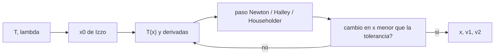

# B82-C06 — Algoritmos iterativos para Lambert (Gooding, Izzo)

<!-- nav:top -->
[🏠 Programa](../../../../README.md) · [📚 Bloque B82](../../../tronco-comun/B82-problema-de-lambert-y-transferencias-de-dos-puntos.md) · [← Anterior: B82-C05 — Singularidades del problema de Lambert](../B82-C05-singularidades-del-problema-de-lambert/CLASE.md) · [Siguiente: B82-C07 — Benchmark entre solucionadores de Lambert →](../B82-C07-benchmark-entre-solucionadores-de-lambert/CLASE.md)
<!-- /nav -->

## 1. Ubicación, nivel y alcance

Clase 6 del bloque B82. Nivel N3. Hasta aquí resolviste la ecuación de Lambert por bisección. Los solucionadores usados en la práctica iteran sobre una sola variable `x` con derivadas analíticas y un buen valor inicial. Aquí comparas Newton, Halley y Householder sobre `T(x)` con el valor inicial de Izzo (S2). Es la familia de Izzo (2014), construida sobre Lancaster–Blanchard; **no** es una implementación del algoritmo de Gooding (1990), que no se consultó. Los datos son sintéticos: el ejemplo conductor (`θ = 100°`, 200 d) y 300 casos aleatorios con semilla 82.

## 2. Por qué esta clase existe

La velocidad de un solucionador importa cuando se evalúan millones de transferencias. La decisión central: **¿cuántas iteraciones necesita cada método, de qué depende, y qué garantiza el valor inicial?**

## 3. Lo que podrás hacer al terminar

1. Escribir `T(x, λ)` y sus tres derivadas analíticas.
2. Verificar las derivadas con diferencias finitas y `T` con la forma de Lagrange.
3. Aplicar Newton, Halley y Householder y comparar sus trazas de error.
4. Estimar el orden de convergencia a partir de la traza.
5. Comparar con y sin el valor inicial de Izzo.
6. Medir iteraciones medias y máximas en 300 casos y verificar por propagación.

La evidencia es la **curva de convergencia por método** del ejercicio 12 (sección 20).

## 4. Con qué llegas y cómo comprobarlo

1. ¿Qué es el método de Newton y qué orden de convergencia tiene?
2. ¿Qué es una derivada de segundo y tercer orden?
3. ¿Qué es el orden de convergencia?
4. ¿Qué dice C04 sobre `T(x)`?
5. ¿Qué es la semilla de un generador aleatorio?

<details>
<summary>Ver respuestas</summary>

1. Una iteración `x ← x − f/f'` con convergencia cuadrática. 2. La derivada de la derivada, y su siguiente. 3. El exponente `p` con que el error `e_{k+1} ∼ e_k^p`. 4. Es la curva del tiempo de vuelo en función de `x` y `λ`. 5. El valor que inicializa el generador para que los números se repitan.
</details>

Con cuatro o cinco aciertos, sigue; si no, repasa los prerrequisitos.

## 5. Un caso de contexto y casos de referencia

Para `θ = 100°` y `t = 200 d` con el valor inicial de Izzo, Newton necesita 5 iteraciones, Halley 3 y Householder 3, todos con residuo de propagación menor que `6 × 10⁻¹⁵ UA`. En 300 casos aleatorios: Newton 5,54 iteraciones de media (máximo 9), Halley 3,45 (5), Householder 3,25 (6). Es el **ejemplo conductor**; todo es sintético.

## 6. Vocabulario

La ecuación a resolver es `T(x, λ) = T`, con `T = t √(2μ/s³)`. Las derivadas son `T'`, `T''` y `T'''`. **Newton:** `x ← x − δ/T'`. **Halley:** `x ← x − 2δ T'/(2T'² − δ T'')`. **Householder** de tercer orden usa también `T'''`. Con `δ = T(x) − T`. El **valor inicial de Izzo** es una aproximación por tramos en función de `T` y los límites `T₀ = arccos λ + λ√(1 − λ²)` y `T₁ = (2/3)(1 − λ³)`.

## 7. Modelo mental: subir por una escalera con pasos cada vez mejores



*Descripción textual:* desde `x₀` se evalúa `T(x)` y sus derivadas; un paso de Newton, Halley o Householder actualiza `x`; se repite hasta que el cambio sea menor que la tolerancia; luego se calculan las velocidades.

Analogía: Newton usa la pendiente, Halley añade la curvatura y Householder también su cambio, como estimar una curva con una recta, una parábola o una cúbica. Límite: usar más derivadas cuesta más por iteración.

## 8. La explicación, paso a paso

### 8.1 Derivadas

Con `y = √(1 − λ²(1 − x²))`:
`T' = (3Tx − 2 + 2λ³x/y)/(1 − x²)`,
`T'' = (3T + 5xT' + 2(1 − λ²)λ³/y³)/(1 − x²)`,
`T''' = (7xT'' + 8T' − 6(1 − λ²)λ⁵x/y⁵)/(1 − x²)`.
El laboratorio las compara con diferencias finitas en `x = −0,5; 0,3; 1,6` con `λ = 0,4`: coinciden a `10⁻⁶` relativo (por ejemplo `T'(−0,5) = −10,451410`). `T` coincide con la forma de Lagrange a `10⁻¹⁰`.

### 8.2 Trazas de error

| Método | Iteraciones | error de `T` por iteración |
|---|---|---|
| Newton | 5 | 2,6e-1; 3,1e-2; 5,8e-4; 2,1e-7; 2,9e-14 |
| Halley | 3 | 2,6e-1; 2,1e-4; 1,5e-13 |
| Householder | 3 | 2,6e-1; 1,7e-5; 0 |

De las razones de logaritmos, el orden aparente es ≈ 2 en Newton, ≈ 3 en Halley y mayor en Householder (el error llega al redondeo en un paso).

### 8.3 Con y sin valor inicial

Con `x₀ = 0` este caso necesita las mismas iteraciones (5, 3, 3): el caso es fácil. El valor inicial de Izzo importa en los casos difíciles (tiempos muy cortos o largos); este laboratorio no lo demuestra con un caso adverso, por lo que no se concluye nada fuera de este ejemplo.

### 8.4 Trescientos casos

| Método | Iteraciones medias | Máximo | Residuo máximo |
|---|---|---|---|
| Newton | 5,54 | 9 | 1,1e-13 |
| Halley | 3,45 | 5 | 1,8e-13 |
| Householder | 3,25 | 6 | 1,9e-13 |

El resumen de Izzo (S2) habla de dos iteraciones; aquí obtenemos 3,05–3,25 con tolerancia `|Δx| < 10⁻¹²` y una implementación propia, por lo que no se compara con su cifra. Un caso `M = 1` (rama izquierda, 1000 d) converge en 3 iteraciones con residuo `8 × 10⁻¹⁵ UA`.

## 9. Magnitudes, símbolos y unidades

| Símbolo | Qué es | Unidad | Valor / nota |
|---|---|---|---|
| `x` | variable de LB | — | −0,2 a 0,7 |
| `T` | tiempo adimensional | — | 0,45 a 3,85 |
| `T'`, `T''`, `T'''` | derivadas | — | analíticas |
| `δ` | residuo de `T` | — | 2,6e-1 inicial |
| `x₀` | valor inicial | — | de Izzo |
| `p` | orden de convergencia | — | ≈ 2, 3 y mayor |

## 10. Convenciones y referencias

Constantes de S1; unidades canónicas; semilla 82; tolerancia de iteración `|Δx| < 10⁻¹²`. Tolerancias de control: derivadas `10⁻⁶`, `T` LB frente a Lagrange `10⁻¹⁰`, residuo `< 10⁻⁸ UA`. Datos sintéticos.

## 11. De dónde sale lo que afirmamos

| ID | Fuente | Localizador | Respalda | Estado |
|---|---|---|---|---|
| S1 | NASA/JPL Solar System Dynamics, Astrodynamic Parameters — https://ssd.jpl.nasa.gov/astro_par.html (consultada 2026-11-10) | página de parámetros | `GM` del Sol = 1,32712440041279419 × 10²⁰ m³/s² (DE440, Park et al. 2021 según la página) y 1 UA = 149 597 870,7 km | Consultada |
| S2 | D. Izzo, «Revisiting Lambert's Problem», arXiv:1403.2705 (2014) — https://arxiv.org/abs/1403.2705 (consultada 2026-11-10) | solo la página de resumen | reformulación de Lancaster–Blanchard con una variable nueva e iteración de Householder; precisión comparable a Gooding con menor costo | Consultada (solo el resumen) |
| — | Relaciones estándar de la mecánica kepleriana (teorema de Lambert, coeficientes de Lagrange, funciones de Stumpff, ecuación de Kepler universal) | — | las verifica el laboratorio propagando la órbita con un propagador independiente | No consultada en una fuente concreta |
| — | Gooding (1990) y libros de texto de astrodinámica | — | — | No consultada |

Límites: Gooding (1990) no se consultó; la fuente S2 se leyó solo en su resumen y no se reprodujo su algoritmo completo. Las cifras de iteraciones son de esta implementación.

## 12. Cómo ver la convergencia

| Método | Iteraciones (ejemplo) |
|---|---|
| Newton | 5 |
| Halley | 3 |
| Householder | 3 |

Descripción larga: el error baja en cada iteración y Householder llega al redondeo en tres pasos.

## 13. Ejemplo trabajado: una iteración de Halley

**Paso 1.** `x₀` de Izzo y `T(x₀)`: el error inicial es `2,6e-1`.

**Paso 2.** `x ← x₀ − 2δT'/(2T'² − δT'')` reduce el error a `2,1e-4`.

**Paso 3.** Una segunda iteración lo lleva a `1,5e-13`.

**Paso 4.** Se calculan `v1` y `v2` y se propaga: residuo `5 × 10⁻¹⁵ UA`.

## 14. Distintas formas de describir la elección del método

**Newton:** una derivada, más iteraciones. **Halley:** dos derivadas, menos iteraciones. **Householder:** tres derivadas, apenas menos iteraciones que Halley. El mejor compromiso depende del costo de las derivadas; C07 lo mide.

## 15. Práctica guiada

**Ejercicio 1 · con los pasos indicados.** Calcula `T₁` para `λ = 0,5`. *Pasos:* `λ³`, `1 − λ³`, por `2/3`.

<details><summary>Solución comentada</summary>

`(2/3)(1 − 0,125) = 0,5833`.
</details>

**Ejercicio 2 · con una pista.** ¿Qué usa Halley que Newton no? *Pista:* mira 8.2.

<details><summary>Solución comentada</summary>

La segunda derivada `T''`.
</details>

**Ejercicio 3 · casi autónomo.** Estima el orden de Newton a partir de `3,1e-2 → 5,8e-4 → 2,1e-7`.

<details><summary>Solución comentada</summary>

`ln(5,8e-4)/ln(3,1e-2) ≈ 2,1`: cuadrático.
</details>

## 16. Práctica autónoma, transferencia e integrador

**Ejercicio 4 · autónomo.** ¿Cuántas iteraciones necesita Householder en el ejemplo?

<details><summary>Solución comentada</summary>

Tres (8.2).
</details>

**Ejercicio 5 · autónomo.** ¿Qué método tiene la menor media en 300 casos?

<details><summary>Solución comentada</summary>

Householder, con 3,25 (8.4).
</details>

**Ejercicio 6 · autónomo.** Compara la media de Newton con la de Halley.

<details><summary>Solución comentada</summary>

5,54 frente a 3,45: Newton necesita 1,6 veces más iteraciones.
</details>

**Ejercicio 7 · autónomo.** ¿Por qué se verifican las derivadas con diferencias finitas?

<details><summary>Solución comentada</summary>

Porque un error en una derivada degradaría la convergencia sin dar error evidente.
</details>

**Ejercicio 8 · autónomo.** ¿Qué comprueba el residuo de propagación?

<details><summary>Solución comentada</summary>

Que la `x` converge a una solución física de Lambert (8.4).
</details>

**Ejercicio 9 · transferencia.** **Transferencia.** Un artículo afirma dos iteraciones. ¿Por qué aquí salen más?

<details><summary>Solución comentada</summary>

Tolerancia, implementación y valor inicial distintos; no se refuta (8.4).
</details>

**Ejercicio 10 · transferencia.** **Transferencia.** ¿Es válido concluir que Householder es siempre mejor?

<details><summary>Solución comentada</summary>

No: apenas ahorra iteraciones frente a Halley y exige `T'''`.
</details>

**Ejercicio 11 · transferencia.** **Transferencia.** ¿Se ha reproducido aquí el algoritmo de Gooding?

<details><summary>Solución comentada</summary>

No: Gooding (1990) no se consultó; solo se aplica la familia de Izzo.
</details>

**Ejercicio 12 · integrador.** **Integrador.** Elabora tu *curva de convergencia por método*: trazas de error, iteraciones medias en 300 casos y residuo de cada método.

<details><summary>Solución comentada</summary>

Secciones 8.2–8.4 y la salida del laboratorio.
</details>

## 17. Laboratorio: Newton, Halley y Householder sobre T(x)

El script [iterativos.py](iterativos.py) verifica las derivadas y `T`, traza el error por iteración, compara con y sin el valor inicial y mide iteraciones en 300 casos aleatorios (**comprueba** derivadas `10⁻⁶`, `T` frente a Lagrange `10⁻¹⁰` y residuo `< 10⁻⁸` UA). Usa la biblioteca común [lambert_comun.py](../lambert_comun.py) del bloque.

**Datos:** constantes del JPL (consultadas el 2026-11-10); posiciones y tiempos de vuelo **sintéticos** (órbitas circulares de ejemplo, no son efemérides). **Predice antes de ejecutar:** ¿qué método necesitará menos iteraciones en los 300 casos? (Householder, 3,25 de media.) **Ejecución del 2026-11-10 (Python 3.12.9, numpy 2.4.4):**

```text
Python 3.12.9 | numpy 2.4.4
Datos SINTETICOS: orbitas circulares de ejemplo y semilla aleatoria 82
x = -0.50: T = 3.846889054, T' = -10.451410 (dif. fin. -10.451410), T'' = +50.39925 (dif. fin. +50.39924)
x = +0.30: T = 1.084141137, T' = -1.079923 (dif. fin. -1.079923), T'' = +1.94361 (dif. fin. +1.94361)
x = +1.60: T = 0.448464096, T' = -0.215279 (dif. fin. -0.215279), T'' = +0.19222 (dif. fin. +0.19222)
Traza del error |T(x_k) - T| (caso: theta = 100 deg, tof = 200 d, x0 de Izzo):
  newton       iter = 5  2.6e-01 3.1e-02 5.8e-04 2.1e-07 2.9e-14  residuo = 5.1e-15
  halley       iter = 3  2.6e-01 2.1e-04 1.5e-13  residuo = 5.1e-15
  householder  iter = 3  2.6e-01 1.7e-05 0.0e+00  residuo = 9.4e-16
Con x0 = 0 (sin valor inicial):
  newton       iter = 5
  halley       iter = 3
  householder  iter = 3
300 casos aleatorios (prograda, M = 0): iteraciones medias y maximas (valor inicial de Izzo)
  newton       media = 5.54  max = 9  residuo max = 1.1e-13
  halley       media = 3.45  max = 5  residuo max = 1.8e-13
  householder  media = 3.25  max = 6  residuo max = 1.9e-13
Caso M = 1 (tof = 1000 d, rama izquierda): iter = 3, residuo = 8.0e-15
Pruebas superadas.
```

```bash
python programa/clases/B82/B82-C06-algoritmos-iterativos-para-lambert-gooding-izzo/iterativos.py
```

**Límites:** solo `M = 0` (más un caso `M = 1`) y prógrada; sin caso adverso para el valor inicial; el tiempo de cómputo se mide en C07.

## 18. Errores frecuentes y cómo corregirlos

**Confundir más derivadas con mejor rendimiento.** Compara costo en C07

**Usar una derivada sin verificarla.** Compárala con diferencias finitas (8.1)

**Citar a Izzo para cifras que no se leyeron.** Solo el resumen se consultó (sección 11)

## 19. Cómo sabrás que vas bien

Tras la sección 8: ¿cuántas iteraciones esperabas de Halley? Si dudas, repasa el ejemplo 13. Tras el laboratorio: ¿qué comprueba la propagación? (ver sección 17).

## 20. Qué entregas y cómo se evalúa

El producto es tu **curva de convergencia por método** (ejercicio 12).

| Criterio | Inicial | En desarrollo | Logrado | Destacado |
|---|---|---|---|---|
| Conceptos | Los confunde | Parciales | Explica el método y su dominio | Explica los límites y las alternativas |
| Cálculo | Sin unidades | Con errores | Resultados con unidades y comprobados | Resuelve casos nuevos |
| Numérico | Sin comprobar | Un caso | Verifica por propagación en varios casos | Interpreta las diferencias y los fallos |
| Fuentes | Sin fuente | Sin fecha | Fuentes con fecha y estado | Declara lo sintético y lo no consultado |
| Límites | No los nombra | Uno | Tres | Discute qué falta del modelo |

**Condiciones críticas (no se compensan con promedio):** rotular los datos como sintéticos; verificar cada solución por propagación; citar solo lo consultado.

## 21. Ética, seguridad y límites

Clase educativa: los modelos son de dos cuerpos y los datos son sintéticos; ningún resultado describe una misión real ni sustituye el diseño de trayectorias con herramientas validadas y revisión de especialistas. Accesibilidad: tablas equivalentes a las gráficas, fórmulas en texto, ejercicios sin conexión.

## 22. Para cerrar y seguir

Tres métodos sobre la misma `T(x)` convergen en 3 a 5 iteraciones; el residuo sigue en `10⁻¹⁴ UA`. Queda una pregunta: ¿cómo se comparan, con un banco de casos, la exactitud y el costo de los solucionadores?

**Glosario español–inglés.** orden de convergencia · *order of convergence*; valor inicial · *initial guess*; Newton · *Newton's method*; Halley · *Halley's method*; Householder · *Householder's method*.

**Continuidad.** [B82-C07](../B82-C07-benchmark-entre-solucionadores-de-lambert/CLASE.md) compara los solucionadores en un banco de casos.

**Referencias:** ver sección 11.

<!-- nav:bottom -->
---

[← Anterior: B82-C05 — Singularidades del problema de Lambert](../B82-C05-singularidades-del-problema-de-lambert/CLASE.md) · [📚 Bloque B82](../../../tronco-comun/B82-problema-de-lambert-y-transferencias-de-dos-puntos.md) · [Siguiente: B82-C07 — Benchmark entre solucionadores de Lambert →](../B82-C07-benchmark-entre-solucionadores-de-lambert/CLASE.md)
<!-- /nav -->
