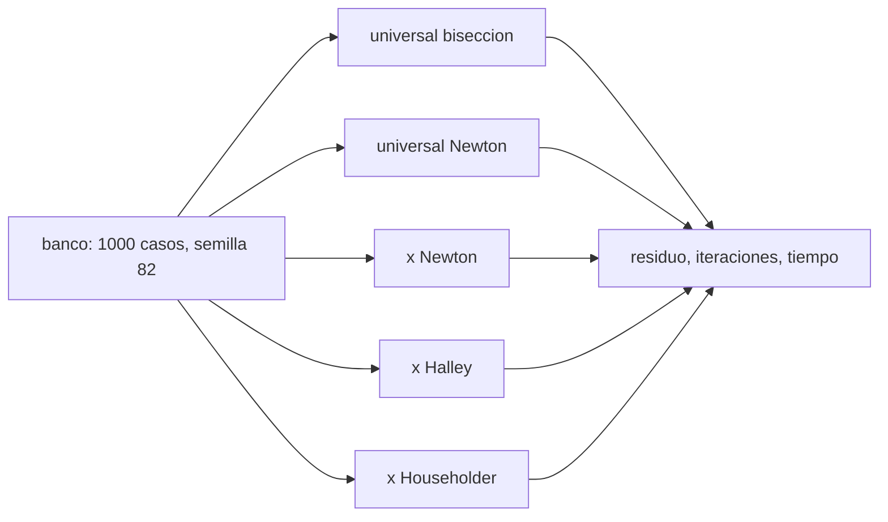

# B82-C07 — Benchmark entre solucionadores de Lambert

<!-- nav:top -->
[🏠 Programa](../../../../README.md) · [📚 Bloque B82](../../../tronco-comun/B82-problema-de-lambert-y-transferencias-de-dos-puntos.md) · [← Anterior: B82-C06 — Algoritmos iterativos para Lambert (Gooding, Izzo)](../B82-C06-algoritmos-iterativos-para-lambert-gooding-izzo/CLASE.md) · [Siguiente: B83-C01 — Necesidad de misión y caso científico →](../../B83/B83-C01-necesidad-de-mision-y-caso-cientifico/CLASE.md)
<!-- /nav -->

## 1. Ubicación, nivel y alcance

Clase 7 del bloque B82. Nivel N3. Cierra el bloque comparando cinco solucionadores de Lambert de `M = 0`: variables universales con bisección y con Newton (C03) y la variable `x` con Newton, Halley y Householder (C06). Mides exactitud (residuo de propagación), robustez (fallos), iteraciones y tiempo. Los datos son sintéticos: 1000 transferencias aleatorias con semilla 82, radios de 0,5 a 3 UA.

## 2. Por qué esta clase existe

Elegir un solucionador sin medirlo es adivinar. La decisión central: **¿qué solucionador conviene para un banco de transferencias, y qué cifras sustentan esa elección?** Y su condición: ¿qué parte de la medida depende del equipo?

## 3. Lo que podrás hacer al terminar

1. Generar un banco reproducible de casos sintéticos con semilla fija.
2. Definir las métricas: éxitos, fallos, iteraciones, residuo relativo y tiempo.
3. Ejecutar los cinco solucionadores sobre el mismo banco.
4. Comparar exactitud e iteraciones e interpretar los fallos.
5. Separar lo reproducible (iteraciones, residuo) de lo que depende del equipo (tiempo).
6. Redactar un informe con las limitaciones del banco.

La evidencia es la **informe comparativo de solucionadores** del ejercicio 12 (sección 20).

## 4. Con qué llegas y cómo comprobarlo

1. ¿Qué es una semilla aleatoria y por qué se fija?
2. ¿Qué es el residuo relativo?
3. ¿Qué diferencia hay entre exactitud y robustez?
4. ¿Qué compara C06?
5. ¿Por qué el tiempo de ejecución no es una medida absoluta?

<details>
<summary>Ver respuestas</summary>

1. El valor inicial de un generador; fijarla permite repetir el experimento. 2. El residuo dividido por la magnitud de referencia (`|r2|` aquí). 3. Exactitud: error pequeño cuando resuelve; robustez: resuelve en la mayoría de los casos. 4. Newton, Halley y Householder sobre `T(x)`. 5. Depende del equipo, la carga y la implementación.
</details>

Con cuatro o cinco aciertos, sigue; si no, repasa los prerrequisitos.

## 5. Un caso de contexto y casos de referencia

Sobre 1000 casos sintéticos: Householder resuelve 999 (iteraciones medias 3,05, máximo 5), Halley y Newton con `x` resuelven los 1000 (3,19 y 5,17), y las dos versiones universales resuelven 996 (bisección 46,53 iteraciones; Newton 10,94). El residuo relativo mediano es `3 × 10⁻¹⁵` con `x` y `1 × 10⁻¹³` a `7 × 10⁻¹⁵` con variables universales. Es el **ejemplo conductor**; todo es sintético.

## 6. Vocabulario

El **banco de casos**: 1000 pares `(r1, r2)` con radios en 0,5–3 UA, ángulos aleatorios (a más de 3° de 0° y 180°) y tiempo de vuelo entre 0,05 y 1,5 veces el periodo de la órbita circular media. El **éxito** exige residuo relativo `< 10⁻⁸`. El **fallo** es cualquier caso sin solución, con excepción o con residuo mayor. Las **iteraciones** son las del bucle del solucionador. El **tiempo por llamada** se mide con `perf_counter` y depende del equipo.

## 7. Modelo mental: una carrera con el mismo recorrido



*Descripción textual:* el mismo banco se pasa a cinco solucionadores y se miden residuo, iteraciones y tiempo.

Analogía: cinco corredores en la misma pista; el cronómetro depende del día, pero el orden de llegada y el número de pasos son comparables. Límite: aquí la pista es sintética, de una geometría coplanar.

## 8. La explicación, paso a paso

### 8.1 Resultados

| Solucionador | Éxitos | Fallos | Iteraciones medias | Iteraciones máximas | Residuo relativo mediano | Residuo relativo máximo |
|---|---|---|---|---|---|---|
| universal-bisección | 996 | 4 | 46,53 | 47 | 1,45e-13 | 2,52e-10 |
| universal-Newton | 996 | 4 | 10,94 | 53 | 7,19e-15 | 1,76e-10 |
| x-Newton | 1000 | 0 | 5,17 | 10 | 3,34e-15 | 1,30e-12 |
| x-Halley | 1000 | 0 | 3,19 | 5 | 3,37e-15 | 4,98e-13 |
| x-Householder | 999 | 1 | 3,05 | 5 | 3,31e-15 | 3,92e-13 |

La variable `x` es más precisa (residuo máximo `10⁻¹²` frente a `10⁻¹⁰`) y requiere menos iteraciones que las variables universales.

### 8.2 Fallos

Hay 4 fallos en cada versión universal y 1 en Householder; **no se analizó la causa** (la bisección acota `z` en `(−4π², 4π²)`, lo que podría explicar parte de los casos hiperbólicos, pero no se comprobó). Un fallo no es una prueba de que el método sea incorrecto: es una advertencia para el banco.

### 8.3 Tiempo

Los tiempos por llamada fueron de 3378, 2833, 2458, 1964 y 2082 µs en este equipo, **con otros procesos en ejecución**: varían entre ejecuciones y no son una medida absoluta. El orden entre los métodos con `x` y los universales es coherente con las iteraciones, pero el orden fino (Halley frente a Householder) no se interpreta.

### 8.4 Acuerdo entre métodos

Entre Householder y universal-Newton, en 500 casos comparados, la diferencia relativa de velocidad es mediana `6 × 10⁻¹⁶` y máxima `0,12`. El máximo corresponde a algún caso donde los dos métodos devuelven soluciones distintas que reproducen igualmente `r2` (por ejemplo, con distinta cantidad de vueltas implícitas): el residuo de propagación no distingue el número de revoluciones (ver C04). No se identificó el caso.

## 9. Magnitudes, símbolos y unidades

| Símbolo | Qué es | Unidad | Valor / nota |
|---|---|---|---|
| residuo relativo | |r_prop − r2|/|r2| | — | 3e-15 (mediano) |
| iteraciones | pasos del bucle | — | 3 a 53 |
| éxitos/fallos | casos con residuo < 1e-8 | — | 996 a 1000 |
| tiempo por llamada | tiempo de ejecución | µs | dependiente del equipo |
| semilla | valor inicial aleatorio | — | 82 |
| banco | casos sintéticos | — | 1000 |

## 10. Convenciones y referencias

Constantes de S1; unidades canónicas; Python 3.12.9, numpy 2.4.4, Windows; semilla 82. Éxito: residuo relativo `< 10⁻⁸`. Se excluyen los casos a menos de 3° de 0° y 180°. Los tiempos de vuelo van de 0,05 a 1,5 veces el periodo. Datos sintéticos coplanares.

## 11. De dónde sale lo que afirmamos

| ID | Fuente | Localizador | Respalda | Estado |
|---|---|---|---|---|
| S1 | NASA/JPL Solar System Dynamics, Astrodynamic Parameters — https://ssd.jpl.nasa.gov/astro_par.html (consultada 2026-11-10) | página de parámetros | `GM` del Sol = 1,32712440041279419 × 10²⁰ m³/s² (DE440, Park et al. 2021 según la página) y 1 UA = 149 597 870,7 km | Consultada |
| S2 | D. Izzo, «Revisiting Lambert's Problem», arXiv:1403.2705 (2014) — https://arxiv.org/abs/1403.2705 (consultada 2026-11-10) | solo la página de resumen | reformulación de Lancaster–Blanchard con una variable nueva e iteración de Householder; precisión comparable a Gooding con menor costo | Consultada (solo el resumen) |
| — | Relaciones estándar de la mecánica kepleriana (teorema de Lambert, coeficientes de Lagrange, funciones de Stumpff, ecuación de Kepler universal) | — | las verifica el laboratorio propagando la órbita con un propagador independiente | No consultada en una fuente concreta |
| — | Gooding (1990) y libros de texto de astrodinámica | — | — | No consultada |

Límites: el banco es sintético, coplanar y prógrado; no incluye `M ≥ 1`; los tiempos dependen del equipo; Gooding (1990) no se incluyó ni se consultó.

## 12. Cómo ver la comparación

| Solucionador | Éxitos | Iteraciones medias |
|---|---|---|
| universal-bisección | 996 | 46,53 |
| universal-Newton | 996 | 10,94 |
| x-Newton | 1000 | 5,17 |
| x-Halley | 1000 | 3,19 |
| x-Householder | 999 | 3,05 |

Descripción larga: los métodos en `x` resuelven más casos con 3 a 5 iteraciones; los universales requieren de 11 a 47.

## 13. Ejemplo trabajado: leer una fila del informe

**Paso 1.** Fila x-Halley: 1000 éxitos, 0 fallos.

**Paso 2.** Iteraciones: media 3,19, máximo 5.

**Paso 3.** Residuo relativo máximo `4,98 × 10⁻¹³`: dentro de la tolerancia `10⁻⁸` con margen de cinco órdenes de magnitud.

**Paso 4.** El tiempo por llamada (1964 µs) se anota como dependiente del equipo.

## 14. Distintas formas de describir el criterio de elección

**Por robustez:** x-Newton y x-Halley (0 fallos). **Por iteraciones:** x-Householder. **Por exactitud:** los tres métodos en `x`. **Por tiempo:** no concluyente en este banco.

## 15. Práctica guiada

**Ejercicio 1 · con los pasos indicados.** Calcula la razón de iteraciones medias entre universal-bisección y x-Halley. *Pasos:* divide.

<details><summary>Solución comentada</summary>

`46,53/3,19 = 14,6`.
</details>

**Ejercicio 2 · con una pista.** ¿Cuántos casos resuelve cada método universal? *Pista:* 8.1.

<details><summary>Solución comentada</summary>

996, con 4 fallos.
</details>

**Ejercicio 3 · casi autónomo.** ¿Qué método tiene el menor residuo relativo máximo?

<details><summary>Solución comentada</summary>

x-Halley, 4,98e-13.
</details>

## 16. Práctica autónoma, transferencia e integrador

**Ejercicio 4 · autónomo.** ¿Qué método tiene el mayor número máximo de iteraciones?

<details><summary>Solución comentada</summary>

universal-Newton, con 53.
</details>

**Ejercicio 5 · autónomo.** ¿Por qué se fija la semilla?

<details><summary>Solución comentada</summary>

Para que el banco y los resultados sean reproducibles.
</details>

**Ejercicio 6 · autónomo.** ¿Qué porcentaje de éxito tiene x-Householder?

<details><summary>Solución comentada</summary>

99,9 %.
</details>

**Ejercicio 7 · autónomo.** ¿Por qué no se compara el tiempo entre Halley y Householder?

<details><summary>Solución comentada</summary>

Porque difieren en 6 % con ruido del equipo y de los procesos en ejecución (8.3).
</details>

**Ejercicio 8 · autónomo.** ¿Qué casos se excluyen del banco y por qué?

<details><summary>Solución comentada</summary>

Los de menos de 3° de 0° o 180°, por la singularidad del plano (C05).
</details>

**Ejercicio 9 · transferencia.** **Transferencia.** Un lector concluye que 'x-Householder es el mejor'. ¿Qué responder?

<details><summary>Solución comentada</summary>

Tiene menos iteraciones, pero un fallo; x-Halley no falla. El tiempo no es concluyente.
</details>

**Ejercicio 10 · transferencia.** **Transferencia.** ¿Qué cambia si el banco incluye `M = 1`?

<details><summary>Solución comentada</summary>

Las versiones universales no resuelven esos casos; los métodos en `x` sí (C04).
</details>

**Ejercicio 11 · transferencia.** **Transferencia.** ¿Por qué el residuo relativo máximo del acuerdo es 0,12?

<details><summary>Solución comentada</summary>

Porque dos soluciones distintas pueden reproducir `r2`; el residuo no cuenta vueltas (8.4).
</details>

**Ejercicio 12 · integrador.** **Integrador.** Elabora tu *informe comparativo de solucionadores*: tabla de 8.1, interpretación de fallos y tiempos, límites del banco y qué es sintético.

<details><summary>Solución comentada</summary>

Secciones 8.1–8.4 y la salida del laboratorio.
</details>

## 17. Laboratorio: banco de pruebas de cinco solucionadores

El script [benchmark.py](benchmark.py) genera 1000 casos aleatorios con semilla 82, ejecuta los cinco solucionadores, mide residuo, iteraciones y tiempo y compara velocidades entre métodos (**comprueba** que Householder resuelva ≥ 990 casos y universal-Newton ≥ 900). Usa la biblioteca común [lambert_comun.py](../lambert_comun.py) del bloque.

**Datos:** constantes del JPL (consultadas el 2026-11-10); posiciones y tiempos de vuelo **sintéticos** (órbitas circulares de ejemplo, no son efemérides). **Predice antes de ejecutar:** ¿qué solucionador tendrá más iteraciones medias? (universal-bisección, con 46,53.) **Ejecución del 2026-11-10 (Python 3.12.9, numpy 2.4.4):**

```text
Python 3.12.9 | numpy 2.4.4 | plataforma Windows
Datos SINTETICOS: 1000 casos, semilla 82
solucionador          exitos  fallos  iter media  iter max   residuo rel. mediano   max       t/llamada [us]
universal-biseccion      996       4      46.53        47   1.45e-13   2.52e-10      3378.2
universal-newton         996       4      10.94        53   7.19e-15   1.76e-10      2832.6
izzo-newton             1000       0       5.17        10   3.34e-15   1.30e-12      2458.1
izzo-halley             1000       0       3.19         5   3.37e-15   4.98e-13      1963.8
izzo-householder         999       1       3.05         5   3.31e-15   3.92e-13      2081.7
Acuerdo de velocidades izzo-householder frente a universal-newton (casos de ambos):
  casos comparados = 500, diferencia relativa mediana = 6.2e-16, max = 1.2e-01
Pruebas superadas.
```

```bash
python programa/clases/B82/B82-C07-benchmark-entre-solucionadores-de-lambert/benchmark.py
```

**Límites:** banco sintético coplanar y prógrado, `M = 0`; los tiempos dependen del equipo; la causa de los fallos no se analizó; el propagador no cuenta vueltas.

## 18. Errores frecuentes y cómo corregirlos

**Tomar un tiempo como medida absoluta.** Repite y anota el equipo (8.3)

**Interpretar un fallo como error del método.** Analiza el caso antes (8.2)

**Concluir desde un banco sintético.** Declara sus límites (sección 17)

## 19. Cómo sabrás que vas bien

Tras la sección 8: ¿qué método esperabas con menos fallos? Si dudas, repasa el ejemplo 13. Tras el laboratorio: ¿qué comprueba el script? (ver sección 17).

## 20. Qué entregas y cómo se evalúa

El producto es tu **informe comparativo de solucionadores** (ejercicio 12).

| Criterio | Inicial | En desarrollo | Logrado | Destacado |
|---|---|---|---|---|
| Conceptos | Los confunde | Parciales | Explica el método y su dominio | Explica los límites y las alternativas |
| Cálculo | Sin unidades | Con errores | Resultados con unidades y comprobados | Resuelve casos nuevos |
| Numérico | Sin comprobar | Un caso | Verifica por propagación en varios casos | Interpreta las diferencias y los fallos |
| Fuentes | Sin fuente | Sin fecha | Fuentes con fecha y estado | Declara lo sintético y lo no consultado |
| Límites | No los nombra | Uno | Tres | Discute qué falta del modelo |

**Condiciones críticas (no se compensan con promedio):** rotular los datos como sintéticos; verificar cada solución por propagación; citar solo lo consultado.

## 21. Ética, seguridad y límites

Clase educativa: los modelos son de dos cuerpos y los datos son sintéticos; ningún resultado describe una misión real ni sustituye el diseño de trayectorias con herramientas validadas y revisión de especialistas. Accesibilidad: tablas equivalentes a las gráficas, fórmulas en texto, ejercicios sin conexión.

## 22. Para cerrar y seguir

Sobre 1000 transferencias sintéticas, los métodos en `x` resuelven 999–1000 casos con 3 a 5 iteraciones y residuo máximo `5 × 10⁻¹³`, mientras los universales resuelven 996 con 11 a 47. Con esto cierra el bloque B82; quedan por analizar los fallos y probar `M ≥ 1` y una implementación de Gooding.

**Glosario español–inglés.** banco de pruebas · *benchmark*; robustez · *robustness*; residuo relativo · *relative residual*; semilla · *seed*; solucionador · *solver*.

**Continuidad.** Cierra el bloque B82. Vuelve al [bloque B82](../../../tronco-comun/B82-problema-de-lambert-y-transferencias-de-dos-puntos.md).

**Referencias:** ver sección 11.

<!-- nav:bottom -->
---

[← Anterior: B82-C06 — Algoritmos iterativos para Lambert (Gooding, Izzo)](../B82-C06-algoritmos-iterativos-para-lambert-gooding-izzo/CLASE.md) · [📚 Bloque B82](../../../tronco-comun/B82-problema-de-lambert-y-transferencias-de-dos-puntos.md) · [Siguiente: B83-C01 — Necesidad de misión y caso científico →](../../B83/B83-C01-necesidad-de-mision-y-caso-cientifico/CLASE.md)
<!-- /nav -->
