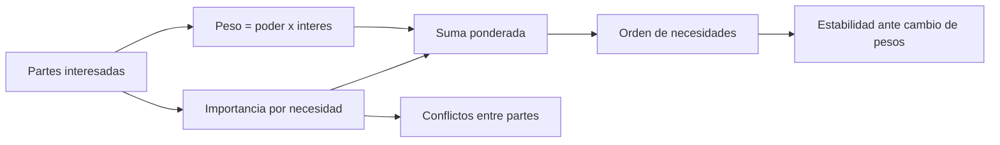

# B83-C02 — Partes interesadas y usuarios

<!-- nav:top -->
[🏠 Programa](../../../../README.md) · [📚 Bloque B83](../../../tronco-comun/B83-ingenieria-de-sistemas-y-diseno-de-misiones.md) · [← Anterior: B83-C01 — Necesidad de misión y caso científico](../B83-C01-necesidad-de-mision-y-caso-cientifico/CLASE.md) · [Siguiente: B83-C03 — Concepto de operaciones CONOPS →](../B83-C03-concepto-de-operaciones-conops/CLASE.md)
<!-- /nav -->

## 1. Ubicación, nivel y alcance

Clase 2 del bloque B83. Nivel N3. Tras la necesidad de misión (C01), hay que saber **quién** tiene voz sobre ella: quien paga, quien opera, quien lanza, quien regula y quien usa los datos. Aquí clasificas partes interesadas por poder e interés, ponderas sus necesidades y compruebas si el orden resultante resiste a un cambio de pesos. Las partes, sus puntajes y sus necesidades son **sintéticos** (misión de ejemplo ESTRELLA-S). El manual de ingeniería de sistemas de NASA (S1) sitúa la definición de las expectativas de las partes interesadas al inicio de los procesos de diseño del sistema.

## 2. Por qué esta clase existe

Cuando las necesidades de dos partes chocan (alta resolución frente a bajo costo), alguien debe decidir con criterio. La decisión central: **¿qué necesidades pasan a requisitos primero y cuánto confías en ese orden?** Sin una ponderación explícita, gana la voz más fuerte de la reunión.

## 3. Lo que podrás hacer al terminar

1. Identificar las partes interesadas de una misión y distinguirlas de los usuarios.
2. Clasificarlas por poder e interés en cuatro estrategias de gestión.
3. Calcular pesos normalizados y prioridades de necesidades con una suma ponderada.
4. Detectar pares de partes con necesidades en conflicto.
5. Medir la estabilidad del orden con perturbaciones de semilla fija.
6. Rotular lo sintético y no atribuir los puntajes a organizaciones reales.

La evidencia es la **matriz de partes interesadas y necesidades con orden estable** del ejercicio 12 (sección 20).

## 4. Con qué llegas y cómo comprobarlo

1. ¿Qué es una parte interesada?
2. ¿Qué es un usuario?
3. ¿Qué es una necesidad?
4. ¿Qué es un coeficiente de correlación de rangos?
5. ¿Qué hace la semilla fija?

<details>
<summary>Ver respuestas</summary>

1. Quien afecta al proyecto o es afectado por él. 2. Quien usa el producto o sus datos; es un tipo de parte interesada. 3. Lo que una parte requiere, expresado sin elegir la solución (C01). 4. Un número entre −1 y 1 que mide cuán parecido es un orden a otro. 5. Hace reproducible la perturbación aleatoria.
</details>

Con cuatro o cinco aciertos, sigue; si no, repasa los prerrequisitos.

## 5. Un caso de contexto y casos de referencia

Las seis partes de ESTRELLA-S (todas sintéticas) son: equipo científico, agencia financiadora, operador de estación, proveedor de lanzamiento, usuarios de datos y regulador de espectro. Cada una puntúa de 0 a 5 cinco necesidades: alta resolución, bajo costo, entrega rápida de datos, cumplir normas de espectro y larga vida útil. Resultado: la necesidad prioritaria es **N2 Bajo costo**, hay 8 pares de partes en conflicto fuerte y el primer lugar se conserva en 76,0 % de las perturbaciones.

## 6. Vocabulario

Una **parte interesada** (*stakeholder*) es toda persona u organización con interés en el resultado. El **poder** es su capacidad de influir; el **interés**, cuánto le afecta. La **matriz poder/interés** las clasifica: *gestionar de cerca* (poder e interés altos), *mantener satisfecha* (poder alto), *mantener informada* (interés alto) y *monitorear*. El **peso** de una parte es `poder×interés` normalizado. La **prioridad** de una necesidad es la suma de peso×importancia. Un **conflicto** (definición del ejemplo) es una diferencia de importancia de 4 o más entre dos partes.

## 7. Modelo mental: de las voces a un orden de necesidades



*Descripción textual:* los pesos de las partes y sus importancias se combinan en una suma ponderada que da el orden de necesidades; se pone a prueba con perturbaciones, y las importancias también revelan conflictos entre partes.

Analogía: una votación ponderada de un consorcio: no todos tienen el mismo voto ni la misma urgencia. Límite: un voto no resuelve un conflicto técnico; solo ordena cuál se discute primero.

## 8. La explicación, paso a paso

### 8.1 Pesos de las partes

Con `poder×interés` (15, 20, 6, 8, 10, 10) y suma 69, los pesos son 21,7 %, 29,0 %, 8,7 %, 11,6 %, 14,5 % y 14,5 %. Solo la agencia financiadora cae en «gestionar de cerca» (poder 5, interés 4): hay 1 parte en esa casilla.

### 8.2 Prioridad de necesidades

La suma ponderada da N1 2,971, N2 3,188, N3 2,652, N4 2,565 y N5 2,754. Gana **N2 Bajo costo**, pero la diferencia con N1 es de unas décimas.

### 8.3 Estabilidad y conflictos

Se multiplican los pesos por factores lognormales (`σ = 0,3`) 10 000 veces: el primer lugar se mantiene en 76,0 % y la correlación de rangos media con el orden base es 0,802. Además hay 8 pares (parte, parte, necesidad) con diferencia de importancia de 4 o más, que deben tratarse como conflictos antes de escribir requisitos.

## 9. Magnitudes, símbolos y unidades

| Símbolo | Qué es | Unidad | Valor / nota |
|---|---|---|---|
| `poder` | capacidad de influir | 1–5 | sintético |
| `interés` | cuánto le afecta | 1–5 | sintético |
| `w` | peso normalizado | % | suma 100 |
| `I` | importancia de una necesidad | 0–5 | sintético |
| `P` | prioridad de la necesidad | — | 3,188 (N2) |
| `ρ` | correlación de rangos | — | 0,802 |

## 10. Convenciones y referencias

Sin constantes físicas ni sistema de referencia. Escalas ordinales 0–5 y 1–5 **inventadas** para el ejemplo. Modelo: suma ponderada lineal; las escalas ordinales se tratan como si fueran intervalos (supuesto que se discute en C07). Tolerancia: dos cálculos de la prioridad coinciden a `10⁻¹²`. Semilla 83002.

## 11. De dónde sale lo que afirmamos

| ID | Fuente | Localizador | Respalda | Estado |
|---|---|---|---|---|
| S1 | NASA, *NASA Systems Engineering Handbook* (NASA/SP-6105), página principal — https://www.nasa.gov/reference/systems-engineering-handbook/ (consultada 2026-11-10) | página principal; procesos de diseño del sistema | el manual agrupa las expectativas de las partes interesadas dentro de los procesos de diseño del sistema (sección 4.0, según los títulos de la página) | Consultada |
| ECSS | ECSS-E-ST-10C, ECSS-M-ST-40C, ECSS-Q-ST-30-02C, ECSS-Q-ST-40-12C y demás estándares (ecss.nl) | — | — | No consultada: la página de estándares no mostró los documentos |
| — | ISO/IEC/IEEE 15288, INCOSE, SysML, MIL-STD-1629, IEC 60812 e IEC 61025 | — | — | No consultada |
| — | Relaciones matemáticas estándar usadas en el laboratorio (AHP, rutas críticas, ley de Stefan, confiabilidad exponencial, cortes mínimos, ecuación del cohete) | — | — | No consultada en una fuente concreta: las verifica el laboratorio por una segunda vía |

Límites: no se consultó una norma que defina «parte interesada»; las clasificaciones poder/interés y la ponderación son técnicas generales que verifica el laboratorio. Los puntajes no representan a organizaciones reales.

## 12. Cómo ver el resultado

| Magnitud | Valor |
|---|---|
| Necesidad prioritaria | N2 Bajo costo |
| Prioridad N1 / N2 | 2,971 / 3,188 |
| Pares en conflicto | 8 |
| Primer lugar estable | 76,0 % |
| Correlación de rangos media | 0,802 |

Descripción larga: el orden de las cinco necesidades cambia poco ante perturbaciones moderadas, pero el primer lugar se pierde en cerca de una cuarta parte de los casos; N1 y N2 son competidoras directas.

## 13. Ejemplo trabajado: el peso de la agencia financiadora

**Paso 1 · Producto.** `5×4 = 20`.

**Paso 2 · Suma.** `15+20+6+8+10+10 = 69`.

**Paso 3 · Peso.** `20/69 = 29,0 %`.

**Paso 4 · Efecto.** Aporta `0,290×5 = 1,45` a la prioridad de N2; es la mayor contribución individual a N2.

## 14. Distintas formas de abordar el problema

**Por la suma ponderada** (esta clase). **Por jerarquía analítica (AHP):** pesos desde comparaciones por pares (C07). **Por consenso estructurado:** talleres con las partes (no calculable aquí). El laboratorio calcula la prioridad por producto matricial y por bucles, y ambas coinciden a `10⁻¹²`.

## 15. Práctica guiada

**Ejercicio 1 · con los pasos indicados.** Calcula el peso de una parte con poder 4 e interés 2 si la suma total de productos es 69. *Pasos:* producto y división.

<details><summary>Solución comentada</summary>

`8/69 = 11,6 %`.
</details>

**Ejercicio 2 · con una pista.** Clasifica una parte con poder 2 e interés 5. *Pista:* revisa la regla de la sección 6.

<details><summary>Solución comentada</summary>

«Mantener informada» (interés alto, poder bajo).
</details>

**Ejercicio 3 · casi autónomo.** Con pesos `(0,6; 0,4)` e importancias `(5, 1)` para una necesidad, ¿cuál es la prioridad?

<details><summary>Solución comentada</summary>

`0,6×5 + 0,4×1 = 3,4`.
</details>

## 16. Práctica autónoma, transferencia e integrador

**Ejercicio 4 · autónomo.** ¿Cuántos pares de partes tienen diferencia ≥ 4 en N1 si las importancias son `(5, 3, 2, 1, 4, 1)`?

<details><summary>Solución comentada</summary>

Los pares (5,1) y (5,1): el equipo científico con el proveedor y con el regulador: 2 pares.
</details>

**Ejercicio 5 · autónomo.** Si el poder del operador de estación sube de 2 a 4, ¿cuál es su nuevo peso? (suma nueva = 69 − 6 + 12)

<details><summary>Solución comentada</summary>

`12/75 = 16,0 %`.
</details>

**Ejercicio 6 · autónomo.** ¿Por qué conviene informar la correlación de rangos y no solo el primer lugar?

<details><summary>Solución comentada</summary>

Porque mide la estabilidad del orden completo, no solo de la cabeza.
</details>

**Ejercicio 7 · autónomo.** Explica por qué dos partes con la misma prioridad ponderada pueden requerir tratos distintos.

<details><summary>Solución comentada</summary>

Porque la matriz poder/interés separa quien puede bloquear (poder) de quien más se verá afectado (interés).
</details>

**Ejercicio 8 · autónomo.** ¿Qué cambia si se usan escalas 0–10 en vez de 0–5 para las importancias?

<details><summary>Solución comentada</summary>

Las prioridades se duplican pero el orden no cambia si la transformación es lineal.
</details>

**Ejercicio 9 · transferencia.** **Transferencia.** Un lector atribuye los puntajes a una agencia real. ¿Es válido?

<details><summary>Solución comentada</summary>

No: las partes y los puntajes son sintéticos y rotulados como tales.
</details>

**Ejercicio 10 · transferencia.** **Transferencia.** ¿Cómo se trata un conflicto entre «alta resolución» y «bajo costo»?

<details><summary>Solución comentada</summary>

Se escribe como compromiso explícito con una decisión del responsable y se cuantifica en C07 y C09.
</details>

**Ejercicio 11 · transferencia.** **Transferencia.** Un regulador tiene poder 5 e interés 1. ¿Debe ignorarse?

<details><summary>Solución comentada</summary>

No: es «mantener satisfecha»; sus requisitos (espectro, seguridad) son restricciones duras aunque su interés sea bajo.
</details>

**Ejercicio 12 · integrador.** **Integrador.** Elabora tu *matriz de partes interesadas y necesidades*: pesos, clasificación, prioridades, conflictos, estabilidad y lista de qué es sintético.

<details><summary>Solución comentada</summary>

Secciones 8.1–8.3 y la salida del laboratorio; incluye 76,0 % de estabilidad y los 8 pares en conflicto.
</details>

## 17. Laboratorio: partes interesadas, necesidades ponderadas y estabilidad del orden

El script [partes_interesadas.py](partes_interesadas.py) calcula los pesos y las prioridades por dos vías, cuenta los conflictos y mide la estabilidad del orden (**comprueba** que las prioridades coinciden a `10⁻¹²` y que los pesos suman 1). Usa la biblioteca común [sistemas_comun.py](../sistemas_comun.py) del bloque.

**Datos:** todos **sintéticos** (partes, poder, interés, importancias); no se usan constantes físicas. **Predice antes de ejecutar:** ¿se conservará el primer lugar en más de tres de cada cuatro perturbaciones? (sí, por poco: 76,0 %.) **Ejecución del 2026-11-10 (Python 3.12.9 | numpy 2.4.4):**

```text
Python 3.12.9 | numpy 2.4.4
Datos SINTETICOS: 6 partes interesadas, 5 necesidades (escala 0-5); poder/interes 1-5
  Equipo cientifico          poder 3 interes 5 peso  21.7 %  -> mantener informada
  Agencia financiadora       poder 5 interes 4 peso  29.0 %  -> gestionar de cerca
  Operador de estacion       poder 2 interes 3 peso   8.7 %  -> monitorear
  Proveedor de lanzamiento   poder 4 interes 2 peso  11.6 %  -> mantener satisfecha
  Usuarios de datos          poder 2 interes 5 peso  14.5 %  -> mantener informada
  Regulador de espectro      poder 5 interes 2 peso  14.5 %  -> mantener satisfecha
Prioridad de las necesidades (suma ponderada):
  N1 Alta resolucion               2.971
  N2 Bajo costo                    3.188
  N3 Entrega rapida de datos       2.652
  N4 Cumplir normas de espectro    2.565
  N5 Larga vida util               2.754
Necesidad prioritaria: N2 Bajo costo ; pares en conflicto (diferencia >= 4): 8
Estabilidad (10000 perturbaciones, semilla 83002): primera necesidad igual en 76.0 % ; correlacion de rangos media 0.802
Pruebas superadas.
```

```bash
python programa/clases/B83/B83-C02-partes-interesadas-y-usuarios/partes_interesadas.py
```

**Límites:** escalas ordinales tratadas como lineales; sin consenso real; los conflictos se definen con un umbral de ejemplo; no hay partes reales.

## 18. Errores frecuentes y cómo corregirlos

**Confundir parte interesada con usuario.** Los usuarios son un subconjunto; el regulador no usa el producto pero lo condiciona

**Dar el orden sin estabilidad.** Informa la correlación de rangos y el porcentaje de primer lugar

**Ocultar los conflictos.** Regístralos y asígnales un responsable de decisión

## 19. Cómo sabrás que vas bien

Tras 8.1: ¿qué parte pesa más y por qué? Tras 8.3: ¿qué tan sólido es el primer lugar? Si dudas, repasa el ejemplo 13.

## 20. Qué entregas y cómo se evalúa

El producto es tu **matriz de partes interesadas y necesidades con orden estable** (ejercicio 12).

| Criterio | Inicial | En desarrollo | Logrado | Destacado |
|---|---|---|---|---|
| Conceptos | Los confunde | Parciales | Explica el método y su dominio | Explica los límites y las alternativas |
| Cálculo | Sin unidades | Con errores | Resultados con unidades y comprobados | Resuelve casos nuevos |
| Numérico | Sin comprobar | Un caso | Verifica por una segunda vía en varios casos | Interpreta las diferencias y los fallos |
| Fuentes | Sin fuente | Sin fecha | Fuentes con fecha y estado | Declara lo sintético y lo no consultado |
| Límites | No los nombra | Uno | Tres | Discute qué falta del modelo |

**Condiciones críticas (no se compensan con promedio):** rotular los datos como sintéticos; verificar el resultado por una segunda vía; citar solo lo consultado.

## 21. Ética, seguridad y límites

Clase educativa: los modelos son simplificados y los datos son sintéticos; ningún resultado describe una misión real, certifica una seguridad ni sustituye a los estándares vigentes y a la revisión de especialistas.  Accesibilidad: tablas equivalentes a las gráficas, fórmulas en texto, ejercicios sin conexión.

## 22. Para cerrar y seguir

Con seis partes sintéticas, la necesidad prioritaria es N2 Bajo costo con una estabilidad del 76,0 %, y hay 8 conflictos que resolver. Queda una pregunta: ¿cómo se usa la misión en el tiempo? (C03).

**Glosario español–inglés.** parte interesada · *stakeholder*; poder · *power*; interés · *interest*; necesidad · *need*; correlación de rangos · *rank correlation*.

**Continuidad.** [B83-C03](../B83-C03-concepto-de-operaciones-conops/CLASE.md) describe cómo se opera la misión para satisfacer esas necesidades.

**Referencias:** ver sección 11.

<!-- nav:bottom -->
---

[← Anterior: B83-C01 — Necesidad de misión y caso científico](../B83-C01-necesidad-de-mision-y-caso-cientifico/CLASE.md) · [📚 Bloque B83](../../../tronco-comun/B83-ingenieria-de-sistemas-y-diseno-de-misiones.md) · [Siguiente: B83-C03 — Concepto de operaciones CONOPS →](../B83-C03-concepto-de-operaciones-conops/CLASE.md)
<!-- /nav -->
