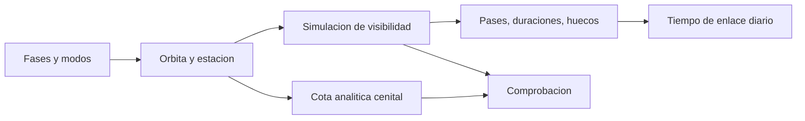

# B83-C03 — Concepto de operaciones CONOPS

<!-- nav:top -->
[🏠 Programa](../../../../README.md) · [📚 Bloque B83](../../../tronco-comun/B83-ingenieria-de-sistemas-y-diseno-de-misiones.md) · [← Anterior: B83-C02 — Partes interesadas y usuarios](../B83-C02-partes-interesadas-y-usuarios/CLASE.md) · [Siguiente: B83-C04 — Requisitos verificables →](../B83-C04-requisitos-verificables/CLASE.md)
<!-- /nav -->

## 1. Ubicación, nivel y alcance

Clase 3 del bloque B83. Nivel N3. El **concepto de operaciones** (CONOPS) cuenta cómo se usará el sistema desde el lanzamiento hasta el fin de vida: fases, modos, actores y cadencias. Aquí armas un CONOPS de la misión sintética ESTRELLA-S y calculas, con una simulación geométrica, cuánto tiempo de contacto diario tiene con una estación de tierra de ejemplo. El manual de NASA (S3) usa el CONOPS como referencia para validar el producto («¿se realizó el producto correcto?»), por eso conviene escribirlo pronto.

## 2. Por qué esta clase existe

Los requisitos de datos, energía y operaciones dependen de cuántas veces al día se puede hablar con el satélite y por cuánto tiempo. La decisión central: **¿cuánto contacto real ofrece la órbita y cómo se reparte en las fases de la misión?** Un CONOPS sin números es un cuento; con números, es un requisito en ciernes.

## 3. Lo que podrás hacer al terminar

1. Describir las fases de una misión y sus modos de operación.
2. Calcular el periodo orbital y la duración de un pase cenital con geometría de dos cuerpos.
3. Simular la visibilidad de una estación y contar pases, duraciones y huecos.
4. Contrastar la simulación con una cota analítica (segunda vía).
5. Convertir el resultado en un presupuesto de tiempo de enlace diario.
6. Rotular lo consultado (`RE`, `GM`), lo estándar no consultado (rotación terrestre) y lo sintético.

La evidencia es la **CONOPS con tabla de contactos y presupuesto de tiempo de enlace** del ejercicio 12 (sección 20).

## 4. Con qué llegas y cómo comprobarlo

1. ¿Qué es el periodo de una órbita circular?
2. ¿Qué es la elevación de un satélite visto desde una estación?
3. ¿Por qué gira la Tierra bajo el satélite?
4. ¿Qué es una fase de misión?
5. ¿Qué es una segunda vía de comprobación?

<details>
<summary>Ver respuestas</summary>

1. `T = 2π√(a³/GM)`. 2. El ángulo sobre el horizonte local. 3. Porque gira con su propia rotación mientras el satélite sigue una órbita inercial. 4. Un tramo del ciclo de vida con objetivos y modos propios (lanzamiento, puesta en servicio, operaciones, fin de vida). 5. Calcular lo mismo con otro método y comparar.
</details>

Con cuatro o cinco aciertos, sigue; si no, repasa los prerrequisitos.

## 5. Un caso de contexto y casos de referencia

ESTRELLA-S (sintética) orbita a 550 km con inclinación de 97,6° y tiene una única estación en 40° N con elevación mínima de 10°. En 3 días la simulación da 13 pases (4,33 por día) de 6,27 min de media, con un tiempo de contacto de 27,17 min al día y un hueco máximo de 11,49 h entre pases. Todo es **sintético**; la estación no es real.

## 6. Vocabulario

Un **CONOPS** describe fases, modos, actores y escenarios de operación. Las **fases** de ejemplo son: lanzamiento y primeras órbitas, puesta en servicio, operaciones nominales y fin de vida. Un **modo** (nominal, seguro, de eclipse) es una configuración con reglas propias. Un **pase** es un intervalo en que el satélite está sobre la elevación mínima. El **hueco** es el tiempo sin contacto entre pases. La **cobertura** diaria es el tiempo total de contacto. El pase **cenital** pasa justo sobre la estación y es el más largo.

## 7. Modelo mental: de las fases a un tiempo de enlace



*Descripción textual:* las fases y modos del CONOPS definen la órbita y la estación; la simulación de visibilidad da pases, duraciones y huecos, de los que sale el tiempo de enlace diario; la cota analítica del pase cenital sirve de comprobación.

Analogía: un horario de trenes: el CONOPS es el horario y el cálculo de pases dice a qué hora pasa realmente el tren por tu estación. Límite: el tren no cambia de horario cuando la órbita se perturba; aquí sí cambiaría (J2, resistencia).

## 8. La explicación, paso a paso

### 8.1 Fases y modos (sintéticos)

El CONOPS de ejemplo tiene cuatro fases: lanzamiento y primeras órbitas (7 d), puesta en servicio (30 d), operaciones nominales (3 años) y fin de vida (90 d). En operaciones hay tres modos: nominal (carga útil activa), eclipse (carga apagada) y seguro (solo supervivencia). Cada contacto sirve para enviar comandos, bajar telemetría y bajar datos científicos.

### 8.2 Geometría de los pases

Con `a = 6928,137 km` el periodo es 95,65 min. Un pase cenital con elevación mínima de 10° tiene un semiángulo central `λ = arccos(R cos ε/(R+h)) − ε` y dura `2λ/n`: 7,95 min si la Tierra no girara. La rotación terrestre y que la estación no está en la traza hacen los pases reales más cortos.

### 8.3 Simulación de visibilidad

Se propaga la órbita en pasos de 5 s, se pasa a un sistema fijo a la Tierra y se calcula la elevación. Resultado: 13 pases en 3 días, máximo 7,17 min (por debajo de la cota de 7,95 min), contacto de 27,17 min al día y hueco máximo de 11,49 h. Esos números fijan el presupuesto de datos de C11: no se puede bajar más de lo que cabe en esos minutos.

## 9. Magnitudes, símbolos y unidades

| Símbolo | Qué es | Unidad | Valor / nota |
|---|---|---|---|
| `a` | semieje de la órbita circular | km | 6928,137 |
| `T` | periodo | min | 95,65 |
| `ε` | elevación mínima | ° | 10 (sintético) |
| `λ` | semiángulo de la huella | rad | según 8.2 |
| `t_pase` | duración de un pase | min | media 6,27 |
| `t_dia` | contacto diario | min | 27,17 |

## 10. Convenciones y referencias

`RE` y `GM` de la ficha de la Tierra de NASA/NSSDC (S8; `GM` con cinco cifras). Rotación terrestre `7,2921159×10⁻⁵ rad/s`: valor estándar **no consultado**. Sistema: inercial geocentrico de ejemplo y fijo a la Tierra rotando alrededor de `z`; Tierra esférica; sin J2, sin refracción. Estación a 40° N, 0° E, elevación mínima de 10°. Tolerancia: el pase máximo simulado queda por debajo de la cota analítica y a más del 75 % de ella. Todo lo orbital y operativo es **sintético**.

## 11. De dónde sale lo que afirmamos

| ID | Fuente | Localizador | Respalda | Estado |
|---|---|---|---|---|
| S3 | NASA, *Systems Engineering Handbook*, 5.3 Product Verification — https://www.nasa.gov/reference/5-3-product-verification/ (consultada 2026-11-10; solo las primeras 100 000 caracteres) | introducción a 5.3; diferencia entre verificación y validación | la validación compara el producto con el ConOps y el uso previsto; la verificación, con los requisitos | Consultada |
| S8 | NASA/NSSDC, Earth Fact Sheet — https://nssdc.gsfc.nasa.gov/planetary/factsheet/earthfact.html (consultada 2026-11-10) | ficha de la Tierra | radio ecuatorial 6378,137 km y GM 398 600 km³/s² | Consultada |
| ECSS | ECSS-E-ST-10C, ECSS-M-ST-40C, ECSS-Q-ST-30-02C, ECSS-Q-ST-40-12C y demás estándares (ecss.nl) | — | — | No consultada: la página de estándares no mostró los documentos |
| — | ISO/IEC/IEEE 15288, INCOSE, SysML, MIL-STD-1629, IEC 60812 e IEC 61025 | — | — | No consultada |
| — | Relaciones matemáticas estándar usadas en el laboratorio (AHP, rutas críticas, ley de Stefan, confiabilidad exponencial, cortes mínimos, ecuación del cohete) | — | — | No consultada en una fuente concreta: las verifica el laboratorio por una segunda vía |

Límites: las fases del CONOPS y las duraciones son de ejemplo; la rotación terrestre no se consultó; el manual no se leyó en su apartado específico de CONOPS (solo se leyó la sección de verificación).

## 12. Cómo ver los contactos

| Magnitud | Valor |
|---|---|
| Periodo | 95,65 min |
| Pases en 3 días | 13 |
| Duración media / máxima | 6,27 / 7,17 min |
| Cota analítica cenital | 7,95 min |
| Contacto diario | 27,17 min |
| Hueco máximo | 11,49 h |

Descripción larga: los pases se agrupan en dos tandas diarias de pases ascendentes y descendentes, con un hueco largo entre ellas; la tabla muestra el hueco máximo, que fija la latencia más desfavorable de los datos.

## 13. Ejemplo trabajado: presupuesto de enlace diario

**Paso 1 · Contacto.** `t_dia = 27,17 min`.

**Paso 2 · Pases.** `4,33` pases al día, de `6,27 min` de media.

**Paso 3 · Tiempo útil.** Si cada pase pierde 1 min en adquisición y cierre, quedan `27,17 − 4,33×1` minutos útiles.

**Paso 4 · Latencia.** El dato tomado justo tras un pase espera hasta `11,49 h` para bajar.

## 14. Distintas formas de abordar el problema

**Por simulación** (esta clase). **Por cota analítica:** pase cenital (`2λ/n`). **Por herramientas de análisis de misión** (no usadas aquí). La simulación y la cota coinciden en el orden de magnitud y la simulación nunca la supera.

## 15. Práctica guiada

**Ejercicio 1 · con los pasos indicados.** Calcula cuántas órbitas completa ESTRELLA-S en un día si el periodo es 95,65 min. *Pasos:* `1440/T`.

<details><summary>Solución comentada</summary>

`1440/95,65 = 15,05` órbitas al día.
</details>

**Ejercicio 2 · con una pista.** Si hay 4,33 pases al día de media, ¿cuántos pases hay en 7 días? *Pista:* multiplica.

<details><summary>Solución comentada</summary>

`4,33×7 ≈ 30,3`, es decir unos 30 pases.
</details>

**Ejercicio 3 · casi autónomo.** Un pase dura 6 min y se pierde 1 min por pase. ¿Cuántos minutos útiles tiene?

<details><summary>Solución comentada</summary>

5 min.
</details>

## 16. Práctica autónoma, transferencia e integrador

**Ejercicio 4 · autónomo.** Con contacto diario de 27,17 min y un enlace de 2 Mbit/s con eficiencia 100 %, ¿cuántos Gbit se pueden bajar al día?

<details><summary>Solución comentada</summary>

`27,17×60×2×10⁶ = 3,26 Gbit` (≈ 3,3 Gbit).
</details>

**Ejercicio 5 · autónomo.** ¿Cómo cambia el hueco máximo si se añade una segunda estación en el hemisferio sur?

<details><summary>Solución comentada</summary>

Se reduce, porque los pases de la segunda estación caen en los huecos de la primera; solo se puede asegurar con otra simulación.
</details>

**Ejercicio 6 · autónomo.** ¿Por qué la duración máxima simulada es menor que la cota cenital?

<details><summary>Solución comentada</summary>

Porque la cota ignora la rotación terrestre y supone un pase exactamente cenital.
</details>

**Ejercicio 7 · autónomo.** Escribe tres modos de operación y su condición de entrada.

<details><summary>Solución comentada</summary>

Nominal (tras la puesta en servicio), eclipse (sombra), seguro (anomalía).
</details>

**Ejercicio 8 · autónomo.** Explica por qué el CONOPS debe escribirse antes de los requisitos de datos.

<details><summary>Solución comentada</summary>

Porque fija cuánto contacto, qué escenarios y qué latencias existen, de los que se derivan los requisitos.
</details>

**Ejercicio 9 · transferencia.** **Transferencia.** Un colega usa 27,17 min/día para una estación de 10° de elevación a 70° N. ¿Es válido?

<details><summary>Solución comentada</summary>

No: el resultado es de una estación a 40° N con datos sintéticos; la latitud cambia los pases.
</details>

**Ejercicio 10 · transferencia.** **Transferencia.** ¿Qué parte de este cálculo cambiaría si la elevación mínima fuera 20°?

<details><summary>Solución comentada</summary>

El semiángulo `λ` baja, los pases se acortan y el contacto diario disminuye.
</details>

**Ejercicio 11 · transferencia.** **Transferencia.** ¿Qué escenario de fallo debería incluir el CONOPS aunque no se calcule aquí?

<details><summary>Solución comentada</summary>

La pérdida de una estación o de un pase, con un modo seguro que mantenga la supervivencia.
</details>

**Ejercicio 12 · integrador.** **Integrador.** Elabora tu *CONOPS con tabla de contactos*: fases, modos, pases, huecos y presupuesto de enlace diario con lista de qué es consultado, estándar y sintético.

<details><summary>Solución comentada</summary>

Secciones 8.1–8.3, la tabla de pases del laboratorio y el ejemplo 13.
</details>

## 17. Laboratorio: contactos con una estación de tierra

El script [contactos_conops.py](contactos_conops.py) propaga una órbita circular, calcula la elevación sobre una estación y cuenta los pases (**comprueba** que ningún pase supera la cota cenital analítica, que el mejor queda a más del 75 % de ella y que hay pases en 3 días). Usa la biblioteca común [sistemas_comun.py](../sistemas_comun.py) del bloque.

**Datos:** `RE` y `GM` de NASA/NSSDC (consultados el 2026-11-10); rotación terrestre estándar **no consultada**; órbita, estación y duración **sintéticas**. **Predice antes de ejecutar:** ¿cuántos pases por día esperas y cuál será el hueco mayor? (unos 4 al día; hueco de más de 10 h.) **Ejecución del 2026-11-10 (Python 3.12.9 | numpy 2.4.4):**

```text
Python 3.12.9 | numpy 2.4.4
Datos SINTETICOS: h = 550 km, i = 97.6 deg, estacion a 40 N, elevacion minima 10 deg, 3 dias, paso 5 s; RE y GM de NASA/NSSDC
Periodo = 95.65 min
Pases en 3 d = 13 (4.33 por dia) ; duracion media = 6.27 min ; maxima = 7.17 min
Duraciones [min]: 7.1 7.0 5.5 5.2 7.1 7.0 5.6 5.2 7.2 6.8 5.7 5.0 7.2
Pase cenital analitico (sin rotacion terrestre) = 7.95 min
Tiempo de contacto diario = 27.17 min ; hueco maximo entre pases = 11.49 h ; pases de al menos 5 min = 13
Pruebas superadas.
```

```bash
python programa/clases/B83/B83-C03-concepto-de-operaciones-conops/contactos_conops.py
```

**Límites:** Tierra esférica y dos cuerpos; sin J2 (la traza real deriva); sin refracción ni obstáculos; una sola estación; sin la geometría solar.

## 18. Errores frecuentes y cómo corregirlos

**Contar todos los minutos de visibilidad como útiles.** Descuenta adquisición, cierre y margen

**Tratar la cota cenital como duración típica.** Es un máximo; los pases típicos son más cortos

**Escribir un CONOPS sin números.** Añade pases, huecos y latencias

## 19. Cómo sabrás que vas bien

Tras 8.2: ¿cuántos pases esperabas? Tras 8.3: ¿qué fija el hueco máximo? Si dudas, repasa el ejemplo 13.

## 20. Qué entregas y cómo se evalúa

El producto es tu **CONOPS con tabla de contactos y presupuesto de tiempo de enlace** (ejercicio 12).

| Criterio | Inicial | En desarrollo | Logrado | Destacado |
|---|---|---|---|---|
| Conceptos | Los confunde | Parciales | Explica el método y su dominio | Explica los límites y las alternativas |
| Cálculo | Sin unidades | Con errores | Resultados con unidades y comprobados | Resuelve casos nuevos |
| Numérico | Sin comprobar | Un caso | Verifica por una segunda vía en varios casos | Interpreta las diferencias y los fallos |
| Fuentes | Sin fuente | Sin fecha | Fuentes con fecha y estado | Declara lo sintético y lo no consultado |
| Límites | No los nombra | Uno | Tres | Discute qué falta del modelo |

**Condiciones críticas (no se compensan con promedio):** rotular los datos como sintéticos; verificar el resultado por una segunda vía; citar solo lo consultado.

## 21. Ética, seguridad y límites

Clase educativa: los modelos son simplificados y los datos son sintéticos; ningún resultado describe una misión real, certifica una seguridad ni sustituye a los estándares vigentes y a la revisión de especialistas.  Accesibilidad: tablas equivalentes a las gráficas, fórmulas en texto, ejercicios sin conexión.

## 22. Para cerrar y seguir

ESTRELLA-S (sintética) tiene 4,33 pases y 27,17 min de contacto al día, con un hueco máximo de 11,49 h. Queda una pregunta: ¿cómo se escriben requisitos que se puedan comprobar? (C04).

**Glosario español–inglés.** concepto de operaciones · *concept of operations*; pase · *pass*; elevación · *elevation*; hueco de cobertura · *coverage gap*; modo seguro · *safe mode*.

**Continuidad.** [B83-C04](../B83-C04-requisitos-verificables/CLASE.md) convierte el CONOPS y las necesidades en requisitos verificables.

**Referencias:** ver sección 11.

<!-- nav:bottom -->
---

[← Anterior: B83-C02 — Partes interesadas y usuarios](../B83-C02-partes-interesadas-y-usuarios/CLASE.md) · [📚 Bloque B83](../../../tronco-comun/B83-ingenieria-de-sistemas-y-diseno-de-misiones.md) · [Siguiente: B83-C04 — Requisitos verificables →](../B83-C04-requisitos-verificables/CLASE.md)
<!-- /nav -->
