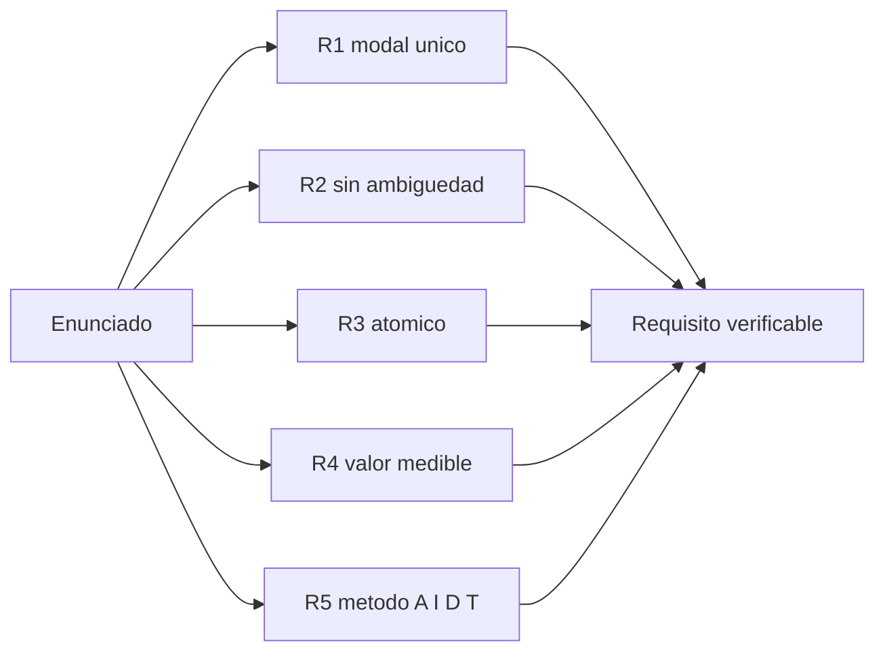

# B83-C04 — Requisitos verificables

<!-- nav:top -->
[🏠 Programa](../../../../README.md) · [📚 Bloque B83](../../../tronco-comun/B83-ingenieria-de-sistemas-y-diseno-de-misiones.md) · [← Anterior: B83-C03 — Concepto de operaciones CONOPS](../B83-C03-concepto-de-operaciones-conops/CLASE.md) · [Siguiente: B83-C05 — Trazabilidad de requisitos →](../B83-C05-trazabilidad-de-requisitos/CLASE.md)
<!-- /nav -->

## 1. Ubicación, nivel y alcance

Clase 4 del bloque B83. Nivel N3. Un requisito es verificable si se puede decidir, con evidencia, que se cumple o no. Aquí aprendes cinco reglas de calidad y las aplicas con un revisor automático a doce requisitos **sintéticos** de la misión de ejemplo ESTRELLA-S, algunos con defectos plantados a propósito. Los cuatro métodos de verificación (análisis, inspección, demostración y ensayo) se describen en el *NASA Systems Engineering Handbook* (S3); las reglas del revisor son de ejemplo y no vienen de una norma.

## 2. Por qué esta clase existe

Un requisito vago («resolución adecuada») no puede aprobarse ni suspenderse: bloquea el diseño y siembra disputas. La decisión central: **¿este enunciado se puede comprobar con un método y un criterio de aceptación?** Cada defecto no corregido aquí reaparece como una disputa en la verificación (C17).

## 3. Lo que podrás hacer al terminar

1. Redactar un requisito con modal único, valor medible y método de verificación.
2. Reconocer palabras ambiguas y requisitos compuestos.
3. Asignar uno de los cuatro métodos de verificación (A, I, D, T).
4. Aplicar un revisor de reglas y leer su reporte.
5. Validar el revisor contra un oráculo de defectos plantados.
6. Rotular que las reglas son de ejemplo y los requisitos son sintéticos.

La evidencia es la **lista de requisitos revisada con reporte de calidad** del ejercicio 12 (sección 20).

## 4. Con qué llegas y cómo comprobarlo

1. ¿Qué diferencia hay entre una necesidad y un requisito?
2. ¿Qué es un criterio de aceptación?
3. ¿Cuáles son los cuatro métodos de verificación?
4. ¿Qué significa «atómico»?
5. ¿Qué es un oráculo en una prueba?

<details>
<summary>Ver respuestas</summary>

1. La necesidad dice qué se quiere; el requisito dice qué debe cumplir el sistema, de forma verificable. 2. El valor o condición que decide si el requisito se cumple. 3. Análisis, inspección, demostración y ensayo. 4. Que expresa una sola obligación. 5. Una respuesta correcta conocida de antemano para comparar.
</details>

Con cuatro o cinco aciertos, sigue; si no, repasa los prerrequisitos.

## 5. Un caso de contexto y casos de referencia

El revisor de la clase analiza doce requisitos de ESTRELLA-S (sintética). Seis cumplen todas las reglas; los otros 14 defectos se reparten así: R1 (sin «deberá») 1, R2 (ambigüedad) 5, R3 (no atómico) 1, R4 (sin valor medible) 5 y R5 (sin método de verificación) 2. Sin defectos: 6 de 12 requisitos (50,0 %).

## 6. Vocabulario

Un **requisito** es un enunciado de lo que el sistema debe cumplir. **Verificable** significa que existe un método y un criterio de aceptación. El **modal** «deberá» marca la obligación (en el ejemplo, «podrá» no lo es). Una **palabra ambigua** («adecuado», «rápido», «robusto», «etc.») impide la decisión. Un requisito **atómico** tiene una sola obligación. Los **métodos de verificación** son análisis (A), inspección (I), demostración (D) y ensayo (T, *test*). Un **oráculo** es el resultado correcto conocido.

## 7. Modelo mental: de un enunciado a un requisito verificable



*Descripción textual:* un enunciado pasa cinco filtros (modal, ambigüedad, atomicidad, valor medible y método de verificación); solo si los supera todos es un requisito verificable.

Analogía: una pregunta de examen: si no tiene una respuesta correcta definida, no se puede corregir. Límite: un requisito puede ser verificable y aun así estar mal pensado (C17 trata ese caso).

## 8. La explicación, paso a paso

### 8.1 Las cinco reglas

R1: aparece «deberá» una vez. R2: no hay palabras ambiguas. R3: una sola obligación. R4: hay un número con unidad o una referencia a un estándar. R5: método A, I, D o T asignado. Son reglas de ejemplo para el laboratorio.

### 8.2 Qué encuentra el revisor

De los doce requisitos, 6 no tienen defectos (R01, R03, R05, R07, R08, R10). R02 y R11 fallan R2, R4 y R5; R04 mezcla ambigüedad y dos obligaciones; R09 usa «podrá» y «aproximadamente»; R12 no tiene valor medible («en cada pase»).

### 8.3 Validar al revisor

Un revisor también puede equivocarse. Por eso el laboratorio compara su salida con un **oráculo** escrito a mano con los defectos plantados: coinciden en los doce requisitos. Un revisor automático no sustituye a la lectura humana: no detecta un requisito bien formado pero equivocado.

## 9. Magnitudes, símbolos y unidades

| Símbolo | Qué es | Unidad | Valor / nota |
|---|---|---|---|
| `N` | requisitos revisados | — | 12 |
| `N_ok` | requisitos sin defectos | — | 6 |
| `p` | porcentaje sin defectos | % | 50,0 |
| `D` | defectos totales | — | 14 |
| `A,I,D,T` | métodos de verificación | — | análisis, inspección, demostración, ensayo |

## 10. Convenciones y referencias

Sin constantes físicas ni sistema de referencia. Reglas R1–R5 de ejemplo (no de una norma). Los métodos A/I/D/T y su significado se tomaron de S3. Requisitos **sintéticos** con defectos plantados. Tolerancia: el revisor coincide con el oráculo en el 100 % de los requisitos.

## 11. De dónde sale lo que afirmamos

| ID | Fuente | Localizador | Respalda | Estado |
|---|---|---|---|---|
| S3 | NASA, *Systems Engineering Handbook*, 5.3 Product Verification — https://www.nasa.gov/reference/5-3-product-verification/ (consultada 2026-11-10; solo las primeras 100 000 caracteres) | sección 5.3.1.2, métodos de verificación | cuatro métodos: análisis (modelado matemático), demostración, inspección (examen visual de un producto realizado) y ensayo (datos detallados en condiciones controladas, el más costoso) | Consultada |
| ECSS | ECSS-E-ST-10C, ECSS-M-ST-40C, ECSS-Q-ST-30-02C, ECSS-Q-ST-40-12C y demás estándares (ecss.nl) | — | — | No consultada: la página de estándares no mostró los documentos |
| — | ISO/IEC/IEEE 15288, INCOSE, SysML, MIL-STD-1629, IEC 60812 e IEC 61025 | — | — | No consultada |
| — | Relaciones matemáticas estándar usadas en el laboratorio (AHP, rutas críticas, ley de Stefan, confiabilidad exponencial, cortes mínimos, ecuación del cohete) | — | — | No consultada en una fuente concreta: las verifica el laboratorio por una segunda vía |

Límites: no se consultó ninguna guía de redacción de requisitos (INCOSE, ECSS-E-ST-10-06); las cinco reglas son de ejemplo. No se infiere nada de una misión real.

## 12. Cómo ver el reporte de calidad

| Magnitud | Valor |
|---|---|
| Requisitos revisados | 12 |
| Sin defectos | 6 (50,0 %) |
| R2 (ambigüedad) | 5 |
| R4 (sin valor medible) | 5 |
| R5 (sin método) | 2 |
| Defectos totales | 14 |

Descripción larga: los defectos más frecuentes son la ambigüedad y la falta de valor medible; ambos se corrigen reemplazando el adjetivo por un número y una unidad.

## 13. Ejemplo trabajado: corregir R02

**Paso 1 · Enunciado.** «El sistema deberá tener una resolución adecuada.»

**Paso 2 · Defectos.** Ambiguo («adecuada»), sin valor medible y sin método.

**Paso 3 · Número.** Desde C01: GSD ≤ 5 m a 550 km.

**Paso 4 · Reescritura.** «El sistema deberá obtener imágenes con un GSD no mayor de 5 m desde 550 km de altura.» (R01).

**Paso 5 · Método.** Ensayo (T): medición con una carta de resolución en laboratorio.

## 14. Distintas formas de abordar el problema

**Por reglas automáticas** (esta clase). **Por revisión por pares:** otra persona lee y discute. **Por formularios con plantilla** («El <sistema> deberá <función> con <valor><unidad> en <condición>»). El laboratorio usa reglas y un oráculo; la lectura humana sigue siendo necesaria.

## 15. Práctica guiada

**Ejercicio 1 · con los pasos indicados.** Marca si «El sistema deberá ser robusto» cumple R2. *Pasos:* busca palabras ambiguas.

<details><summary>Solución comentada</summary>

No cumple: «robusto» es ambiguo.
</details>

**Ejercicio 2 · con una pista.** Reescribe «La batería deberá durar mucho» con un valor. *Pista:* elige una cantidad y una unidad.

<details><summary>Solución comentada</summary>

«La batería deberá entregar al menos 20 Wh por órbita durante 3 años.» (valores de ejemplo).
</details>

**Ejercicio 3 · casi autónomo.** ¿Qué método de verificación asignas a «La masa deberá ser ≤ 120 kg»?

<details><summary>Solución comentada</summary>

Ensayo (pesaje, T) o análisis del presupuesto (A) antes del hardware.
</details>

## 16. Práctica autónoma, transferencia e integrador

**Ejercicio 4 · autónomo.** Divide «El sistema deberá comandarse y deberá almacenar 8 Gbit» en dos requisitos atómicos.

<details><summary>Solución comentada</summary>

1) «El sistema deberá comandarse desde la estación de tierra.» 2) «El sistema deberá almacenar al menos 8 Gbit.»
</details>

**Ejercicio 5 · autónomo.** ¿Qué regla incumple «El sistema podrá almacenar datos»?

<details><summary>Solución comentada</summary>

R1 (sin «deberá») y R4 (sin valor).
</details>

**Ejercicio 6 · autónomo.** Con 6 sin defectos de 12, ¿qué porcentaje es?

<details><summary>Solución comentada</summary>

`6/12 = 50,0 %`.
</details>

**Ejercicio 7 · autónomo.** ¿Por qué un requisito con método «inspección» puede ser insuficiente para un valor numérico de desempeño?

<details><summary>Solución comentada</summary>

Porque la inspección examina características físicas o documentos; un desempeño numérico suele requerir ensayo o análisis.
</details>

**Ejercicio 8 · autónomo.** Explica por qué el oráculo valida al revisor.

<details><summary>Solución comentada</summary>

Porque compara su salida con las respuestas correctas conocidas; si difiere, el revisor tiene un error.
</details>

**Ejercicio 9 · transferencia.** **Transferencia.** Un colega usa el 50 % de requisitos sin defectos como evidencia de que el diseño es bueno. ¿Es válido?

<details><summary>Solución comentada</summary>

No: mide la redacción, no el diseño, y es un conjunto sintético.
</details>

**Ejercicio 10 · transferencia.** **Transferencia.** ¿Qué requisito de ESTRELLA-S vincularías con la necesidad de entrega de datos (C02)?

<details><summary>Solución comentada</summary>

«La carga útil deberá bajar 2 Gbit por día.» (R05), a verificar en C11.
</details>

**Ejercicio 11 · transferencia.** **Transferencia.** Un requisito cumple R1–R5 pero pide algo que nadie necesita. ¿Qué falla?

<details><summary>Solución comentada</summary>

La trazabilidad a una necesidad (C05) y la validación (C17).
</details>

**Ejercicio 12 · integrador.** **Integrador.** Elabora tu *lista de requisitos revisada*: los doce requisitos corregidos, método y criterio de aceptación, y el reporte de calidad antes y después.

<details><summary>Solución comentada</summary>

Secciones 8.1–8.3, el ejemplo 13 y la salida del laboratorio; el reporte «después» debe tener 12 de 12 sin defectos.
</details>

## 17. Laboratorio: revisor automático de calidad de requisitos

El script [revisor_de_requisitos.py](revisor_de_requisitos.py) aplica las reglas R1–R5 a doce requisitos y compara su salida con un oráculo de defectos plantados (**comprueba** que el revisor coincide con el oráculo y que las cuentas son consistentes). Usa la biblioteca común [sistemas_comun.py](../sistemas_comun.py) del bloque.

**Datos:** doce requisitos **sintéticos** con defectos plantados; reglas de ejemplo; sin constantes físicas. **Predice antes de ejecutar:** ¿cuántos de los doce requisitos pasan todas las reglas? (seis). **Ejecución del 2026-11-10 (Python 3.12.9 | numpy 2.4.4):**

```text
Python 3.12.9 | numpy 2.4.4
Datos SINTETICOS: 12 requisitos de ESTRELLA-S con defectos plantados; reglas R1-R5 de ejemplo
  R01 [T] defectos: -          El sistema deberá obtener imágenes con un GSD no mayor de 5 m desde 550 km de altura.
  R02 [ ] defectos: R2,R4,R5   El sistema deberá tener una resolución adecuada.
  R03 [A] defectos: -          La masa de lanzamiento deberá ser menor o igual que 120 kg.
  R04 [D] defectos: R2,R3,R4   El sistema deberá ser fácil de operar y deberá usar baja potencia.
  R05 [A] defectos: -          La carga útil deberá bajar 2 Gbit por día.
  R06 [T] defectos: R2,R4      El enlace descendente deberá ser rápido.
  R07 [A] defectos: -          El satélite deberá funcionar 3 años en órbita.
  R08 [T] defectos: -          La potencia media consumida no deberá superar 40 W.
  R09 [I] defectos: R1,R2      El sistema podrá almacenar datos aproximadamente 8 Gbit.
  R10 [I] defectos: -          La telemetría deberá transmitirse según CCSDS 131.0-B-5.
  R11 [ ] defectos: R2,R4,R5   El software deberá ser robusto, etc.
  R12 [D] defectos: R4         El sistema deberá comandarse desde la estación en cada pase.
Requisitos sin defectos: 6 de 12 (50.0 %) -> R01, R03, R05, R07, R08, R10
Incumplimientos por regla: R1 1, R2 5, R3 1, R4 5, R5 2 ; defectos totales 14
Pruebas superadas.
```

```bash
python programa/clases/B83/B83-C04-requisitos-verificables/revisor_de_requisitos.py
```

**Límites:** reglas simples por palabras clave; el español natural es más variado; el revisor no entiende el significado; las reglas no son de una norma.

## 18. Errores frecuentes y cómo corregirlos

**Medir la calidad solo por el número de requisitos.** Cuenta defectos por regla y revisa el significado

**Aceptar «aproximadamente» sin tolerancia.** Escribe el valor con su tolerancia

**Asignar un método sin criterio.** Escribe cómo se decide el cumplimiento

## 19. Cómo sabrás que vas bien

Tras 8.2: ¿qué requisitos esperabas que fallaran? Tras el laboratorio: ¿qué comprueba el oráculo? Si dudas, repasa el ejemplo 13.

## 20. Qué entregas y cómo se evalúa

El producto es tu **lista de requisitos revisada con reporte de calidad** (ejercicio 12).

| Criterio | Inicial | En desarrollo | Logrado | Destacado |
|---|---|---|---|---|
| Conceptos | Los confunde | Parciales | Explica el método y su dominio | Explica los límites y las alternativas |
| Cálculo | Sin unidades | Con errores | Resultados con unidades y comprobados | Resuelve casos nuevos |
| Numérico | Sin comprobar | Un caso | Verifica por una segunda vía en varios casos | Interpreta las diferencias y los fallos |
| Fuentes | Sin fuente | Sin fecha | Fuentes con fecha y estado | Declara lo sintético y lo no consultado |
| Límites | No los nombra | Uno | Tres | Discute qué falta del modelo |

**Condiciones críticas (no se compensan con promedio):** rotular los datos como sintéticos; verificar el resultado por una segunda vía; citar solo lo consultado.

## 21. Ética, seguridad y límites

Clase educativa: los modelos son simplificados y los datos son sintéticos; ningún resultado describe una misión real, certifica una seguridad ni sustituye a los estándares vigentes y a la revisión de especialistas.  Accesibilidad: tablas equivalentes a las gráficas, fórmulas en texto, ejercicios sin conexión.

## 22. Para cerrar y seguir

El revisor encontró 14 defectos y dejó 6 de 12 requisitos limpios; el oráculo confirma el resultado. Queda una pregunta: ¿cómo se asegura que cada requisito viene de una necesidad y llega a una prueba? (C05).

**Glosario español–inglés.** requisito · *requirement*; verificable · *verifiable*; criterio de aceptación · *acceptance criterion*; análisis · *analysis*; ensayo · *test*.

**Continuidad.** [B83-C05](../B83-C05-trazabilidad-de-requisitos/CLASE.md) enlaza cada requisito con su origen y su verificación.

**Referencias:** ver sección 11.

<!-- nav:bottom -->
---

[← Anterior: B83-C03 — Concepto de operaciones CONOPS](../B83-C03-concepto-de-operaciones-conops/CLASE.md) · [📚 Bloque B83](../../../tronco-comun/B83-ingenieria-de-sistemas-y-diseno-de-misiones.md) · [Siguiente: B83-C05 — Trazabilidad de requisitos →](../B83-C05-trazabilidad-de-requisitos/CLASE.md)
<!-- /nav -->
