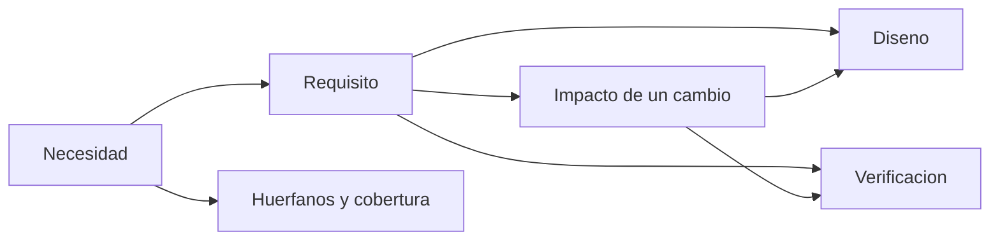

# B83-C05 — Trazabilidad de requisitos

<!-- nav:top -->
[🏠 Programa](../../../../README.md) · [📚 Bloque B83](../../../tronco-comun/B83-ingenieria-de-sistemas-y-diseno-de-misiones.md) · [← Anterior: B83-C04 — Requisitos verificables](../B83-C04-requisitos-verificables/CLASE.md) · [Siguiente: B83-C06 — Descomposición funcional →](../B83-C06-descomposicion-funcional/CLASE.md)
<!-- /nav -->

## 1. Ubicación, nivel y alcance

Clase 5 del bloque B83. Nivel N3. La **trazabilidad** enlaza cada necesidad con los requisitos que la satisfacen, con los elementos de diseño que los cumplen y con la verificación que lo comprueba. Aquí armas ese grafo para la misión sintética ESTRELLA-S, encuentras cuatro defectos plantados y calculas el alcance de un cambio. El manual de NASA (S2) indica que, tras la revisión de requisitos del sistema (SRR), los requisitos quedan bajo control formal y los cambios exigen aprobación de una junta de control de configuración o autoridad equivalente.

## 2. Por qué esta clase existe

Cuando cambia un requisito, ¿qué piezas y qué pruebas hay que revisar? Sin trazabilidad, nadie lo sabe y el cambio rompe algo en silencio. La decisión central: **¿cada requisito tiene un origen, un responsable de diseño y una verificación, y qué se afecta si cambia?**

## 3. Lo que podrás hacer al terminar

1. Construir un grafo necesidad → requisito → diseño → verificación.
2. Detectar necesidades sin requisito, requisitos huérfanos, requisitos sin verificación y diseño sin requisito.
3. Calcular métricas de cobertura de cada eslabón.
4. Calcular el impacto de un cambio con un recorrido en anchura.
5. Comprobar el impacto con la clausura transitiva de Warshall.
6. Rotular que el grafo es sintético y que la trazabilidad no prueba que el diseño sea correcto.

La evidencia es la **matriz de trazabilidad con análisis de impacto** del ejercicio 12 (sección 20).

## 4. Con qué llegas y cómo comprobarlo

1. ¿Qué es un grafo dirigido?
2. ¿Qué es un requisito huérfano?
3. ¿Qué es un recorrido en anchura?
4. ¿Qué es la clausura transitiva?
5. ¿Qué es el *gold plating*?

<details>
<summary>Ver respuestas</summary>

1. Un conjunto de nodos con aristas que tienen sentido. 2. Uno sin necesidad u origen que lo justifique. 3. Un método que visita los nodos por capas desde un origen. 4. El conjunto de pares conectados por algún camino. 5. Añadir características que nadie pidió.
</details>

Con cuatro o cinco aciertos, sigue; si no, repasa los prerrequisitos.

## 5. Un caso de contexto y casos de referencia

El grafo de ESTRELLA-S (sintético) tiene 6 necesidades, 8 requisitos, 6 elementos de diseño, 6 verificaciones y 31 enlaces. Los defectos plantados son N6 (sin requisito), R07 (sin necesidad y sin verificación) y D6, un radiador decorativo sin requisito. Cobertura: necesidades 83,3 %, requisitos con origen 87,5 %, requisitos verificados 87,5 % y diseño con requisito 83,3 %. Cambiar R03 afecta a 3 elementos aguas abajo.

## 6. Vocabulario

La **trazabilidad** es el enlace verificable entre elementos del desarrollo. **Aguas arriba** se llega al origen (necesidad); **aguas abajo**, a diseño y verificación. Una **matriz de trazabilidad** lista esos enlaces. El **análisis de impacto** calcula qué se afecta si algo cambia. Un **requisito huérfano** no tiene origen; un **requisito no verificado** no tiene prueba; el **diseño sin requisito** es *gold plating* o un requisito faltante. La **cobertura** es el porcentaje de elementos con el enlace.

## 7. Modelo mental: una cadena de enlaces



*Descripción textual:* cada necesidad se enlaza con requisitos; estos, con diseño y verificación; un cambio en un requisito se propaga a lo que cuelga de él, y los huecos de la cadena son los huérfanos y la cobertura.

Analogía: el árbol genealógico de una pieza: si cambias un ancestro, recorres a los descendientes. Límite: un árbol de enlaces correcto no demuestra que los requisitos sean los adecuados (C17).

## 8. La explicación, paso a paso

### 8.1 Construir el grafo

Se definen nodos (N, R, D, V) y aristas dirigidas: de la necesidad al requisito, del requisito al diseño y del requisito a la verificación. En ESTRELLA-S hay 31 aristas. R02 (masa ≤ 120 kg) toca a cinco elementos de diseño porque la masa es transversal.

### 8.2 Detectar huecos

El laboratorio encuentra: N6 sin requisito, R07 sin necesidad y sin verificación, y D6 sin requisito. La cobertura de cada eslabón es 83,3 %, 87,5 %, 87,5 % y 83,3 %. Un requisito huérfano es candidato a eliminarse o a justificarse con una necesidad nueva; una necesidad sin requisito, a convertirse en uno.

### 8.3 Impacto de un cambio

Si cambia R03 (2 Gbit/día), el recorrido aguas abajo llega a D4 (computadora), D5 (radio) y V3 (ensayo de enlace): 3 elementos. Aguas arriba, R03 viene de N3. La clausura de Warshall da el mismo conjunto, lo que valida el recorrido. Desde N3 se alcanzan 7 elementos: una necesidad mal planteada contamina mucho más.

## 9. Magnitudes, símbolos y unidades

| Símbolo | Qué es | Unidad | Valor / nota |
|---|---|---|---|
| `N` | necesidades | — | 6 |
| `R` | requisitos | — | 8 |
| `E` | enlaces | — | 31 |
| `cob` | cobertura de un eslabón | % | 87,5 (requisitos con origen) |
| `I(R03)` | elementos afectados | — | 3 |

## 10. Convenciones y referencias

Sin constantes físicas ni sistema de referencia. Datos **sintéticos**. Los enlaces se codifican como pares; la dirección es de origen a derivado. Tolerancia: el impacto por BFS y por Warshall debe ser idéntico y los defectos plantados deben detectarse exactamente. Congelación formal de requisitos tras SRR según S2.

## 11. De dónde sale lo que afirmamos

| ID | Fuente | Localizador | Respalda | Estado |
|---|---|---|---|---|
| S2 | NASA, *Systems Engineering Handbook*, 6.0 Crosscutting Technical Management — https://www.nasa.gov/reference/6-0-crosscutting-technical-management/ (consultada 2026-11-10; solo las primeras 100 000 caracteres de la página) | 6.2.1.2.4; sección de gestión de configuración | tras SRR los requisitos se controlan formalmente y los cambios se aprueban por una junta de control de configuración o autoridad equivalente; el control de configuración evita que cambios invaliden análisis previos | Consultada |
| ECSS | ECSS-E-ST-10C, ECSS-M-ST-40C, ECSS-Q-ST-30-02C, ECSS-Q-ST-40-12C y demás estándares (ecss.nl) | — | — | No consultada: la página de estándares no mostró los documentos |
| — | ISO/IEC/IEEE 15288, INCOSE, SysML, MIL-STD-1629, IEC 60812 e IEC 61025 | — | — | No consultada |
| — | Relaciones matemáticas estándar usadas en el laboratorio (AHP, rutas críticas, ley de Stefan, confiabilidad exponencial, cortes mínimos, ecuación del cohete) | — | — | No consultada en una fuente concreta: las verifica el laboratorio por una segunda vía |

Límites: solo se leyó la primera parte de la página 6.0; no se consultó el apartado de gestión de requisitos del manual ni herramientas de trazabilidad. El grafo no representa un proyecto real.

## 12. Cómo ver la cobertura y el impacto

| Magnitud | Valor |
|---|---|
| Necesidades con requisito | 83,3 % |
| Requisitos con origen | 87,5 % |
| Requisitos verificados | 87,5 % |
| Diseño con requisito | 83,3 % |
| Impacto de R03 | 3 elementos (D4, D5, V3) |
| Alcance desde N3 | 7 elementos |

Descripción larga: cuatro huecos en cuatro eslabones: ninguno supera el 17 % de cobertura faltante, pero cada uno es un riesgo distinto (necesidad perdida, requisito sin sustento, requisito sin prueba y diseño injustificado).

## 13. Ejemplo trabajado: impacto de cambiar R03

**Paso 1 · Origen.** R03 viene de N3 (entrega rápida de datos).

**Paso 2 · Aguas abajo.** R03 → D5 (radio) y D4 (computadora); R03 → V3 (ensayo de enlace).

**Paso 3 · Conteo.** 3 elementos.

**Paso 4 · Acción.** Revisar los tres, actualizar la línea base (C15) y repetir V3 si cambia el criterio.

## 14. Distintas formas de abordar el problema

**Por recorrido (BFS)** (esta clase). **Por matriz y clausura (Warshall):** se multiplica la matriz de adyacencia hasta cerrar. **Por herramienta de gestión de requisitos o MBSE (C12):** los enlaces viven en el modelo. El laboratorio usa BFS y Warshall.

## 15. Práctica guiada

**Ejercicio 1 · con los pasos indicados.** Calcula la cobertura de necesidades si 5 de 6 tienen requisito. *Pasos:* divide.

<details><summary>Solución comentada</summary>

`5/6 = 83,3 %`.
</details>

**Ejercicio 2 · con una pista.** ¿Qué elementos cuelgan de R06 en el grafo? *Pista:* mira las aristas de R06.

<details><summary>Solución comentada</summary>

D2 (panel), D3 (batería), D4 (computadora) y V5 (ensayo de potencia): 4 elementos.
</details>

**Ejercicio 3 · casi autónomo.** ¿Qué defecto tiene D6 y cómo se corrige?

<details><summary>Solución comentada</summary>

Es diseño sin requisito: se elimina o se justifica con un requisito nuevo.
</details>

## 16. Práctica autónoma, transferencia e integrador

**Ejercicio 4 · autónomo.** Si se elimina R07, ¿qué cobertura de requisitos con origen resulta?

<details><summary>Solución comentada</summary>

Quedan 7 requisitos y todos tienen origen: 100 %.
</details>

**Ejercicio 5 · autónomo.** ¿Qué le pasa a la cobertura de verificación si se añade una verificación para R07?

<details><summary>Solución comentada</summary>

Pasa de 87,5 % a 100 %.
</details>

**Ejercicio 6 · autónomo.** Explica por qué R02 toca a cinco elementos de diseño.

<details><summary>Solución comentada</summary>

Porque la masa es un requisito transversal: todos los elementos aportan masa.
</details>

**Ejercicio 7 · autónomo.** Calcula la cobertura de diseño si se añade un requisito que cubre D6.

<details><summary>Solución comentada</summary>

`6/6 = 100 %`.
</details>

**Ejercicio 8 · autónomo.** ¿Por qué es útil verificar BFS con Warshall?

<details><summary>Solución comentada</summary>

Porque son dos algoritmos distintos; si coinciden, el resultado es fiable.
</details>

**Ejercicio 9 · transferencia.** **Transferencia.** Un colega afirma que, como la cobertura es del 87,5 %, el diseño es correcto. ¿Es válido?

<details><summary>Solución comentada</summary>

No: la cobertura mide enlaces, no la corrección de requisitos ni del diseño; el grafo además es sintético.
</details>

**Ejercicio 10 · transferencia.** **Transferencia.** ¿Qué pasa con la trazabilidad si un requisito se divide en dos?

<details><summary>Solución comentada</summary>

Cada nuevo requisito necesita su origen, su diseño y su verificación; se actualizan los enlaces del requisito padre.
</details>

**Ejercicio 11 · transferencia.** **Transferencia.** ¿Por qué debe haber una junta que apruebe cambios tras SRR?

<details><summary>Solución comentada</summary>

Para que cada cambio tenga un análisis de impacto y una decisión registrada (S2); sin control, se invalidan análisis previos.
</details>

**Ejercicio 12 · integrador.** **Integrador.** Elabora tu *matriz de trazabilidad con análisis de impacto*: enlaces, huecos, cobertura, impacto de un cambio por dos vías y lista de qué es sintético.

<details><summary>Solución comentada</summary>

Secciones 8.1–8.3, el ejemplo 13 y la salida del laboratorio.
</details>

## 17. Laboratorio: grafo de trazabilidad y análisis de impacto

El script [matriz_de_trazabilidad.py](matriz_de_trazabilidad.py) construye el grafo de trazabilidad, detecta los huecos y calcula el impacto de un cambio por BFS y por Warshall (**comprueba** que ambos conjuntos son iguales y que los cuatro defectos plantados se detectan exactamente). Usa la biblioteca común [sistemas_comun.py](../sistemas_comun.py) del bloque.

**Datos:** todos **sintéticos** (necesidades, requisitos, diseño, verificaciones y enlaces); sin constantes físicas. **Predice antes de ejecutar:** ¿cuántos elementos afecta un cambio en R03? (tres: D4, D5 y V3.) **Ejecución del 2026-11-10 (Python 3.12.9 | numpy 2.4.4):**

```text
Python 3.12.9 | numpy 2.4.4
Datos SINTETICOS: 6 necesidades, 8 requisitos, 6 elementos de diseno, 6 verificaciones, 31 enlaces
Necesidades sin requisito: ['N6'] ; requisitos sin necesidad: ['R07']
Requisitos sin verificacion: ['R07'] ; elementos de diseno sin requisito: ['D6 Radiador decorativo']
Cobertura: necesidades 83.3 % ; requisitos con origen 87.5 % ; requisitos verificados 87.5 % ; diseno con requisito 83.3 %
Impacto de cambiar R03 (BFS): ['D4 Computadora', 'D5 Radio', 'V3 Ensayo de enlace']
Impacto de cambiar R03 (Warshall): ['D4 Computadora', 'D5 Radio', 'V3 Ensayo de enlace']
Ancestros de R03: ['N3'] ; elementos alcanzados desde N3: 7
Pruebas superadas.
```

```bash
python programa/clases/B83/B83-C05-trazabilidad-de-requisitos/matriz_de_trazabilidad.py
```

**Límites:** el grafo es pequeño y de un solo nivel; no hay versiones ni estados; la cobertura no mide la calidad de cada enlace.

## 18. Errores frecuentes y cómo corregirlos

**Enlazar sin justificar.** Cada enlace debe responder «por qué este elemento cumple este requisito»

**Dejar huérfanos sin decidir.** Elimínalos o justifícalos con una necesidad

**Olvidar los enlaces transversales.** Marca los requisitos que tocan a todo (masa, potencia)

## 19. Cómo sabrás que vas bien

Tras 8.2: ¿qué cuatro huecos esperabas? Tras 8.3: ¿qué elementos cuelgan de R03? Si dudas, repasa el ejemplo 13.

## 20. Qué entregas y cómo se evalúa

El producto es tu **matriz de trazabilidad con análisis de impacto** (ejercicio 12).

| Criterio | Inicial | En desarrollo | Logrado | Destacado |
|---|---|---|---|---|
| Conceptos | Los confunde | Parciales | Explica el método y su dominio | Explica los límites y las alternativas |
| Cálculo | Sin unidades | Con errores | Resultados con unidades y comprobados | Resuelve casos nuevos |
| Numérico | Sin comprobar | Un caso | Verifica por una segunda vía en varios casos | Interpreta las diferencias y los fallos |
| Fuentes | Sin fuente | Sin fecha | Fuentes con fecha y estado | Declara lo sintético y lo no consultado |
| Límites | No los nombra | Uno | Tres | Discute qué falta del modelo |

**Condiciones críticas (no se compensan con promedio):** rotular los datos como sintéticos; verificar el resultado por una segunda vía; citar solo lo consultado.

## 21. Ética, seguridad y límites

Clase educativa: los modelos son simplificados y los datos son sintéticos; ningún resultado describe una misión real, certifica una seguridad ni sustituye a los estándares vigentes y a la revisión de especialistas.  Accesibilidad: tablas equivalentes a las gráficas, fórmulas en texto, ejercicios sin conexión.

## 22. Para cerrar y seguir

El grafo de ESTRELLA-S (sintético) tiene cuatro huecos y un cambio en R03 afecta a 3 elementos, según dos algoritmos. Queda una pregunta: ¿cómo se descompone el sistema en funciones? (C06).

**Glosario español–inglés.** trazabilidad · *traceability*; requisito huérfano · *orphan requirement*; análisis de impacto · *impact analysis*; cobertura · *coverage*; aguas abajo · *downstream*.

**Continuidad.** [B83-C06](../B83-C06-descomposicion-funcional/CLASE.md) descompone la misión en funciones que alimentan el diseño.

**Referencias:** ver sección 11.

<!-- nav:bottom -->
---

[← Anterior: B83-C04 — Requisitos verificables](../B83-C04-requisitos-verificables/CLASE.md) · [📚 Bloque B83](../../../tronco-comun/B83-ingenieria-de-sistemas-y-diseno-de-misiones.md) · [Siguiente: B83-C06 — Descomposición funcional →](../B83-C06-descomposicion-funcional/CLASE.md)
<!-- /nav -->
