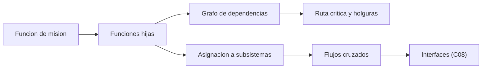

# B83-C06 — Descomposición funcional

<!-- nav:top -->
[🏠 Programa](../../../../README.md) · [📚 Bloque B83](../../../tronco-comun/B83-ingenieria-de-sistemas-y-diseno-de-misiones.md) · [← Anterior: B83-C05 — Trazabilidad de requisitos](../B83-C05-trazabilidad-de-requisitos/CLASE.md) · [Siguiente: B83-C07 — Arquitecturas de sistemas →](../B83-C07-arquitecturas-de-sistemas/CLASE.md)
<!-- /nav -->

## 1. Ubicación, nivel y alcance

Clase 6 del bloque B83. Nivel N3. La **descomposición funcional** parte de *qué hace* el sistema (no de qué piezas tiene): divide la misión en funciones, ordena su flujo y las asigna después a subsistemas. Aquí descompones la secuencia «tomar y entregar una imagen» de la misión sintética ESTRELLA-S en once funciones, calculas su ruta crítica y cuentas los flujos que cruzan entre subsistemas. El manual de NASA (S1) sitúa la definición de la arquitectura lógica y la asignación de requisitos dentro de los procesos de diseño del sistema.

## 2. Por qué esta clase existe

Si se salta a las piezas demasiado pronto, se diseñan cosas que nadie sabe para qué sirven; si se descompone bien, se ve qué función domina el tiempo y dónde se acoplan los subsistemas. La decisión central: **¿qué funciones son críticas para el tiempo y qué subsistemas quedan más acoplados?**

## 3. Lo que podrás hacer al terminar

1. Descomponer una función de misión en funciones hijas sin mencionar piezas.
2. Ordenar las funciones en un grafo de dependencias.
3. Calcular la ruta crítica y las holguras por programación dinámica.
4. Comprobar la ruta crítica enumerando todos los caminos.
5. Asignar funciones a subsistemas y contar los flujos entre ellos.
6. Rotular que funciones, duraciones y asignaciones son sintéticas.

La evidencia es la **árbol funcional con asignación y ruta crítica** del ejercicio 12 (sección 20).

## 4. Con qué llegas y cómo comprobarlo

1. ¿Qué es una función?
2. ¿Qué es un grafo acíclico?
3. ¿Qué es la ruta crítica?
4. ¿Qué es la holgura?
5. ¿Qué es un subsistema?

<details>
<summary>Ver respuestas</summary>

1. Una acción que el sistema realiza, expresada con un verbo. 2. Un grafo dirigido sin ciclos. 3. El camino más largo, que fija la duración mínima total. 4. El retraso que una actividad admite sin alargar el total. 5. Un conjunto de elementos que cumple un grupo de funciones.
</details>

Con cuatro o cinco aciertos, sigue; si no, repasa los prerrequisitos.

## 5. Un caso de contexto y casos de referencia

ESTRELLA-S (sintética) tiene 11 funciones asignadas a 7 subsistemas. La secuencia de una toma dura 655 s por la ruta crítica; las funciones de comando (F1) y calentamiento del detector (F4) tienen 88 s de holgura. Hay 5 flujos entre subsistemas distintos; el más acoplado es **C&DH** (empata con la carga útil).

## 6. Vocabulario

Una **función** es lo que el sistema hace. La **descomposición funcional** la divide en funciones más simples. Un **diagrama de flujo funcional** (FFBD) ordena las funciones por dependencia. La **ruta crítica** es el camino de mayor duración; la **holgura** es el margen de una actividad fuera de ella. La **asignación** reparte funciones a subsistemas. Un **flujo cruzado** es una dependencia entre funciones de subsistemas distintos y es un candidato a interfaz (C08).

## 7. Modelo mental: de la misión a funciones y subsistemas



*Descripción textual:* la función de misión se divide en hijas; sus dependencias dan la ruta crítica y las holguras, y su asignación a subsistemas da los flujos cruzados, que se convertirán en interfaces.

Analogía: el flujo de una cocina: primero qué pasos hay y en qué orden, luego qué cocinero hace cada uno. Límite: en un satélite los pasos compiten por recursos (energía, memoria) que un diagrama de flujo no muestra.

## 8. La explicación, paso a paso

### 8.1 Funciones y grupos

Se agrupan en cuatro funciones de nivel superior: adquirir imagen (F1–F5), procesar y almacenar (F6–F7), entregar datos (F8–F9) y soportar la plataforma (F10–F11). Las funciones de soporte no tienen duración de secuencia: están siempre activas.

### 8.2 Ruta crítica

La duración se calcula con el camino más largo: `F2 → F3 → F5 → F6 → F7 → F8 → F9`, de 655 s. Las funciones F1 y F4 forman una rama paralela de 62 s frente a los 150 s de apuntar y estabilizar, por eso tienen una holgura de 88 s. La enumeración de los 4 caminos da 655 s y la misma ruta.

### 8.3 Asignación y flujos cruzados

Al asignar funciones a subsistemas, 5 dependencias cruzan límites: ADCS–carga útil (1), C&DH–carga útil (2), C&DH–comunicaciones (1) y comunicaciones–segmento terreno (1). Cada cruce es una interfaz por definir en C08. C&DH y la carga útil empatan con 3 cruces.

## 9. Magnitudes, símbolos y unidades

| Símbolo | Qué es | Unidad | Valor / nota |
|---|---|---|---|
| `n_f` | número de funciones | — | 11 |
| `T` | duración de la ruta crítica | s | 655 |
| `h` | holgura de F1 y F4 | s | 88 |
| `c` | flujos cruzados | — | 5 |
| `F` | funciones en la ruta crítica | — | F2, F3, F5, F6, F7, F8, F9 |

## 10. Convenciones y referencias

Sin constantes físicas ni sistema de referencia. Duraciones y asignaciones **sintéticas** de ejemplo. Modelo: grafo dirigido acíclico; ruta crítica por programación dinámica en orden topológico; las funciones de soporte tienen duración 0. Tolerancia: la ruta crítica por programación dinámica y por enumeración coinciden en duración y en secuencia.

## 11. De dónde sale lo que afirmamos

| ID | Fuente | Localizador | Respalda | Estado |
|---|---|---|---|---|
| S1 | NASA, *NASA Systems Engineering Handbook* (NASA/SP-6105), página principal — https://www.nasa.gov/reference/systems-engineering-handbook/ (consultada 2026-11-10) | página principal; sección 4.0, procesos de diseño del sistema | los procesos de diseño del sistema (sección 4.0 según los títulos) son los que definen la arquitectura y asignan requisitos | Consultada |
| ECSS | ECSS-E-ST-10C, ECSS-M-ST-40C, ECSS-Q-ST-30-02C, ECSS-Q-ST-40-12C y demás estándares (ecss.nl) | — | — | No consultada: la página de estándares no mostró los documentos |
| — | ISO/IEC/IEEE 15288, INCOSE, SysML, MIL-STD-1629, IEC 60812 e IEC 61025 | — | — | No consultada |
| — | Relaciones matemáticas estándar usadas en el laboratorio (AHP, rutas críticas, ley de Stefan, confiabilidad exponencial, cortes mínimos, ecuación del cohete) | — | — | No consultada en una fuente concreta: las verifica el laboratorio por una segunda vía |

Límites: solo se consultó la estructura de la página principal; no se leyó el detalle de la descomposición funcional ni la asignación de requisitos del manual. Los métodos de ruta crítica son estándar y los verifica el laboratorio.

## 12. Cómo ver la ruta crítica

| Magnitud | Valor |
|---|---|
| Duración de la ruta crítica | 655 s |
| Ruta | F2 → F3 → F5 → F6 → F7 → F8 → F9 |
| Holgura F1 / F4 | 88 / 88 s |
| Caminos enumerados | 4 |
| Flujos cruzados | 5 |

Descripción larga: la bajada de datos (400 s) domina la ruta crítica: es la función más larga y la que más depende del contacto con la estación (C03).

## 13. Ejemplo trabajado: la duración de la ruta crítica

**Paso 1 · Suma.** `120 + 30 + 10 + 45 + 20 + 400 + 30 = 655 s`.

**Paso 2 · Rama paralela.** `F1 + F4 = 2 + 60 = 62 s`, frente a `F2 + F3 = 150 s`.

**Paso 3 · Holgura.** `150 − 62 = 88 s`.

**Paso 4 · Comprobación.** La enumeración de caminos da el mismo valor.

## 14. Distintas formas de abordar el problema

**Por programación dinámica** (esta clase). **Por enumeración** de caminos (segunda vía). **Por PERT con duraciones inciertas:** se asignan distribuciones y se simula (C16). El laboratorio usa las dos primeras.

## 15. Práctica guiada

**Ejercicio 1 · con los pasos indicados.** Calcula la duración de la secuencia si F8 dura 300 s en vez de 400 s. *Pasos:* resta la diferencia.

<details><summary>Solución comentada</summary>

`655 − 100 = 555 s`.
</details>

**Ejercicio 2 · con una pista.** ¿Cuál es la holgura de F4 si dura 100 s en vez de 60 s? *Pista:* la rama pasa de 62 a 102 s.

<details><summary>Solución comentada</summary>

`150 − 102 = 48 s`.
</details>

**Ejercicio 3 · casi autónomo.** ¿Por qué F10 y F11 no entran en la ruta crítica?

<details><summary>Solución comentada</summary>

Tienen duración 0 y no son predecesoras de las funciones de la secuencia.
</details>

## 16. Práctica autónoma, transferencia e integrador

**Ejercicio 4 · autónomo.** Si F2 dura 20 s en vez de 120 s, ¿cuál es la nueva ruta crítica?

<details><summary>Solución comentada</summary>

La rama `F1 → F4` (62 s) supera a `F2 → F3` (50 s): la crítica pasa por F1 y F4 y el total es `62 + 10 + 45 + 20 + 400 + 30 = 567 s`.
</details>

**Ejercicio 5 · autónomo.** ¿Cuántos flujos cruzados hay en la asignación del laboratorio?

<details><summary>Solución comentada</summary>

5.
</details>

**Ejercicio 6 · autónomo.** Escribe una función hija de «Entregar datos» sin nombrar piezas.

<details><summary>Solución comentada</summary>

«Verificar la integridad de los datos recibidos».
</details>

**Ejercicio 7 · autónomo.** Explica por qué conviene descomponer antes de asignar.

<details><summary>Solución comentada</summary>

Porque la asignación a piezas depende de las funciones; si se asigna antes, se oculta qué función es crítica.
</details>

**Ejercicio 8 · autónomo.** Un subsistema tiene 0 flujos cruzados. ¿Qué significa?

<details><summary>Solución comentada</summary>

Que sus funciones no dependen de otros en la secuencia; sus interfaces son de soporte (energía, térmico).
</details>

**Ejercicio 9 · transferencia.** **Transferencia.** Un colega usa 655 s como el tiempo real de una toma de una misión. ¿Es válido?

<details><summary>Solución comentada</summary>

No: las funciones y duraciones son sintéticas y no incluyen esperas por contacto ni fallos.
</details>

**Ejercicio 10 · transferencia.** **Transferencia.** ¿Qué cambia si F8 solo puede ocurrir durante un pase de 6 min?

<details><summary>Solución comentada</summary>

La bajada se fragmenta en varios pases y el tiempo total depende del hueco máximo (C03), no solo de la duración.
</details>

**Ejercicio 11 · transferencia.** **Transferencia.** ¿Qué función añadirías para el modo seguro?

<details><summary>Solución comentada</summary>

«Mantener la supervivencia ante anomalías», con subfunciones de detección y respuesta (C22).
</details>

**Ejercicio 12 · integrador.** **Integrador.** Elabora tu *árbol funcional con asignación y ruta crítica*: funciones, dependencias, ruta crítica por dos vías, flujos cruzados y lista de qué es sintético.

<details><summary>Solución comentada</summary>

Secciones 8.1–8.3, el ejemplo 13 y la salida del laboratorio.
</details>

## 17. Laboratorio: flujo funcional, asignación y ruta crítica

El script [flujo_funcional.py](flujo_funcional.py) calcula la ruta crítica y las holguras por programación dinámica, la comprueba enumerando todos los caminos y cuenta los flujos entre subsistemas (**comprueba** que ambas duraciones y rutas coinciden y que las holguras son no negativas). Usa la biblioteca común [sistemas_comun.py](../sistemas_comun.py) del bloque.

**Datos:** funciones, duraciones y asignaciones **sintéticas**; sin constantes físicas. **Predice antes de ejecutar:** ¿qué función domina la ruta crítica? (F8, la bajada de datos, con 400 s de 655.) **Ejecución del 2026-11-10 (Python 3.12.9 | numpy 2.4.4):**

```text
Python 3.12.9 | numpy 2.4.4
Datos SINTETICOS: 11 funciones, 7 subsistemas, duraciones en segundos
  Adquirir imagen: F1 Recibir comando de toma [C&DH], F2 Apuntar la plataforma [ADCS], F3 Estabilizar [ADCS], F4 Calentar el detector [Carga util], F5 Capturar la imagen [Carga util]
  Procesar y almacenar: F6 Comprimir [C&DH], F7 Almacenar [C&DH]
  Entregar datos: F8 Bajar los datos [Comunicaciones], F9 Verificar integridad en tierra [Segmento terreno]
  Soportar la plataforma: F10 Generar y distribuir potencia [EPS], F11 Controlar la temperatura [Termico]
Duracion de la ruta critica = 655 s ; ruta critica = F2 -> F3 -> F5 -> F6 -> F7 -> F8 -> F9
Segunda via (enumeracion de 4 caminos): 655 s ; F2 -> F3 -> F5 -> F6 -> F7 -> F8 -> F9
Holgura de F1 = 88 s ; holgura de F4 = 88 s
Flujos entre subsistemas distintos = 5
  ADCS - Carga util: 1
  C&DH - Carga util: 2
  C&DH - Comunicaciones: 1
  Comunicaciones - Segmento terreno: 1
Acoplamiento por subsistema: ADCS 1, C&DH 3, Carga util 3, Comunicaciones 2, EPS 0, Segmento terreno 1, Termico 0 ; mas acoplado: C&DH
Pruebas superadas.
```

```bash
python programa/clases/B83/B83-C06-descomposicion-funcional/flujo_funcional.py
```

**Límites:** duraciones deterministas; sin recursos compartidos ni fallos; un solo escenario; el nivel de descomposición es de ejemplo.

## 18. Errores frecuentes y cómo corregirlos

**Nombrar piezas en lugar de funciones.** Usa verbos: «apuntar», «almacenar»

**Ignorar las funciones de soporte.** Inclúyelas aunque no tengan duración

**Olvidar los flujos cruzados.** Cuéntalos: son las interfaces futuras

## 19. Cómo sabrás que vas bien

Tras 8.2: ¿qué función domina? Tras 8.3: ¿qué flujos esperabas que cruzaran? Si dudas, repasa el ejemplo 13.

## 20. Qué entregas y cómo se evalúa

El producto es tu **árbol funcional con asignación y ruta crítica** (ejercicio 12).

| Criterio | Inicial | En desarrollo | Logrado | Destacado |
|---|---|---|---|---|
| Conceptos | Los confunde | Parciales | Explica el método y su dominio | Explica los límites y las alternativas |
| Cálculo | Sin unidades | Con errores | Resultados con unidades y comprobados | Resuelve casos nuevos |
| Numérico | Sin comprobar | Un caso | Verifica por una segunda vía en varios casos | Interpreta las diferencias y los fallos |
| Fuentes | Sin fuente | Sin fecha | Fuentes con fecha y estado | Declara lo sintético y lo no consultado |
| Límites | No los nombra | Uno | Tres | Discute qué falta del modelo |

**Condiciones críticas (no se compensan con promedio):** rotular los datos como sintéticos; verificar el resultado por una segunda vía; citar solo lo consultado.

## 21. Ética, seguridad y límites

Clase educativa: los modelos son simplificados y los datos son sintéticos; ningún resultado describe una misión real, certifica una seguridad ni sustituye a los estándares vigentes y a la revisión de especialistas.  Accesibilidad: tablas equivalentes a las gráficas, fórmulas en texto, ejercicios sin conexión.

## 22. Para cerrar y seguir

La secuencia de ESTRELLA-S (sintética) dura 655 s, domina la bajada de datos y hay 5 flujos entre subsistemas. Queda una pregunta: ¿qué arquitectura reparte esas funciones mejor? (C07).

**Glosario español–inglés.** descomposición funcional · *functional decomposition*; ruta crítica · *critical path*; holgura · *slack*; asignación · *allocation*; diagrama de flujo funcional · *functional flow block diagram*.

**Continuidad.** [B83-C07](../B83-C07-arquitecturas-de-sistemas/CLASE.md) compara arquitecturas candidatas para esas funciones.

**Referencias:** ver sección 11.

<!-- nav:bottom -->
---

[← Anterior: B83-C05 — Trazabilidad de requisitos](../B83-C05-trazabilidad-de-requisitos/CLASE.md) · [📚 Bloque B83](../../../tronco-comun/B83-ingenieria-de-sistemas-y-diseno-de-misiones.md) · [Siguiente: B83-C07 — Arquitecturas de sistemas →](../B83-C07-arquitecturas-de-sistemas/CLASE.md)
<!-- /nav -->
