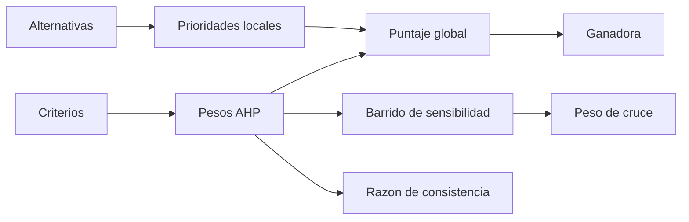

# B83-C07 — Arquitecturas de sistemas

<!-- nav:top -->
[🏠 Programa](../../../../README.md) · [📚 Bloque B83](../../../tronco-comun/B83-ingenieria-de-sistemas-y-diseno-de-misiones.md) · [← Anterior: B83-C06 — Descomposición funcional](../B83-C06-descomposicion-funcional/CLASE.md) · [Siguiente: B83-C08 — Interfaz entre subsistemas →](../B83-C08-interfaz-entre-subsistemas/CLASE.md)
<!-- /nav -->

## 1. Ubicación, nivel y alcance

Clase 7 del bloque B83. Nivel N3. Una **arquitectura de sistema** es la organización de sus elementos y relaciones que satisface las funciones (C06). Rara vez hay una sola candidata: aquí comparas tres arquitecturas **sintéticas** para la misión ESTRELLA-S con la jerarquía analítica (AHP): comparaciones por pares, pesos por vector propio, razón de consistencia y sensibilidad. Las escalas, los índices aleatorios de consistencia y las comparaciones son de ejemplo o estándar no consultado.

## 2. Por qué esta clase existe

Elegir una arquitectura «porque sí» es una decisión sin rastro. La decisión central: **¿qué arquitectura conviene, con qué criterios y qué tan firme es la elección?** Un estudio de compromiso bien hecho deja ver qué peso haría cambiar la respuesta.

## 3. Lo que podrás hacer al terminar

1. Plantear criterios y alternativas para un estudio de compromiso.
2. Construir matrices de comparación por pares y obtener pesos por vector propio.
3. Calcular la razón de consistencia y decidir si las comparaciones son coherentes.
4. Obtener puntajes globales y el ganador.
5. Hacer un barrido de sensibilidad y hallar el peso que cambia el orden.
6. Rotular que las comparaciones son sintéticas y que RI es un valor tabulado no consultado.

La evidencia es la **estudio comparativo de arquitecturas con sensibilidad** del ejercicio 12 (sección 20).

## 4. Con qué llegas y cómo comprobarlo

1. ¿Qué es un vector propio principal?
2. ¿Qué es una matriz recíproca?
3. ¿Qué mide la razón de consistencia?
4. ¿Qué es un barrido de sensibilidad?
5. ¿Qué es un criterio?

<details>
<summary>Ver respuestas</summary>

1. El vector asociado al mayor valor propio; en AHP da los pesos. 2. Una donde `a_ji = 1/a_ij`. 3. Qué tan incoherentes son las comparaciones por pares. 4. Variar un peso y ver cuándo cambia el resultado. 5. Una propiedad con la que se juzgan las alternativas.
</details>

Con cuatro o cinco aciertos, sigue; si no, repasa los prerrequisitos.

## 5. Un caso de contexto y casos de referencia

Tres arquitecturas sintéticas para ESTRELLA-S: A (un satélite de 80 kg), B (tres microsatélites) y C (carga alojada en una plataforma ajena). Cuatro criterios: costo, desempeño, riesgo y calendario. Pesos: costo 0,232, desempeño 0,546, riesgo 0,138, calendario 0,084, con razón de consistencia 0,0189. Puntajes globales: A 0,3078, B 0,3709, C 0,3213; gana **B Tres microsatelites**, pero si el desempeño pesara poco ganaría otra.

## 6. Vocabulario

Una **arquitectura candidata** es una organización posible del sistema. Un **estudio de compromiso** (*trade study*) compara candidatas con criterios. **AHP** convierte comparaciones por pares (escala 1–9) en pesos. La **razón de consistencia** `CR = CI/RI`, con `CI = (λ_max − n)/(n − 1)`, debe ser menor que 0,10 por convención. La **sensibilidad** mide cuánto debe cambiar un peso para que cambie el ganador. Una **dominancia** ocurre cuando una alternativa gana en todos los criterios.

## 7. Modelo mental: del problema a una decisión con sensibilidad



*Descripción textual:* los criterios dan pesos y las alternativas dan prioridades locales; juntos forman el puntaje global y la ganadora; los pesos también alimentan el barrido de sensibilidad y la razón de consistencia.

Analogía: elegir un coche con tres amigos: cada uno compara por pares y luego se ponderan sus gustos. Límite: las comparaciones son juicios; el método ordena juicios, no los convierte en hechos.

## 8. La explicación, paso a paso

### 8.1 Pesos de los criterios

La matriz de criterios (4×4) da, por vector propio, `(`0,232`; `0,546`; `0,138`; `0,084`)` y `λ_max = 4,0511`. Con `RI = 0,90` para n = 4, `CR = 0,0189` (menor que 0,10: coherente). El método de potencias da los mismos pesos a `10⁻⁹`.

### 8.2 Puntajes globales

Cada criterio tiene una matriz 3×3 de comparaciones de las alternativas; todas son consistentes (CR máximo 0,0212). El puntaje global es la suma ponderada: A 0,3078, B 0,3709, C 0,3213. Gana **B Tres microsatelites**.

### 8.3 Sensibilidad

Se barre el peso del desempeño de 0 a 1 reescalando los demás en proporción. Con peso 0 gana **C Carga alojada en plataforma ajena**; con peso 1, **B Tres microsatelites**; el cruce ocurre en `p = 0,493`, y el peso base es 0,546. La decisión depende de que el desempeño pese más que el cruce: debe decirse en la ficha.

## 9. Magnitudes, símbolos y unidades

| Símbolo | Qué es | Unidad | Valor / nota |
|---|---|---|---|
| `w` | peso de un criterio | — | 0,546 (desempeño) |
| `λ_max` | mayor valor propio | — | 4,0511 |
| `CR` | razón de consistencia | — | 0,0189 |
| `g` | puntaje global | — | B: 0,3709 |
| `p*` | peso de cruce del desempeño | — | 0,493 |

## 10. Convenciones y referencias

Sin constantes físicas ni sistema de referencia. Comparaciones por pares **sintéticas** en la escala 1–9. Índices aleatorios `RI = 0,58` (n = 3) y `0,90` (n = 4): valores tabulados estándar **no consultados** en una fuente concreta. Tolerancias: pesos por `eig` y por potencias coinciden a `10⁻⁹`; `CR < 0,10`; los puntajes globales suman 1.

## 11. De dónde sale lo que afirmamos

| ID | Fuente | Localizador | Respalda | Estado |
|---|---|---|---|---|
| S1 | NASA, *NASA Systems Engineering Handbook* (NASA/SP-6105), página principal — https://www.nasa.gov/reference/systems-engineering-handbook/ (consultada 2026-11-10) | página principal; sección 4.0 de diseño del sistema | el manual incluye el diseño de la solución del sistema entre sus procesos técnicos; no se leyó un apartado concreto de estudios de compromiso | Consultada |
| ECSS | ECSS-E-ST-10C, ECSS-M-ST-40C, ECSS-Q-ST-30-02C, ECSS-Q-ST-40-12C y demás estándares (ecss.nl) | — | — | No consultada: la página de estándares no mostró los documentos |
| — | ISO/IEC/IEEE 15288, INCOSE, SysML, MIL-STD-1629, IEC 60812 e IEC 61025 | — | — | No consultada |
| — | Relaciones matemáticas estándar usadas en el laboratorio (AHP, rutas críticas, ley de Stefan, confiabilidad exponencial, cortes mínimos, ecuación del cohete) | — | — | No consultada en una fuente concreta: las verifica el laboratorio por una segunda vía |

Límites: el manual no se leyó en su apartado de selección de soluciones de diseño; AHP y los valores RI son técnicas estándar no consultadas en una fuente concreta; no se infiere nada de una misión real.

## 12. Cómo ver el resultado de la comparación

| Magnitud | Valor |
|---|---|
| Pesos (costo, desempeño, riesgo, calendario) | 0,232; 0,546; 0,138; 0,084 |
| Razón de consistencia | 0,0189 |
| Puntajes A / B / C | 0,3078 / 0,3709 / 0,3213 |
| Ganadora | B Tres microsatelites |
| Peso de cruce del desempeño | 0,493 |

Descripción larga: B gana por poco sobre C; la ventaja desaparece si el peso del desempeño baja a cerca de la mitad, y entonces C pasa al frente.

## 13. Ejemplo trabajado: el puntaje global de la arquitectura B

**Paso 1 · Pesos.** `(`0,232`; `0,546`; `0,138`; `0,084`)`.

**Paso 2 · Prioridades locales de B.** Se leen de los vectores propios de las cuatro matrices 3×3.

**Paso 3 · Suma.** `g_B = Σ w_i · p_Bi = 0,3709`.

**Paso 4 · Comparación.** `g_B > g_C > g_A`: B es la ganadora, por 0,3709 frente a 0,3213.

## 14. Distintas formas de abordar el problema

**Por AHP** (esta clase). **Por suma ponderada simple** (C01): más fácil pero sin comprobación de consistencia. **Por utilidad multiatributo:** funciones de valor por criterio (no calculado). El laboratorio verifica los pesos por dos algoritmos y la coherencia por CR.

## 15. Práctica guiada

**Ejercicio 1 · con los pasos indicados.** Calcula `CI` si `λ_max = 4,0511` y `n = 4`. *Pasos:* `(λ − n)/(n − 1)`.

<details><summary>Solución comentada</summary>

`0,0511/3 = 0,0170`.
</details>

**Ejercicio 2 · con una pista.** Calcula `CR` con `RI = 0,90`. *Pista:* divide `CI` entre `RI`.

<details><summary>Solución comentada</summary>

`0,0170/0,90 = 0,0189`.
</details>

**Ejercicio 3 · casi autónomo.** ¿Es consistente una matriz con `CR = 0,15`?

<details><summary>Solución comentada</summary>

No: supera el 0,10 convencional; hay que revisar las comparaciones.
</details>

## 16. Práctica autónoma, transferencia e integrador

**Ejercicio 4 · autónomo.** Si el peso de costo sube y el del desempeño baja, ¿qué arquitectura tiende a ganar?

<details><summary>Solución comentada</summary>

C, que es la más barata: gana cuando el desempeño pesa menos que el cruce.
</details>

**Ejercicio 5 · autónomo.** Los pesos son `(0,25; 0,50; 0,15; 0,10)` y los prioridades de B son `(0,2; 0,5; 0,3; 0,3)`. Calcula `g_B`.

<details><summary>Solución comentada</summary>

`0,05 + 0,25 + 0,045 + 0,03 = 0,375`.
</details>

**Ejercicio 6 · autónomo.** ¿Qué pasa con la matriz si `a_12 = 3`?

<details><summary>Solución comentada</summary>

`a_21 = 1/3` por ser recíproca.
</details>

**Ejercicio 7 · autónomo.** Explica por qué conviene el barrido de sensibilidad aunque `CR` sea bajo.

<details><summary>Solución comentada</summary>

`CR` mide coherencia interna, no robustez: la decisión puede cambiar con un peso plausible.
</details>

**Ejercicio 8 · autónomo.** ¿Qué hace el método de potencias y por qué sirve de segunda vía?

<details><summary>Solución comentada</summary>

Multiplica y normaliza repetidamente; converge al vector principal y es independiente de `eig`.
</details>

**Ejercicio 9 · transferencia.** **Transferencia.** Un colega dice que B es «la mejor arquitectura» para una misión real. ¿Es válido?

<details><summary>Solución comentada</summary>

No: las comparaciones son sintéticas; el resultado solo ilustra el método.
</details>

**Ejercicio 10 · transferencia.** **Transferencia.** Se añade un criterio «reutilización» con peso 0,2. ¿Qué haces?

<details><summary>Solución comentada</summary>

Reescalas los demás pesos para que sumen 1, añades las matrices de comparación nuevas y repites el estudio.
</details>

**Ejercicio 11 · transferencia.** **Transferencia.** Un criterio no es comparable por pares (p. ej., seguridad legal). ¿Cómo se trata?

<details><summary>Solución comentada</summary>

Como restricción (pasa o no pasa) antes del estudio, no como criterio ponderado.
</details>

**Ejercicio 12 · integrador.** **Integrador.** Elabora tu *estudio comparativo de arquitecturas*: criterios, pesos, `CR`, puntajes, ganadora, peso de cruce y lista de qué es sintético o no consultado.

<details><summary>Solución comentada</summary>

Secciones 8.1–8.3, el ejemplo 13 y la salida del laboratorio; incluye el cruce en `p = 0,493`.
</details>

## 17. Laboratorio: comparación de arquitecturas con AHP y sensibilidad

El script [estudio_ahp.py](estudio_ahp.py) calcula los pesos por vector propio y por potencias, las razones de consistencia, los puntajes globales y un barrido de sensibilidad (**comprueba** que los pesos coinciden a `10⁻⁹`, que `CR < 0,10` y que los puntajes suman 1). Usa la biblioteca común [sistemas_comun.py](../sistemas_comun.py) del bloque.

**Datos:** comparaciones por pares **sintéticas**; `RI` tabulado estándar **no consultado**; sin constantes físicas. **Predice antes de ejecutar:** ¿qué arquitectura gana y qué le ocurre al orden si el desempeño casi no importa? (B; pasa a ganar C.) **Ejecución del 2026-11-10 (Python 3.12.9 | numpy 2.4.4):**

```text
Python 3.12.9 | numpy 2.4.4
Datos SINTETICOS: 3 arquitecturas, 4 criterios, escala de comparacion 1-9; RI tabulado (no consultado)
Pesos de criterios: Costo 0.2323, Desempeno 0.5462, Riesgo 0.1377, Calendario 0.0838 ; lambda_max = 4.0511 ; CR = 0.0189
CR de las matrices de alternativas: Costo 0.0032, Desempeno 0.0032, Riesgo 0.0000, Calendario 0.0212
Puntaje global: A 0.3078, B 0.3709, C 0.3213
Ganadora: B Tres microsatelites
Sensibilidad al peso del desempeno: con peso 0 gana C Carga alojada en plataforma ajena ; con peso 1 gana B Tres microsatelites ; cruce en p = 0.493
Pruebas superadas.
```

```bash
python programa/clases/B83/B83-C07-arquitecturas-de-sistemas/estudio_ahp.py
```

**Límites:** juicios sintéticos en una escala ordinal; tres alternativas y cuatro criterios; las alternativas no se modelan físicamente; no hay incertidumbre en las comparaciones.

## 18. Errores frecuentes y cómo corregirlos

**Tratar el ganador como un hecho.** Informa el peso de cruce y el CR

**Mezclar restricciones con criterios.** Las restricciones se aplican antes

**Olvidar normalizar los pesos al cambiarlos.** Deben sumar 1

## 19. Cómo sabrás que vas bien

Tras 8.2: ¿qué arquitectura esperabas ganadora? Tras 8.3: ¿qué peso la haría perder? Si dudas, repasa el ejemplo 13.

## 20. Qué entregas y cómo se evalúa

El producto es tu **estudio comparativo de arquitecturas con sensibilidad** (ejercicio 12).

| Criterio | Inicial | En desarrollo | Logrado | Destacado |
|---|---|---|---|---|
| Conceptos | Los confunde | Parciales | Explica el método y su dominio | Explica los límites y las alternativas |
| Cálculo | Sin unidades | Con errores | Resultados con unidades y comprobados | Resuelve casos nuevos |
| Numérico | Sin comprobar | Un caso | Verifica por una segunda vía en varios casos | Interpreta las diferencias y los fallos |
| Fuentes | Sin fuente | Sin fecha | Fuentes con fecha y estado | Declara lo sintético y lo no consultado |
| Límites | No los nombra | Uno | Tres | Discute qué falta del modelo |

**Condiciones críticas (no se compensan con promedio):** rotular los datos como sintéticos; verificar el resultado por una segunda vía; citar solo lo consultado.

## 21. Ética, seguridad y límites

Clase educativa: los modelos son simplificados y los datos son sintéticos; ningún resultado describe una misión real, certifica una seguridad ni sustituye a los estándares vigentes y a la revisión de especialistas.  Accesibilidad: tablas equivalentes a las gráficas, fórmulas en texto, ejercicios sin conexión.

## 22. Para cerrar y seguir

En el estudio sintético gana B Tres microsatelites con 0,3709, pero C la supera si el peso del desempeño baja de 0,493. Queda una pregunta: ¿cómo se conectan los subsistemas de la arquitectura elegida? (C08).

**Glosario español–inglés.** arquitectura · *architecture*; estudio de compromiso · *trade study*; jerarquía analítica · *analytic hierarchy process*; razón de consistencia · *consistency ratio*; sensibilidad · *sensitivity*.

**Continuidad.** [B83-C08](../B83-C08-interfaz-entre-subsistemas/CLASE.md) define y verifica las interfaces entre los subsistemas de la arquitectura.

**Referencias:** ver sección 11.

<!-- nav:bottom -->
---

[← Anterior: B83-C06 — Descomposición funcional](../B83-C06-descomposicion-funcional/CLASE.md) · [📚 Bloque B83](../../../tronco-comun/B83-ingenieria-de-sistemas-y-diseno-de-misiones.md) · [Siguiente: B83-C08 — Interfaz entre subsistemas →](../B83-C08-interfaz-entre-subsistemas/CLASE.md)
<!-- /nav -->
