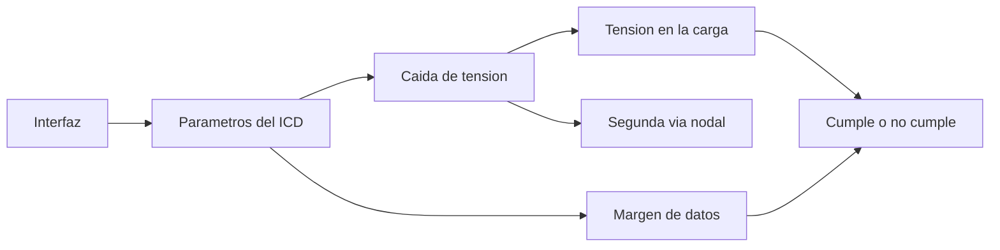

# B83-C08 — Interfaz entre subsistemas

<!-- nav:top -->
[🏠 Programa](../../../../README.md) · [📚 Bloque B83](../../../tronco-comun/B83-ingenieria-de-sistemas-y-diseno-de-misiones.md) · [← Anterior: B83-C07 — Arquitecturas de sistemas](../B83-C07-arquitecturas-de-sistemas/CLASE.md) · [Siguiente: B83-C09 — Presupuestos de masa →](../../../tronco-comun/B83-ingenieria-de-sistemas-y-diseno-de-misiones.md#b83-c09)
<!-- /nav -->

## 1. Ubicación, nivel y alcance

Clase 8 del bloque B83. Nivel N3. Una **interfaz** es el límite entre dos subsistemas donde se intercambian energía, datos, fuerzas o calor; un **documento de control de interfaces** (ICD) fija sus parámetros para que cada lado se diseñe por separado y encajen. Aquí verificas seis interfaces **sintéticas** de ESTRELLA-S: caída de tensión en el arnés, rango de la carga y margen de la tasa de datos. Las tensiones de ejemplo (8,2 V, 5,0 V, 3,3 V) se inspiran en los buses típicos que describe el capítulo de energía de *State-of-the-Art of Small Spacecraft Technology* (S7).

## 2. Por qué esta clase existe

La mayoría de los fallos de integración aparecen en las interfaces: un conector mal definido, una tensión fuera de rango o una tasa de datos insuficiente. La decisión central: **¿cada interfaz cumple en su caso más desfavorable, con margen, antes de construir?**

## 3. Lo que podrás hacer al terminar

1. Definir una interfaz con sus parámetros (tipo, tensión, corriente, tasa, conector).
2. Calcular la resistencia del arnés `R = 2ρL/A` y la caída de tensión.
3. Comprobar que la tensión en la carga está dentro del rango admitido.
4. Comprobar el margen de capacidad de un enlace de datos.
5. Verificar el cálculo con una segunda formulación (análisis nodal).
6. Rotular lo sintético, las reglas de ejemplo y el valor estándar no consultado (resistividad).

La evidencia es la **tabla de control de interfaces verificada** del ejercicio 12 (sección 20).

## 4. Con qué llegas y cómo comprobarlo

1. ¿Qué es la ley de Ohm?
2. ¿De qué depende la resistencia de un conductor?
3. ¿Por qué se usa ida y vuelta?
4. ¿Qué es la capacidad de un enlace de datos?
5. ¿Qué es un margen?

<details>
<summary>Ver respuestas</summary>

1. `V = I·R`. 2. De la resistividad, la longitud y el área: `R = ρL/A`. 3. Porque la corriente recorre dos conductores: alimentación y retorno. 4. La tasa máxima que puede transportar (bit/s). 5. La holgura entre lo que se necesita y lo que hay.
</details>

Con cuatro o cinco aciertos, sigue; si no, repasa los prerrequisitos.

## 5. Un caso de contexto y casos de referencia

De las seis interfaces sintéticas de ESTRELLA-S, 3 de 6 cumplen. Fallan I3 (la alimentación de la carga útil a 3,3 V pierde un 3,58 % en el arnés, más del 2 % permitido, aunque la carga aún recibe 3,182 V), I6 (una fuente de 5 V conectada a un sensor que solo admite 3,0–3,6 V) e I5 (un enlace serie de 115,2 kbit/s para una demanda de 150 kbit/s, razón 0,77).

## 6. Vocabulario

Una **interfaz** es un límite de intercambio. Un **ICD** (*interface control document*) lo especifica. La **caída de tensión** es `ΔV = I·R` a lo largo del arnés. El **rango de la carga** es el intervalo de tensión en que el equipo funciona. El **margen de datos** es la razón capacidad/demanda; la regla del ejemplo exige 1,3 (30 %). Un **caso más desfavorable** combina los extremos (corriente máxima, largo máximo).

## 7. Modelo mental: de la interfaz a un veredicto



*Descripción textual:* cada interfaz se describe con parámetros; de ellos se calculan la caída de tensión y el margen de datos, y de ahí un veredicto; la caída se comprueba por una segunda formulación.

Analogía: una cañería entre dos casas: el diámetro, la longitud y el caudal pedido determinan la presión que llega. Límite: una cañería no tiene ruido ni protocolo; un enlace de datos sí (C11).

## 8. La explicación, paso a paso

### 8.1 Interfaces eléctricas

El arnés de ida y vuelta de longitud `L` y área `A` tiene `R = 2ρL/A`, con `ρ = 1,68×10⁻⁸ Ω·m`. En I3, `R = 131,1 mΩ` y la corriente de 0,9 A produce una caída de 3,58 %. Las otras tres tienen caídas de 0,83 % (I1), 0,90 % (I2) y 0,08 % (I6).

### 8.2 Rangos de la carga

La carga debe recibir una tensión admitida: I1 4,958 V en 4,75–5,25 V (cumple); I2 8,126 V en 6–9 V (cumple); I3 3,182 V en 3,135–3,465 V (dentro del rango pero con caída excesiva); I6 4,996 V frente a 3,0–3,6 V (fuera de rango: error de interfaz, no de arnés).

### 8.3 Interfaces de datos y segunda vía

I4 (carga útil→C&DH) tiene razón capacidad/demanda de 1,67 y cumple; I5 (C&DH→radio) tiene 0,77 y no cumple. La caída también se calcula resolviendo el circuito nodal con una carga de resistencia constante: la diferencia con la fórmula cerrada es menor que 10⁻¹⁵ V. Esta segunda vía es otra implementación de la misma ley de Ohm: detecta errores de cálculo pero no de modelo.

## 9. Magnitudes, símbolos y unidades

| Símbolo | Qué es | Unidad | Valor / nota |
|---|---|---|---|
| `ρ` | resistividad del cobre | Ω·m | 1,68×10⁻⁸ (no consultado) |
| `R` | resistencia del arnés | mΩ | I3: 131,1 |
| `ΔV/V` | caída relativa | % | I3: 3,58 |
| `V_L` | tensión en la carga | V | I1: 4,958 |
| `m` | razón capacidad/demanda | — | I5: 0,77 |
| `P` | potencia disipada en arneses | W | 0,212 |

## 10. Convenciones y referencias

Resistividad del cobre estándar **no consultada**; las tensiones de ejemplo se inspiran en S7 pero los valores son sintéticos. Sin sistema de referencia. Reglas del ejemplo: caída ≤ 2 %, tensión de la carga en su rango y capacidad ≥ 1,3 × demanda (no son de una norma). Tolerancia: fórmula cerrada y análisis nodal coinciden a `10⁻⁶ V`. Datos **sintéticos**.

## 11. De dónde sale lo que afirmamos

| ID | Fuente | Localizador | Respalda | Estado |
|---|---|---|---|---|
| S7 | NASA, *State-of-the-Art of Small Spacecraft Technology*, capítulo Power Subsystems — https://www.nasa.gov/smallsat-institute/sst-soa/power-subsystems/ (consultada 2026-11-10; solo las primeras 100 000 de 119 638 caracteres) | sección 3.6, bus de potencia | los buses tradicionales de microsatélites usan un bus de batería de 8,2 V con salidas reguladas de 5,0 V y 3,3 V | Consultada |
| ECSS | ECSS-E-ST-10C, ECSS-M-ST-40C, ECSS-Q-ST-30-02C, ECSS-Q-ST-40-12C y demás estándares (ecss.nl) | — | — | No consultada: la página de estándares no mostró los documentos |
| — | ISO/IEC/IEEE 15288, INCOSE, SysML, MIL-STD-1629, IEC 60812 e IEC 61025 | — | — | No consultada |
| — | Relaciones matemáticas estándar usadas en el laboratorio (AHP, rutas críticas, ley de Stefan, confiabilidad exponencial, cortes mínimos, ecuación del cohete) | — | — | No consultada en una fuente concreta: las verifica el laboratorio por una segunda vía |

Límites: la resistividad del cobre, las reglas de caída y de margen y las corrientes son de ejemplo o estándar no consultado; no se leyó ningún estándar de interfaces (ECSS, CCSDS) para este tema.

## 12. Cómo ver el resultado del ICD

| Magnitud | Valor |
|---|---|
| Interfaces que cumplen | 3 de 6 |
| Caída en I3 | 3,58 % |
| Tensión en la carga de I6 | 4,996 V (rango 3,0–3,6 V) |
| Margen de datos de I5 | 0,77 |
| Potencia en arneses | 0,212 W |

Descripción larga: los tres fallos tienen causas distintas: caída excesiva (I3), error de tensión de fuente (I6) y capacidad insuficiente (I5); cada una pide una corrección diferente.

## 13. Ejemplo trabajado: la caída en I3

**Paso 1 · Resistencia.** `R = 2×1,68×10⁻⁸×0,8/(0,205×10⁻⁶) = 131,1 mΩ`.

**Paso 2 · Caída.** `ΔV = 0,9 A × 131,1 mΩ ≈ 0,118 V`, es decir `3,58 %` de 3,3 V.

**Paso 3 · Regla.** La regla exige ≤ 2 %: no cumple.

**Paso 4 · Corrección.** Un cable de mayor área (AWG20, 0,519 mm²) o un arnés más corto reduce `R` en proporción.

## 14. Distintas formas de abordar el problema

**Por fórmula cerrada** (esta clase). **Por análisis nodal** (segunda vía). **Por simulación de circuitos completa:** incluye reguladores y transitorios (no usada aquí). **Por ensayo de interfaz:** una prueba de integración con un simulador de la contraparte (C14).

## 15. Práctica guiada

**Ejercicio 1 · con los pasos indicados.** Calcula la resistencia de ida y vuelta de 0,5 m de cobre de 0,2 mm². *Pasos:* `R = 2ρL/A`.

<details><summary>Solución comentada</summary>

`2×1,68×10⁻⁸×0,5/0,2×10⁻⁶ = 0,084 Ω`.
</details>

**Ejercicio 2 · con una pista.** ¿Qué caída produce 1 A en esa resistencia? *Pista:* `ΔV = I·R`.

<details><summary>Solución comentada</summary>

`0,084 V`.
</details>

**Ejercicio 3 · casi autónomo.** ¿Qué razón capacidad/demanda tiene un enlace de 1 Mbit/s para 600 kbit/s de demanda?

<details><summary>Solución comentada</summary>

`1000/600 = 1,67`: cumple el margen de 1,3.
</details>

## 16. Práctica autónoma, transferencia e integrador

**Ejercicio 4 · autónomo.** Si I3 se rehace con un cable de área doble, ¿cuál es la nueva caída? *Pista:* la resistencia se divide por dos.

<details><summary>Solución comentada</summary>

`3,58/2 = 1,79 %`: ahora cumple.
</details>

**Ejercicio 5 · autónomo.** ¿Cuánta potencia se disipa en un arnés de 0,1 Ω con 2 A?

<details><summary>Solución comentada</summary>

`P = I²R = 4×0,1 = 0,4 W`.
</details>

**Ejercicio 6 · autónomo.** Explica por qué I6 no se arregla con un cable más grueso.

<details><summary>Solución comentada</summary>

Porque la tensión de la fuente (5 V) excede el rango del sensor; hace falta un regulador a 3,3 V.
</details>

**Ejercicio 7 · autónomo.** ¿Qué capacidad mínima necesita I5 para la demanda de 150 kbit/s con margen 1,3?

<details><summary>Solución comentada</summary>

`195 kbit/s`.
</details>

**Ejercicio 8 · autónomo.** ¿Por qué conviene un caso más desfavorable en el ICD?

<details><summary>Solución comentada</summary>

Porque la interfaz debe funcionar con la corriente y la longitud máximas, no solo con las nominales.
</details>

**Ejercicio 9 · transferencia.** **Transferencia.** Un colega usa estas interfaces como el ICD de un satélite real. ¿Es válido?

<details><summary>Solución comentada</summary>

No: son sintéticas, con reglas de ejemplo y sin conectores ni protocolos reales.
</details>

**Ejercicio 10 · transferencia.** **Transferencia.** ¿Qué parámetro de interfaz térmica añadirías (bloque B85)?

<details><summary>Solución comentada</summary>

La resistencia térmica de contacto y el flujo de calor máximo.
</details>

**Ejercicio 11 · transferencia.** **Transferencia.** ¿Qué hace falta además para una interfaz de datos real?

<details><summary>Solución comentada</summary>

Protocolo, formato de tramas, temporización y manejo de errores, p. ej. según un estándar tipo CCSDS.
</details>

**Ejercicio 12 · integrador.** **Integrador.** Elabora tu *tabla de control de interfaces verificada*: seis interfaces, parámetros, veredicto y corrección propuesta, con lista de qué es sintético.

<details><summary>Solución comentada</summary>

Secciones 8.1–8.3, el ejemplo 13 y la salida del laboratorio.
</details>

## 17. Laboratorio: tabla de control de interfaces eléctricas y de datos

El script [control_de_interfaces.py](control_de_interfaces.py) calcula la caída y la tensión de carga de cuatro interfaces eléctricas y el margen de dos enlaces de datos (**comprueba** que la fórmula cerrada y el análisis nodal coinciden a `10⁻⁶ V` y que los tres defectos plantados se detectan). Usa la biblioteca común [sistemas_comun.py](../sistemas_comun.py) del bloque.

**Datos:** resistividad del cobre estándar **no consultada**; tensiones, corrientes, largos y tasas **sintéticos**. **Predice antes de ejecutar:** ¿cuántas de las seis interfaces cumplen? (tres.) **Ejecución del 2026-11-10 (Python 3.12.9 | numpy 2.4.4):**

```text
Python 3.12.9 | numpy 2.4.4
Datos SINTETICOS: 4 interfaces electricas y 2 de datos; rho(Cu) = 1.68e-8 ohm*m (no consultado)
Reglas del ejemplo: caida <= 2 %, tension de carga en rango, capacidad >= 1.3 x demanda
  I1  EPS->C&DH               R =  104.2 mohm  V_carga = 4.9583 V  caida = 0.83 %  P_arnes = 16.7 mW  CUMPLE
  I2  EPS->Radio              R =   61.8 mohm  V_carga = 8.1258 V  caida = 0.90 %  P_arnes = 89.1 mW  CUMPLE
  I3  EPS->Carga util         R =  131.1 mohm  V_carga = 3.1820 V  caida = 3.58 %  P_arnes = 106.2 mW  NO CUMPLE
  I6  EPS->Sensor solo 3.3 V  R =   78.1 mohm  V_carga = 4.9961 V  caida = 0.08 %  P_arnes = 0.2 mW  NO CUMPLE
  I4 Carga util->C&DH   capacidad 100000.0 kbit/s  demanda 60000.0  razon 1.67  CUMPLE
  I5       C&DH->Radio  capacidad 115.2 kbit/s  demanda 150.0  razon 0.77  NO CUMPLE
Interfaces que cumplen: 3 de 6 ; no cumplen: I3, I6, I5
Diferencia maxima formula cerrada - analisis nodal = 4.44e-16 V ; potencia total disipada en arneses = 212.1 mW
Pruebas superadas.
```

```bash
python programa/clases/B83/B83-C08-interfaz-entre-subsistemas/control_de_interfaces.py
```

**Límites:** corriente continua y régimen estacionario; sin transitorios, ruido ni protocolos; resistividad a temperatura ambiente; reglas de ejemplo.

## 18. Errores frecuentes y cómo corregirlos

**Olvidar el retorno.** El arnés es de ida y vuelta: `2L`

**Revisar solo el valor nominal.** Usa corriente y largo máximos

**Resolver un error de tensión con más cable.** Si la fuente excede el rango, se necesita regulación

## 19. Cómo sabrás que vas bien

Tras 8.1: ¿qué interfaz esperabas con más caída? Tras 8.3: ¿por qué fallan I3, I5 e I6? Si dudas, repasa el ejemplo 13.

## 20. Qué entregas y cómo se evalúa

El producto es tu **tabla de control de interfaces verificada** (ejercicio 12).

| Criterio | Inicial | En desarrollo | Logrado | Destacado |
|---|---|---|---|---|
| Conceptos | Los confunde | Parciales | Explica el método y su dominio | Explica los límites y las alternativas |
| Cálculo | Sin unidades | Con errores | Resultados con unidades y comprobados | Resuelve casos nuevos |
| Numérico | Sin comprobar | Un caso | Verifica por una segunda vía en varios casos | Interpreta las diferencias y los fallos |
| Fuentes | Sin fuente | Sin fecha | Fuentes con fecha y estado | Declara lo sintético y lo no consultado |
| Límites | No los nombra | Uno | Tres | Discute qué falta del modelo |

**Condiciones críticas (no se compensan con promedio):** rotular los datos como sintéticos; verificar el resultado por una segunda vía; citar solo lo consultado.

## 21. Ética, seguridad y límites

Clase educativa: los modelos son simplificados y los datos son sintéticos; ningún resultado describe una misión real, certifica una seguridad ni sustituye a los estándares vigentes y a la revisión de especialistas.  Accesibilidad: tablas equivalentes a las gráficas, fórmulas en texto, ejercicios sin conexión.

## 22. Para cerrar y seguir

De seis interfaces sintéticas, 3 cumplen y tres necesitan corrección distinta. Queda una pregunta: ¿cuánto pesa todo el sistema? (C09).

**Glosario español–inglés.** interfaz · *interface*; documento de control de interfaces · *interface control document*; caída de tensión · *voltage drop*; arnés · *harness*; margen · *margin*.

**Continuidad.** [B83-C09](../B83-C09-presupuestos-de-masa/CLASE.md) suma la masa de todos los subsistemas conectados por esas interfaces.

**Referencias:** ver sección 11.

<!-- nav:bottom -->
---

[← Anterior: B83-C07 — Arquitecturas de sistemas](../B83-C07-arquitecturas-de-sistemas/CLASE.md) · [📚 Bloque B83](../../../tronco-comun/B83-ingenieria-de-sistemas-y-diseno-de-misiones.md) · [Siguiente: B83-C09 — Presupuestos de masa →](../../../tronco-comun/B83-ingenieria-de-sistemas-y-diseno-de-misiones.md#b83-c09)
<!-- /nav -->
