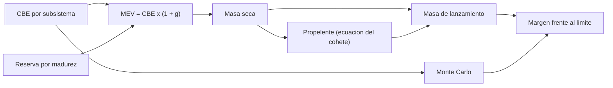

# B83-C09 — Presupuestos de masa

<!-- nav:top -->
[🏠 Programa](../../../../README.md) · [📚 Bloque B83](../../../tronco-comun/B83-ingenieria-de-sistemas-y-diseno-de-misiones.md) · [← Anterior: B83-C08 — Interfaz entre subsistemas](../B83-C08-interfaz-entre-subsistemas/CLASE.md) · [Siguiente: B83-C10 — Presupuestos de energía →](../B83-C10-presupuestos-de-energia/CLASE.md)
<!-- /nav -->

## 1. Ubicación, nivel y alcance

Clase 9 del bloque B83. Nivel N3. Un **presupuesto de masa** suma la masa de cada elemento, la corrige por la incertidumbre según su madurez y la compara con el límite que impone el lanzador. Aquí armas el presupuesto de la misión sintética ESTRELLA-S: masa estimada actual (CBE), reserva de crecimiento por madurez, propelente por la ecuación del cohete y margen frente al límite, con una simulación de Monte Carlo. La gravedad normal `g₀` viene de la ficha de la Tierra de NASA/NSSDC (S8); todas las masas y reservas son **sintéticas**.

## 2. Por qué esta clase existe

La masa crece durante el diseño casi siempre; un presupuesto sin reserva se rompe en la revisión crítica. La decisión central: **¿cuánto margen queda frente al límite si cada elemento crece como su madurez sugiere?** Y una segunda pregunta: ¿cuánto propelente hace falta, que a su vez pesa?

## 3. Lo que podrás hacer al terminar

1. Distinguir CBE, reserva de crecimiento, MEV y margen.
2. Calcular la masa esperada máxima de cada subsistema y del total.
3. Calcular el propelente con la ecuación del cohete y comprobarlo por bisección.
4. Calcular el margen absoluto y relativo frente al límite.
5. Estimar la probabilidad de cumplir el límite con una simulación de semilla fija.
6. Rotular que reservas, masas y límite son sintéticos y que `g₀` es consultada.

La evidencia es la **presupuesto de masa con margen e incertidumbre** del ejercicio 12 (sección 20).

## 4. Con qué llegas y cómo comprobarlo

1. ¿Qué es la ecuación del cohete?
2. ¿Qué es el impulso específico?
3. ¿Qué es una distribución triangular?
4. ¿Qué es un percentil 95?
5. ¿Qué es una reserva?

<details>
<summary>Ver respuestas</summary>

1. `Δv = g₀·Isp·ln(m₀/m_f)`. 2. El impulso por unidad de peso de propelente, en segundos. 3. Una distribución con mínimo, moda y máximo. 4. El valor que el 95 % de las muestras no supera. 5. Un margen añadido por incertidumbre.
</details>

Con cuatro o cinco aciertos, sigue; si no, repasa los prerrequisitos.

## 5. Un caso de contexto y casos de referencia

ESTRELLA-S (sintética) tiene diez subsistemas con masa seca CBE de 59,400 kg. Con reservas por madurez, el MEV es 67,310 kg (reserva 7,910 kg, 13,32 %). Para un Δv de 150 m/s con Isp de 220 s hacen falta 4,846 kg de propelente. La masa de lanzamiento MEV es 72,156 kg frente a un límite de 80 kg: margen de 7,844 kg (9,80 %). El subsistema con más reserva absoluta es **Carga util**.

## 6. Vocabulario

La **masa CBE** (*current best estimate*) es la estimación actual. La **reserva de crecimiento** es un porcentaje según madurez (comercial 5 %, modificado 10 %, nuevo 20 %, en desarrollo 30 %, valores de ejemplo). **MEV** (*maximum expected value*) es CBE más reserva. El **margen** es la diferencia entre el límite y el MEV. La **ecuación del cohete** relaciona Δv, `Isp` y masas. Una **simulación de Monte Carlo** toma muestras aleatorias de cada masa y reporta la distribución del total.

## 7. Modelo mental: de la masa estimada al margen



*Descripción textual:* la masa estimada y la reserva por madurez dan el MEV; la masa seca determina el propelente; ambos suman la masa de lanzamiento, que se compara con el límite; el Monte Carlo ofrece una segunda estimación del margen.

Analogía: hacer la maleta para un vuelo con límite de peso: pesas lo que ya tienes y reservas espacio para lo que aún comprarás. Límite: una maleta no necesita propelente para moverse; en un satélite, el propelente depende de la masa que mueve.

## 8. La explicación, paso a paso

### 8.1 CBE, reserva y MEV

La reserva depende de la madurez: la carga útil (nuevo, 20 %) aporta 3,60 kg; el arnés (en desarrollo, 30 %), 1,20 kg. La reserva total es 7,910 kg (13,32 % de la CBE) y el MEV seco es 67,310 kg.

### 8.2 Propelente

`m_p = m_seco·(e^{Δv/(g₀·Isp)} − 1)`. Con `Δv/(g₀·Isp) = 0,06953`, `m_p = 4,846 kg` sobre el MEV (sobre la CBE serían 4,277 kg). La bisección numérica de la ecuación del cohete da el mismo valor a `10⁻⁹` kg.

### 8.3 Margen y probabilidad

Masa de lanzamiento MEV = 72,156 kg; margen 7,844 kg = 9,80 %. Con 20 000 muestras triangulares la masa tiene media 70,340 kg y percentil 95 de 73,744 kg; la probabilidad de caber en 80 kg es 100,0 %. El MEV es conservador: queda sobre la media simulada. Un margen de 9,80 % queda por debajo del 10 % que el proyecto sintético fijaría como regla para el PDR (regla de ejemplo, ver C13).

## 9. Magnitudes, símbolos y unidades

| Símbolo | Qué es | Unidad | Valor / nota |
|---|---|---|---|
| `CBE` | masa estimada actual | kg | 59,400 (seca) |
| `g` | reserva de crecimiento | — | 5–30 % (sintético) |
| `MEV` | masa esperada máxima | kg | 67,310 (seca) |
| `m_p` | propelente | kg | 4,846 |
| `M` | masa de lanzamiento | kg | 72,156 |
| `margen` | límite − MEV | kg | 7,844 |

## 10. Convenciones y referencias

`g₀ = 9,80665 m/s²` de la ficha de la Tierra de NASA/NSSDC (S8). Sin sistema de referencia. Modelo: MEV = CBE·(1+g); propelente por la ecuación del cohete con empuje impulsivo; triangular `(0,98·CBE; CBE·(1+g/2); CBE·(1+2g))`; semilla 83009. Reservas, `Δv`, `Isp` y límite **sintéticos**. Tolerancia: propelente por fórmula y por bisección a `10⁻⁹` kg.

## 11. De dónde sale lo que afirmamos

| ID | Fuente | Localizador | Respalda | Estado |
|---|---|---|---|---|
| S8 | NASA/NSSDC, Earth Fact Sheet — https://nssdc.gsfc.nasa.gov/planetary/factsheet/earthfact.html (consultada 2026-11-10) | ficha de la Tierra, gravedad estándar | aceleración estándar de la gravedad 9,80665 m/s² (valor exacto según la página) | Consultada |
| ECSS | ECSS-E-ST-10C, ECSS-M-ST-40C, ECSS-Q-ST-30-02C, ECSS-Q-ST-40-12C y demás estándares (ecss.nl) | — | — | No consultada: la página de estándares no mostró los documentos |
| — | ISO/IEC/IEEE 15288, INCOSE, SysML, MIL-STD-1629, IEC 60812 e IEC 61025 | — | — | No consultada |
| — | Relaciones matemáticas estándar usadas en el laboratorio (AHP, rutas críticas, ley de Stefan, confiabilidad exponencial, cortes mínimos, ecuación del cohete) | — | — | No consultada en una fuente concreta: las verifica el laboratorio por una segunda vía |

Límites: las reservas por madurez no vienen de una norma (la guía AIAA S-120 y los estándares ECSS no se consultaron); la ecuación del cohete es estándar y la verifica el laboratorio por bisección. No se infiere nada de una misión real.

## 12. Cómo ver el presupuesto

| Magnitud | Valor |
|---|---|
| Masa seca CBE / MEV | 59,400 / 67,310 kg |
| Reserva | 7,910 kg (13,32 %) |
| Propelente | 4,846 kg |
| Masa de lanzamiento MEV | 72,156 kg |
| Margen | 7,844 kg (9,80 %) |
| P(masa ≤ 80 kg) | 100,0 % |

Descripción larga: el presupuesto cabe con holgura según la simulación, pero el margen determinista del MEV es inferior al 10 %: el margen se mide frente a la mayor masa esperada, no frente a la media.

## 13. Ejemplo trabajado: el propelente de ESTRELLA-S

**Paso 1 · Exponente.** `Δv/(g₀·Isp) = 150/(9,80665×220) = 0,06953`.

**Paso 2 · Razón de masas.** `e^{0,06953} − 1 = 0,07200`.

**Paso 3 · Propelente.** `m_p = 67,310 × 0,07200 = 4,846 kg`.

**Paso 4 · Comprobación.** La bisección sobre la ecuación del cohete da el mismo valor.

## 14. Distintas formas de abordar el problema

**Determinista con MEV** (esta clase). **Probabilístico con Monte Carlo** (esta clase): da una distribución. **Por margen contra la regla de la agencia o del lanzador:** la regla depende del proyecto y de la fase (C13). El laboratorio compara el propelente por fórmula y por bisección.

## 15. Práctica guiada

**Ejercicio 1 · con los pasos indicados.** Calcula el MEV de un elemento de 10 kg con reserva del 20 %. *Pasos:* `10×1,2`.

<details><summary>Solución comentada</summary>

`12 kg`.
</details>

**Ejercicio 2 · con una pista.** Calcula el propelente para `Δv = 100 m/s`, `Isp = 220 s` y masa seca 60 kg. *Pista:* `e^{100/(9,80665×220)} − 1 = 0,04745`.

<details><summary>Solución comentada</summary>

`60×0,04745 = 2,85 kg`.
</details>

**Ejercicio 3 · casi autónomo.** Con límite 80 kg y MEV 72,2 kg, ¿cuál es el margen relativo?

<details><summary>Solución comentada</summary>

`(80−72,2)/80 = 9,8 %`.
</details>

## 16. Práctica autónoma, transferencia e integrador

**Ejercicio 4 · autónomo.** ¿Qué le pasa al margen si la carga útil pasa de «nuevo» (20 %) a «comercial» (5 %)? (CBE 18 kg)

<details><summary>Solución comentada</summary>

La reserva baja 2,7 kg y el margen sube en ese valor más el propelente asociado: unos 2,9 kg.
</details>

**Ejercicio 5 · autónomo.** Si el `Isp` sube a 300 s, ¿el propelente sube o baja? Explica.

<details><summary>Solución comentada</summary>

Baja: el exponente `Δv/(g₀·Isp)` disminuye.
</details>

**Ejercicio 6 · autónomo.** ¿Por qué la media simulada es menor que el MEV?

<details><summary>Solución comentada</summary>

Porque el MEV suma todas las reservas completas y la simulación mezcla casos.
</details>

**Ejercicio 7 · autónomo.** Si 20 000 muestras tienen P95 de 73,7 kg, ¿qué significa?

<details><summary>Solución comentada</summary>

Que el 95 % de las muestras pesan 73,7 kg o menos.
</details>

**Ejercicio 8 · autónomo.** ¿Por qué el propelente se calcula sobre la masa seca y no sobre la de lanzamiento?

<details><summary>Solución comentada</summary>

Porque la ecuación del cohete usa la masa final (seca) como referencia; el propelente es lo que se agrega.
</details>

**Ejercicio 9 · transferencia.** **Transferencia.** Un colega usa el margen de 9,80 % como evidencia de que un satélite real cabe en un lanzador. ¿Es válido?

<details><summary>Solución comentada</summary>

No: masas, reservas y límite son sintéticos.
</details>

**Ejercicio 10 · transferencia.** **Transferencia.** ¿Cómo cambia el presupuesto si se añade un adaptador de lanzamiento de 2 kg?

<details><summary>Solución comentada</summary>

Se suma a la masa seca como un elemento más (con su reserva), aumenta el propelente y baja el margen.
</details>

**Ejercicio 11 · transferencia.** **Transferencia.** ¿Qué haría el equipo si el margen cae por debajo de la regla en el PDR?

<details><summary>Solución comentada</summary>

Reducir masa, cambiar de lanzador, aumentar madurez para bajar reservas o renegociar el límite; todo con registro de riesgo (C16).
</details>

**Ejercicio 12 · integrador.** **Integrador.** Elabora tu *presupuesto de masa con margen e incertidumbre*: tabla CBE/reserva/MEV, propelente por dos vías, margen y probabilidad por Monte Carlo, con lista de qué es sintético.

<details><summary>Solución comentada</summary>

Secciones 8.1–8.3, el ejemplo 13 y la salida del laboratorio.
</details>

## 17. Laboratorio: presupuesto de masa con reserva por madurez y propelente

El script [presupuesto_de_masa.py](presupuesto_de_masa.py) calcula la masa CBE y MEV de diez subsistemas, el propelente por la ecuación del cohete y por bisección, el margen y una simulación de Monte Carlo (**comprueba** que las dos vías del propelente coinciden a `10⁻⁹` kg, que el MEV cabe en el límite y que la media simulada es menor que el MEV). Usa la biblioteca común [sistemas_comun.py](../sistemas_comun.py) del bloque.

**Datos:** `g₀` de NASA/NSSDC (consultada el 2026-11-10); masas, reservas, `Δv`, `Isp` y límite **sintéticos**. **Predice antes de ejecutar:** ¿el margen determinista será mayor o menor que 10 %? (menor: 9,80 %, aunque la simulación dice que cabe casi siempre.) **Ejecución del 2026-11-10 (Python 3.12.9 | numpy 2.4.4):**

```text
Python 3.12.9 | numpy 2.4.4
Datos SINTETICOS: 10 subsistemas; limite 80 kg; dv = 150 m/s; Isp = 220 s; g0 = 9.80665 m/s2 (NASA/NSSDC)
subsistema                 CBE kg        madurez  reserva   MEV kg
Estructura                  14.00     modificado      10%   15.400
Carga util                  18.00          nuevo      20%   21.600
Control de actitud           3.50      comercial       5%    3.675
Paneles solares              6.00      comercial       5%    6.300
Bateria                      4.50      comercial       5%    4.725
Computadora de a bordo       1.80     modificado      10%    1.980
Comunicaciones               2.40     modificado      10%    2.640
Termico                      2.20          nuevo      20%    2.640
Propulsion (seco)            3.00      comercial       5%    3.150
Arnes electrico              4.00  en desarrollo      30%    5.200
Masa seca CBE = 59.400 kg ; MEV = 67.310 kg ; reserva = 7.910 kg (13.32 %)
Propelente (ecuacion del cohete): sobre CBE 4.277 kg ; sobre MEV 4.846323 kg ; biseccion 4.846323 kg
Masa de lanzamiento: CBE 63.677 kg ; MEV 72.156 kg ; limite 80.0 kg ; margen 7.844 kg (9.80 %)
Monte Carlo (20000, semilla 83009): media 70.340 kg ; P95 73.744 kg ; P(masa <= limite) = 100.0 %
Pruebas superadas.
```

```bash
python programa/clases/B83/B83-C09-presupuestos-de-masa/presupuesto_de_masa.py
```

**Límites:** empuje impulsivo; sin masa de propelente residual ni de presurizante; reservas de ejemplo; incertidumbres independientes entre subsistemas.

## 18. Errores frecuentes y cómo corregirlos

**Presentar CBE como valor final.** Usa MEV y declara la reserva

**Calcular el propelente sobre la masa seca sin reserva.** Usa la masa seca esperada máxima

**Confundir margen con reserva.** La reserva está en el MEV; el margen es lo que queda frente al límite

## 19. Cómo sabrás que vas bien

Tras 8.2: ¿cuánto propelente esperabas? Tras 8.3: ¿qué fracción de simulaciones cabe? Si dudas, repasa el ejemplo 13.

## 20. Qué entregas y cómo se evalúa

El producto es tu **presupuesto de masa con margen e incertidumbre** (ejercicio 12).

| Criterio | Inicial | En desarrollo | Logrado | Destacado |
|---|---|---|---|---|
| Conceptos | Los confunde | Parciales | Explica el método y su dominio | Explica los límites y las alternativas |
| Cálculo | Sin unidades | Con errores | Resultados con unidades y comprobados | Resuelve casos nuevos |
| Numérico | Sin comprobar | Un caso | Verifica por una segunda vía en varios casos | Interpreta las diferencias y los fallos |
| Fuentes | Sin fuente | Sin fecha | Fuentes con fecha y estado | Declara lo sintético y lo no consultado |
| Límites | No los nombra | Uno | Tres | Discute qué falta del modelo |

**Condiciones críticas (no se compensan con promedio):** rotular los datos como sintéticos; verificar el resultado por una segunda vía; citar solo lo consultado.

## 21. Ética, seguridad y límites

Clase educativa: los modelos son simplificados y los datos son sintéticos; ningún resultado describe una misión real, certifica una seguridad ni sustituye a los estándares vigentes y a la revisión de especialistas.  Accesibilidad: tablas equivalentes a las gráficas, fórmulas en texto, ejercicios sin conexión.

## 22. Para cerrar y seguir

El presupuesto sintético de ESTRELLA-S da 72,156 kg de masa MEV, 9,80 % de margen y 100,0 % de probabilidad de caber. Queda una pregunta: ¿alcanza la energía? (C10).

**Glosario español–inglés.** presupuesto de masa · *mass budget*; reserva de crecimiento · *growth allowance*; margen · *margin*; ecuación del cohete · *rocket equation*; masa seca · *dry mass*.

**Continuidad.** [B83-C10](../B83-C10-presupuestos-de-energia/CLASE.md) construye el presupuesto de energía con la misma lógica de margen.

**Referencias:** ver sección 11.

<!-- nav:bottom -->
---

[← Anterior: B83-C08 — Interfaz entre subsistemas](../B83-C08-interfaz-entre-subsistemas/CLASE.md) · [📚 Bloque B83](../../../tronco-comun/B83-ingenieria-de-sistemas-y-diseno-de-misiones.md) · [Siguiente: B83-C10 — Presupuestos de energía →](../B83-C10-presupuestos-de-energia/CLASE.md)
<!-- /nav -->
