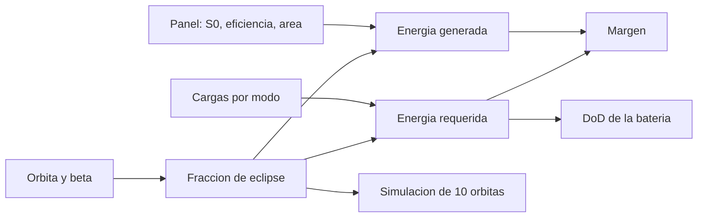

# B83-C10 — Presupuestos de energía

<!-- nav:top -->
[🏠 Programa](../../../../README.md) · [📚 Bloque B83](../../../tronco-comun/B83-ingenieria-de-sistemas-y-diseno-de-misiones.md) · [← Anterior: B83-C09 — Presupuestos de masa](../B83-C09-presupuestos-de-masa/CLASE.md) · [Siguiente: B83-C11 — Presupuestos de datos →](../B83-C11-presupuestos-de-datos/CLASE.md)
<!-- /nav -->

## 1. Ubicación, nivel y alcance

Clase 10 del bloque B83. Nivel N3. Un **presupuesto de energía** compara la energía que generan los paneles con la que consumen las cargas en una órbita completa, y dimensiona la batería para el eclipse. Aquí lo construyes para la misión sintética ESTRELLA-S: fracción de eclipse según el ángulo beta, potencia del panel al final de vida, balance por órbita y profundidad de descarga (DoD). La irradiancia y los datos de la Tierra son de NASA/NSSDC (S8); los rangos de eficiencia de celda y de energía específica de baterías, del capítulo de energía de NASA SmallSat (S7); las cargas y el área, **sintéticos**.

## 2. Por qué esta clase existe

Un satélite sin energía suficiente en el peor eclipse se apaga y no vuelve. La decisión central: **¿el panel y la batería cierran el balance en el caso más desfavorable, con margen y con una descarga que la batería soporte?**

## 3. Lo que podrás hacer al terminar

1. Calcular la fracción de eclipse de una órbita circular en función del ángulo beta.
2. Calcular la potencia del panel al final de vida con eficiencia, empaquetado, coseno y degradación.
3. Calcular la energía por órbita por modos de operación y el balance.
4. Calcular la profundidad de descarga y compararla con un límite.
5. Comprobar la fracción de eclipse por geometría numérica y el balance por simulación de 10 órbitas.
6. Rotular lo consultado (`S₀`, rangos de S7) y lo sintético (cargas, área, batería).

La evidencia es la **presupuesto de energía orbital con margen** del ejercicio 12 (sección 20).

## 4. Con qué llegas y cómo comprobarlo

1. ¿Qué es el ángulo beta?
2. ¿Qué es la eficiencia de una celda?
3. ¿Qué es la profundidad de descarga?
4. ¿Qué es la sombra cilindrica?
5. ¿Por qué se usa el final de vida?

<details>
<summary>Ver respuestas</summary>

1. El ángulo entre el vector al Sol y el plano de la órbita. 2. La fracción de la potencia solar incidente que se convierte en eléctrica. 3. La fracción de la capacidad de la batería que se usa en un ciclo. 4. Un modelo en que la sombra de la Tierra es un cilindro paralelo a la dirección al Sol. 5. Porque los paneles se degradan y el balance debe cerrar al final.
</details>

Con cuatro o cinco aciertos, sigue; si no, repasa los prerrequisitos.

## 5. Un caso de contexto y casos de referencia

ESTRELLA-S (sintética) tiene un panel de 0,60 m² que entrega 126,10 W al final de vida y una batería de 150 Wh. La carga por órbita es de 91,07 Wh. En el peor caso (β = 0°) el eclipse dura 35,61 min (37,23 % de la órbita de 95,65 min), el panel genera 119,87 Wh frente a 93,96 Wh requeridos (margen 27,58 %) y la descarga llega a 18,74 %. Con β = 75° no hay eclipse.

## 6. Vocabulario

El **eclipse** es el tramo de la órbita en que la Tierra tapa al Sol. El **ángulo beta** (β) fija su duración: `fracción = arccos(√(h²+2Rh)/((R+h)cos β))/π`, y es cero si el argumento es 1 o mayor. La **potencia del panel** es `S₀·η·f_emp·f_cos·f_deg·A`. La **energía requerida** suma las cargas de luz y de eclipse con las pérdidas de regulación y descarga. La **profundidad de descarga** (DoD) es la energía extraída entre la capacidad. El **margen** es `(generada − requerida)/requerida`.

## 7. Modelo mental: de la órbita al balance de energía



*Descripción textual:* la órbita y beta dan la fracción de eclipse; el panel y las cargas dan energía generada y requerida; su comparación da el margen y la requerida en eclipse da el DoD; una simulación de 10 órbitas comprueba el balance.

Analogía: un cubo con grifo y desagüe: el grifo solo corre al sol, el desagüe corre siempre y la batería es la reserva del cubo. Límite: el cubo no se degrada con cada ciclo de llenado; una batería sí, por eso se limita el DoD.

## 8. La explicación, paso a paso

### 8.1 Fracción de eclipse

Con `h = 550 km` y `R = 6378,137 km`, `√(h²+2Rh) = 2705 km` y `R+h = 6928,137 km`. Para β = 0°, `arccos(0,3904)/π = 0,3723`: 37,23 % de la órbita, 35,61 min. Para β = 30°, 60° y 75° la fracción es 35,11 %, 21,47 % y 0 %. La geometría numérica con paso de 1 s da 37,219 % para β = 0°.

### 8.2 Panel y balance

`P = 1361 × 0,28 × 0,85 × 0,7 × 0,9269 × 0,60 = 126,10 W` al final de vida. La energía requerida por órbita en el caso β = 0° es 93,96 Wh y la generada, 119,87 Wh: margen de 27,58 %. Con β = 60° el margen sube a 61,71 %; con β = 75° a 109,69 %.

### 8.3 Batería y simulación

En eclipse la carga de reposo consume `45 W × 35,61 min = 26,71 Wh`; con el rendimiento de descarga, el DoD es 18,74 % de 150 Wh, bajo el 30 % de ejemplo. La simulación de 10 órbitas da un DoD máximo de 18,74 % y la batería termina al 100,0 %: el balance cierra.

## 9. Magnitudes, símbolos y unidades

| Símbolo | Qué es | Unidad | Valor / nota |
|---|---|---|---|
| `β` | ángulo beta | ° | 0, 30, 60, 75 |
| `f_e` | fracción de eclipse | — | 37,23 % (β = 0°) |
| `P_sa` | potencia del panel (EOL) | W | 126,10 |
| `E_req` | energía requerida por órbita | Wh | 93,96 (β = 0°) |
| `DoD` | profundidad de descarga | % | 18,74 |
| `m` | margen | % | 27,58 |

## 10. Convenciones y referencias

`S₀ = 1361,0 W/m²`, `R = 6378,137 km`, `GM = 398 600 km³/s²` de NASA/NSSDC (S8). Eficiencia de celda de 28 %, dentro del rango BOL de 27–32 % de celdas espaciales y energía específica de 150–270 Wh/kg de ion-litio comercial (S7). Sombra cilíndrica, órbita circular de 550 km, Sol en el plano definido por β; sin albedo ni infrarrojo terrestre. Cargas, área, batería y factores **sintéticos**. Tolerancias: fracción de eclipse numérica y analítica a `2×10⁻³`; margen de β = 0° mayor que 20 % (regla de ejemplo).

## 11. De dónde sale lo que afirmamos

| ID | Fuente | Localizador | Respalda | Estado |
|---|---|---|---|---|
| S7 | NASA, *State-of-the-Art of Small Spacecraft Technology*, capítulo Power Subsystems — https://www.nasa.gov/smallsat-institute/sst-soa/power-subsystems/ (consultada 2026-11-10; solo las primeras 100 000 de 119 638 caracteres) | secciones 3.2.1, 3.4 y 3.4.1 | celdas multiunión espaciales de 27–32 % (BOL) y baterías de ion-litio de 150–270 Wh/kg | Consultada |
| S8 | NASA/NSSDC, Earth Fact Sheet — https://nssdc.gsfc.nasa.gov/planetary/factsheet/earthfact.html (consultada 2026-11-10) | ficha de la Tierra | irradiancia solar 1361,0 W/m²; radio ecuatorial 6378,137 km; GM 398 600 km³/s² | Consultada |
| ECSS | ECSS-E-ST-10C, ECSS-M-ST-40C, ECSS-Q-ST-30-02C, ECSS-Q-ST-40-12C y demás estándares (ecss.nl) | — | — | No consultada: la página de estándares no mostró los documentos |
| — | ISO/IEC/IEEE 15288, INCOSE, SysML, MIL-STD-1629, IEC 60812 e IEC 61025 | — | — | No consultada |
| — | Relaciones matemáticas estándar usadas en el laboratorio (AHP, rutas críticas, ley de Stefan, confiabilidad exponencial, cortes mínimos, ecuación del cohete) | — | — | No consultada en una fuente concreta: las verifica el laboratorio por una segunda vía |

Límites: el factor de coseno, el empaquetado, la degradación y las cargas son sintéticos; no se leyó el capítulo completo (solo las primeras 100 000 de 119 638 caracteres); la fórmula de eclipse es geométrica estándar y la verifica el laboratorio.

## 12. Cómo ver el balance por beta

| Magnitud | Valor |
|---|---|
| β = 0° | eclipse 37,23 %; margen 27,58 %; DoD 18,74 % |
| β = 30° | eclipse 35,11 %; margen 32,12 % |
| β = 60° | eclipse 21,47 %; margen 61,71 % |
| β = 75° | sin eclipse; margen 109,69 % |
| Eclipse numérico (β = 0°) | 37,219 % |

Descripción larga: el margen crece con β porque el eclipse se acorta y desaparece; el caso de dimensionamiento es β = 0°, el de mayor eclipse.

## 13. Ejemplo trabajado: el balance de β = 0°

**Paso 1 · Eclipse.** `t_e = 0,3723 × 95,65 = 35,61 min`.

**Paso 2 · Requerida.** `P_reposo·t_s + cargas de toma y comunicaciones + P_reposo·t_e/(η_des·η_reg) = 93,96 Wh`.

**Paso 3 · Generada.** `126,10 W × t_s × 0,95 = 119,87 Wh`.

**Paso 4 · Margen.** `(119,87 − 93,96)/93,96 = 27,58 %`.

## 14. Distintas formas de abordar el problema

**Analítica** (esta clase). **Por simulación temporal** (esta clase): integra la órbita y el estado de carga. **Por herramientas de análisis de energía** con albedo y cargas detalladas (no usadas). La simulación y la fórmula coinciden en eclipse y en DoD.

## 15. Práctica guiada

**Ejercicio 1 · con los pasos indicados.** Calcula `t_e` si la fracción de eclipse es 0,35 y el periodo 95,65 min. *Pasos:* multiplica.

<details><summary>Solución comentada</summary>

`33,5 min`.
</details>

**Ejercicio 2 · con una pista.** Calcula la energía de eclipse con 45 W durante 33,5 min en Wh. *Pista:* divide Wmin entre 60.

<details><summary>Solución comentada</summary>

`45×33,5/60 = 25,1 Wh`.
</details>

**Ejercicio 3 · casi autónomo.** ¿Qué DoD produce 25,1 Wh si el rendimiento de descarga es 0,95 y la batería es de 150 Wh?

<details><summary>Solución comentada</summary>

`25,1/0,95/150 = 17,6 %`.
</details>

## 16. Práctica autónoma, transferencia e integrador

**Ejercicio 4 · autónomo.** Si el panel baja a 100 W y la energía requerida es de 94 Wh con 60 min de luz y rendimiento 0,95, ¿cuál es la generada?

<details><summary>Solución comentada</summary>

`100×60×0,95/60 = 95 Wh`: margen de apenas 1 %.
</details>

**Ejercicio 5 · autónomo.** ¿Por qué β = 0° es el caso de dimensionamiento?

<details><summary>Solución comentada</summary>

Porque el eclipse es el más largo y la batería carga en menos tiempo de luz.
</details>

**Ejercicio 6 · autónomo.** Explica por qué una batería con DoD menor dura más ciclos.

<details><summary>Solución comentada</summary>

Porque el desgaste por ciclo crece con la profundidad de descarga.
</details>

**Ejercicio 7 · autónomo.** Si la eficiencia de celda baja de 28 % a 25 %, ¿cómo cambia `P_sa`?

<details><summary>Solución comentada</summary>

Escala por `25/28`: baja un 10,7 %.
</details>

**Ejercicio 8 · autónomo.** ¿Por qué se calcula con degradación al final de vida?

<details><summary>Solución comentada</summary>

Porque el balance debe cerrar cuando el panel genera menos.
</details>

**Ejercicio 9 · transferencia.** **Transferencia.** Un colega usa 27,58 % como margen de un satélite real. ¿Es válido?

<details><summary>Solución comentada</summary>

No: cargas, área y batería son sintéticas y se omiten albedo, temperatura y modos de falla.
</details>

**Ejercicio 10 · transferencia.** **Transferencia.** ¿Qué pasaría si se añade un modo de comunicaciones de 60 W durante 15 min por órbita?

<details><summary>Solución comentada</summary>

La energía requerida sube `60×15/60 − 40×7/60 ≈ 10,3 Wh`; se reevalúa el margen.
</details>

**Ejercicio 11 · transferencia.** **Transferencia.** ¿Qué cambia en una órbita con β permanente cercano a 75° (órbita sincronizada con el Sol al amanecer)?

<details><summary>Solución comentada</summary>

El eclipse desaparece o se acorta, el balance mejora y el DoD baja, pero el coseno de apuntamiento del panel cambia.
</details>

**Ejercicio 12 · integrador.** **Integrador.** Elabora tu *presupuesto de energía orbital*: eclipse por β, generada y requerida, margen, DoD y simulación de 10 órbitas, con lista de qué es consultado y sintético.

<details><summary>Solución comentada</summary>

Secciones 8.1–8.3, el ejemplo 13 y la salida del laboratorio.
</details>

## 17. Laboratorio: presupuesto de energía orbital

El script [presupuesto_de_energia.py](presupuesto_de_energia.py) calcula la fracción de eclipse por fórmula y por geometría numérica, el balance de energía para cuatro valores de β y una simulación de 10 órbitas del estado de carga (**comprueba** eclipse a `2×10⁻³`, margen de β = 0° mayor que 20 %, DoD ≤ 30 % y recarga completa). Usa la biblioteca común [sistemas_comun.py](../sistemas_comun.py) del bloque.

**Datos:** `S₀`, `R` y `GM` de NASA/NSSDC y rangos de eficiencia y de energía específica de NASA SmallSat (consultados el 2026-11-10); cargas, área, batería y factores **sintéticos**. **Predice antes de ejecutar:** ¿en qué β hay más margen y en cuál se dimensiona? (más margen con β grande; se dimensiona con β = 0°.) **Ejecución del 2026-11-10 (Python 3.12.9 | numpy 2.4.4):**

```text
Python 3.12.9 | numpy 2.4.4
Datos SINTETICOS: orbita 550 km, panel 0.60 m2, bateria 150 Wh; S0, RE, GM de NASA/NSSDC; eficiencia de celda 28 % (rango de S7)
Periodo = 95.65 min ; potencia del panel al final de vida = 126.10 W ; energia de carga por orbita = 91.07 Wh
 beta  eclipse t_ecl[min]   gen[Wh]   req[Wh]  margen[%]  DoD[%]
    0   37.23%      35.61    119.87     93.96      27.58   18.74
   30   35.11%      33.58    123.92     93.79      32.12   17.68
   60   21.47%      20.54    149.96     92.73      61.71   10.81
   75    0.00%       0.00    190.97     91.07     109.69    0.00
Eclipse por geometria numerica: beta 0 -> 37.219 % (analitico 37.231 %) ; beta 60 -> 21.467 % (analitico 21.474 %)
Simulacion de 10 orbitas, beta 0: DoD maxima = 18.74 % ; carga final = 100.00 %
Pruebas superadas.
```

```bash
python programa/clases/B83/B83-C10-presupuestos-de-energia/presupuesto_de_energia.py
```

**Límites:** sombra cilíndrica sin penumbra; sin albedo ni infrarrojo; sin variación de la temperatura de las celdas; factor de coseno constante; sin modo seguro.

## 18. Errores frecuentes y cómo corregirlos

**Dimensionar con β favorable.** Usa β = 0°, el eclipse más largo

**Usar la eficiencia de inicio de vida.** Aplica la degradación al final de vida

**Olvidar las pérdidas de regulación y descarga.** Inclúyelas en el balance

## 19. Cómo sabrás que vas bien

Tras 8.1: ¿qué fracción de eclipse esperabas? Tras 8.3: ¿cuánto margen hay en β = 0°? Si dudas, repasa el ejemplo 13.

## 20. Qué entregas y cómo se evalúa

El producto es tu **presupuesto de energía orbital con margen** (ejercicio 12).

| Criterio | Inicial | En desarrollo | Logrado | Destacado |
|---|---|---|---|---|
| Conceptos | Los confunde | Parciales | Explica el método y su dominio | Explica los límites y las alternativas |
| Cálculo | Sin unidades | Con errores | Resultados con unidades y comprobados | Resuelve casos nuevos |
| Numérico | Sin comprobar | Un caso | Verifica por una segunda vía en varios casos | Interpreta las diferencias y los fallos |
| Fuentes | Sin fuente | Sin fecha | Fuentes con fecha y estado | Declara lo sintético y lo no consultado |
| Límites | No los nombra | Uno | Tres | Discute qué falta del modelo |

**Condiciones críticas (no se compensan con promedio):** rotular los datos como sintéticos; verificar el resultado por una segunda vía; citar solo lo consultado.

## 21. Ética, seguridad y límites

Clase educativa: los modelos son simplificados y los datos son sintéticos; ningún resultado describe una misión real, certifica una seguridad ni sustituye a los estándares vigentes y a la revisión de especialistas.  Accesibilidad: tablas equivalentes a las gráficas, fórmulas en texto, ejercicios sin conexión.

## 22. Para cerrar y seguir

Con un panel de 0,60 m² y 150 Wh, ESTRELLA-S (sintética) cierra el balance con 27,58 % de margen y un DoD de 18,74 %. Queda una pregunta: ¿cuántos datos genera y cuántos puede bajar? (C11).

**Glosario español–inglés.** presupuesto de energía · *power budget*; ángulo beta · *beta angle*; profundidad de descarga · *depth of discharge*; final de vida · *end of life*; eclipse · *eclipse*.

**Continuidad.** [B83-C11](../B83-C11-presupuestos-de-datos/CLASE.md) calcula cuántos datos genera la carga útil y cuántos se pueden bajar.

**Referencias:** ver sección 11.

<!-- nav:bottom -->
---

[← Anterior: B83-C09 — Presupuestos de masa](../B83-C09-presupuestos-de-masa/CLASE.md) · [📚 Bloque B83](../../../tronco-comun/B83-ingenieria-de-sistemas-y-diseno-de-misiones.md) · [Siguiente: B83-C11 — Presupuestos de datos →](../B83-C11-presupuestos-de-datos/CLASE.md)
<!-- /nav -->
