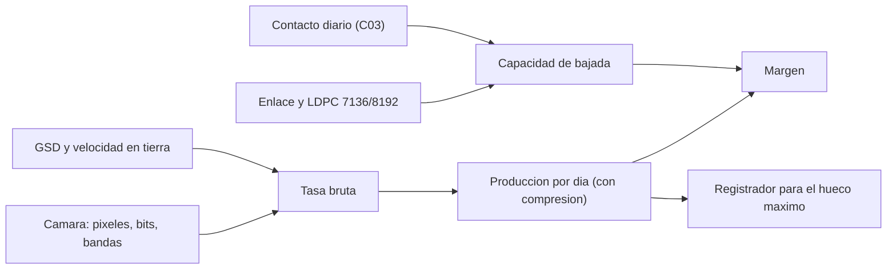

# B83-C11 — Presupuestos de datos

<!-- nav:top -->
[🏠 Programa](../../../../README.md) · [📚 Bloque B83](../../../tronco-comun/B83-ingenieria-de-sistemas-y-diseno-de-misiones.md) · [← Anterior: B83-C10 — Presupuestos de energía](../B83-C10-presupuestos-de-energia/CLASE.md) · [Siguiente: B83-C12 — Model-Based Systems Engineering →](../B83-C12-model-based-systems-engineering/CLASE.md)
<!-- /nav -->

## 1. Ubicación, nivel y alcance

Clase 11 del bloque B83. Nivel N3. Un **presupuesto de datos** compara cuánta información produce la carga útil con cuánta se puede bajar a tierra, y dimensiona el registrador de a bordo para los huecos sin contacto. Aquí lo calculas para la misión sintética ESTRELLA-S usando el tiempo de contacto de C03 y la sobrecarga de la codificación de canal de la recomendación **CCSDS 131.0-B-5** (S9): código LDPC (8160, 7136) con marcador de sincronización de 32 bits. La cámara, la compresión y el enlace son **sintéticos**.

## 2. Por qué esta clase existe

Un satélite que produce más datos de los que puede bajar los pierde o se satura. La decisión central: **¿cabe todo lo que se produce en los minutos de contacto, y qué tamaño de registrador cubre el peor hueco?** El enlace y la codificación se calculan antes de comprar hardware.

## 3. Lo que podrás hacer al terminar

1. Calcular la tasa de una cámara de barrido a partir de GSD, franja, bits y bandas.
2. Calcular la producción diaria con compresión.
3. Calcular la eficiencia de codificación con el código LDPC y el marcador ASM de CCSDS 131.0-B-5.
4. Calcular la capacidad de bajada con el tiempo de contacto de C03 y el margen.
5. Dimensionar el registrador para el hueco máximo.
6. Verificar la capacidad por pase con un conteo discreto de palabras de código.

La evidencia es la **presupuesto de datos con ocupación del registrador** del ejercicio 12 (sección 20).

## 4. Con qué llegas y cómo comprobarlo

1. ¿Qué es una cámara de barrido?
2. ¿Qué es la tasa de código?
3. ¿Qué es un marcador de sincronización (ASM)?
4. ¿Qué es la compresión 3:1?
5. ¿Qué es un registrador?

<details>
<summary>Ver respuestas</summary>

1. Un sensor lineal que forma la imagen con el avance del satélite. 2. La fracción de bits útiles entre bits transmitidos. 3. Una secuencia fija que permite al receptor hallar el inicio de cada palabra de código. 4. Reducir los datos a un tercio. 5. La memoria que guarda los datos hasta su bajada.
</details>

Con cuatro o cinco aciertos, sigue; si no, repasa los prerrequisitos.

## 5. Un caso de contexto y casos de referencia

ESTRELLA-S (sintética) con 6000 píxeles, 12 bits y 4 bandas produce una tasa bruta de 402,22 Mbit/s; en 40 s por órbita son 16,089 Gbit y, comprimidos 3:1, 5,363 Gbit, es decir 80,74 Gbit al día. Con 27,17 min/día de contacto (C03), 22,83 min útiles y un enlace de 100 Mbit/s con eficiencia total de 84,50 %, se pueden bajar 115,76 Gbit/día: margen de 43,38 %.

## 6. Vocabulario

La **tasa bruta** es `píxeles × líneas/s × bits × bandas`. Las **líneas por segundo** son `v_suelo/GSD`. La **compresión** reduce los datos. El **código LDPC (8160, 7136)** de CCSDS 131.0-B-5 transmite 8160 símbolos por 7136 bits de información (tasa 223/255, aprox. 7/8) y cada palabra va precedida de un ASM de 32 bits: la eficiencia es `7136/(8160+32)`. La **eficiencia de tramas** (sintética) descuenta cabeceras. La **capacidad de bajada** es `t_útil × R × eficiencia`. El **registrador** debe cubrir lo producido durante el hueco máximo con margen.

## 7. Modelo mental: de la imagen a los bits bajados



*Descripción textual:* la cámara y la velocidad en tierra dan la tasa bruta y, con compresión, la producción diaria; el enlace, la codificación y el contacto dan la capacidad de bajada; su comparación es el margen y la producción en el hueco máximo dimensiona el registrador.

Analogía: una bañera con grifo y desagüe en horas fijas: el desagüe solo está abierto unos minutos al día. Límite: el agua no se comprime ni lleva cabeceras; los datos sí.

## 8. La explicación, paso a paso

### 8.1 Producción

La velocidad sobre el suelo es `R·n = 6,983 km/s`, lo que da 1396,6 líneas/s para `GSD = 5 m`. La tasa bruta es `6000 × 1396,6 × 12 × 4 = 402,22 Mbit/s`. En 40 s son 16,089 Gbit; con 3:1, 5,363 Gbit por órbita y 80,74 Gbit por día (15,055 órbitas).

### 8.2 Codificación y capacidad

El código LDPC (8160, 7136) con ASM de 32 bits tiene eficiencia `7136/8192 = 0,871094`; con tramas al 97 % la eficiencia total es 84,50 %. De los 27,17 min diarios de contacto se descuentan 4,33 min de adquisición: quedan 22,83 min. La capacidad es 115,76 Gbit/día: razón 1,434 y margen 43,38 %. La compresión mínima para cerrar el balance es 2,092:1.

### 8.3 Registrador y comprobación discreta

En el hueco máximo de 11,49 h se producen 38,66 Gbit; con margen 1,3 el registrador debe tener 50,26 Gbit de los 256 de ejemplo (19,6 %). El conteo discreto de palabras de código por pase medio da una capacidad de 26,7138 Gbit y difiere de la fórmula continua en 6090 bit, menos que una palabra de código útil.

## 9. Magnitudes, símbolos y unidades

| Símbolo | Qué es | Unidad | Valor / nota |
|---|---|---|---|
| `v_s` | velocidad en tierra | km/s | 6,983 |
| `R_bruta` | tasa bruta del sensor | Mbit/s | 402,22 |
| `D_dia` | producción diaria | Gbit | 80,74 |
| `η_cod` | eficiencia del código con ASM | — | 0,871094 |
| `C_dia` | capacidad de bajada | Gbit/día | 115,76 |
| `m` | margen | % | 43,38 |

## 10. Convenciones y referencias

Constantes de la Tierra de NASA/NSSDC (S8) para el periodo y la velocidad en tierra (suelo esférico). Codificación: CCSDS 131.0-B-5 (S9): LDPC (8160, 7136), tasa 223/255, ASM de 32 bits. Cámara, compresión, enlace, eficiencia de tramas y registrador **sintéticos**. El contacto proviene de la simulación sintética de C03. Sin tolerancia de enlace (Eb/N0 no calculado). Tolerancias: eficiencia del código exacta; el residuo discreto es menor que una palabra.

## 11. De dónde sale lo que afirmamos

| ID | Fuente | Localizador | Respalda | Estado |
|---|---|---|---|---|
| S9 | CCSDS, *TM Synchronization and Channel Coding*, CCSDS 131.0-B-5, Blue Book, septiembre de 2023 — https://ccsds.org/Pubs/131x0b5.pdf (consultada 2026-11-10, texto leído con PyMuPDF; secciones 7.3 y la tabla de tamaños de bloque) | sección 7.3 (código LDPC de tasa 223/255) y 7.2.1.1 (ASM de 32 bits) | el código LDPC recomendado es (8160, 7136), de tasa 223/255 (aprox. 7/8), toma una trama de 7136 bits (892 octetos) y se usa con un ASM de 32 bits | Consultada |
| S8 | NASA/NSSDC, Earth Fact Sheet — https://nssdc.gsfc.nasa.gov/planetary/factsheet/earthfact.html (consultada 2026-11-10) | ficha de la Tierra | radio y GM de la Tierra | Consultada |
| ECSS | ECSS-E-ST-10C, ECSS-M-ST-40C, ECSS-Q-ST-30-02C, ECSS-Q-ST-40-12C y demás estándares (ecss.nl) | — | — | No consultada: la página de estándares no mostró los documentos |
| — | ISO/IEC/IEEE 15288, INCOSE, SysML, MIL-STD-1629, IEC 60812 e IEC 61025 | — | — | No consultada |
| — | Relaciones matemáticas estándar usadas en el laboratorio (AHP, rutas críticas, ley de Stefan, confiabilidad exponencial, cortes mínimos, ecuación del cohete) | — | — | No consultada en una fuente concreta: las verifica el laboratorio por una segunda vía |

Límites: de CCSDS 131.0-B-5 solo se leyeron los pasajes de la sección 7.3 y los tamaños de bloque; no se calculó ningún margen de enlace (Eb/N0), no se consultó el estándar de encapsulado de paquetes ni los del resto de capas; la eficiencia de tramas es sintética.

## 12. Cómo ver el presupuesto de datos

| Magnitud | Valor |
|---|---|
| Tasa bruta | 402,22 Mbit/s |
| Producción diaria | 80,74 Gbit |
| Eficiencia total | 84,50 % |
| Capacidad diaria | 115,76 Gbit |
| Margen | 43,38 % |
| Registrador requerido | 50,26 Gbit |
| Compresión mínima | 2,092:1 |

Descripción larga: la capacidad supera a la producción con un margen del 43 %; el registrador de 256 Gbit se usa a menos del 20 % en el peor hueco, de modo que la restricción dominante es el contacto y no la memoria.

## 13. Ejemplo trabajado: la capacidad de bajada de un día

**Paso 1 · Tiempo útil.** `27,17 − 4,33×1 = 22,83 min = 1370 s` aproximadamente.

**Paso 2 · Bits de canal.** `1370 s × 100 Mbit/s`.

**Paso 3 · Eficiencias.** `× 0,871094 × 0,97`.

**Paso 4 · Capacidad.** `115,76 Gbit/día`; producción `80,74 Gbit/día`: razón `1,434`.

## 14. Distintas formas de abordar el problema

**Analítica** (esta clase). **Por conteo discreto** de palabras de código (esta clase): segunda vía. **Por simulación de eventos** con pases reales y colas (no usada). Con una estación única, el límite lo fija el contacto; añadir estaciones sube la capacidad casi en proporción.

## 15. Práctica guiada

**Ejercicio 1 · con los pasos indicados.** Calcula las líneas por segundo con `v = 7 km/s` y `GSD = 5 m`. *Pasos:* `7000/5`.

<details><summary>Solución comentada</summary>

`1400` líneas/s.
</details>

**Ejercicio 2 · con una pista.** Calcula la tasa bruta de `6000 px`, `1400 líneas/s`, `12 bit` y `4 bandas`. *Pista:* multiplica.

<details><summary>Solución comentada</summary>

`6000×1400×12×4 = 403,2 Mbit/s`.
</details>

**Ejercicio 3 · casi autónomo.** Calcula la eficiencia `7136/(8160+32)`.

<details><summary>Solución comentada</summary>

`0,8711` (87,1 %).
</details>

## 16. Práctica autónoma, transferencia e integrador

**Ejercicio 4 · autónomo.** Con 20 min útiles al día, 100 Mbit/s y eficiencia total de 84,5 %, ¿cuántos Gbit se bajan?

<details><summary>Solución comentada</summary>

`20×60×100×0,845/1000 = 101,4 Gbit`.
</details>

**Ejercicio 5 · autónomo.** Si la compresión sube de 3:1 a 4:1, ¿cuál es la nueva producción diaria?

<details><summary>Solución comentada</summary>

`80,74×3/4 = 60,6 Gbit`.
</details>

**Ejercicio 6 · autónomo.** ¿Qué pasa con el margen si se pierde un pase de cada cuatro?

<details><summary>Solución comentada</summary>

El tiempo útil baja cerca de un 25 %, la capacidad también y el margen baja de ≈ 43 % a ≈ 7 %.
</details>

**Ejercicio 7 · autónomo.** Explica por qué el ASM añade sobrecarga.

<details><summary>Solución comentada</summary>

Porque son 32 bits por palabra de código que no transportan información útil, pero permiten la sincronización.
</details>

**Ejercicio 8 · autónomo.** ¿Por qué el registrador se dimensiona con el hueco máximo y no con el medio?

<details><summary>Solución comentada</summary>

Porque debe guardar los datos del peor caso sin perderlos.
</details>

**Ejercicio 9 · transferencia.** **Transferencia.** Un colega usa 43,38 % como margen de enlace de un satélite real. ¿Es válido?

<details><summary>Solución comentada</summary>

No: la cámara, la compresión, el enlace y el contacto son sintéticos, y no se calculó Eb/N0.
</details>

**Ejercicio 10 · transferencia.** **Transferencia.** ¿Qué cambia si la estación solo funciona con elevación mínima de 20°?

<details><summary>Solución comentada</summary>

Los pases se acortan, el contacto baja y la capacidad también; hay que recalcular C03 y este presupuesto.
</details>

**Ejercicio 11 · transferencia.** **Transferencia.** ¿Qué dato falta para validar el enlace físico?

<details><summary>Solución comentada</summary>

El presupuesto de enlace (potencia, ganancias, pérdidas, ruido, Eb/N0 requerido) y el margen asociado.
</details>

**Ejercicio 12 · integrador.** **Integrador.** Elabora tu *presupuesto de datos*: producción, eficiencia, capacidad, margen, registrador y compresión mínima, con lista de qué es consultado y sintético.

<details><summary>Solución comentada</summary>

Secciones 8.1–8.3, el ejemplo 13 y la salida del laboratorio.
</details>

## 17. Laboratorio: presupuesto de datos con codificación CCSDS y registrador

El script [presupuesto_de_datos.py](presupuesto_de_datos.py) calcula la tasa del sensor, la producción diaria, la eficiencia del código CCSDS, la capacidad de bajada con el contacto de C03 y el tamaño del registrador (**comprueba** que la eficiencia es 7136/8192, que el residuo discreto es menor que una palabra de código, que la capacidad supera a la producción y que el registrador cubre el hueco máximo). Usa la biblioteca común [sistemas_comun.py](../sistemas_comun.py) del bloque.

**Datos:** `RE` y `GM` de NASA/NSSDC y los parámetros del código de CCSDS 131.0-B-5 (consultados el 2026-11-10); cámara, compresión, enlace, registrador y contacto **sintéticos**. **Predice antes de ejecutar:** ¿cuál es el factor limitante, el contacto o el registrador? (el contacto: el registrador se usa a menos del 20 %.) **Ejecución del 2026-11-10 (Python 3.12.9 | numpy 2.4.4):**

```text
Python 3.12.9 | numpy 2.4.4
Datos SINTETICOS: 6000 px x 12 bit x 4 bandas, GSD 5 m, 40 s/orbita, compresion 3:1, enlace 100 Mbit/s; CCSDS 131.0-B-5 (LDPC 8160,7136; ASM 32 bit)
Periodo = 95.65 min ; orbitas por dia = 15.055 ; velocidad en tierra = 6.983 km/s ; lineas/s = 1396.6
Tasa bruta del sensor = 402.22 Mbit/s ; por orbita = 16.089 Gbit bruto, 5.363 Gbit comprimido
Produccion por dia = 80.74 Gbit
Eficiencia del codigo = 7136/(8160+32) = 0.871094 ; eficiencia total con tramas = 84.496 %
Contacto (de B83-C03): 27.17 min/dia en 4.33 pases ; util = 22.83 min/dia ; hueco maximo = 11.49 h
Capacidad de bajada = 115.76 Gbit/dia ; margen = 43.38 % ; razon capacidad/produccion = 1.434
Capacidad por pase medio: formula 26.7138 Gbit ; diferencia con conteo discreto = 6090.0 bit (< 6922 bit)
Registrador: se producen 38.66 Gbit en el hueco maximo ; con margen 1.3 -> 50.26 Gbit de 256 (19.6 %)
Compresion minima para cerrar el balance = 2.092:1
Pruebas superadas.
```

```bash
python programa/clases/B83/B83-C11-presupuestos-de-datos/presupuesto_de_datos.py
```

**Límites:** sin margen de enlace físico; compresión constante; un solo código; producción uniforme por órbita; un solo tipo de dato; sin retransmisiones.

## 18. Errores frecuentes y cómo corregirlos

**Olvidar la sobrecarga de codificación.** Aplica `7136/8192` y la eficiencia de tramas

**Contar todo el contacto como útil.** Descuenta la adquisición de cada pase

**Dimensionar el registrador con el promedio.** Usa el hueco máximo con margen

## 19. Cómo sabrás que vas bien

Tras 8.1: ¿qué producción diaria esperabas? Tras 8.3: ¿qué limita más, contacto o memoria? Si dudas, repasa el ejemplo 13.

## 20. Qué entregas y cómo se evalúa

El producto es tu **presupuesto de datos con ocupación del registrador** (ejercicio 12).

| Criterio | Inicial | En desarrollo | Logrado | Destacado |
|---|---|---|---|---|
| Conceptos | Los confunde | Parciales | Explica el método y su dominio | Explica los límites y las alternativas |
| Cálculo | Sin unidades | Con errores | Resultados con unidades y comprobados | Resuelve casos nuevos |
| Numérico | Sin comprobar | Un caso | Verifica por una segunda vía en varios casos | Interpreta las diferencias y los fallos |
| Fuentes | Sin fuente | Sin fecha | Fuentes con fecha y estado | Declara lo sintético y lo no consultado |
| Límites | No los nombra | Uno | Tres | Discute qué falta del modelo |

**Condiciones críticas (no se compensan con promedio):** rotular los datos como sintéticos; verificar el resultado por una segunda vía; citar solo lo consultado.

## 21. Ética, seguridad y límites

Clase educativa: los modelos son simplificados y los datos son sintéticos; ningún resultado describe una misión real, certifica una seguridad ni sustituye a los estándares vigentes y a la revisión de especialistas.  Accesibilidad: tablas equivalentes a las gráficas, fórmulas en texto, ejercicios sin conexión.

## 22. Para cerrar y seguir

ESTRELLA-S (sintética) produce 80,74 Gbit/día y puede bajar 115,76 Gbit/día; el registrador requerido es 50,26 Gbit. Queda una pregunta: ¿cómo se mantiene un modelo único con los tres presupuestos? (C12).

**Glosario español–inglés.** presupuesto de datos · *data budget*; registrador de datos · *data recorder*; marcador de sincronización · *attached sync marker*; código LDPC · *LDPC code*; tasa de código · *code rate*.

**Continuidad.** [B83-C12](../B83-C12-model-based-systems-engineering/CLASE.md) reúne los presupuestos de masa, energía y datos en un modelo de sistema.

**Referencias:** ver sección 11.

<!-- nav:bottom -->
---

[← Anterior: B83-C10 — Presupuestos de energía](../B83-C10-presupuestos-de-energia/CLASE.md) · [📚 Bloque B83](../../../tronco-comun/B83-ingenieria-de-sistemas-y-diseno-de-misiones.md) · [Siguiente: B83-C12 — Model-Based Systems Engineering →](../B83-C12-model-based-systems-engineering/CLASE.md)
<!-- /nav -->
