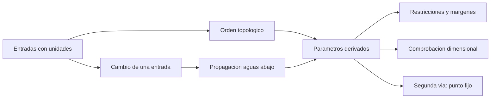

# B83-C12 — Model-Based Systems Engineering

<!-- nav:top -->
[🏠 Programa](../../../../README.md) · [📚 Bloque B83](../../../tronco-comun/B83-ingenieria-de-sistemas-y-diseno-de-misiones.md) · [← Anterior: B83-C11 — Presupuestos de datos](../B83-C11-presupuestos-de-datos/CLASE.md) · [Siguiente: B83-C13 — Revisiones SRR y PDR →](../../../tronco-comun/B83-ingenieria-de-sistemas-y-diseno-de-misiones.md#b83-c13)
<!-- /nav -->

## 1. Ubicación, nivel y alcance

Clase 12 del bloque B83. Nivel N3. La **ingeniería de sistemas basada en modelos** (MBSE) sustituye los documentos sueltos por un modelo único del que se derivan requisitos, presupuestos y vistas. Aquí construyes un modelo paramétrico mínimo de la misión sintética ESTRELLA-S que reúne los presupuestos de C09 y C11: parámetros con unidades, ecuaciones, orden de evaluación, comprobación dimensional y propagación de un cambio. No es SysML ni una herramienta comercial: ilustra la idea de **una sola fuente de verdad**. El manual de NASA (S2) subraya el control de configuración para que un cambio no invalide análisis previos.

## 2. Por qué esta clase existe

Cuando los presupuestos viven en hojas distintas, un cambio de requisito se propaga a mano y algo se olvida. La decisión central: **¿qué parámetros cambian si cambia este requisito, y siguen cumpliéndose todos los presupuestos?** Un modelo ejecutable responde en milisegundos y deja traza.

## 3. Lo que podrás hacer al terminar

1. Explicar qué es una fuente única de verdad y por qué reduce inconsistencias.
2. Escribir parámetros y ecuaciones con unidades en un modelo ejecutable.
3. Evaluar el modelo en orden topológico y detectar dependencias circulares.
4. Comprobar las dimensiones físicas de cada ecuación.
5. Propagar un cambio (GSD de 5 m a 4 m y 3 m) y leer qué presupuestos se rompen.
6. Comprobar el resultado con una segunda vía (iteración de punto fijo).

La evidencia es la **modelo de sistema ejecutable con trazas de cambio** del ejercicio 12 (sección 20).

## 4. Con qué llegas y cómo comprobarlo

1. ¿Qué es una dimensión física?
2. ¿Qué es un orden topológico?
3. ¿Qué es una dependencia circular?
4. ¿Qué es una iteración de punto fijo?
5. ¿Qué es una trazabilidad aguas abajo?

<details>
<summary>Ver respuestas</summary>

1. La naturaleza de una magnitud (longitud, masa, tiempo). 2. Un orden de evaluación en que cada elemento va después de los que dependen de él. 3. Dos parámetros que se definen uno por el otro sin punto de partida. 4. Repetir las evaluaciones hasta que los valores no cambien. 5. El conjunto de elementos que cuelgan de uno dado (C05).
</details>

Con cuatro o cinco aciertos, sigue; si no, repasa los prerrequisitos.

## 5. Un caso de contexto y casos de referencia

El modelo de ESTRELLA-S (sintético) tiene 20 entradas y 15 ecuaciones con unidades. Con el GSD base de 5 m, todos los presupuestos cumplen: masa 72,16 kg (margen 9,80 %), datos 80,74 Gbit/día (margen 43,38 %) y potencia de toma 110,0 W. Al exigir 4 m, la apertura sube a 9,23 cm, la masa de la cámara a 33,75 kg y los tres presupuestos se rompen (-6,48 %, -8,24 % y -14,58 %). Cambiar el GSD afecta a 13 de 15 parámetros derivados.

## 6. Vocabulario

Un **modelo de sistema** reúne parámetros, relaciones y restricciones en un solo lugar. **MBSE** es la práctica de usarlo como fuente central. Un **parámetro de entrada** se fija; uno **derivado** se calcula de otros. Una **restricción** compara un parámetro con un límite. El **análisis dimensional** comprueba que cada ecuación sea coherente en unidades. La **propagación** es el recálculo de lo que depende de un cambio. Una **vista** es una presentación del modelo para un lector (p. ej., la tabla de masas).

## 7. Modelo mental: del cambio de una entrada a los veredictos



*Descripción textual:* las entradas se evalúan en orden topológico para dar los parámetros derivados y los márgenes; cada ecuación se comprueba dimensionalmente; un cambio en una entrada se propaga aguas abajo y el resultado se contrasta con una iteración de punto fijo.

Analogía: una hoja de cálculo bien hecha: cambias una celda y se recalculan las que dependen de ella. Límite: la hoja no verifica unidades ni deja claro quién es dueño de cada celda; el modelo sí lo exige.

## 8. La explicación, paso a paso

### 8.1 Entradas, ecuaciones y orden

Las 20 entradas incluyen GSD, longitud de onda, altura, velocidad en tierra, bits, bandas, compresión, masas de referencia y límites; las 15 ecuaciones calculan apertura, píxeles, líneas por segundo, tasa, potencia de toma, producción diaria, masas, propelente y tres márgenes. El motor halla un orden en que cada ecuación va después de sus dependencias; si hubiera un ciclo, el motor lo rechazaría.

### 8.2 Unidades

Cada magnitud lleva sus dimensiones (m, kg, s, bit). Sumar masa con longitud o aplicar `exp` a una magnitud con unidades lanza un error. Cada ecuación declara las dimensiones de su resultado y el motor las comprueba: la potencia sale en `kg·m²/s³` (vatios) y la producción en bit.

### 8.3 Propagar un cambio

Con GSD = 4 m: `D = 9,23 cm`, `m_cam = 21,6×(D/D₀)² = 33,75 kg`, masa total 85,18 kg (margen -6,48 %), producción 126,15 Gbit/día (margen -8,24 %) y potencia de toma 171,9 W (margen -14,58 %). Con 3 m, los márgenes son -41,7 %, -48,4 % y -103,7 %. El orden topológico y la iteración de punto fijo dan los mismos resultados.

## 9. Magnitudes, símbolos y unidades

| Símbolo | Qué es | Unidad | Valor / nota |
|---|---|---|---|
| `gsd` | resolución en tierra requerida | m | 5 → 4 → 3 |
| `D` | apertura | cm | 7,38 / 9,23 / 12,30 |
| `m_total` | masa de lanzamiento | kg | 72,16 / 85,18 / 113,32 |
| `prod_dia` | producción diaria | Gbit | 80,74 / 126,15 / 224,28 |
| `P_toma` | potencia de toma | W | 110,0 / 171,9 / 305,6 |
| `n_afect` | parámetros afectados por el GSD | — | 13 |

## 10. Convenciones y referencias

`g₀ = 9,80665 m/s²` de NASA/NSSDC (S8, la misma consulta de C09). Parámetros base de C01, C09 y C11 (sintéticos): masa resto 45,71 kg, carga útil 21,6 kg, capacidad de bajada de 115,76 Gbit/día, límites de 80 kg y de 150 W de potencia de pico. Escalados de ejemplo: masa de la cámara ∝ `D²` y potencia de toma ∝ tasa de datos. Dimensiones: m, kg, s, bit. Tolerancia: orden topológico y punto fijo a `10⁻⁹`.

## 11. De dónde sale lo que afirmamos

| ID | Fuente | Localizador | Respalda | Estado |
|---|---|---|---|---|
| S2 | NASA, *Systems Engineering Handbook*, 6.0 Crosscutting Technical Management — https://www.nasa.gov/reference/6-0-crosscutting-technical-management/ (consultada 2026-11-10; solo las primeras 100 000 caracteres de la página) | 6.2.1.2.4; sección de gestión de configuración | el control de configuración se necesita porque un cambio de diseño o de entorno puede invalidar análisis previos; los análisis deben ponerse bajo control de configuración | Consultada |
| S8 | NASA/NSSDC, Earth Fact Sheet — https://nssdc.gsfc.nasa.gov/planetary/factsheet/earthfact.html (consultada 2026-11-10) | ficha de la Tierra, gravedad estándar | aceleración estándar de la gravedad 9,80665 m/s² | Consultada |
| ECSS | ECSS-E-ST-10C, ECSS-M-ST-40C, ECSS-Q-ST-30-02C, ECSS-Q-ST-40-12C y demás estándares (ecss.nl) | — | — | No consultada: la página de estándares no mostró los documentos |
| — | ISO/IEC/IEEE 15288, INCOSE, SysML, MIL-STD-1629, IEC 60812 e IEC 61025 | — | — | No consultada |
| — | Relaciones matemáticas estándar usadas en el laboratorio (AHP, rutas críticas, ley de Stefan, confiabilidad exponencial, cortes mínimos, ecuación del cohete) | — | — | No consultada en una fuente concreta: las verifica el laboratorio por una segunda vía |

Límites: no se consultó SysML, ISO/IEC/IEEE 15288 ni la guía de MBSE de INCOSE; el modelo mínimo no es un lenguaje de modelado ni una herramienta; los escalados son hipótesis de ejemplo.

## 12. Cómo ver la propagación de un cambio

| Magnitud | Valor |
|---|---|
| GSD 5 m | masa 72,16 kg; datos 80,74 Gbit/día; pico 110,0 W; CUMPLE |
| GSD 4 m | masa 85,18 kg; datos 126,15 Gbit/día; pico 171,9 W; NO CUMPLE |
| GSD 3 m | masa 113,32 kg; datos 224,28 Gbit/día; pico 305,6 W; NO CUMPLE |
| Parámetros afectados | 13 de 15 |

Descripción larga: un requisito más exigente (de 5 a 4 m) rompe los tres presupuestos a la vez; una sola decisión de requisito tiene un costo sistémico que un presupuesto aislado no mostraría.

## 13. Ejemplo trabajado: propagar GSD = 4 m

**Paso 1 · Apertura.** `D = 1,22 λ h/GSD = 9,23 cm`.

**Paso 2 · Masa de cámara.** `m_cam = 21,6 × (D/D₀)² = 33,75 kg`.

**Paso 3 · Masa total.** `m_resto + m_cam` más propelente: `85,18 kg` frente a 80 kg.

**Paso 4 · Datos y potencia.** La tasa sube `(5/4)² = 1,5625` veces: producción 126,15 Gbit/día y potencia de toma 171,9 W.

**Paso 5 · Veredicto.** Los tres márgenes son negativos: el modelo no cumple.

## 14. Distintas formas de abordar el problema

**Modelo paramétrico mínimo** (esta clase). **Hoja de cálculo:** similar pero sin dimensiones ni orden garantizado. **SysML y herramientas MBSE:** añaden bloques, interfaces, requisitos y simulación (no usados aquí). El laboratorio verifica el orden con una iteración de punto fijo.

## 15. Práctica guiada

**Ejercicio 1 · con los pasos indicados.** Calcula `D` para `GSD = 4 m`. *Pasos:* `D = 7,38 cm × 5/4`.

<details><summary>Solución comentada</summary>

`9,23 cm`.
</details>

**Ejercicio 2 · con una pista.** Calcula el factor de masa de la cámara. *Pista:* `(D/D₀)² = (5/4)²`.

<details><summary>Solución comentada</summary>

`1,5625`: `21,6×1,5625 = 33,75 kg`.
</details>

**Ejercicio 3 · casi autónomo.** ¿Qué dimensiones tiene `lineas = v_suelo/gsd`?

<details><summary>Solución comentada</summary>

`s⁻¹`: m/s dividido entre m.
</details>

## 16. Práctica autónoma, transferencia e integrador

**Ejercicio 4 · autónomo.** ¿Por qué falla sumar `m_cam` (kg) con `D` (m)?

<details><summary>Solución comentada</summary>

Porque las dimensiones difieren: no se pueden sumar masa y longitud.
</details>

**Ejercicio 5 · autónomo.** ¿Cuántos parámetros derivados se afectan al cambiar `m_limite`?

<details><summary>Solución comentada</summary>

Uno: solo `margen_masa` lo usa.
</details>

**Ejercicio 6 · autónomo.** ¿Por qué existe un orden de evaluación?

<details><summary>Solución comentada</summary>

Porque cada parámetro derivado depende de otros que deben estar calculados antes.
</details>

**Ejercicio 7 · autónomo.** Si se añade `m_limite` → `margen_masa` y `margen_masa` → `m_limite`, ¿qué ocurre?

<details><summary>Solución comentada</summary>

Dependencia circular: el motor rechaza el modelo.
</details>

**Ejercicio 8 · autónomo.** Explica por qué la iteración de punto fijo es una segunda vía y no una copia.

<details><summary>Solución comentada</summary>

Evalúa en otro orden y repite hasta converger; si coincide con el orden topológico, los dos algoritmos y el modelo son consistentes.
</details>

**Ejercicio 9 · transferencia.** **Transferencia.** Un colega afirma que un satélite real no cumple con GSD de 4 m. ¿Es válido?

<details><summary>Solución comentada</summary>

No: los escalados son hipótesis de ejemplo y el modelo es sintético.
</details>

**Ejercicio 10 · transferencia.** **Transferencia.** ¿Qué parámetro añadirías para ligar la energía (C10)?

<details><summary>Solución comentada</summary>

La energía por orbita como función de `p_toma`, con el eclipse como entrada.
</details>

**Ejercicio 11 · transferencia.** **Transferencia.** ¿Qué ventaja tiene el modelo frente a tres documentos separados?

<details><summary>Solución comentada</summary>

Un solo valor para cada parámetro, propagación automática, unidades comprobadas y traza de cambios.
</details>

**Ejercicio 12 · integrador.** **Integrador.** Elabora tu *modelo de sistema con trazas de cambio*: parámetros, ecuaciones, orden, tres casos de GSD y parámetros afectados, con lista de qué es consultado y sintético.

<details><summary>Solución comentada</summary>

Secciones 8.1–8.3, el ejemplo 13 y la salida del laboratorio.
</details>

## 17. Laboratorio: modelo paramétrico con unidades y propagación de cambios

El script [modelo_parametrico.py](modelo_parametrico.py) define el modelo con cantidades con unidades, lo evalúa en orden topológico, propaga tres valores de GSD y lo contrasta con una iteración de punto fijo (**comprueba** que ambos órdenes coinciden a `10⁻⁹`, que el caso base cumple y que GSD = 4 m rompe algún presupuesto). Usa la biblioteca común [sistemas_comun.py](../sistemas_comun.py) del bloque.

**Datos:** `g₀` de NASA/NSSDC (consultada el 2026-11-10); parámetros base, escalados y límites **sintéticos** (los mismos de C01, C09 y C11). **Predice antes de ejecutar:** ¿qué ocurre con la masa total al pasar de GSD = 5 m a 4 m? (sube de 72,16 kg a 85,18 kg y deja de caber.) **Ejecución del 2026-11-10 (Python 3.12.9 | numpy 2.4.4):**

```text
Python 3.12.9 | numpy 2.4.4
Datos SINTETICOS: 20 entradas y 15 ecuaciones con unidades (m, kg, s, bit); g0 = 9.80665 m/s2 (NASA/NSSDC)
Orden de evaluacion: D -> D0 -> lineas -> pix -> tasa0 -> m_cam -> tasa -> m_seco -> p_toma -> prod_dia -> m_prop -> margen_datos -> margen_pico -> m_total -> margen_masa
 GSD   D [cm]   m_cam  m_total  marg.masa  prod.[Gbit]  marg.datos  P_toma[W]  marg.pico  veredicto
   5     7.38   21.60    72.16      9.80%        80.74      43.38%     110.00     26.67%  CUMPLE
   4     9.23   33.75    85.18     -6.48%       126.15      -8.24%     171.88    -14.58%  NO CUMPLE
   3    12.30   60.00   113.32    -41.65%       224.28     -48.38%     305.56   -103.70%  NO CUMPLE
Parametros afectados por cambiar gsd: 13 de 15 derivados -> D, lineas, m_cam, m_prop, m_seco, m_total, margen_datos, margen_masa, margen_pico, p_toma, pix, prod_dia, tasa
Afectados por m_limite: 1 ; por compresion: 2
Diferencia maxima entre orden topologico y punto fijo = 0.00e+00
Pruebas superadas.
```

```bash
python programa/clases/B83/B83-C12-model-based-systems-engineering/modelo_parametrico.py
```

**Límites:** un solo modelo de un solo nivel; escalados de ejemplo; sin incertidumbre; sin estados ni comportamientos; no es SysML.

## 18. Errores frecuentes y cómo corregirlos

**Duplicar un parámetro en dos lugares.** Defínelo una vez y deriva el resto

**Ignorar las unidades.** Declara y comprueba dimensiones

**Cambiar un valor sin ver la propagación.** Calcula el conjunto de parámetros afectados

## 19. Cómo sabrás que vas bien

Tras 8.1: ¿qué parámetros esperabas afectados por el GSD? Tras 8.3: ¿qué presupuesto se rompe primero? Si dudas, repasa el ejemplo 13.

## 20. Qué entregas y cómo se evalúa

El producto es tu **modelo de sistema ejecutable con trazas de cambio** (ejercicio 12).

| Criterio | Inicial | En desarrollo | Logrado | Destacado |
|---|---|---|---|---|
| Conceptos | Los confunde | Parciales | Explica el método y su dominio | Explica los límites y las alternativas |
| Cálculo | Sin unidades | Con errores | Resultados con unidades y comprobados | Resuelve casos nuevos |
| Numérico | Sin comprobar | Un caso | Verifica por una segunda vía en varios casos | Interpreta las diferencias y los fallos |
| Fuentes | Sin fuente | Sin fecha | Fuentes con fecha y estado | Declara lo sintético y lo no consultado |
| Límites | No los nombra | Uno | Tres | Discute qué falta del modelo |

**Condiciones críticas (no se compensan con promedio):** rotular los datos como sintéticos; verificar el resultado por una segunda vía; citar solo lo consultado.

## 21. Ética, seguridad y límites

Clase educativa: los modelos son simplificados y los datos son sintéticos; ningún resultado describe una misión real, certifica una seguridad ni sustituye a los estándares vigentes y a la revisión de especialistas.  Accesibilidad: tablas equivalentes a las gráficas, fórmulas en texto, ejercicios sin conexión.

## 22. Para cerrar y seguir

El modelo de ESTRELLA-S (sintético) muestra que exigir 4 m de GSD en lugar de 5 m rompe los tres presupuestos; el cambio afecta a 13 parámetros. Queda una pregunta: ¿cómo se revisa formalmente ese diseño? (C13).

**Glosario español–inglés.** ingeniería de sistemas basada en modelos · *model-based systems engineering*; fuente única de verdad · *single source of truth*; parámetro derivado · *derived parameter*; análisis dimensional · *dimensional analysis*; propagación · *propagation*.

**Continuidad.** [B83-C13](../B83-C13-revisiones-srr-y-pdr/CLASE.md) trata las revisiones formales SRR y PDR donde se presentan estos modelos.

**Referencias:** ver sección 11.

<!-- nav:bottom -->
---

[← Anterior: B83-C11 — Presupuestos de datos](../B83-C11-presupuestos-de-datos/CLASE.md) · [📚 Bloque B83](../../../tronco-comun/B83-ingenieria-de-sistemas-y-diseno-de-misiones.md) · [Siguiente: B83-C13 — Revisiones SRR y PDR →](../../../tronco-comun/B83-ingenieria-de-sistemas-y-diseno-de-misiones.md#b83-c13)
<!-- /nav -->
