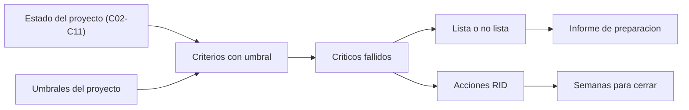

# B83-C13 — Revisiones SRR y PDR

<!-- nav:top -->
[🏠 Programa](../../../../README.md) · [📚 Bloque B83](../../../tronco-comun/B83-ingenieria-de-sistemas-y-diseno-de-misiones.md) · [← Anterior: B83-C12 — Model-Based Systems Engineering](../B83-C12-model-based-systems-engineering/CLASE.md) · [Siguiente: B83-C14 — Revisiones CDR y TRR →](../B83-C14-revisiones-cdr-y-trr/CLASE.md)
<!-- /nav -->

## 1. Ubicación, nivel y alcance

Clase 13 del bloque B83. Nivel N3. Las **revisiones técnicas** son hitos formales en que se decide si el proyecto puede pasar a la fase siguiente. La **SRR** (revisión de requisitos del sistema) confirma que los requisitos son completos y verificables; la **PDR** (revisión preliminar de diseño) confirma que el diseño preliminar cumple los requisitos con margen. El manual de NASA (S2) indica que los requisitos se validan en la última parte de la fase A y quedan bajo control formal tras la SRR, que el plan de verificación se fija como línea base en la PDR, y que cada revisión debe tener criterios de entrada y celebrarse cuando se cumplen, no por calendario. Aquí evalúas esos criterios con umbrales explícitos sobre la misión **sintética** ESTRELLA-S.

## 2. Por qué esta clase existe

Una revisión aprobada sin criterios es un trámite; una revisión con criterios medibles es una decisión. La decisión central: **¿el proyecto cumple los criterios de entrada de la SRR y de la PDR y qué falta para llegar?** Los umbrales de esta clase son reglas del proyecto sintético, no de una agencia.

## 3. Lo que podrás hacer al terminar

1. Distinguir el propósito de la SRR y de la PDR.
2. Escribir criterios de entrada y salida con operador, umbral y criticidad.
3. Evaluar un estado con valores provenientes de las clases anteriores.
4. Declarar una revisión «lista» solo si pasan todos los criterios críticos.
5. Estimar el tiempo para cerrar las acciones de revisión (RID).
6. Rotular que los umbrales y los estados son sintéticos y que no provienen de una norma.

La evidencia es la **informe de preparación de SRR/PDR con veredicto** del ejercicio 12 (sección 20).

## 4. Con qué llegas y cómo comprobarlo

1. ¿Qué es una línea base?
2. ¿Qué es un criterio de entrada?
3. ¿Qué es un margen de masa?
4. ¿Qué es un TRL?
5. ¿Qué es una acción de revisión (RID)?

<details>
<summary>Ver respuestas</summary>

1. Un conjunto de elementos aprobado que solo cambia por control formal. 2. Una condición que debe cumplirse para convocar la revisión. 3. La holgura frente al límite (C09). 4. Un nivel de madurez tecnológica de 1 a 9 (C18). 5. Un hallazgo que exige respuesta y cierre registrado.
</details>

Con cuatro o cinco aciertos, sigue; si no, repasa los prerrequisitos.

## 5. Un caso de contexto y casos de referencia

Con los valores de las clases anteriores, ESTRELLA-S (sintética) **no está lista** para ninguna de las dos revisiones: pasan 2 de 5 criterios de SRR y 2 de 7 de PDR, con 8 criterios críticos fallidos (requisitos verificables 50 %, trazabilidad incompleta, margen de masa de 9,80 % frente a 10 %, interfaces al 50 %, TRL mínimo 4, plan de verificación sin línea base y 3 acciones críticas abiertas). Tras las acciones hipotéticas, ambas quedan listas. Cerrar todas las acciones de revisión toma 5 semanas.

## 6. Vocabulario

La **SRR** revisa requisitos y concepto de operaciones. La **PDR** revisa el diseño preliminar, los presupuestos con márgenes, las interfaces, la madurez tecnológica y el plan de verificación. Un **criterio** compara un valor con un umbral. Es **crítico** si su fallo impide la revisión. Un **RID** (*review item discrepancy*) es un hallazgo que debe cerrarse. «Lista» significa que pasan todos los criterios críticos; los no críticos se registran.

## 7. Modelo mental: del estado del proyecto al veredicto



*Descripción textual:* el estado del proyecto y los umbrales dan criterios evaluados; los críticos fallidos determinan si la revisión está lista y generan acciones, cuyo cierre se estima en semanas.

Analogía: la lista de verificación previa al despegue de un avión: si un punto crítico falla, no se despega, aunque el resto esté bien. Límite: una lista no mide la calidad de cada punto; la revisión humana sigue siendo necesaria.

## 8. La explicación, paso a paso

### 8.1 Qué se mira en cada revisión

SRR: requisitos verificables (≥ 95 %), necesidades con requisito (100 %), requisitos con origen (100 %), CONOPS documentado y estabilidad del orden de necesidades (≥ 70 %, no crítico). PDR: margen de masa ≥ 10 %, de energía ≥ 20 %, de datos ≥ 25 %, interfaces verificadas al 100 %, TRL mínimo ≥ 5, plan de verificación con línea base y cero acciones críticas abiertas. Todos los umbrales son del ejemplo.

### 8.2 Estado actual

Se alimenta con los resultados previos: 50 % de requisitos sin defectos (C04), 83,3 % de necesidades cubiertas y 87,5 % de requisitos con origen (C05), margen de masa de 9,80 % (C09), energía 27,58 % (C10), datos 43,38 % (C11), interfaces 50 % (C08) y TRL mínimo 4 (C18). Resultado: SRR 2/5 y PDR 2/7; ninguna lista.

### 8.3 Acciones y tiempo

Con 10 acciones, 3 críticas, y una capacidad de 2 cierres por semana, las críticas tardan 2 semanas y todas 5. Tras las acciones hipotéticas (requisitos corregidos, trazabilidad completa, masa con 12 % de margen, interfaces corregidas, TRL 5 y plan en línea base) ambas revisiones quedan listas. La segunda vía evalúa los mismos criterios de forma vectorizada y coincide con los bucles.

## 9. Magnitudes, símbolos y unidades

| Símbolo | Qué es | Unidad | Valor / nota |
|---|---|---|---|
| `criterio` | comparación valor/umbral | — | 12 en el ejemplo |
| `crítico` | su fallo impide la revisión | sí/no | 11 de 12 |
| `pasan` | criterios cumplidos | — | SRR 2/5; PDR 2/7 |
| `RID` | acciones de revisión | — | 10 (3 críticas) |
| `semanas` | tiempo de cierre | semana | 5 |

## 10. Convenciones y referencias

Sin constantes físicas ni sistema de referencia. Umbrales y capacidad de cierre **sintéticos**: no son de NASA ni de ECSS. Los valores del estado actual provienen de C02–C11 (sintéticos). Reglas de S2 usadas solo como contexto: congelación de requisitos tras SRR, línea base del plan de verificación en PDR y revisiones por criterios de entrada. Tolerancia: la evaluación vectorizada coincide con la de bucles.

## 11. De dónde sale lo que afirmamos

| ID | Fuente | Localizador | Respalda | Estado |
|---|---|---|---|---|
| S2 | NASA, *Systems Engineering Handbook*, 6.0 Crosscutting Technical Management — https://www.nasa.gov/reference/6-0-crosscutting-technical-management/ (consultada 2026-11-10; solo las primeras 100 000 caracteres de la página) | 6.2.1.2.4; 6.1.1.2.4; claves de gestión técnica transversal | los requisitos se validan al final de la fase A y se controlan formalmente tras SRR; el plan de verificación se fija en PDR; las revisiones tienen criterios de entrada | Consultada |
| S5 | NASA, *Systems Engineering Handbook*, Apéndice G Technology Assessment/Insertion — https://www.nasa.gov/reference/appendix-g-technology-assessment-insertion/ (consultada 2026-11-10) | evaluación tecnológica antes del PDR | la evaluación de madurez tecnológica se define al inicio y se ejecuta hasta el PDR; la TMA final ocurre justo antes del PDR | Consultada |
| ECSS | ECSS-E-ST-10C, ECSS-M-ST-40C, ECSS-Q-ST-30-02C, ECSS-Q-ST-40-12C y demás estándares (ecss.nl) | — | — | No consultada: la página de estándares no mostró los documentos |
| — | ISO/IEC/IEEE 15288, INCOSE, SysML, MIL-STD-1629, IEC 60812 e IEC 61025 | — | — | No consultada |
| — | Relaciones matemáticas estándar usadas en el laboratorio (AHP, rutas críticas, ley de Stefan, confiabilidad exponencial, cortes mínimos, ecuación del cohete) | — | — | No consultada en una fuente concreta: las verifica el laboratorio por una segunda vía |

Límites: no se consultaron las listas completas de criterios de entrada y salida de NASA ni de ECSS; los umbrales numéricos son del proyecto sintético; no se leyó el resto de las revisiones del manual.

## 12. Cómo ver el veredicto

| Magnitud | Valor |
|---|---|
| SRR (estado actual) | 2 de 5; no lista |
| PDR (estado actual) | 2 de 7; no lista |
| SRR / PDR tras acciones | listas ambas |
| Semanas para cerrar las RID | 5 (críticas: 2) |

Descripción larga: la mayoría de los fallos son de trazabilidad y de madurez; el único número que falla por poco es el margen de masa (9,80 % frente a 10 %).

## 13. Ejemplo trabajado: el margen de masa en la PDR

**Paso 1 · Valor.** 9,80 % (C09).

**Paso 2 · Umbral.** 10 % (regla del proyecto).

**Paso 3 · Veredicto.** No cumple, por 0,20 puntos.

**Paso 4 · Acción.** Reducir masa o reservas por madurez; con 12 % pasa.

## 14. Distintas formas de abordar el problema

**Por criterios numéricos** (esta clase). **Por revisión de expertos:** un panel independiente juzga la evidencia. **Por listas de verificación de la agencia o del cliente** (no usadas). Se combinan: los números preparan la revisión, los expertos la deciden.

## 15. Práctica guiada

**Ejercicio 1 · con los pasos indicados.** Evalúa un margen de energía de 18 % con umbral 20 %. *Pasos:* compara.

<details><summary>Solución comentada</summary>

No cumple (18 < 20).
</details>

**Ejercicio 2 · con una pista.** ¿Qué diferencia hay entre SRR y PDR? *Pista:* mira qué se revisa.

<details><summary>Solución comentada</summary>

SRR: requisitos y CONOPS; PDR: diseño preliminar, presupuestos, interfaces y plan de verificación.
</details>

**Ejercicio 3 · casi autónomo.** Si 4 de 7 criterios pasan pero el margen de masa (crítico) falla, ¿está lista la PDR?

<details><summary>Solución comentada</summary>

No: basta un crítico fallido.
</details>

## 16. Práctica autónoma, transferencia e integrador

**Ejercicio 4 · autónomo.** Con 7 acciones y 2 cierres por semana, ¿cuántas semanas?

<details><summary>Solución comentada</summary>

`⌈7/2⌉ = 4`.
</details>

**Ejercicio 5 · autónomo.** ¿Por qué la estabilidad del orden de necesidades no es crítica?

<details><summary>Solución comentada</summary>

Porque informa la solidez de una decisión, no impide el siguiente paso.
</details>

**Ejercicio 6 · autónomo.** Explica por qué conviene convocar la revisión cuando se cumplen los criterios y no por fecha.

<details><summary>Solución comentada</summary>

Porque una revisión prematura aprueba sin evidencia o repite trabajo; S2 recomienda criterios de entrada.
</details>

**Ejercicio 7 · autónomo.** ¿Qué TRL mínimo exige el ejemplo en PDR y por qué importa el mínimo?

<details><summary>Solución comentada</summary>

5; el sistema es tan maduro como su elemento menos maduro (C18).
</details>

**Ejercicio 8 · autónomo.** Añade un criterio de PDR para el presupuesto de datos con umbral y justificación.

<details><summary>Solución comentada</summary>

«Margen de datos ≥ 25 %», porque la bajada depende de contactos variables.
</details>

**Ejercicio 9 · transferencia.** **Transferencia.** Un colega usa los umbrales como requisitos de una agencia. ¿Es válido?

<details><summary>Solución comentada</summary>

No: son del proyecto sintético.
</details>

**Ejercicio 10 · transferencia.** **Transferencia.** ¿Qué hace el equipo si la PDR no está lista?

<details><summary>Solución comentada</summary>

Posponerla, cerrar los críticos y repetir la evaluación, registrando las acciones.
</details>

**Ejercicio 11 · transferencia.** **Transferencia.** ¿Qué evidencia adicional pedirías para la TRL?

<details><summary>Solución comentada</summary>

Registro de ensayos y del entorno en que se demostró cada elemento (S5).
</details>

**Ejercicio 12 · integrador.** **Integrador.** Elabora tu *informe de preparación de SRR/PDR*: criterios, valores, veredicto, acciones y plan para llegar a «lista», con lista de qué es sintético.

<details><summary>Solución comentada</summary>

Secciones 8.1–8.3, el ejemplo 13 y la salida del laboratorio.
</details>

## 17. Laboratorio: criterios de entrada y salida de SRR y PDR

El script [preparacion_srr_pdr.py](preparacion_srr_pdr.py) evalúa 12 criterios en dos estados, declara si cada revisión está lista y estima el cierre de las acciones (**comprueba** que la evaluación vectorizada coincide con la de bucles, que el estado actual no está listo y que el estado tras acciones sí). Usa la biblioteca común [sistemas_comun.py](../sistemas_comun.py) del bloque.

**Datos:** valores del estado actual tomados de C02–C11 y valores tras acciones, todos **sintéticos**; umbrales **del proyecto de ejemplo**; sin constantes físicas. **Predice antes de ejecutar:** ¿está lista la PDR con los valores actuales? (no: cinco críticos fallan.) **Ejecución del 2026-11-10 (Python 3.12.9 | numpy 2.4.4):**

```text
Python 3.12.9 | numpy 2.4.4
Datos SINTETICOS; umbrales = reglas del proyecto de ejemplo (no de una agencia); valores actuales vienen de C02-C11
ESTADO ACTUAL
  SRR Requisitos verificables [%]                  valor   50.00 umbral  95.00 NO CUMPLE (critico) [C04]
  SRR Necesidades con requisito [%]                valor   83.30 umbral 100.00 NO CUMPLE (critico) [C05]
  SRR Requisitos con origen [%]                    valor   87.50 umbral 100.00 NO CUMPLE (critico) [C05]
  SRR CONOPS documentado [0/1]                     valor    1.00 umbral   1.00 CUMPLE (critico) [C03]
  SRR Estabilidad del orden de necesidades [%]     valor   76.00 umbral  70.00 CUMPLE [C02]
  PDR Margen de masa [%]                           valor    9.80 umbral  10.00 NO CUMPLE (critico) [C09]
  PDR Margen de energia [%]                        valor   27.58 umbral  20.00 CUMPLE (critico) [C10]
  PDR Margen de datos [%]                          valor   43.38 umbral  25.00 CUMPLE (critico) [C11]
  PDR Interfaces verificadas [%]                   valor   50.00 umbral 100.00 NO CUMPLE (critico) [C08]
  PDR TRL minimo de los elementos                  valor    4.00 umbral   5.00 NO CUMPLE (critico) [C18]
  PDR Plan de verificacion con linea base [0/1]    valor    0.00 umbral   1.00 NO CUMPLE (critico) [C14]
  PDR Acciones criticas abiertas                   valor    3.00 umbral   0.00 NO CUMPLE (critico) [C13]
  SRR: 2 de 5 criterios; criticos fallidos: 3 -> NO LISTA
  PDR: 2 de 7 criterios; criticos fallidos: 5 -> NO LISTA
ESTADO TRAS ACCIONES (hipotetico)
  SRR Requisitos verificables [%]                  valor  100.00 umbral  95.00 CUMPLE (critico) [C04]
  SRR Necesidades con requisito [%]                valor  100.00 umbral 100.00 CUMPLE (critico) [C05]
  SRR Requisitos con origen [%]                    valor  100.00 umbral 100.00 CUMPLE (critico) [C05]
  SRR CONOPS documentado [0/1]                     valor    1.00 umbral   1.00 CUMPLE (critico) [C03]
  SRR Estabilidad del orden de necesidades [%]     valor   76.00 umbral  70.00 CUMPLE [C02]
  PDR Margen de masa [%]                           valor   12.00 umbral  10.00 CUMPLE (critico) [C09]
  PDR Margen de energia [%]                        valor   27.58 umbral  20.00 CUMPLE (critico) [C10]
  PDR Margen de datos [%]                          valor   43.38 umbral  25.00 CUMPLE (critico) [C11]
  PDR Interfaces verificadas [%]                   valor  100.00 umbral 100.00 CUMPLE (critico) [C08]
  PDR TRL minimo de los elementos                  valor    5.00 umbral   5.00 CUMPLE (critico) [C18]
  PDR Plan de verificacion con linea base [0/1]    valor    1.00 umbral   1.00 CUMPLE (critico) [C14]
  PDR Acciones criticas abiertas                   valor    0.00 umbral   0.00 CUMPLE (critico) [C13]
  SRR: 5 de 5 criterios; criticos fallidos: 0 -> LISTA
  PDR: 7 de 7 criterios; criticos fallidos: 0 -> LISTA
Acciones (RID): 10 en total, 3 criticas, capacidad 2 por semana -> 5 semanas para cerrar todas, 2 para las criticas
Pruebas superadas.
```

```bash
python programa/clases/B83/B83-C13-revisiones-srr-y-pdr/preparacion_srr_pdr.py
```

**Límites:** doce criterios de ejemplo; sin pesos entre criterios; el veredicto es binario; sin la evidencia documental detrás de cada valor.

## 18. Errores frecuentes y cómo corregirlos

**Convocar sin criterios de entrada.** Define umbrales antes de la revisión

**Promediar criterios críticos.** Un crítico fallido impide la revisión

**Cerrar RID sin evidencia.** Registra la evidencia del cierre

## 19. Cómo sabrás que vas bien

Tras 8.2: ¿qué criterios esperabas fallidos? Tras el laboratorio: ¿qué cambia el veredicto? Si dudas, repasa el ejemplo 13.

## 20. Qué entregas y cómo se evalúa

El producto es tu **informe de preparación de SRR/PDR con veredicto** (ejercicio 12).

| Criterio | Inicial | En desarrollo | Logrado | Destacado |
|---|---|---|---|---|
| Conceptos | Los confunde | Parciales | Explica el método y su dominio | Explica los límites y las alternativas |
| Cálculo | Sin unidades | Con errores | Resultados con unidades y comprobados | Resuelve casos nuevos |
| Numérico | Sin comprobar | Un caso | Verifica por una segunda vía en varios casos | Interpreta las diferencias y los fallos |
| Fuentes | Sin fuente | Sin fecha | Fuentes con fecha y estado | Declara lo sintético y lo no consultado |
| Límites | No los nombra | Uno | Tres | Discute qué falta del modelo |

**Condiciones críticas (no se compensan con promedio):** rotular los datos como sintéticos; verificar el resultado por una segunda vía; citar solo lo consultado.

## 21. Ética, seguridad y límites

Clase educativa: los modelos son simplificados y los datos son sintéticos; ningún resultado describe una misión real, certifica una seguridad ni sustituye a los estándares vigentes y a la revisión de especialistas.  Accesibilidad: tablas equivalentes a las gráficas, fórmulas en texto, ejercicios sin conexión.

## 22. Para cerrar y seguir

Con los valores de C02–C11, ni la SRR ni la PDR de ESTRELLA-S (sintética) están listas; las acciones llevan a 5 semanas de trabajo. Queda una pregunta: ¿y la revisión crítica y la de preparación de ensayos? (C14).

**Glosario español–inglés.** revisión de requisitos del sistema · *system requirements review*; revisión preliminar de diseño · *preliminary design review*; criterio de entrada · *entry criterion*; línea base · *baseline*; acción de revisión · *review item discrepancy*.

**Continuidad.** [B83-C14](../B83-C14-revisiones-cdr-y-trr/CLASE.md) trata las revisiones CDR y TRR.

**Referencias:** ver sección 11.

<!-- nav:bottom -->
---

[← Anterior: B83-C12 — Model-Based Systems Engineering](../B83-C12-model-based-systems-engineering/CLASE.md) · [📚 Bloque B83](../../../tronco-comun/B83-ingenieria-de-sistemas-y-diseno-de-misiones.md) · [Siguiente: B83-C14 — Revisiones CDR y TRR →](../B83-C14-revisiones-cdr-y-trr/CLASE.md)
<!-- /nav -->
