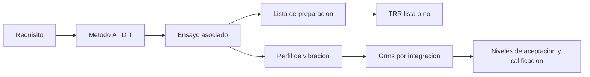

# B83-C14 — Revisiones CDR y TRR

<!-- nav:top -->
[🏠 Programa](../../../../README.md) · [📚 Bloque B83](../../../tronco-comun/B83-ingenieria-de-sistemas-y-diseno-de-misiones.md) · [← Anterior: B83-C13 — Revisiones SRR y PDR](../B83-C13-revisiones-srr-y-pdr/CLASE.md) · [Siguiente: B83-C15 — Gestión de configuración →](../B83-C15-gestion-de-configuracion/CLASE.md)
<!-- /nav -->

## 1. Ubicación, nivel y alcance

Clase 14 del bloque B83. Nivel N3. La **CDR** (revisión crítica de diseño) decide si el diseño está completo para fabricar; la **TRR** (revisión de preparación de ensayos) decide si cada ensayo puede ejecutarse con garantías. Aquí armas la matriz de verificación de ocho requisitos **sintéticos** con los cuatro métodos de NASA (análisis, inspección, demostración y ensayo, S3), evalúas la preparación de seis ensayos y calculas el nivel de una vibración aleatoria (Grms) con dos métodos. Las reglas de preparación y el perfil son de ejemplo.

## 2. Por qué esta clase existe

Un ensayo mal preparado destruye hardware o no demuestra nada. La decisión central: **¿cada requisito tiene un método asignado, y cada ensayo está listo (procedimiento, equipo, configuración, personal e instalación) y con un nivel de carga definido?**

## 3. Lo que podrás hacer al terminar

1. Construir una matriz de verificación con los métodos A, I, D y T.
2. Contar la cobertura de ensayo y los ensayos necesarios.
3. Evaluar la lista de preparación de cada ensayo y decidir la TRR.
4. Calcular el Grms de un perfil de vibración aleatoria con tramos log-log.
5. Distinguir los niveles de aceptación y calificación (+3 dB) y comprobar el factor √2.
6. Rotular lo sintético y lo no consultado.

La evidencia es la **informe de preparación de CDR/TRR y nivel de ensayo** del ejercicio 12 (sección 20).

## 4. Con qué llegas y cómo comprobarlo

1. ¿Qué es una densidad espectral de potencia (DSP)?
2. ¿Qué es el Grms?
3. ¿Qué significa +3 dB?
4. ¿Cuáles son los cuatro métodos de verificación?
5. ¿Qué es una prueba de calificación frente a una de aceptación?

<details>
<summary>Ver respuestas</summary>

1. La distribución de la potencia de una señal por frecuencia, aquí en g²/Hz. 2. El valor eficaz de la aceleración: raíz de la integral de la DSP. 3. Multiplicar la potencia por 2. 4. Análisis, inspección, demostración y ensayo. 5. La primera demuestra el diseño con márgenes; la segunda comprueba cada unidad de vuelo con niveles menores.
</details>

Con cuatro o cinco aciertos, sigue; si no, repasa los prerrequisitos.

## 5. Un caso de contexto y casos de referencia

La matriz de ESTRELLA-S (sintética) asigna 2 requisitos a análisis, 1 a inspección, 0 a demostración y 5 a ensayo (62,5 %); hacen falta 5 de los 6 ensayos definidos. Solo 3 ensayos están listos: la TRR no está lista. El perfil de vibración tiene 7,3560 g rms en aceptación y 10,4030 g rms en calificación (razón 1,4142). Solo 2 de 3 criterios de CDR del ejemplo se cumplen.

## 6. Vocabulario

La **matriz de verificación** asigna a cada requisito un método. La **CDR** revisa que el diseño esté completo (planos, análisis, compras). La **TRR** revisa la preparación de cada ensayo. La **vibración aleatoria** se describe con una DSP; el **Grms** es `√(∫ DSP df)`. Un tramo log-log con pendiente `s` se integra con `P₁f₁/(s+1)·[(f₂/f₁)^(s+1) − 1]` (o `P₁f₁ ln(f₂/f₁)` si `s = −1`). El nivel de **calificación** del ejemplo es el de aceptación más 3 dB.

## 7. Modelo mental: del requisito al ensayo listo



*Descripción textual:* cada requisito recibe un método; los de ensayo se asocian a un ensayo con su lista de preparación y su veredicto de TRR; si es de vibración, el perfil se integra para dar los niveles de carga.

Analogía: el ensayo general de una obra antes del estreno: se comprueba que cada actor, el vestuario y la sala estén listos. Límite: el ensayo de un satélite puede destruir la unidad, de modo que no se repite a voluntad.

## 8. La explicación, paso a paso

### 8.1 Matriz y cobertura

Cada requisito de C05 recibe un método: R01, R02, R04, R06 y R08 por ensayo; R03 y R05 por análisis; R07 por inspección. Se necesitan 5 ensayos (E1–E5); E6 está definido pero ningún requisito lo usa y debe justificarse o eliminarse (diseño de pruebas sin requisito).

### 8.2 Preparación de ensayos

Cada ensayo exige cinco condiciones: procedimiento aprobado, equipo calibrado, configuración congelada, personal capacitado e instalación lista. Están listos 3 de 6: E3 no tiene el equipo calibrado, E4 no tiene la configuración congelada y E6 carece de personal e instalación. La TRR de los ensayos requeridos no está lista hasta resolver E3 y E4.

### 8.3 Nivel de vibración

Con los tramos de 20 a 50 Hz (+), 50 a 800 Hz (plano) y 800 a 2000 Hz (−), el Grms de aceptación es 7,3560 g (unos 72,1 m/s² rms). El nivel de calificación duplica la DSP (+3 dB): 10,4030 g, razón `√2 = 1,4142`. La integración numérica coincide con la fórmula analítica (7,3560 g). Las dosis `g²·s` por eje son 3247 (60 s de aceptación) y 12987 (120 s de calificación).

## 9. Magnitudes, símbolos y unidades

| Símbolo | Qué es | Unidad | Valor / nota |
|---|---|---|---|
| `DSP` | densidad espectral de potencia | g²/Hz | 0,01–0,04 |
| `Grms` | aceleración eficaz | g | 7,3560 (aceptación) |
| `Grms_q` | nivel de calificación | g | 10,4030 |
| `dosis` | `Grms²·t` por eje | g²·s | 3247 / 12987 |
| `n_T` | requisitos por ensayo | — | 5 |

## 10. Convenciones y referencias

`g = 9,80665 m/s²` (NASA/NSSDC, S8) solo para convertir a m/s²; los métodos A/I/D/T de S3. Perfil de vibración, duraciones, factor de +3 dB y listas de preparación **sintéticos** (no son de una norma ni de un lanzador). Tolerancias: Grms analítico y numérico a `10⁻⁴` relativo; `√2` exacto.

## 11. De dónde sale lo que afirmamos

| ID | Fuente | Localizador | Respalda | Estado |
|---|---|---|---|---|
| S3 | NASA, *Systems Engineering Handbook*, 5.3 Product Verification — https://www.nasa.gov/reference/5-3-product-verification/ (consultada 2026-11-10; solo las primeras 100 000 caracteres) | sección 5.3.1.2, métodos de verificación | los cuatro métodos de verificación (análisis, demostración, inspección y ensayo) | Consultada |
| S2 | NASA, *Systems Engineering Handbook*, 6.0 Crosscutting Technical Management — https://www.nasa.gov/reference/6-0-crosscutting-technical-management/ (consultada 2026-11-10; solo las primeras 100 000 caracteres de la página) | 6.1.1.2.4, plan de verificación | el plan de verificación se fija como línea base en la PDR y se actualiza al madurar el diseño | Consultada |
| S8 | NASA/NSSDC, Earth Fact Sheet — https://nssdc.gsfc.nasa.gov/planetary/factsheet/earthfact.html (consultada 2026-11-10) | ficha de la Tierra, gravedad estándar | gravedad estándar 9,80665 m/s² | Consultada |
| ECSS | ECSS-E-ST-10C, ECSS-M-ST-40C, ECSS-Q-ST-30-02C, ECSS-Q-ST-40-12C y demás estándares (ecss.nl) | — | — | No consultada: la página de estándares no mostró los documentos |
| — | ISO/IEC/IEEE 15288, INCOSE, SysML, MIL-STD-1629, IEC 60812 e IEC 61025 | — | — | No consultada |
| — | Relaciones matemáticas estándar usadas en el laboratorio (AHP, rutas críticas, ley de Stefan, confiabilidad exponencial, cortes mínimos, ecuación del cohete) | — | — | No consultada en una fuente concreta: las verifica el laboratorio por una segunda vía |

Límites: no se consultó la definición de CDR ni de TRR del manual (no estaban en el texto leído), ni normas de ensayo de vibración de un lanzador; los niveles y duraciones son de ejemplo.

## 12. Cómo ver la preparación

| Magnitud | Valor |
|---|---|
| Métodos A / I / D / T | 2 / 1 / 0 / 5 |
| Ensayos listos | 3 de 6 |
| Grms aceptación / calificación | 7,3560 / 10,4030 g |
| Dosis aceptación / calificación | 3247 / 12987 g²·s |
| CDR del ejemplo | 2 de 3 |

Descripción larga: la preparación falla por detalles logísticos (calibración y configuración), no por el diseño; son los fallos típicos que una TRR sirve para detectar.

## 13. Ejemplo trabajado: el Grms del tramo plano

**Paso 1 · Tramo.** 50 a 800 Hz con DSP de 0,04 g²/Hz, pendiente `s = 0`.

**Paso 2 · Área.** `0,04 × (800 − 50) = 30 g²`.

**Paso 3 · Todo el perfil.** Suma de los tres tramos: `Grms² = 7,3560² = 54,11 g²`.

**Paso 4 · Calificación.** `× 2 → 10,4030 g`.

## 14. Distintas formas de abordar el problema

**Analítica por tramos log-log** (esta clase). **Numérica por trapecios** (segunda vía). **Medición con un sistema de vibración** (la prueba real; no calculable aquí). Para ensayos, el nivel nunca se fija por cálculo solo: se toma del requisito del lanzador.

## 15. Práctica guiada

**Ejercicio 1 · con los pasos indicados.** Calcula el área de un tramo plano de 0,02 g²/Hz entre 100 y 500 Hz. *Pasos:* DSP por ancho.

<details><summary>Solución comentada</summary>

`0,02×400 = 8 g²`.
</details>

**Ejercicio 2 · con una pista.** ¿Cuál es el Grms de un área total de 25 g²? *Pista:* raíz cuadrada.

<details><summary>Solución comentada</summary>

`5 g`.
</details>

**Ejercicio 3 · casi autónomo.** ¿Cuánto vale +6 dB en DSP?

<details><summary>Solución comentada</summary>

Factor 4 en potencia y 2 en Grms.
</details>

## 16. Práctica autónoma, transferencia e integrador

**Ejercicio 4 · autónomo.** ¿Por qué E6 es un problema aunque esté sin preparar?

<details><summary>Solución comentada</summary>

Porque ningún requisito lo exige: es una prueba sin requisito (o falta un requisito).
</details>

**Ejercicio 5 · autónomo.** Con 3 de 6 ensayos listos, ¿qué fracción es?

<details><summary>Solución comentada</summary>

50 %.
</details>

**Ejercicio 6 · autónomo.** Explica por qué una TRR revisa el equipo calibrado.

<details><summary>Solución comentada</summary>

Porque un instrumento sin calibrar invalida los datos del ensayo.
</details>

**Ejercicio 7 · autónomo.** ¿Qué método asignarías a «masa ≤ 80 kg» y por qué?

<details><summary>Solución comentada</summary>

Ensayo (pesaje) en hardware real; análisis del presupuesto antes (C09).
</details>

**Ejercicio 8 · autónomo.** ¿Por qué el nivel de calificación supera al de aceptación?

<details><summary>Solución comentada</summary>

Para demostrar el diseño con margen sin consumir vida útil de las unidades de vuelo.
</details>

**Ejercicio 9 · transferencia.** **Transferencia.** Un colega usa 7,3560 g como el nivel de vibración de un lanzador real. ¿Es válido?

<details><summary>Solución comentada</summary>

No: el perfil es de ejemplo; el nivel lo fija el lanzador.
</details>

**Ejercicio 10 · transferencia.** **Transferencia.** ¿Qué ocurre con la TRR si cambia la configuración después de congelarla?

<details><summary>Solución comentada</summary>

Hay que repetir la revisión de esa condición (C15) y registrar el cambio.
</details>

**Ejercicio 11 · transferencia.** **Transferencia.** ¿Qué criterio añadirías a la CDR sobre interfaces?

<details><summary>Solución comentada</summary>

Todas las interfaces verificadas y los ICD en línea base.
</details>

**Ejercicio 12 · integrador.** **Integrador.** Elabora tu *informe de preparación de CDR/TRR*: matriz de verificación, estado de los ensayos, Grms por dos vías y pendientes, con lista de qué es sintético.

<details><summary>Solución comentada</summary>

Secciones 8.1–8.3, el ejemplo 13 y la salida del laboratorio.
</details>

## 17. Laboratorio: cobertura de verificación, preparación de ensayos y Grms

El script [preparacion_cdr_trr.py](preparacion_cdr_trr.py) cuenta los métodos de verificación, evalúa la preparación de seis ensayos y calcula el Grms por fórmula analítica y por integración numérica (**comprueba** que ambas coinciden a `10⁻⁴`, que +3 dB multiplica el Grms por `√2` y que cada requisito tiene un método). Usa la biblioteca común [sistemas_comun.py](../sistemas_comun.py) del bloque.

**Datos:** `g` de NASA/NSSDC (consultada el 2026-11-10); matriz, ensayos, perfil y duraciones **sintéticos**. **Predice antes de ejecutar:** ¿cuántos ensayos están listos para la TRR? (tres de seis.) **Ejecución del 2026-11-10 (Python 3.12.9 | numpy 2.4.4):**

```text
Python 3.12.9 | numpy 2.4.4
Datos SINTETICOS: 8 requisitos, 6 ensayos, perfil de vibracion de ejemplo; metodos A/I/D/T segun S3; g = 9.80665 m/s2 (NASA/NSSDC)
Metodos de verificacion: analisis 2, inspeccion 1, demostracion 0, ensayo 5 (62.5 % por ensayo)
Ensayos necesarios para los requisitos: 5 de 6 definidos
  E1: LISTO ; falta: -
  E2: LISTO ; falta: -
  E3: NO LISTO ; falta: equipo calibrado
  E4: NO LISTO ; falta: configuracion
  E5: LISTO ; falta: -
  E6: NO LISTO ; falta: personal, instalacion
Ensayos listos: 3 de 6 ; TRR de los ensayos requeridos: NO LISTA
Grms de aceptacion = 7.3560 g (72.138 m/s2 rms) ; calificacion (+3 dB) = 10.4030 g ; razon = 1.4142
Grms por integracion numerica = 7.3560 g ; diferencia relativa = 1.65e-11
Dosis g2*s por eje: aceptacion 60 s = 3246.65 ; calificacion 120 s = 12986.58
Criterios de CDR de ejemplo cumplidos: 2 de 3
Pruebas superadas.
```

```bash
python programa/clases/B83/B83-C14-revisiones-cdr-y-trr/preparacion_cdr_trr.py
```

**Límites:** un solo perfil de vibración y un solo eje; sin respuesta estructural; listas de preparación binarias; sin norma de ensayo.

## 18. Errores frecuentes y cómo corregirlos

**Asignar «ensayo» a todo.** Elige el método más económico que demuestra el requisito

**Confundir aceptación con calificación.** La calificación demuestra el diseño; la aceptación, la unidad

**Convocar la TRR sin la lista.** Verifica las cinco condiciones

## 19. Cómo sabrás que vas bien

Tras 8.2: ¿qué ensayos esperabas listos? Tras 8.3: ¿por qué `√2`? Si dudas, repasa el ejemplo 13.

## 20. Qué entregas y cómo se evalúa

El producto es tu **informe de preparación de CDR/TRR y nivel de ensayo** (ejercicio 12).

| Criterio | Inicial | En desarrollo | Logrado | Destacado |
|---|---|---|---|---|
| Conceptos | Los confunde | Parciales | Explica el método y su dominio | Explica los límites y las alternativas |
| Cálculo | Sin unidades | Con errores | Resultados con unidades y comprobados | Resuelve casos nuevos |
| Numérico | Sin comprobar | Un caso | Verifica por una segunda vía en varios casos | Interpreta las diferencias y los fallos |
| Fuentes | Sin fuente | Sin fecha | Fuentes con fecha y estado | Declara lo sintético y lo no consultado |
| Límites | No los nombra | Uno | Tres | Discute qué falta del modelo |

**Condiciones críticas (no se compensan con promedio):** rotular los datos como sintéticos; verificar el resultado por una segunda vía; citar solo lo consultado.

## 21. Ética, seguridad y límites

Clase educativa: los modelos son simplificados y los datos son sintéticos; ningún resultado describe una misión real, certifica una seguridad ni sustituye a los estándares vigentes y a la revisión de especialistas.  Accesibilidad: tablas equivalentes a las gráficas, fórmulas en texto, ejercicios sin conexión.

## 22. Para cerrar y seguir

La TRR de ESTRELLA-S (sintética) no está lista (3 de 6 ensayos) y el perfil de vibración da 7,3560 g de aceptación. Queda una pregunta: ¿cómo se controla qué configuración se ensaya? (C15).

**Glosario español–inglés.** revisión crítica de diseño · *critical design review*; revisión de preparación de ensayos · *test readiness review*; densidad espectral de potencia · *power spectral density*; matriz de verificación · *verification matrix*; calificación · *qualification*.

**Continuidad.** [B83-C15](../B83-C15-gestion-de-configuracion/CLASE.md) trata cómo se controla la configuración de lo que se ensaya.

**Referencias:** ver sección 11.

<!-- nav:bottom -->
---

[← Anterior: B83-C13 — Revisiones SRR y PDR](../B83-C13-revisiones-srr-y-pdr/CLASE.md) · [📚 Bloque B83](../../../tronco-comun/B83-ingenieria-de-sistemas-y-diseno-de-misiones.md) · [Siguiente: B83-C15 — Gestión de configuración →](../B83-C15-gestion-de-configuracion/CLASE.md)
<!-- /nav -->
