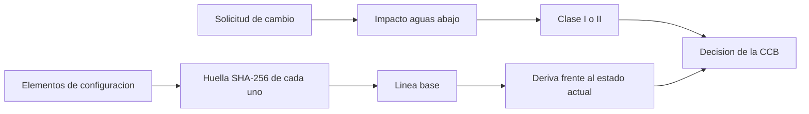

# B83-C15 — Gestión de configuración

<!-- nav:top -->
[🏠 Programa](../../../../README.md) · [📚 Bloque B83](../../../tronco-comun/B83-ingenieria-de-sistemas-y-diseno-de-misiones.md) · [← Anterior: B83-C14 — Revisiones CDR y TRR](../B83-C14-revisiones-cdr-y-trr/CLASE.md) · [Siguiente: B83-C16 — Gestión de riesgos técnicos →](../../../tronco-comun/B83-ingenieria-de-sistemas-y-diseno-de-misiones.md#b83-c16)
<!-- /nav -->

## 1. Ubicación, nivel y alcance

Clase 15 del bloque B83. Nivel N3. La **gestión de configuración** identifica qué elementos componen el sistema, congela su versión en **líneas base**, controla los cambios y registra el estado. El manual de NASA (S2) la justifica así: un cambio de diseño o de entorno puede invalidar análisis previos, por lo que los análisis y los productos de planificación (WBS, SEMP) se mantienen bajo control de configuración y los cambios a requisitos se aprueban por una junta de control de configuración (CCB) o autoridad equivalente. Aquí construyes una línea base con huellas SHA-256 sobre seis elementos **sintéticos**, detectas una deriva y clasificas dos solicitudes de cambio.

## 2. Por qué esta clase existe

Si nadie sabe qué versión de qué documento se ensayó, no se puede demostrar nada. La decisión central: **¿la configuración actual es la aprobada, y qué se afecta si apruebo este cambio?**

## 3. Lo que podrás hacer al terminar

1. Definir un elemento de configuración y una línea base.
2. Calcular una huella SHA-256 por elemento y para toda la línea base.
3. Detectar la deriva comparando la configuración actual con la línea base.
4. Calcular el impacto de una solicitud de cambio con el grafo de dependencias.
5. Clasificar el cambio con una regla explícita y decidir si va a la CCB.
6. Rotular que los elementos son sintéticos y que la regla de clase es de ejemplo.

La evidencia es la **registro de línea base con huella y control de cambios** del ejercicio 12 (sección 20).

## 4. Con qué llegas y cómo comprobarlo

1. ¿Qué es una función hash?
2. ¿Qué es una línea base?
3. ¿Qué es una CCB?
4. ¿Qué es una dependencia entre elementos?
5. ¿Qué es una deriva?

<details>
<summary>Ver respuestas</summary>

1. Una función que convierte un contenido en una huella de longitud fija; un cambio mínimo cambia la huella. 2. Un conjunto de elementos con versión aprobada que solo cambia por control formal. 3. La junta que aprueba o rechaza cambios a la línea base. 4. Una relación en que un elemento se apoya en otro (C05). 5. Una diferencia no autorizada respecto de la línea base.
</details>

Con cuatro o cinco aciertos, sigue; si no, repasa los prerrequisitos.

## 5. Un caso de contexto y casos de referencia

ESTRELLA-S (sintética) tiene 6 elementos de configuración y una línea base con huella `c4bbd14a0918…`. Un ingeniero modifica la estructura sin aprobación: la huella pasa a `7bc98aa36dae…` y la deriva se detecta solo en CAD-STRUCT. La solicitud CR-01 (cambiar los requisitos) afecta a 4 elementos y es de clase **I**; la CR-02 (cambiar la estructura) afecta a 1 y es de clase **II**.

## 6. Vocabulario

Un **elemento de configuración** (CI) es un producto bajo control (documento, plano, software). Una **línea base** es un conjunto aprobado de CI con versión. La **huella** (*hash*) resume el contenido. La **deriva** es una diferencia sin aprobación. Una **solicitud de cambio** (CR) propone un cambio; la **CCB** la decide tras un análisis de impacto. La **clase** de un cambio (regla del ejemplo): I si afecta a tres o más elementos o a una interfaz; II en otro caso.

## 7. Modelo mental: de los elementos a una línea base controlada



*Descripción textual:* los elementos se resumen con huellas y forman la línea base; la comparación con el estado actual detecta deriva; una solicitud de cambio genera un impacto y una clase que la CCB decide.

Analogía: el sello de cera de un documento notarial: si el sello cambia, alguien lo abrió. Límite: la huella dice que algo cambió, no si el cambio es bueno.

## 8. La explicación, paso a paso

### 8.1 Huellas y línea base

Cada elemento tiene versión y contenido; su huella SHA-256 resume ese contenido. La huella de la línea base se calcula sobre la lista ordenada de `(nombre, versión, huella)`: `c4bbd14a0918…`. Cambiar cualquier carácter de cualquier elemento cambia la huella final; una segunda serialización (JSON) da el mismo valor.

### 8.2 Deriva

Tras editar CAD-STRUCT sin aprobación (versión 0.10, 14,6 kg), la huella de la línea base pasa a `7bc98aa36dae…`. La comparación por huella y la comparación directa de textos señalan el mismo elemento. Una deriva no es necesariamente un error, pero sí un cambio sin registro: debe regularizarse por una CR o revertirse.

### 8.3 Impacto y clase

Con las dependencias (ICD y plan de ensayos dependen de los requisitos, el software depende del ICD, el presupuesto de masa depende de la estructura y los requisitos), CR-01 afecta a 4 elementos: clase I, va a la CCB. CR-02 afecta a 1 elemento: clase II, puede resolverse con aprobación del responsable y aviso a la CCB. La regla es de ejemplo.

## 9. Magnitudes, símbolos y unidades

| Símbolo | Qué es | Unidad | Valor / nota |
|---|---|---|---|
| `n` | elementos de configuración | — | 6 |
| `H_base` | huella de la línea base | — | `c4bbd14a0918…` |
| `H_actual` | huella con la deriva | — | `7bc98aa36dae…` |
| `I(CR-01)` | elementos afectados | — | 4 |
| `clase` | I o II | — | I / II |

## 10. Convenciones y referencias

SHA-256 de la biblioteca estándar `hashlib`. Sin constantes físicas ni sistema de referencia. Elementos, versiones, contenidos y dependencias **sintéticos**. Regla de clase de cambio **de ejemplo**. Principios de S2 solo como contexto. Tolerancia: la huella de la línea base por dos serializaciones es idéntica.

## 11. De dónde sale lo que afirmamos

| ID | Fuente | Localizador | Respalda | Estado |
|---|---|---|---|---|
| S2 | NASA, *Systems Engineering Handbook*, 6.0 Crosscutting Technical Management — https://www.nasa.gov/reference/6-0-crosscutting-technical-management/ (consultada 2026-11-10; solo las primeras 100 000 caracteres de la página) | 6.2.1.2.4; sección de gestión de configuración (6.5) | el control de configuración evita que cambios invaliden análisis previos; tras SRR los requisitos pasan a control formal con aprobación de una CCB o equivalente; los productos de planificación se mantienen bajo control | Consultada |
| ECSS | ECSS-E-ST-10C, ECSS-M-ST-40C, ECSS-Q-ST-30-02C, ECSS-Q-ST-40-12C y demás estándares (ecss.nl) | — | — | No consultada: la página de estándares no mostró los documentos |
| — | ISO/IEC/IEEE 15288, INCOSE, SysML, MIL-STD-1629, IEC 60812 e IEC 61025 | — | — | No consultada |
| — | Relaciones matemáticas estándar usadas en el laboratorio (AHP, rutas críticas, ley de Stefan, confiabilidad exponencial, cortes mínimos, ecuación del cohete) | — | — | No consultada en una fuente concreta: las verifica el laboratorio por una segunda vía |

Límites: solo se leyó la parte inicial de la página 6.0; no se consultó el detalle de 6.5 ni ECSS-M-ST-40C; las clases de cambio son de ejemplo.

## 12. Cómo ver el control de cambios

| Magnitud | Valor |
|---|---|
| Elementos | 6 |
| Huella de la línea base | `c4bbd14a0918…` |
| Huella tras la deriva | `7bc98aa36dae…` |
| Impacto de CR-01 | 4 (clase I) |
| Impacto de CR-02 | 1 (clase II) |

Descripción larga: un cambio pequeño en el contenido produce una huella totalmente distinta, lo que permite detectar derivas sin leer el contenido.

## 13. Ejemplo trabajado: detectar la deriva de CAD-STRUCT

**Paso 1 · Base.** Línea base con `CAD-STRUCT v0.9`.

**Paso 2 · Edición.** Se cambia a `v0.10` con 14,6 kg sin CR.

**Paso 3 · Huella.** La huella del elemento cambia y con ella la de la línea base.

**Paso 4 · Acción.** Abrir una CR retroactiva o revertir; el impacto es solo MASS-BUDGET.

## 14. Distintas formas de abordar el problema

**Por huellas criptográficas** (esta clase). **Por sistemas de control de versiones** (p. ej., Git): cada confirmación tiene su huella. **Por auditorías de configuración:** inspección humana de lo construido frente a lo aprobado. Se combinan.

## 15. Práctica guiada

**Ejercicio 1 · con los pasos indicados.** Si 4 de 6 elementos dependen de los requisitos, ¿qué clase tiene un cambio de requisitos con la regla del ejemplo? *Pasos:* cuenta.

<details><summary>Solución comentada</summary>

Clase I (afecta a 3 o más).
</details>

**Ejercicio 2 · con una pista.** ¿Qué le pasa a la huella si se cambia una coma en un elemento? *Pista:* propiedad de la función hash.

<details><summary>Solución comentada</summary>

Cambia por completo.
</details>

**Ejercicio 3 · casi autónomo.** ¿Por qué la lista se ordena antes de calcular la huella de la línea base?

<details><summary>Solución comentada</summary>

Para que no dependa del orden de enumeración.
</details>

## 16. Práctica autónoma, transferencia e integrador

**Ejercicio 4 · autónomo.** ¿Qué elementos cuelgan del ICD en el grafo?

<details><summary>Solución comentada</summary>

SW-OBC y TEST-PLAN.
</details>

**Ejercicio 5 · autónomo.** Si CR-03 cambia SW-OBC, ¿cuántos elementos afecta?

<details><summary>Solución comentada</summary>

Ninguno más (es una hoja): clase II.
</details>

**Ejercicio 6 · autónomo.** Explica por qué una deriva puede ser benigna y aun así no aceptable.

<details><summary>Solución comentada</summary>

Porque el cambio no tiene registro ni análisis de impacto.
</details>

**Ejercicio 7 · autónomo.** ¿Por qué conviene que los análisis estén bajo configuración?

<details><summary>Solución comentada</summary>

Porque un cambio de diseño puede invalidarlos (S2).
</details>

**Ejercicio 8 · autónomo.** ¿Qué hace la CCB con una CR de clase I?

<details><summary>Solución comentada</summary>

Evalúa el impacto, decide aprobar o rechazar y registra la decisión.
</details>

**Ejercicio 9 · transferencia.** **Transferencia.** Un colega usa las huellas como prueba de que el diseño es correcto. ¿Es válido?

<details><summary>Solución comentada</summary>

No: prueban identidad, no corrección.
</details>

**Ejercicio 10 · transferencia.** **Transferencia.** ¿Cómo se relaciona la línea base con una TRR (C14)?

<details><summary>Solución comentada</summary>

La TRR ensaya una configuración congelada; si cambia, se repite la condición.
</details>

**Ejercicio 11 · transferencia.** **Transferencia.** ¿Qué elemento añadirías a la configuración para el modo seguro?

<details><summary>Solución comentada</summary>

La base de datos de comandos y telemetría (C19) con su versión.
</details>

**Ejercicio 12 · integrador.** **Integrador.** Elabora tu *registro de línea base con huella y control de cambios*: elementos, huellas, deriva, CR con impacto y clase, con lista de qué es sintético.

<details><summary>Solución comentada</summary>

Secciones 8.1–8.3, el ejemplo 13 y la salida del laboratorio.
</details>

## 17. Laboratorio: línea base con huella, deriva y control de cambios

El script [linea_base.py](linea_base.py) calcula huellas SHA-256, la línea base y su huella por dos serializaciones, detecta la deriva y clasifica dos solicitudes de cambio (**comprueba** que las dos serializaciones dan la misma huella, que la deriva se detecta solo en CAD-STRUCT y que la huella cambia). Usa la biblioteca común [sistemas_comun.py](../sistemas_comun.py) del bloque.

**Datos:** elementos, versiones, contenidos y dependencias **sintéticos**; SHA-256 de `hashlib`. **Predice antes de ejecutar:** ¿cuántos elementos afecta cambiar los requisitos? (cuatro.) **Ejecución del 2026-11-10 (Python 3.12.9 | numpy 2.4.4):**

```text
Python 3.12.9 | numpy 2.4.4
Datos SINTETICOS: 6 elementos de configuracion; SHA-256 (hashlib)
  CAD-STRUCT   v0.9   a5b3a7c67f88108c
  ICD          v1.0   9272515afc651a1e
  MASS-BUDGET  v2.1   44b081df637ac3d8
  REQ-DOC      v1.2   3e4ad806a2f9e0c0
  SW-OBC       v0.3   74071e02bedc8475
  TEST-PLAN    v0.1   c8826f9df7126cc5
Huella de la linea base = c4bbd14a0918... ; por segunda serializacion = c4bbd14a0918...
Tras editar CAD-STRUCT sin aprobacion: huella = 7bc98aa36dae... ; distinta de la base: True ; deriva detectada en ['CAD-STRUCT'] (comparacion directa: ['CAD-STRUCT'])
CR-01 (cambiar REQ-DOC): afecta a 4 -> ['ICD', 'MASS-BUDGET', 'SW-OBC', 'TEST-PLAN'] ; clase I
CR-02 (cambiar CAD-STRUCT): afecta a 1 -> ['MASS-BUDGET'] ; clase II
Pruebas superadas.
```

```bash
python programa/clases/B83/B83-C15-gestion-de-configuracion/linea_base.py
```

**Límites:** seis elementos; sin ramas ni fusiones; clase de cambio con una regla simple; no hay firma ni control de acceso.

## 18. Errores frecuentes y cómo corregirlos

**Cambiar sin CR.** Registra cada cambio con su impacto

**No ordenar los elementos al calcular la huella.** Ordena siempre

**Confundir versión con huella.** La versión es una etiqueta; la huella es el contenido

## 19. Cómo sabrás que vas bien

Tras 8.2: ¿qué elemento esperabas con deriva? Tras 8.3: ¿qué clase tiene cada CR? Si dudas, repasa el ejemplo 13.

## 20. Qué entregas y cómo se evalúa

El producto es tu **registro de línea base con huella y control de cambios** (ejercicio 12).

| Criterio | Inicial | En desarrollo | Logrado | Destacado |
|---|---|---|---|---|
| Conceptos | Los confunde | Parciales | Explica el método y su dominio | Explica los límites y las alternativas |
| Cálculo | Sin unidades | Con errores | Resultados con unidades y comprobados | Resuelve casos nuevos |
| Numérico | Sin comprobar | Un caso | Verifica por una segunda vía en varios casos | Interpreta las diferencias y los fallos |
| Fuentes | Sin fuente | Sin fecha | Fuentes con fecha y estado | Declara lo sintético y lo no consultado |
| Límites | No los nombra | Uno | Tres | Discute qué falta del modelo |

**Condiciones críticas (no se compensan con promedio):** rotular los datos como sintéticos; verificar el resultado por una segunda vía; citar solo lo consultado.

## 21. Ética, seguridad y límites

Clase educativa: los modelos son simplificados y los datos son sintéticos; ningún resultado describe una misión real, certifica una seguridad ni sustituye a los estándares vigentes y a la revisión de especialistas.  Accesibilidad: tablas equivalentes a las gráficas, fórmulas en texto, ejercicios sin conexión.

## 22. Para cerrar y seguir

La línea base de ESTRELLA-S (sintética) detecta la deriva de la estructura y clasifica CR-01 como clase I y CR-02 como clase II. Queda una pregunta: ¿qué riesgos amenazan al proyecto y cómo se priorizan? (C16).

**Glosario español–inglés.** gestión de configuración · *configuration management*; línea base · *baseline*; junta de control de configuración · *configuration control board*; deriva · *drift*; huella · *hash*.

**Continuidad.** [B83-C16](../B83-C16-gestion-de-riesgos-tecnicos/CLASE.md) registra y prioriza los riesgos técnicos.

**Referencias:** ver sección 11.

<!-- nav:bottom -->
---

[← Anterior: B83-C14 — Revisiones CDR y TRR](../B83-C14-revisiones-cdr-y-trr/CLASE.md) · [📚 Bloque B83](../../../tronco-comun/B83-ingenieria-de-sistemas-y-diseno-de-misiones.md) · [Siguiente: B83-C16 — Gestión de riesgos técnicos →](../../../tronco-comun/B83-ingenieria-de-sistemas-y-diseno-de-misiones.md#b83-c16)
<!-- /nav -->
