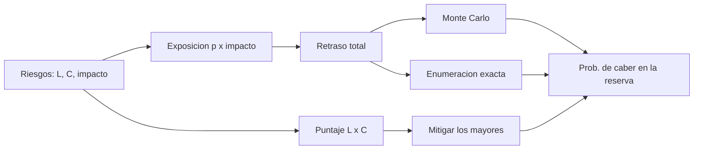

# B83-C16 — Gestión de riesgos técnicos

<!-- nav:top -->
[🏠 Programa](../../../../README.md) · [📚 Bloque B83](../../../tronco-comun/B83-ingenieria-de-sistemas-y-diseno-de-misiones.md) · [← Anterior: B83-C15 — Gestión de configuración](../B83-C15-gestion-de-configuracion/CLASE.md) · [Siguiente: B83-C17 — Verificación frente a validación →](../B83-C17-verificacion-frente-a-validacion/CLASE.md)
<!-- /nav -->

## 1. Ubicación, nivel y alcance

Clase 16 del bloque B83. Nivel N3. El manual de NASA (S4) define el riesgo como la posibilidad de futuros incumplimientos de requisitos de seguridad, técnicos, de costo o de calendario, caracterizado por un «triplete» de escenarios, verosimilitudes y consecuencias, con incertidumbre en ambas. Aquí armas un registro de diez riesgos **sintéticos** de ESTRELLA-S con matriz 5×5, calculas la exposición esperada y simulas si la reserva de calendario alcanza, por dos vías (Monte Carlo y enumeración exacta). Las probabilidades por nivel, los umbrales y los retrasos son de ejemplo.

## 2. Por qué esta clase existe

Una lista de riesgos sin números no dice cuánta reserva hace falta ni qué mitigar primero. La decisión central: **¿qué riesgos mitigar primero y alcanza la reserva de calendario para los que no se mitiguen?**

## 3. Lo que podrás hacer al terminar

1. Redactar un riesgo como escenario, verosimilitud y consecuencia.
2. Calcular el puntaje L×C y clasificarlo en alto, medio o bajo con una convención explícita.
3. Calcular la exposición esperada probabilidad × impacto.
4. Simular el retraso total por Monte Carlo y verificarlo por enumeración exacta.
5. Medir el efecto de mitigar los tres mayores puntajes.
6. Rotular que probabilidades, umbrales e impactos son sintéticos.

La evidencia es la **registro de riesgos técnicos con exposición y simulación** del ejercicio 12 (sección 20).

## 4. Con qué llegas y cómo comprobarlo

1. ¿Qué es una matriz de riesgo 5×5?
2. ¿Qué es una variable de Bernoulli?
3. ¿Qué es una esperanza?
4. ¿Qué es una reserva?
5. ¿Qué es una mitigación?

<details>
<summary>Ver respuestas</summary>

1. Una tabla de verosimilitud (1–5) por consecuencia (1–5). 2. Un suceso que ocurre con probabilidad `p` o no ocurre. 3. El promedio ponderado de los resultados posibles. 4. Tiempo, masa o dinero guardado para absorber lo imprevisto. 5. Una acción que baja la verosimilitud o la consecuencia.
</details>

Con cuatro o cinco aciertos, sigue; si no, repasa los prerrequisitos.

## 5. Un caso de contexto y casos de referencia

El registro sintético tiene 2 riesgos altos, 5 medios y 3 bajos; la exposición esperada total es 89,35 días y el mayor aporte es el de K1 (22,50 días). La reserva es de 60 días: el retraso simulado tiene media de 89,20 días, percentil 90 de 155 días y una probabilidad de caber en la reserva de 30,13 % (exacta) frente a 30,27 % (Monte Carlo). Mitigando K1, K3 y K2 sube a 48,80 %.

## 6. Vocabulario

Un **riesgo** es un escenario con verosimilitud (L, 1–5) y consecuencia (C, 1–5). El **puntaje** `L×C` se clasifica (en el ejemplo: alto ≥ 15, medio 8–14, bajo < 8). La **exposición esperada** es `p×impacto`. La **reserva** absorbe retrasos. Una **simulación de Monte Carlo** muestrea qué riesgos ocurren; la **enumeración exacta** suma las probabilidades de los 2¹⁰ casos. Las respuestas típicas son aceptar, mitigar, vigilar o investigar más (el manual S4 no las lista en la parte consultada).

## 7. Modelo mental: del registro a la reserva



*Descripción textual:* cada riesgo da un puntaje y una exposición; sumados definen el retraso total, que se estudia por Monte Carlo y por enumeración exacta; la probabilidad de caber en la reserva se mejora mitigando los mayores puntajes.

Analogía: el seguro de un viaje: cada imprevisto tiene probabilidad y costo, y la reserva es el dinero guardado. Límite: los imprevistos de un proyecto se correlacionan (un retraso arrastra a otro); aquí se suponen independientes.

## 8. La explicación, paso a paso

### 8.1 Registro y matriz

Cada riesgo tiene `L`, `C`, probabilidad asociada al nivel (0,05; 0,15; 0,30; 0,50; 0,70) y un retraso en días. K1 (proveedor de la cámara, L4 C4) y K3 (detector con TRL bajo, L3 C5) son los altos, con 16 y 15 puntos. Hay 5 medios y 3 bajos.

### 8.2 Exposición y reserva

La exposición esperada es `Σ p·d = 89,35` días, mayor que la reserva de 60 días: en media la reserva no alcanza. La simulación da una media de 89,20 días y un P90 de 155 días (el máximo posible, si todo ocurriera, es 312 días). La probabilidad de que el retraso no supere la reserva es 30,13 % por enumeración exacta y 30,27 % por Monte Carlo.

### 8.3 Mitigar los mayores

Bajar un nivel la verosimilitud de K1, K3 y K2 eleva la probabilidad de cumplir la reserva a 48,80 %. Aun así hay más de la mitad de casos en que la reserva no alcanza: el equipo debe aumentar la reserva, mitigar más o aceptar el riesgo con una decisión registrada.

## 9. Magnitudes, símbolos y unidades

| Símbolo | Qué es | Unidad | Valor / nota |
|---|---|---|---|
| `L`, `C` | verosimilitud y consecuencia | 1–5 | sintético |
| `p` | probabilidad por nivel | — | 0,05–0,70 |
| `E` | exposición esperada | d | 89,35 (total) |
| `R` | reserva de calendario | d | 60 |
| `P(≤R)` | prob. de caber en la reserva | % | 30,13 |
| `P(≤R)'` | tras mitigar | % | 48,80 |

## 10. Convenciones y referencias

Sin constantes físicas ni sistema de referencia. Riesgos, probabilidades por nivel, umbrales del puntaje, retrasos y reserva **sintéticos**. Definición de riesgo y de gestión técnica de S4. Independencia entre riesgos (supuesto). Monte Carlo: 100 000 muestras, semilla 83016; enumeración exacta de 1024 casos. Tolerancia: las dos vías de `P(≤R)` difieren menos de 0,01 (1 punto porcentual).

## 11. De dónde sale lo que afirmamos

| ID | Fuente | Localizador | Respalda | Estado |
|---|---|---|---|---|
| S4 | NASA, *Systems Engineering Handbook*, 6.4 Technical Risk Management — https://www.nasa.gov/reference/6-4-technical-risk-management/ (consultada 2026-11-10) | 6.4, conceptos clave y 6.4.1.2.2 | el riesgo es la posibilidad de incumplir requisitos de seguridad, técnicos, de costo o de calendario, descrito por un triplete de escenarios, verosimilitudes y consecuencias; los equipos identifican riesgos y preparan declaraciones de riesgo; se refiere a los manuales NASA/SP-2011-3422 y NASA/SP-2010-576 | Consultada |
| ECSS | ECSS-E-ST-10C, ECSS-M-ST-40C, ECSS-Q-ST-30-02C, ECSS-Q-ST-40-12C y demás estándares (ecss.nl) | — | — | No consultada: la página de estándares no mostró los documentos |
| — | ISO/IEC/IEEE 15288, INCOSE, SysML, MIL-STD-1629, IEC 60812 e IEC 61025 | — | — | No consultada |
| — | Relaciones matemáticas estándar usadas en el laboratorio (AHP, rutas críticas, ley de Stefan, confiabilidad exponencial, cortes mínimos, ecuación del cohete) | — | — | No consultada en una fuente concreta: las verifica el laboratorio por una segunda vía |

Límites: la página 6.4 no menciona la matriz 5×5 ni las opciones aceptar/vigilar/investigar, ni el FMEA; los manuales de gestión de riesgos de NASA que cita no se consultaron; los niveles de la matriz son de ejemplo.

## 12. Cómo ver el registro

| Magnitud | Valor |
|---|---|
| Altos / medios / bajos | 2 / 5 / 3 |
| Exposición total | 89,35 d |
| Mayor exposición | K1 (22,50 d) |
| P(retraso ≤ reserva) | 30,13 % (exacta); 30,27 % (MC) |
| Tras mitigar | 48,80 % |

Descripción larga: la exposición esperada (89 días) supera a la reserva de 60 días; la clasificación por colores no lo muestra, pero la simulación sí.

## 13. Ejemplo trabajado: la exposición de K1

**Paso 1 · Verosimilitud.** `L = 4 → p = 0,50`.

**Paso 2 · Impacto.** 45 días.

**Paso 3 · Exposición.** `0,50 × 45 = 22,5 d`.

**Paso 4 · Puntaje.** `4 × 4 = 16`: alto.

## 14. Distintas formas de abordar el problema

**Matriz de colores** (esta clase): rápida, cualitativa. **Exposición esperada** (esta clase): suma lineal. **Simulación de calendario con distribuciones y correlaciones** (no usada): más realista. La enumeración exacta valida al Monte Carlo.

## 15. Práctica guiada

**Ejercicio 1 · con los pasos indicados.** Calcula el puntaje y el nivel de un riesgo con L2 y C5. *Pasos:* multiplica.

<details><summary>Solución comentada</summary>

`10`: medio.
</details>

**Ejercicio 2 · con una pista.** Calcula la exposición con `p = 0,30` e impacto de 40 días. *Pista:* multiplica.

<details><summary>Solución comentada</summary>

`12 d`.
</details>

**Ejercicio 3 · casi autónomo.** ¿Cuántos casos tiene la enumeración exacta de 10 riesgos?

<details><summary>Solución comentada</summary>

`2¹⁰ = 1024`.
</details>

## 16. Práctica autónoma, transferencia e integrador

**Ejercicio 4 · autónomo.** Si la reserva sube de 60 a 90 días, ¿qué ocurre con `P(≤R)`?

<details><summary>Solución comentada</summary>

Aumenta, porque más casos caben.
</details>

**Ejercicio 5 · autónomo.** ¿Por qué la media simulada se parece a la exposición total?

<details><summary>Solución comentada</summary>

Porque la esperanza de una suma es la suma de las esperanzas.
</details>

**Ejercicio 6 · autónomo.** Explica por qué dos riesgos medios pueden pesar más que uno alto.

<details><summary>Solución comentada</summary>

Porque la exposición es aditiva: sumar dos exposiciones medias puede superar una alta.
</details>

**Ejercicio 7 · autónomo.** ¿Qué supuesto del modelo es dudoso y por qué?

<details><summary>Solución comentada</summary>

La independencia: un retraso de un proveedor suele correlacionarse con otros.
</details>

**Ejercicio 8 · autónomo.** ¿Qué haces con un riesgo que no puedes mitigar?

<details><summary>Solución comentada</summary>

Lo aceptas con una decisión registrada y reservas, y lo vigilas.
</details>

**Ejercicio 9 · transferencia.** **Transferencia.** Un colega usa los retrasos como pronóstico del proyecto real. ¿Es válido?

<details><summary>Solución comentada</summary>

No: son sintéticos.
</details>

**Ejercicio 10 · transferencia.** **Transferencia.** ¿Cómo entra el FMEA (C22) en este registro?

<details><summary>Solución comentada</summary>

Los modos de fallo de alto RPN generan riesgos con verosimilitud y consecuencia asignadas.
</details>

**Ejercicio 11 · transferencia.** **Transferencia.** ¿Qué cambia si un riesgo afecta a la masa en lugar del calendario?

<details><summary>Solución comentada</summary>

El impacto se mide en kg y consume el margen de masa (C09) en lugar de la reserva de días.
</details>

**Ejercicio 12 · integrador.** **Integrador.** Elabora tu *registro de riesgos técnicos*: puntajes, exposición, probabilidad de caber en la reserva por dos vías y plan de mitigación, con lista de qué es sintético.

<details><summary>Solución comentada</summary>

Secciones 8.1–8.3, el ejemplo 13 y la salida del laboratorio.
</details>

## 17. Laboratorio: registro de riesgos, exposición y reserva de calendario

El script [registro_de_riesgos.py](registro_de_riesgos.py) calcula puntajes y exposiciones, simula el retraso por Monte Carlo, lo verifica por enumeración exacta y mide el efecto de una mitigación (**comprueba** que las dos vías de `P(≤R)` difieren menos de 0,01, que la media simulada coincide con la exposición y que mitigar mejora la probabilidad). Usa la biblioteca común [sistemas_comun.py](../sistemas_comun.py) del bloque.

**Datos:** todos **sintéticos** (riesgos, probabilidades por nivel, retrasos y reserva); sin constantes físicas. **Predice antes de ejecutar:** ¿alcanzará la reserva de 60 días? (solo en cerca del 30 % de los casos.) **Ejecución del 2026-11-10 (Python 3.12.9 | numpy 2.4.4):**

```text
Python 3.12.9 | numpy 2.4.4
Datos SINTETICOS: 10 riesgos; puntaje = L x C (alto >= 15, medio 8-14, bajo < 8); reserva de calendario 60 dias
  K1  L4 C4 puntaje 16 alto  p=0.50 retraso 45 d exposicion 22.50 d  Retraso del proveedor de la camara
  K2  L4 C3 puntaje 12 medio p=0.50 retraso 20 d exposicion 10.00 d  Crecimiento de masa
  K3  L3 C5 puntaje 15 alto  p=0.30 retraso 60 d exposicion 18.00 d  Detector con TRL bajo
  K4  L2 C4 puntaje  8 medio p=0.15 retraso 30 d exposicion  4.50 d  Interferencia de espectro
  K5  L2 C5 puntaje 10 medio p=0.15 retraso 50 d exposicion  7.50 d  Fallo en el ensayo de vibracion
  K6  L3 C2 puntaje  6 bajo  p=0.30 retraso  7 d exposicion  2.10 d  Estacion de tierra indisponible
  K7  L3 C3 puntaje  9 medio p=0.30 retraso 25 d exposicion  7.50 d  Retraso del software de a bordo
  K8  L2 C3 puntaje  6 bajo  p=0.15 retraso 15 d exposicion  2.25 d  Envejecimiento de la bateria
  K9  L3 C4 puntaje 12 medio p=0.30 retraso 40 d exposicion 12.00 d  Cambio de fecha de lanzamiento
  K10 L2 C3 puntaje  6 bajo  p=0.15 retraso 20 d exposicion  3.00 d  Perdida de personal clave
Niveles: alto 2, medio 5, bajo 3 ; exposicion esperada total = 89.35 d ; mayor: K1 (22.50 d)
Retraso total simulado: media 89.20 d ; P90 155.0 d ; maximo posible 312 d
P(retraso <= 60 d): Monte Carlo 30.27 % ; enumeracion exacta 30.13 %
Mitigando K1, K3, K2 (L-1): P(retraso <= reserva) = 48.80 %
Pruebas superadas.
```

```bash
python programa/clases/B83/B83-C16-gestion-de-riesgos-tecnicos/registro_de_riesgos.py
```

**Límites:** riesgos independientes; probabilidades discretas por nivel; sin costo de las mitigaciones; un solo recurso (días); sin riesgos nuevos en el tiempo.

## 18. Errores frecuentes y cómo corregirlos

**Clasificar sin cuantificar.** Calcula la exposición y la reserva

**Sumar el peor caso de todo.** Usa la distribución del total

**Mitigar por color sin ver el aporte.** Ordena también por exposición

## 19. Cómo sabrás que vas bien

Tras 8.1: ¿qué riesgos esperabas altos? Tras 8.3: ¿qué mitigación sube más la probabilidad? Si dudas, repasa el ejemplo 13.

## 20. Qué entregas y cómo se evalúa

El producto es tu **registro de riesgos técnicos con exposición y simulación** (ejercicio 12).

| Criterio | Inicial | En desarrollo | Logrado | Destacado |
|---|---|---|---|---|
| Conceptos | Los confunde | Parciales | Explica el método y su dominio | Explica los límites y las alternativas |
| Cálculo | Sin unidades | Con errores | Resultados con unidades y comprobados | Resuelve casos nuevos |
| Numérico | Sin comprobar | Un caso | Verifica por una segunda vía en varios casos | Interpreta las diferencias y los fallos |
| Fuentes | Sin fuente | Sin fecha | Fuentes con fecha y estado | Declara lo sintético y lo no consultado |
| Límites | No los nombra | Uno | Tres | Discute qué falta del modelo |

**Condiciones críticas (no se compensan con promedio):** rotular los datos como sintéticos; verificar el resultado por una segunda vía; citar solo lo consultado.

## 21. Ética, seguridad y límites

Clase educativa: los modelos son simplificados y los datos son sintéticos; ningún resultado describe una misión real, certifica una seguridad ni sustituye a los estándares vigentes y a la revisión de especialistas.  Accesibilidad: tablas equivalentes a las gráficas, fórmulas en texto, ejercicios sin conexión.

## 22. Para cerrar y seguir

El registro sintético da 89,35 días de exposición contra 60 de reserva; la probabilidad de cumplirla es 30,13 % y sube a 48,80 % tras mitigar. Queda una pregunta: ¿cómo se demuestra que el producto cumple? (C17).

**Glosario español–inglés.** riesgo · *risk*; verosimilitud · *likelihood*; consecuencia · *consequence*; exposición · *exposure*; mitigación · *mitigation*.

**Continuidad.** [B83-C17](../B83-C17-verificacion-frente-a-validacion/CLASE.md) separa verificar de validar.

**Referencias:** ver sección 11.

<!-- nav:bottom -->
---

[← Anterior: B83-C15 — Gestión de configuración](../B83-C15-gestion-de-configuracion/CLASE.md) · [📚 Bloque B83](../../../tronco-comun/B83-ingenieria-de-sistemas-y-diseno-de-misiones.md) · [Siguiente: B83-C17 — Verificación frente a validación →](../B83-C17-verificacion-frente-a-validacion/CLASE.md)
<!-- /nav -->
