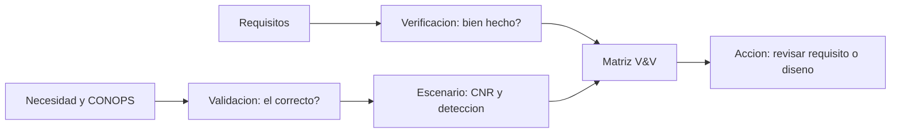

# B83-C17 — Verificación frente a validación

<!-- nav:top -->
[🏠 Programa](../../../../README.md) · [📚 Bloque B83](../../../tronco-comun/B83-ingenieria-de-sistemas-y-diseno-de-misiones.md) · [← Anterior: B83-C16 — Gestión de riesgos técnicos](../B83-C16-gestion-de-riesgos-tecnicos/CLASE.md) · [Siguiente: B83-C18 — Niveles de madurez tecnológica →](../B83-C18-niveles-de-madurez-tecnologica/CLASE.md)
<!-- /nav -->

## 1. Ubicación, nivel y alcance

Clase 17 del bloque B83. Nivel N3. El manual de NASA (S3) separa dos preguntas: la **verificación** comprueba el producto frente al conjunto de requisitos aprobado y responde «¿se realizó bien el producto?»; la **validación** lo comprueba frente al concepto de operaciones y el uso previsto, en condiciones reales o simuladas, y responde «¿se realizó el producto correcto?». Aquí muestras, con datos **sintéticos** de ESTRELLA-S, un instrumento que cumple sus tres requisitos y aun así no detecta lo que la necesidad pedía.

## 2. Por qué esta clase existe

Un proyecto puede pasar todas las pruebas de requisitos y fracasar en el uso. La decisión central: **¿además de cumplir los requisitos, el sistema satisface la necesidad en las condiciones reales de uso?** La respuesta exige un escenario de validación con criterios medibles.

## 3. Lo que podrás hacer al terminar

1. Distinguir verificación y validación con las preguntas de NASA (S3).
2. Construir una matriz V&V con requisitos verificados y necesidades validadas.
3. Modelar un escenario de validación con contraste, MTF y relación señal-ruido.
4. Calcular la probabilidad de detección por Monte Carlo y por una fórmula analítica.
5. Interpretar un caso que verifica y no valida y proponer una acción.
6. Rotular lo sintético y el criterio de detección no consultado.

La evidencia es la **matriz V&V con un caso que verifica y no valida** del ejercicio 12 (sección 20).

## 4. Con qué llegas y cómo comprobarlo

1. ¿Qué es la MTF?
2. ¿Qué es la relación señal-ruido (SNR)?
3. ¿Qué es el contraste relativo?
4. ¿Qué es un escenario de validación?
5. ¿Qué es el límite de ruido de disparo?

<details>
<summary>Ver respuestas</summary>

1. La función de transferencia de modulación: cuánto contraste conserva el sistema a cada frecuencia espacial. 2. El cociente entre la señal y el ruido. 3. La diferencia relativa de brillo entre un rasgo y su fondo. 4. Una situación de uso representativa con un criterio de éxito. 5. El ruido que crece con la raíz de la señal: SNR ∝ √señal.
</details>

Con cuatro o cinco aciertos, sigue; si no, repasa los prerrequisitos.

## 5. Un caso de contexto y casos de referencia

Los tres requisitos de ESTRELLA-S (sintética) se verifican (3 de 3): GSD medido de 4,8 m, MTF de 0,12 y SNR de 105. Pero la necesidad «cambio de costa» exige detectar rasgos de 10 m con contraste de 0,08 incluso con escenas oscuras: la CNR es 5,15 con albedo 0,30 (justo sobre 5) y 2,10 con albedo 0,05. La probabilidad de detección en escenas de albedo 0,03–0,40 es 31,79 %. Se validan 3 de 4 necesidades.

## 6. Vocabulario

**Verificación**: producto frente a requisitos. **Validación**: producto frente a la necesidad y el uso previsto. La **MTF** mide el contraste conservado. La **CNR** (relación contraste-ruido) es `contraste × SNR × MTF`. El **umbral de detección** del ejemplo es CNR ≥ 5 (criterio de Rose, valor estándar no consultado). Un requisito puede ser **correcto pero insuficiente** si no cubre un escenario de uso.

## 7. Modelo mental: dos preguntas distintas



*Descripción textual:* los requisitos se verifican y la necesidad se valida con un escenario; ambos resultados se reúnen en la matriz V&V, y una discrepancia lleva a revisar el requisito o el diseño.

Analogía: un examen de manejo y la vida real: aprobar el examen (verificación) no garantiza llegar de noche con lluvia (validación). Límite: el examen tiene criterios claros; el uso real puede no tenerlos.

## 8. La explicación, paso a paso

### 8.1 Verificación

GSD 4,8 m (≤ 5 m), MTF en Nyquist 0,12 (≥ 0,10) y SNR 105 a albedo 0,3 (≥ 100): tres requisitos cumplidos. Cada uno se mide en laboratorio con un método de S3 (ensayo). La matriz marca 3/3.

### 8.2 Validación

Para un rasgo de 10 m la frecuencia espacial es 0,05 ciclos/m y la MTF gaussiana ajustada da 0,614. La CNR es `0,08 × SNR × 0,614`; con SNR de 105 (albedo 0,3) da 5,15, apenas sobre el umbral 5, y con albedo 0,05 (costa oscura) la SNR baja a `105·√(0,05/0,3)` y la CNR a 2,10: no se detecta. El albedo mínimo para detectar es 0,2824 (SNR necesaria 101,9, mayor que los 100 del requisito).

### 8.3 Probabilidad y diagnóstico

Con albedos uniformes en 0,03–0,40, la probabilidad de detección es 31,71 % por Monte Carlo y 31,79 % por fórmula. El requisito de SNR se fijó a albedo 0,3 y no a las escenas oscuras que la necesidad exige: el defecto está en el requisito, no en la fabricación. Acción: reescribir el requisito (SNR ≥ 102 en albedo 0,28, o un valor mayor a albedo bajo) y volver a verificar.

## 9. Magnitudes, símbolos y unidades

| Símbolo | Qué es | Unidad | Valor / nota |
|---|---|---|---|
| `SNR` | relación señal-ruido | — | 105 a albedo 0,3 |
| `MTF` | contraste conservado | — | 0,614 a 0,05 ciclos/m |
| `CNR` | relación contraste-ruido | — | 5,15 / 2,10 |
| `A*` | albedo umbral | — | 0,2824 |
| `P_det` | probabilidad de detección | % | 31,79 |
| `V`/`N` | verificados / validadas | — | 3/3 y 3/4 |

## 10. Convenciones y referencias

Sin constantes físicas ni sistema de referencia. Mediciones, escena, contraste y rangos de albedo **sintéticos**. Criterio de Rose (CNR ≥ 5) estándar **no consultado**. Definición de verificación y validación de S3. Monte Carlo: 100 000 muestras, semilla 83017. Tolerancia: Monte Carlo y probabilidad analítica difieren menos de 0,5 puntos porcentuales. Los resultados de validación de las otras tres necesidades se **suponen** (no se calculan).

## 11. De dónde sale lo que afirmamos

| ID | Fuente | Localizador | Respalda | Estado |
|---|---|---|---|---|
| S3 | NASA, *Systems Engineering Handbook*, 5.3 Product Verification — https://www.nasa.gov/reference/5-3-product-verification/ (consultada 2026-11-10; solo las primeras 100 000 caracteres) | introducción a 5.3: diferencias entre verificación y validación | verificación: producto frente a requisitos aprobados («¿se realizó bien?»); validación: producto frente al ConOps y el uso previsto («¿se realizó el producto correcto?») | Consultada |
| ECSS | ECSS-E-ST-10C, ECSS-M-ST-40C, ECSS-Q-ST-30-02C, ECSS-Q-ST-40-12C y demás estándares (ecss.nl) | — | — | No consultada: la página de estándares no mostró los documentos |
| — | ISO/IEC/IEEE 15288, INCOSE, SysML, MIL-STD-1629, IEC 60812 e IEC 61025 | — | — | No consultada |
| — | Relaciones matemáticas estándar usadas en el laboratorio (AHP, rutas críticas, ley de Stefan, confiabilidad exponencial, cortes mínimos, ecuación del cohete) | — | — | No consultada en una fuente concreta: las verifica el laboratorio por una segunda vía |

Límites: solo se leyó la definición de S3, no sus procedimientos de validación; el criterio de Rose y el modelo de MTF gaussiana son estándar y no se consultaron; no se infiere nada de una misión real.

## 12. Cómo ver la matriz V&V

| Magnitud | Valor |
|---|---|
| Requisitos verificados | 3 de 3 |
| Necesidades validadas | 3 de 4 |
| CNR albedo 0,30 / 0,05 | 5,15 / 2,10 |
| Albedo umbral | 0,2824 |
| Probabilidad de detección | 31,79 % |

Descripción larga: el 100 % de verificación convive con una probabilidad de detección de un tercio: el requisito de SNR estaba bien cumplido pero mal elegido.

## 13. Ejemplo trabajado: la CNR con albedo 0,05

**Paso 1 · SNR.** `105 × √(0,05/0,3) = 42,9`.

**Paso 2 · MTF.** `0,614` a 0,05 ciclos/m.

**Paso 3 · CNR.** `0,08 × 42,9 × 0,614 = 2,10`.

**Paso 4 · Veredicto.** Menor que 5: no detecta; la necesidad no se valida.

## 14. Distintas formas de abordar el problema

**Escenario con modelo analítico** (esta clase). **Prueba con datos reales o con un simulador de escenas** (no disponible aquí). **Revisión por usuarios:** los usuarios juzgan el producto. La validación idealmente usa el producto real o un modelo validado, no solo el modelo del requisito.

## 15. Práctica guiada

**Ejercicio 1 · con los pasos indicados.** Clasifica como verificación o validación: «medir el GSD en laboratorio». *Pasos:* ¿frente a qué se compara?

<details><summary>Solución comentada</summary>

Verificación (frente a un requisito).
</details>

**Ejercicio 2 · con una pista.** Clasifica: «un operador usa el instrumento para seguir una costa y juzga los resultados».

<details><summary>Solución comentada</summary>

Validación (frente al uso previsto).
</details>

**Ejercicio 3 · casi autónomo.** Calcula la SNR a albedo 0,12 con SNR 105 a 0,3. *Pista:* `√(0,12/0,3)`.

<details><summary>Solución comentada</summary>

`105×0,632 = 66,4`.
</details>

## 16. Práctica autónoma, transferencia e integrador

**Ejercicio 4 · autónomo.** Calcula la CNR con SNR 66,4, contraste 0,08 y MTF 0,614.

<details><summary>Solución comentada</summary>

`0,08×66,4×0,614 = 3,26`.
</details>

**Ejercicio 5 · autónomo.** ¿Cuál es la probabilidad de detección si el albedo umbral es 0,2 y el rango U[0,03; 0,40]?

<details><summary>Solución comentada</summary>

`(0,40−0,20)/0,37 = 54,1 %`.
</details>

**Ejercicio 6 · autónomo.** Explica por qué un 100 % de verificación no basta.

<details><summary>Solución comentada</summary>

Porque verifica los requisitos escritos, que pueden no cubrir el uso real.
</details>

**Ejercicio 7 · autónomo.** ¿Qué haces con un requisito que se verifica pero no valida?

<details><summary>Solución comentada</summary>

Lo revisas con las partes interesadas, lo reescribes y vuelves a verificar.
</details>

**Ejercicio 8 · autónomo.** ¿Por qué es útil el Monte Carlo aquí?

<details><summary>Solución comentada</summary>

Porque comprueba la probabilidad sobre un rango de escenas sin integrar a mano.
</details>

**Ejercicio 9 · transferencia.** **Transferencia.** Un colega usa 31,79 % como la tasa de detección de un instrumento real. ¿Es válido?

<details><summary>Solución comentada</summary>

No: modelo y datos sintéticos.
</details>

**Ejercicio 10 · transferencia.** **Transferencia.** ¿Qué escenario de validación añadirías para la cobertura de cultivos?

<details><summary>Solución comentada</summary>

Rasgos de contraste medio sobre suelo claro con humedad y nubes parciales.
</details>

**Ejercicio 11 · transferencia.** **Transferencia.** ¿Quién debe juzgar la validación y por qué?

<details><summary>Solución comentada</summary>

Los usuarios o expertos del dominio, porque son quienes definen el uso previsto (C02).
</details>

**Ejercicio 12 · integrador.** **Integrador.** Elabora tu *matriz V&V con un caso que verifica y no valida*: requisitos, escenario, CNR, probabilidad, diagnóstico y acción, con lista de qué es sintético.

<details><summary>Solución comentada</summary>

Secciones 8.1–8.3, el ejemplo 13 y la salida del laboratorio.
</details>

## 17. Laboratorio: un producto verificado que no valida

El script [verificar_y_validar.py](verificar_y_validar.py) verifica tres requisitos con mediciones sintéticas, modela un escenario de validación de CNR, calcula la probabilidad de detección por Monte Carlo y por fórmula (**comprueba** que todo requisito se verifica y que no todas las necesidades se validan, y que las dos vías de la probabilidad difieren menos de 0,5 puntos). Usa la biblioteca común [sistemas_comun.py](../sistemas_comun.py) del bloque.

**Datos:** mediciones, escena, albedos y contraste **sintéticos**; criterio de detección estándar **no consultado**; sin constantes físicas. **Predice antes de ejecutar:** ¿se validará la necesidad de cambio de costa? (no: la probabilidad de detección es de un tercio.) **Ejecución del 2026-11-10 (Python 3.12.9 | numpy 2.4.4):**

```text
Python 3.12.9 | numpy 2.4.4
Datos SINTETICOS: mediciones de laboratorio y escena inventadas; criterio de Rose (CNR >= 5) estandar no consultado
VERIFICACION (producto frente a requisitos):
  GSD <= 5 m                   medido   4.800 umbral   5.000  CUMPLE
  MTF en Nyquist >= 0.10       medido   0.120 umbral   0.100  CUMPLE
  SNR >= 100 a albedo 0.3      medido 105.000 umbral 100.000  CUMPLE
  Requisitos verificados: 3 de 3
VALIDACION (producto frente a la necesidad: detectar cambios de costa de 10 m, contraste 0.08):
  frecuencia del rasgo = 0.0500 ciclos/m ; Nyquist = 0.1042 ; MTF en el rasgo = 0.614
  CNR con albedo 0.30 = 5.15 ; con albedo 0.05 (agua) = 2.10 ; umbral = 5.0
  SNR necesaria = 101.9 ; albedo umbral = 0.2824
  Probabilidad de deteccion en escenas con albedo U[0.03, 0.40]: Monte Carlo 31.71 % ; analitica 31.79 %
  Necesidad Cobertura de cultivos    VALIDADA
  Necesidad Cambio de costa          NO VALIDADA
  Necesidad Hielo estacional         VALIDADA
  Necesidad Calidad del aire         VALIDADA
Necesidades validadas: 3 de 4 aunque se verificaron 3 de 3 requisitos
Pruebas superadas.
```

```bash
python programa/clases/B83/B83-C17-verificacion-frente-a-validacion/verificar_y_validar.py
```

**Límites:** una sola necesidad calculada; MTF gaussiana; ruido de disparo solamente; sin nubes ni geometría solar; criterio de detección simple.

## 18. Errores frecuentes y cómo corregirlos

**Usar «verificado» como «válido».** Ejecuta un escenario de uso

**Fijar requisitos a un caso favorable.** Incluye casos desfavorables

**No registrar los supuestos de la validación.** Anota el modelo y el criterio

## 19. Cómo sabrás que vas bien

Tras 8.2: ¿qué necesidad esperabas no validada? Tras el laboratorio: ¿qué requisito hay que reescribir? Si dudas, repasa el ejemplo 13.

## 20. Qué entregas y cómo se evalúa

El producto es tu **matriz V&V con un caso que verifica y no valida** (ejercicio 12).

| Criterio | Inicial | En desarrollo | Logrado | Destacado |
|---|---|---|---|---|
| Conceptos | Los confunde | Parciales | Explica el método y su dominio | Explica los límites y las alternativas |
| Cálculo | Sin unidades | Con errores | Resultados con unidades y comprobados | Resuelve casos nuevos |
| Numérico | Sin comprobar | Un caso | Verifica por una segunda vía en varios casos | Interpreta las diferencias y los fallos |
| Fuentes | Sin fuente | Sin fecha | Fuentes con fecha y estado | Declara lo sintético y lo no consultado |
| Límites | No los nombra | Uno | Tres | Discute qué falta del modelo |

**Condiciones críticas (no se compensan con promedio):** rotular los datos como sintéticos; verificar el resultado por una segunda vía; citar solo lo consultado.

## 21. Ética, seguridad y límites

Clase educativa: los modelos son simplificados y los datos son sintéticos; ningún resultado describe una misión real, certifica una seguridad ni sustituye a los estándares vigentes y a la revisión de especialistas.  Accesibilidad: tablas equivalentes a las gráficas, fórmulas en texto, ejercicios sin conexión.

## 22. Para cerrar y seguir

ESTRELLA-S (sintética) verifica 3/3 requisitos y valida 3/4 necesidades; el requisito de SNR hay que reescribirlo. Queda una pregunta: ¿qué tan madura es la tecnología que se usa? (C18).

**Glosario español–inglés.** verificación · *verification*; validación · *validation*; función de transferencia de modulación · *modulation transfer function*; relación señal-ruido · *signal-to-noise ratio*; escenario · *scenario*.

**Continuidad.** [B83-C18](../B83-C18-niveles-de-madurez-tecnologica/CLASE.md) trata los niveles de madurez tecnológica.

**Referencias:** ver sección 11.

<!-- nav:bottom -->
---

[← Anterior: B83-C16 — Gestión de riesgos técnicos](../B83-C16-gestion-de-riesgos-tecnicos/CLASE.md) · [📚 Bloque B83](../../../tronco-comun/B83-ingenieria-de-sistemas-y-diseno-de-misiones.md) · [Siguiente: B83-C18 — Niveles de madurez tecnológica →](../B83-C18-niveles-de-madurez-tecnologica/CLASE.md)
<!-- /nav -->
