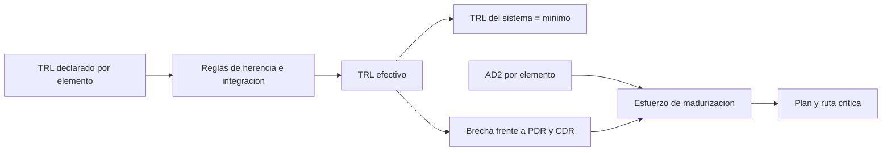

# B83-C18 — Niveles de madurez tecnológica

<!-- nav:top -->
[🏠 Programa](../../../../README.md) · [📚 Bloque B83](../../../tronco-comun/B83-ingenieria-de-sistemas-y-diseno-de-misiones.md) · [← Anterior: B83-C17 — Verificación frente a validación](../B83-C17-verificacion-frente-a-validacion/CLASE.md) · [Siguiente: B83-C19 — Aceptación y transferencia a operaciones →](../../../tronco-comun/B83-ingenieria-de-sistemas-y-diseno-de-misiones.md#b83-c19)
<!-- /nav -->

## 1. Ubicación, nivel y alcance

Clase 18 del bloque B83. Nivel N3. Los **niveles de madurez tecnológica** (TRL) describen el historial de desempeño de un sistema, subsistema o componente en una escala de 1 a 9 (S6). El Apéndice G del manual de NASA (S5) añade reglas de uso: el TRL de un sistema es el menor de sus elementos, un elemento heredado cuyo entorno o arquitectura cambia baja a TRL 5 al menos inicialmente, y la evaluación tecnológica se hace desde el concepto hasta el PDR. Aquí evalúas ocho elementos **sintéticos** de ESTRELLA-S, calculas el TRL del sistema y estimas el esfuerzo de madurización.

## 2. Por qué esta clase existe

Un elemento «con herencia de vuelo» que se usa en otro entorno no es TRL 9. La decisión central: **¿cuál es el TRL real del sistema, qué elementos lo frenan y cuánto cuesta llevarlos al nivel que pide la revisión?**

## 3. Lo que podrás hacer al terminar

1. Enunciar los TRL 1–9 con los hitos de S6.
2. Aplicar la regla del mínimo y la degradación por herencia con cambio.
3. Distinguir TRL declarado de TRL efectivo.
4. Comparar con el nivel exigido en PDR y CDR (reglas del ejemplo).
5. Estimar el esfuerzo de madurización con una dificultad de avance (AD2) sintética.
6. Rotular las reglas de ejemplo (3 meses por nivel, tope de integración) como no consultadas.

La evidencia es la **evaluación de madurez tecnológica con plan de madurización** del ejercicio 12 (sección 20).

## 4. Con qué llegas y cómo comprobarlo

1. ¿Qué es el TRL 6?
2. ¿Qué es el TRL 7?
3. ¿Qué es el TRL 9?
4. ¿Qué es un sistema heredado?
5. ¿Qué es una ruta crítica de esfuerzo?

<details>
<summary>Ver respuestas</summary>

1. Un modelo o prototipo representativo plenamente funcional (S6). 2. El prototipo demostrado en el entorno espacial (S6). 3. La tecnología probada en una misión real (S6). 4. Uno ya usado en otra misión. 5. El elemento que más tarda si todo avanza en paralelo.
</details>

Con cuatro o cinco aciertos, sigue; si no, repasa los prerrequisitos.

## 5. Un caso de contexto y casos de referencia

De ocho elementos sintéticos de ESTRELLA-S, el TRL promedio declarado es 7,62 y el efectivo, 6,50, porque 3 elementos se degradan (computadora y propulsión por herencia con cambio; radio y propulsión por integración no demostrada). El TRL del sistema es 4 (el del detector). Por debajo del TRL 5 de PDR hay 1 elemento y por debajo del TRL 6 de CDR, 3. Madurizar todo cuesta 18,75 meses-elemento; en paralelo, 10,50 meses por el elemento más lento (Detector de imagen).

## 6. Vocabulario

Los **TRL** (S6): 1 principios básicos; 2 concepto; 3 prueba de concepto; 4 componentes probados; 5 maqueta en entorno relevante; 6 prototipo representativo; 7 prototipo en el espacio; 8 calificado para vuelo; 9 probado en misión. El **TRL del sistema** es el mínimo de sus elementos (S5). La **herencia** pierde nivel si cambia el entorno o la arquitectura (baja a 5, S5). La **AD2** (dificultad de avance, S5) estima cuán difícil es subir de nivel; aquí es una escala 1–5 sintética. La **evaluación de madurez** debe estar lista antes del PDR.

## 7. Modelo mental: del nivel declarado al plan



*Descripción textual:* el TRL declarado pasa por las reglas de herencia e integración y da el TRL efectivo; su mínimo es el del sistema; la brecha frente a PDR/CDR y la dificultad de avance dan el esfuerzo y el plan.

Analogía: una cadena vale lo que su eslabón más débil. Límite: un eslabón débil se puede reforzar mientras otros avanzan en paralelo; el plan lo muestra.

## 8. La explicación, paso a paso

### 8.1 Declarado frente a efectivo

Los TRL declarados son 4, 6, 9, 8, 9, 7, 9 y 9. Dos elementos son heredados con cambio de entorno o arquitectura (computadora y propulsión): bajan a 5 según la regla de S5. La radio y la propulsión tienen una integración no demostrada: en el ejemplo se limitan a 6 (el valor del tope es una regla sintética, S5 solo dice que la integración puede bajar el nivel). El TRL efectivo del sistema es 4.

### 8.2 Brecha con las revisiones

Con el objetivo de TRL ≥ 5 en PDR (regla del ejemplo), solo el detector (TRL 4) está por debajo; con TRL ≥ 6 en CDR, quedan 3 elementos por debajo (detector, computadora y propulsión). Una consecuencia: la PDR de C13 no está lista mientras el TRL mínimo sea 4.

### 8.3 Plan de madurización

Con 3 meses por nivel y un factor de dificultad `1 + 0,25·(AD2 − 1)`, el esfuerzo a TRL 6 es de 18,75 meses-elemento; si todo avanza en paralelo, el plazo lo fija Detector de imagen: 10,50 meses. Es una estimación de ejemplo; el plan real se negocia con los equipos.

## 9. Magnitudes, símbolos y unidades

| Símbolo | Qué es | Unidad | Valor / nota |
|---|---|---|---|
| `TRL` | nivel de madurez | 1–9 | por elemento |
| `TRL_sis` | TRL del sistema | — | 4 |
| `n_deg` | elementos degradados | — | 3 |
| `AD2` | dificultad de avance | 1–5 | sintética |
| `M` | esfuerzo a TRL 6 | meses-elemento | 18,75 |
| `T_crit` | ruta crítica | meses | 10,50 |

## 10. Convenciones y referencias

Sin constantes físicas ni sistema de referencia. TRL de S6; reglas del mínimo y de la herencia de S5. Tope de integración, 3 meses por nivel, objetivos de PDR/CDR y AD2 **sintéticos**. Datos de los elementos **sintéticos**. Tolerancia: el mínimo calculado por dos vías coincide y ningún elemento sube de nivel por herencia.

## 11. De dónde sale lo que afirmamos

| ID | Fuente | Localizador | Respalda | Estado |
|---|---|---|---|---|
| S5 | NASA, *Systems Engineering Handbook*, Apéndice G Technology Assessment/Insertion — https://www.nasa.gov/reference/appendix-g-technology-assessment-insertion/ (consultada 2026-11-10) | apéndice G: TMA, AD2, sistemas heredados | el TRL del sistema es el menor de sus elementos; la herencia con cambio de entorno o arquitectura baja a TRL 5 al menos inicialmente; la evaluación se hace hasta el PDR; el TMA va con la AD2 | Consultada |
| S6 | NASA, Technology Readiness Levels — https://www.nasa.gov/directorates/somd/space-communications-navigation-program/technology-readiness-levels/ (consultada 2026-11-10) | lista de TRL 1–9 | definiciones de los TRL 1 a 9, de investigación básica (1) a éxito en una misión real (9) | Consultada |
| ECSS | ECSS-E-ST-10C, ECSS-M-ST-40C, ECSS-Q-ST-30-02C, ECSS-Q-ST-40-12C y demás estándares (ecss.nl) | — | — | No consultada: la página de estándares no mostró los documentos |
| — | ISO/IEC/IEEE 15288, INCOSE, SysML, MIL-STD-1629, IEC 60812 e IEC 61025 | — | — | No consultada |
| — | Relaciones matemáticas estándar usadas en el laboratorio (AHP, rutas críticas, ley de Stefan, confiabilidad exponencial, cortes mínimos, ecuación del cohete) | — | — | No consultada en una fuente concreta: las verifica el laboratorio por una segunda vía |

Límites: no se consultó el manual de evaluación de TRL de NASA que reemplazará al apéndice; el apéndice indica que las definiciones por nivel están en una figura; las reglas numéricas de esta clase (tope de integración, objetivos, meses) son sintéticas; no se consultó el nivel TRL requerido en CDR.

## 12. Cómo ver la madurez

| Magnitud | Valor |
|---|---|
| TRL del sistema (declarado / efectivo) | 4 / 4 |
| TRL promedio (declarado / efectivo) | 7,62 / 6,50 |
| Elementos degradados | 3 |
| Bajo TRL 5 / TRL 6 | 1 / 3 |
| Esfuerzo total / en paralelo | 18,75 / 10,50 meses |

Descripción larga: el TRL promedio engaña: 7,6 declarado y 6,5 efectivo ocultan que el sistema vale 4; el mínimo, no el promedio, manda.

## 13. Ejemplo trabajado: el esfuerzo del detector

**Paso 1 · Brecha.** `6 − 4 = 2` niveles.

**Paso 2 · Duración base.** `2 × 3 = 6 meses`.

**Paso 3 · Dificultad.** `1 + 0,25×(4−1) = 1,75`.

**Paso 4 · Esfuerzo.** `6 × 1,75 = 10,5 meses`.

## 14. Distintas formas de abordar el problema

**Reglas del mínimo y la herencia** (esta clase). **Evaluación por paneles de expertos** con evidencia por nivel. **Modelos de riesgo de desarrollo** que combinan TRL y AD2 en un plan con probabilidades (no usados). El laboratorio usa las reglas y verifica el mínimo por dos vías.

## 15. Práctica guiada

**Ejercicio 1 · con los pasos indicados.** ¿Cuál es el TRL de un sistema con elementos de TRL 9, 7 y 5? *Pasos:* toma el mínimo.

<details><summary>Solución comentada</summary>

5.
</details>

**Ejercicio 2 · con una pista.** Un elemento TRL 9 heredado se usa en un entorno nuevo. ¿Qué TRL se le asigna inicialmente según S5?

<details><summary>Solución comentada</summary>

TRL 5, al menos inicialmente.
</details>

**Ejercicio 3 · casi autónomo.** Calcula el esfuerzo de un elemento TRL 4 con AD2 = 2 hacia TRL 6. *Pista:* `2×3×(1+0,25)`.

<details><summary>Solución comentada</summary>

`7,5 meses`.
</details>

## 16. Práctica autónoma, transferencia e integrador

**Ejercicio 4 · autónomo.** Si dos elementos necesitan 4 y 7,5 meses en paralelo, ¿cuál es la ruta crítica?

<details><summary>Solución comentada</summary>

7,5 meses.
</details>

**Ejercicio 5 · autónomo.** ¿Por qué el promedio de TRL no sirve para el sistema?

<details><summary>Solución comentada</summary>

Porque un elemento de bajo nivel arrastra al sistema; manda el mínimo.
</details>

**Ejercicio 6 · autónomo.** ¿Qué evidencia pedirías para pasar un componente de TRL 5 a 6?

<details><summary>Solución comentada</summary>

Un prototipo representativo probado en un entorno relevante, con registro de ensayos (S6).
</details>

**Ejercicio 7 · autónomo.** Explica por qué la integración puede bajar el TRL.

<details><summary>Solución comentada</summary>

Porque elementos maduros por separado pueden no haberse demostrado juntos (S5).
</details>

**Ejercicio 8 · autónomo.** ¿Cuándo debe estar lista la evaluación de madurez según S5?

<details><summary>Solución comentada</summary>

Hasta el PDR, con la evaluación final justo antes.
</details>

**Ejercicio 9 · transferencia.** **Transferencia.** Un colega afirma que un satélite real tiene TRL 4. ¿Es válido?

<details><summary>Solución comentada</summary>

No: los elementos y niveles son sintéticos.
</details>

**Ejercicio 10 · transferencia.** **Transferencia.** ¿Cómo se relaciona el TRL con el riesgo (C16)?

<details><summary>Solución comentada</summary>

Un TRL bajo genera riesgos de calendario y de costo con verosimilitud y consecuencia.
</details>

**Ejercicio 11 · transferencia.** **Transferencia.** Un elemento comercial «de catálogo» sin historial espacial, ¿qué TRL tiene?

<details><summary>Solución comentada</summary>

Depende de la evidencia de ensayos en entorno espacial; sin ella, es bajo aunque sea un producto comercial.
</details>

**Ejercicio 12 · integrador.** **Integrador.** Elabora tu *evaluación de madurez tecnológica con plan de madurización*: TRL declarado y efectivo, TRL del sistema, brechas y ruta crítica, con lista de qué es sintético.

<details><summary>Solución comentada</summary>

Secciones 8.1–8.3, el ejemplo 13 y la salida del laboratorio.
</details>

## 17. Laboratorio: evaluación de TRL por elemento y plan de madurización

El script [evaluacion_trl.py](evaluacion_trl.py) aplica las reglas de herencia e integración, calcula el TRL del sistema por dos vías, la brecha con PDR y CDR y el esfuerzo de madurización (**comprueba** que el mínimo coincide por dos vías, que el efectivo no supera al declarado y que ningún elemento sube por herencia). Usa la biblioteca común [sistemas_comun.py](../sistemas_comun.py) del bloque.

**Datos:** elementos, TRL, AD2 y reglas numéricas **sintéticos**; reglas de TRL de S5 y S6 (consultadas el 2026-11-10). **Predice antes de ejecutar:** ¿cuál es el TRL del sistema? (4, el del detector.) **Ejecución del 2026-11-10 (Python 3.12.9 | numpy 2.4.4):**

```text
Python 3.12.9 | numpy 2.4.4
Datos SINTETICOS: 8 elementos; reglas de TRL de NASA (S5): TRL del sistema = minimo; herencia con cambio baja a 5
elemento                   declarado  efectivo  AD2  meses a TRL 6
Detector de imagen                 4         4    4          10.50
Optica                             6         6    2           0.00
Paneles solares                    9         9    1           0.00
Bateria                            8         8    1           0.00
Computadora de a bordo             9         5    2           3.75  (herencia con cambio)
Radio de banda X                   7         6    3           0.00  (integracion no demostrada)
Control de actitud                 9         9    1           0.00
Propulsion                         9         5    3           4.50  (herencia con cambio)  (integracion no demostrada)
TRL del sistema: declarado 4 ; efectivo 4 (con numpy: 4) ; promedio 7.62 -> 6.50
Elementos degradados por herencia o integracion: 3 -> Computadora de a bordo, Radio de banda X, Propulsion
Por debajo de TRL 5 (PDR): 1 -> Detector de imagen ; por debajo de TRL 6 (CDR): 3
Esfuerzo de madurizacion a TRL 6: total 18.75 meses-elemento ; ruta critica en paralelo 10.50 meses ; mayor: Detector de imagen (10.50 meses)
Pruebas superadas.
```

```bash
python programa/clases/B83/B83-C18-niveles-de-madurez-tecnologica/evaluacion_trl.py
```

**Límites:** el tope de integración y el esfuerzo son sintéticos; la AD2 es subjetiva; sin incertidumbre; ocho elementos.

## 18. Errores frecuentes y cómo corregirlos

**Promediar TRL.** Usa el mínimo

**Dar TRL 9 por herencia sin ver el entorno.** Reevalúa si cambió el entorno o la arquitectura

**Olvidar la integración.** Evalúa la unidad integrada

## 19. Cómo sabrás que vas bien

Tras 8.1: ¿cuál esperabas como TRL del sistema? Tras 8.3: ¿qué elemento fija la ruta crítica? Si dudas, repasa el ejemplo 13.

## 20. Qué entregas y cómo se evalúa

El producto es tu **evaluación de madurez tecnológica con plan de madurización** (ejercicio 12).

| Criterio | Inicial | En desarrollo | Logrado | Destacado |
|---|---|---|---|---|
| Conceptos | Los confunde | Parciales | Explica el método y su dominio | Explica los límites y las alternativas |
| Cálculo | Sin unidades | Con errores | Resultados con unidades y comprobados | Resuelve casos nuevos |
| Numérico | Sin comprobar | Un caso | Verifica por una segunda vía en varios casos | Interpreta las diferencias y los fallos |
| Fuentes | Sin fuente | Sin fecha | Fuentes con fecha y estado | Declara lo sintético y lo no consultado |
| Límites | No los nombra | Uno | Tres | Discute qué falta del modelo |

**Condiciones críticas (no se compensan con promedio):** rotular los datos como sintéticos; verificar el resultado por una segunda vía; citar solo lo consultado.

## 21. Ética, seguridad y límites

Clase educativa: los modelos son simplificados y los datos son sintéticos; ningún resultado describe una misión real, certifica una seguridad ni sustituye a los estándares vigentes y a la revisión de especialistas.  Accesibilidad: tablas equivalentes a las gráficas, fórmulas en texto, ejercicios sin conexión.

## 22. Para cerrar y seguir

ESTRELLA-S (sintética) tiene TRL del sistema 4; llevar todo a TRL 6 cuesta 18,75 meses-elemento y 10,50 meses en paralelo. Queda una pregunta: ¿cómo se entrega a operaciones lo ya maduro? (C19).

**Glosario español–inglés.** nivel de madurez tecnológica · *technology readiness level*; herencia · *heritage*; evaluación tecnológica · *technology assessment*; dificultad de avance · *advancement degree of difficulty*; prototipo · *prototype*.

**Continuidad.** [B83-C19](../B83-C19-aceptacion-y-transferencia-a-operaciones/CLASE.md) trata la aceptación y la entrega a operaciones.

**Referencias:** ver sección 11.

<!-- nav:bottom -->
---

[← Anterior: B83-C17 — Verificación frente a validación](../B83-C17-verificacion-frente-a-validacion/CLASE.md) · [📚 Bloque B83](../../../tronco-comun/B83-ingenieria-de-sistemas-y-diseno-de-misiones.md) · [Siguiente: B83-C19 — Aceptación y transferencia a operaciones →](../../../tronco-comun/B83-ingenieria-de-sistemas-y-diseno-de-misiones.md#b83-c19)
<!-- /nav -->
