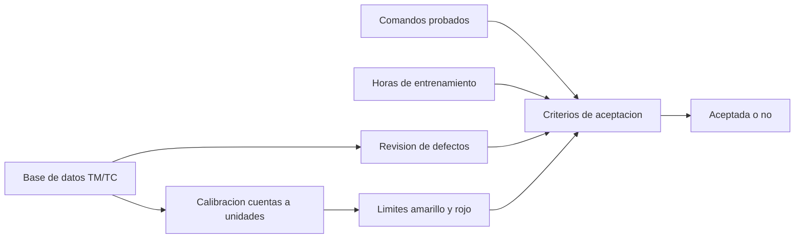

# B83-C19 — Aceptación y transferencia a operaciones

<!-- nav:top -->
[🏠 Programa](../../../../README.md) · [📚 Bloque B83](../../../tronco-comun/B83-ingenieria-de-sistemas-y-diseno-de-misiones.md) · [← Anterior: B83-C18 — Niveles de madurez tecnológica](../B83-C18-niveles-de-madurez-tecnologica/CLASE.md) · [Siguiente: B83-C20 — Diseño preliminar completo de misión →](../B83-C20-diseno-preliminar-completo-de-mision/CLASE.md)
<!-- /nav -->

## 1. Ubicación, nivel y alcance

Clase 19 del bloque B83. Nivel N3. La **aceptación** es la decisión formal de que el producto cumple lo acordado; la **transferencia a operaciones** entrega el sistema a quienes lo operarán, con su documentación, su base de datos de telemetría y comandos, sus procedimientos y su personal entrenado. Aquí compruebas una base de datos **sintética** de ESTRELLA-S (calibraciones, límites, comandos), evalúas telemetría simulada contra sus límites y aplicas tres criterios de aceptación del ejemplo. El manual de NASA (S3) enmarca la validación frente al concepto de operaciones y el uso previsto, que es lo que operaciones vivirá.

## 2. Por qué esta clase existe

Un satélite entregado con una base de datos errónea muestra valores falsos o alarmas inútiles; operadores sin entrenamiento no saben responder. La decisión central: **¿la base de datos, los comandos y las personas están listos, de modo que operaciones pueda recibir el sistema?**

## 3. Lo que podrás hacer al terminar

1. Describir qué contiene una base de datos de telemetría y comandos.
2. Convertir cuentas a unidades de ingeniería con una calibración polinómica (Horner) y comprobarla con otra implementación.
3. Aplicar límites amarillo y rojo y contar muestras fuera de límites.
4. Detectar defectos de la base de datos (calibración ausente, límites invertidos, identificadores duplicados).
5. Evaluar criterios de aceptación y decidir si se acepta la transferencia.
6. Rotular lo sintético y las reglas de ejemplo.

La evidencia es la **lista de aceptación y transferencia con prueba de calibración** del ejercicio 12 (sección 20).

## 4. Con qué llegas y cómo comprobarlo

1. ¿Qué es una calibración?
2. ¿Qué es un límite amarillo y uno rojo?
3. ¿Qué es un comando probado de extremo a extremo?
4. ¿Qué es el método de Horner?
5. ¿Qué es una revisión de preparación operacional?

<details>
<summary>Ver respuestas</summary>

1. La relación entre la lectura cruda (cuentas) y la magnitud de ingeniería. 2. Un umbral de advertencia y otro de peligro. 3. Uno cuya ejecución se comprobó desde la consola hasta el efecto y la telemetría. 4. Evaluar un polinomio con multiplicaciones anidadas. 5. La revisión que decide si el sistema y su equipo están listos para operar.
</details>

Con cuatro o cinco aciertos, sigue; si no, repasa los prerrequisitos.

## 5. Un caso de contexto y casos de referencia

La base de datos sintética de ESTRELLA-S tiene 3 defectos plantados (identificador duplicado, un parámetro sin calibración y uno con límites invertidos). Con 8000 muestras simuladas de los cuatro parámetros calculables, 14,61 % cae en amarillo y 0,05 % en rojo. Se probaron 6 de 8 comandos y 2 de 3 operadores cumplen las horas: la transferencia **no se acepta** (0 de 3 criterios).

## 6. Vocabulario

La **base de datos de telemetría y comandos** (TM/TC) lista cada parámetro con su identificador, unidad, calibración y límites, y cada comando con sus argumentos. La **calibración polinómica** es `eng = c₀ + c₁x + c₂x²`. Un valor **fuera de límites** (OOL) activa una alarma. La **aceptación** es la decisión formal de recibir el producto. La **transferencia a operaciones** entrega el sistema, sus procedimientos y su personal. Los **criterios de aceptación** del ejemplo son: base sin defectos, 100 % de comandos probados y todos los operadores con al menos 32 h.

## 7. Modelo mental: de la base de datos a la transferencia



*Descripción textual:* la base de datos se revisa y se calibra; los límites dan alarmas; junto con los comandos probados y el entrenamiento forman los criterios de aceptación, que deciden si la transferencia se acepta.

Analogía: entregar las llaves de una casa: además de la casa hay que entregar los planos, el manual y que el nuevo dueño sepa usar la calefacción. Límite: una casa se prueba viviendo en ella; un satélite se opera sin poder entrar a repararlo.

## 8. La explicación, paso a paso

### 8.1 Revisar la base de datos

Cada parámetro debe tener identificador único, unidad, calibración y límites ordenados. El revisor encuentra tres defectos: el identificador 101 duplicado (BATT_V y RW_RPM), PL_T sin calibración y RW_RPM con los límites en orden inverso. Cada defecto se corrige antes de operar: un identificador duplicado mezcla dos parámetros; una calibración ausente deja valores sin sentido; los límites invertidos hacen que todo valor se marque como alarma.

### 8.2 Calibrar y vigilar

BATT_V: `V = 0,002441·cuentas`; con 3300 cuentas son 8,06 V. BATT_T: `−40 + 0,0488·cuentas`: con 1500 cuentas son 33,2 °C, cerca del amarillo superior (35 °C). La implementación de Horner y `numpy.polyval` coinciden. En 8000 muestras hay 1169 en amarillo (14,61 %) y 4 en rojo (0,05 %), concentradas en BATT_T y CPU_T: son candidatas a revisar límites o a investigar.

### 8.3 Criterios y veredicto

Se probaron 6 de 8 comandos; faltan DEPLOY_PANEL y FIRE_THRUSTER, justo los de ejecución única, que se validan con simuladores. Cumplen el entrenamiento 2 de 3 operadores. Con los tres criterios fallidos la transferencia no se acepta; las acciones son corregir la base, probar los dos comandos con un simulador y completar 8 h al operador con 24 h.

## 9. Magnitudes, símbolos y unidades

| Símbolo | Qué es | Unidad | Valor / nota |
|---|---|---|---|
| `x` | cuentas crudas | cuentas | 0–4095 |
| `eng` | valor de ingeniería | V, °C, A, rpm | según parámetro |
| `n_def` | defectos de la base | — | 3 |
| `OOL` | fuera de límites | % | amarillo 14,61; rojo 0,05 |
| `cmd` | comandos probados | — | 6 de 8 |
| `h` | horas de entrenamiento | h | 40, 32, 24 |

## 10. Convenciones y referencias

Sin constantes físicas ni sistema de referencia. Base de datos, calibraciones, límites, comandos y horas **sintéticos**; criterios de aceptación **del ejemplo** (no de una agencia). Telemetría simulada con ruido gaussiano, semilla 83019. Tolerancia: Horner y `polyval` coinciden a `10⁻⁹`; los tres defectos plantados se detectan. Marco conceptual de S3 (validación frente al ConOps).

## 11. De dónde sale lo que afirmamos

| ID | Fuente | Localizador | Respalda | Estado |
|---|---|---|---|---|
| S3 | NASA, *Systems Engineering Handbook*, 5.3 Product Verification — https://www.nasa.gov/reference/5-3-product-verification/ (consultada 2026-11-10; solo las primeras 100 000 caracteres) | introducción a 5.3, diferencia entre verificación y validación | la validación comprueba el producto frente al ConOps y el uso previsto («¿se realizó el producto correcto?») | Consultada |
| ECSS | ECSS-E-ST-10C, ECSS-M-ST-40C, ECSS-Q-ST-30-02C, ECSS-Q-ST-40-12C y demás estándares (ecss.nl) | — | — | No consultada: la página de estándares no mostró los documentos |
| — | ISO/IEC/IEEE 15288, INCOSE, SysML, MIL-STD-1629, IEC 60812 e IEC 61025 | — | — | No consultada |
| — | Relaciones matemáticas estándar usadas en el laboratorio (AHP, rutas críticas, ley de Stefan, confiabilidad exponencial, cortes mínimos, ecuación del cohete) | — | — | No consultada en una fuente concreta: las verifica el laboratorio por una segunda vía |

Límites: no se consultó la definición de la revisión de preparación operacional ni de aceptación del manual, ni el estándar CCSDS de comandos y telemetría; los criterios, horas y límites son de ejemplo.

## 12. Cómo ver el veredicto de aceptación

| Magnitud | Valor |
|---|---|
| Defectos de la base | 3 |
| Muestras en amarillo / rojo | 14,61 % / 0,05 % |
| Comandos probados | 6 de 8 |
| Operadores entrenados | 2 de 3 |
| Criterios cumplidos | 0 de 3 |

Descripción larga: los tres criterios fallan por razones diferentes (datos, pruebas y personas); ninguna se corrige con el mismo tipo de trabajo.

## 13. Ejemplo trabajado: una calibración y un límite

**Paso 1 · Cuentas.** `1500` cuentas de BATT_T.

**Paso 2 · Calibración.** `−40 + 0,0488 × 1500 = 33,2 °C`.

**Paso 3 · Límite.** Amarillo superior 35 °C, rojo 45 °C.

**Paso 4 · Veredicto.** Dentro de límites, con 1,8 °C de holgura al amarillo.

## 14. Distintas formas de abordar el problema

**Revisión de la base de datos con reglas** (esta clase). **Pruebas de extremo a extremo con un simulador de vuelo** (no disponible aquí). **Auditoría de procedimientos:** operadores ejecutan procedimientos supervisados. Se combinan.

## 15. Práctica guiada

**Ejercicio 1 · con los pasos indicados.** Convierte 2000 cuentas de BATT_V a voltios. *Pasos:* `0,002441×2000`.

<details><summary>Solución comentada</summary>

`4,88 V`.
</details>

**Ejercicio 2 · con una pista.** ¿Qué temperatura da `−40 + 0,0488×2200`? *Pista:* multiplica y resta.

<details><summary>Solución comentada</summary>

`67,4 °C` (CPU_T; el amarillo está en 70 °C).
</details>

**Ejercicio 3 · casi autónomo.** ¿Por qué dos parámetros no pueden compartir identificador?

<details><summary>Solución comentada</summary>

Porque el sistema no sabría a cuál asignar el valor recibido.
</details>

## 16. Práctica autónoma, transferencia e integrador

**Ejercicio 4 · autónomo.** ¿Qué provoca un límite amarillo mayor que el rojo?

<details><summary>Solución comentada</summary>

Alarmas incorrectas o ausentes.
</details>

**Ejercicio 5 · autónomo.** Calcula el porcentaje de comandos probados con 6 de 8.

<details><summary>Solución comentada</summary>

`75 %`.
</details>

**Ejercicio 6 · autónomo.** ¿Cuántas horas faltan al operador con 24 h para llegar a 32 h?

<details><summary>Solución comentada</summary>

8 h.
</details>

**Ejercicio 7 · autónomo.** Explica por qué DEPLOY_PANEL no se prueba en vuelo antes de aceptar.

<details><summary>Solución comentada</summary>

Porque su ejecución es irreversible; se valida con un simulador o en tierra.
</details>

**Ejercicio 8 · autónomo.** ¿Qué ocurre si se acepta con defectos en la base de datos?

<details><summary>Solución comentada</summary>

Operaciones recibe valores o alarmas erróneos y pierde confianza en los datos.
</details>

**Ejercicio 9 · transferencia.** **Transferencia.** Un colega usa estos criterios como los de una agencia real. ¿Es válido?

<details><summary>Solución comentada</summary>

No: son reglas del ejemplo.
</details>

**Ejercicio 10 · transferencia.** **Transferencia.** ¿Qué documentos incluirías en la transferencia además de la base de datos?

<details><summary>Solución comentada</summary>

Manual de operaciones, procedimientos, registro de configuración (C15), lista de anomalías abiertas e historial de ensayos.
</details>

**Ejercicio 11 · transferencia.** **Transferencia.** ¿Cómo se relaciona esta clase con la validación de C17?

<details><summary>Solución comentada</summary>

La aceptación de operaciones es una validación frente al uso previsto: ¿pueden los operadores cumplir el CONOPS con lo recibido?
</details>

**Ejercicio 12 · integrador.** **Integrador.** Elabora tu *lista de aceptación y transferencia con prueba de calibración*: defectos de la base, OOL, comandos, entrenamiento y veredicto, con lista de qué es sintético.

<details><summary>Solución comentada</summary>

Secciones 8.1–8.3, el ejemplo 13 y la salida del laboratorio.
</details>

## 17. Laboratorio: base de datos de telemetría, calibraciones y criterios de aceptación

El script [base_de_telemetria.py](base_de_telemetria.py) revisa la base de datos, calibra y evalúa 8000 muestras simuladas contra sus límites y aplica tres criterios de aceptación (**comprueba** que Horner y `polyval` coinciden, que se detectan los tres defectos plantados y que, con defectos, no se acepta). Usa la biblioteca común [sistemas_comun.py](../sistemas_comun.py) del bloque.

**Datos:** base de datos, calibraciones, límites, comandos y horas **sintéticos**; sin constantes físicas. **Predice antes de ejecutar:** ¿se acepta la transferencia? (no: ningún criterio se cumple.) **Ejecución del 2026-11-10 (Python 3.12.9 | numpy 2.4.4):**

```text
Python 3.12.9 | numpy 2.4.4
Datos SINTETICOS: 6 parametros de telemetria, 8 comandos, 3 operadores; reglas de aceptacion del ejemplo
Defectos de la base de datos: 3
  - identificador duplicado 101
  - PL_T: sin calibracion
  - RW_RPM: limites invertidos o no ordenados
Telemetria sintetica evaluada: 8000 muestras ; amarillo 1169 (14.61 %) ; rojo 4 (0.05 %)
  BATT_V   amarillo     0 rojo     0
  BATT_T   amarillo   553 rojo     0
  PANEL_I  amarillo     0 rojo     0
  CPU_T    amarillo   616 rojo     4
Diferencia maxima Horner - numpy.polyval = 0.00e+00
Comandos probados de extremo a extremo: 6 de 8 ; sin probar: DEPLOY_PANEL, FIRE_THRUSTER
Operadores con >= 32 h: 2 de 3
  Criterio 'base de datos sin defectos': NO CUMPLE
  Criterio 'comandos probados de extremo a extremo': NO CUMPLE
  Criterio 'operadores entrenados': NO CUMPLE
Aceptacion para transferir a operaciones: NO ACEPTADA (0 de 3 criterios)
Pruebas superadas.
```

```bash
python programa/clases/B83/B83-C19-aceptacion-y-transferencia-a-operaciones/base_de_telemetria.py
```

**Límites:** solo calibraciones polinómicas de grado 2; límites estáticos; comandos sin argumentos probados; entrenamiento medido en horas; sin simulador.

## 18. Errores frecuentes y cómo corregirlos

**Entregar sin base de datos revisada.** Revisa identificadores, calibraciones y límites

**Probar solo los comandos fáciles.** Cubre los de ejecución única con un simulador

**Aceptar por calendario.** Acepta por criterios cumplidos

## 19. Cómo sabrás que vas bien

Tras 8.1: ¿qué defectos esperabas? Tras 8.3: ¿qué acciones llevan a aceptar? Si dudas, repasa el ejemplo 13.

## 20. Qué entregas y cómo se evalúa

El producto es tu **lista de aceptación y transferencia con prueba de calibración** (ejercicio 12).

| Criterio | Inicial | En desarrollo | Logrado | Destacado |
|---|---|---|---|---|
| Conceptos | Los confunde | Parciales | Explica el método y su dominio | Explica los límites y las alternativas |
| Cálculo | Sin unidades | Con errores | Resultados con unidades y comprobados | Resuelve casos nuevos |
| Numérico | Sin comprobar | Un caso | Verifica por una segunda vía en varios casos | Interpreta las diferencias y los fallos |
| Fuentes | Sin fuente | Sin fecha | Fuentes con fecha y estado | Declara lo sintético y lo no consultado |
| Límites | No los nombra | Uno | Tres | Discute qué falta del modelo |

**Condiciones críticas (no se compensan con promedio):** rotular los datos como sintéticos; verificar el resultado por una segunda vía; citar solo lo consultado.

## 21. Ética, seguridad y límites

Clase educativa: los modelos son simplificados y los datos son sintéticos; ningún resultado describe una misión real, certifica una seguridad ni sustituye a los estándares vigentes y a la revisión de especialistas.  Accesibilidad: tablas equivalentes a las gráficas, fórmulas en texto, ejercicios sin conexión.

## 22. Para cerrar y seguir

La transferencia de ESTRELLA-S (sintética) no se acepta: 3 defectos en la base, 6 de 8 comandos probados y 2 de 3 operadores entrenados. Queda una pregunta: ¿cómo se cierra todo en un diseño preliminar completo? (C20).

**Glosario español–inglés.** aceptación · *acceptance*; transferencia a operaciones · *handover to operations*; telemetría · *telemetry*; calibración · *calibration*; fuera de límites · *out of limits*.

**Continuidad.** [B83-C20](../B83-C20-diseno-preliminar-completo-de-mision/CLASE.md) integra todo en un diseño preliminar completo.

**Referencias:** ver sección 11.

<!-- nav:bottom -->
---

[← Anterior: B83-C18 — Niveles de madurez tecnológica](../B83-C18-niveles-de-madurez-tecnologica/CLASE.md) · [📚 Bloque B83](../../../tronco-comun/B83-ingenieria-de-sistemas-y-diseno-de-misiones.md) · [Siguiente: B83-C20 — Diseño preliminar completo de misión →](../B83-C20-diseno-preliminar-completo-de-mision/CLASE.md)
<!-- /nav -->
