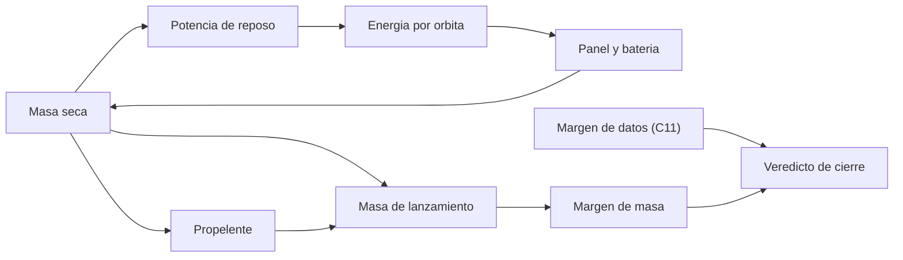

# B83-C20 — Diseño preliminar completo de misión

<!-- nav:top -->
[🏠 Programa](../../../../README.md) · [📚 Bloque B83](../../../tronco-comun/B83-ingenieria-de-sistemas-y-diseno-de-misiones.md) · [← Anterior: B83-C19 — Aceptación y transferencia a operaciones](../B83-C19-aceptacion-y-transferencia-a-operaciones/CLASE.md) · [Siguiente: B83-C21 — Identificación de peligros en sistemas de lanzamiento (HAZID) →](../B83-C21-identificacion-de-peligros-en-sistemas-de-lanzamiento-hazid/CLASE.md)
<!-- /nav -->

## 1. Ubicación, nivel y alcance

Clase 20 del bloque B83. Nivel N3. Un **diseño preliminar completo** cierra a la vez los presupuestos que se influyen entre sí: más masa pide más potencia, más potencia pide paneles y baterías más pesados, y más masa seca pide más propelente. Aquí cierras ese lazo para la misión sintética ESTRELLA-S con una iteración de punto fijo, lo verificas con una bisección y lo contrastas con el margen de datos de C11. Usa la gravedad normal, el radio y el `GM` de NASA/NSSDC (S8) y los valores centrales de potencia específica de paneles y de energía específica de paquetes de baterías de *State-of-the-Art of Small Spacecraft Technology* (S7). Todo lo demás es **sintético**.

## 2. Por qué esta clase existe

Cada presupuesto aislado puede cerrar y el conjunto no. La decisión central: **¿existe una masa seca que sea coherente con la potencia, las baterías, la estructura y el propelente que ella misma exige, y cabe en el límite?** Un lazo de diseño responde con una iteración que converge o no.

## 3. Lo que podrás hacer al terminar

1. Plantear el lazo masa → potencia → paneles y baterías → masa.
2. Resolver el lazo con una iteración de punto fijo y verificarlo con una bisección.
3. Calcular el desglose de masas, la energía por órbita, el panel y la batería.
4. Calcular el propelente y el margen de masa con el resultado del lazo.
5. Combinar el resultado con el margen de datos de C11 para un veredicto de cierre.
6. Reconciliar el resultado con el presupuesto de C09 y listar lo pendiente (TRL, interfaces, reservas).

La evidencia es la **diseño preliminar integrado con presupuestos cerrados** del ejercicio 12 (sección 20).

## 4. Con qué llegas y cómo comprobarlo

1. ¿Qué es una iteración de punto fijo?
2. ¿Cuándo converge?
3. ¿Qué es una bisección?
4. ¿Qué es la potencia específica de un panel?
5. ¿Qué es el margen de masa?

<details>
<summary>Ver respuestas</summary>

1. Repetir `x ← g(x)` hasta que `x` no cambie. 2. Cuando `g` es contractiva cerca del punto fijo (pendiente de módulo menor que 1). 3. Un método que encierra la raíz de `f(m)=0` y reduce el intervalo a la mitad. 4. Los vatios por kilogramo que entrega (W/kg). 5. La holgura relativa frente al límite (C09).
</details>

Con cuatro o cinco aciertos, sigue; si no, repasa los prerrequisitos.

## 5. Un caso de contexto y casos de referencia

El lazo de ESTRELLA-S (sintética) converge en 10 iteraciones a una masa seca de 55,575 kg: carga útil 21,6, resto de subsistemas 19,285, paneles 3,915, batería 0,771 y estructura 10,004 kg. La potencia de reposo es 44,45 W, el panel entrega 117,46 W y la batería es de 92,57 Wh. Con 4,001 kg de propelente, la masa de lanzamiento es 59,577 kg frente a 80 kg: margen de 25,53 %. El margen de datos de C11 es 43,38 %: el diseño **cierra** en masa y datos.

## 6. Vocabulario

Un **diseño preliminar** fija arquitectura, subsistemas y presupuestos con margen. El **lazo de diseño** es la dependencia circular entre masa y potencia. La **iteración de punto fijo** lo resuelve: `m = g(m)` con `g(m) = (carga + resto + paneles(m) + batería(m))/(1 − f_estr)`. La **bisección** busca la raíz de `f(m) = m − g(m)`. La **potencia de reposo** crece con la masa (`25 W + 0,35 W/kg`, sintético). Un diseño **cierra** cuando todos los presupuestos son coherentes y cumplen sus márgenes.

## 7. Modelo mental: del lazo a un diseño cerrado



*Descripción textual:* la masa seca fija la potencia de reposo, de la que salen energía, panel y batería, que a su vez devuelven masa seca; cuando el lazo converge, la masa seca da el propelente y la masa de lanzamiento, cuyo margen junto con el de datos da el veredicto.

Analogía: el peso de un velero y su vela: más vela exige más mástil y el mástil agrega peso que exige más vela. Límite: en un velero el lazo se corta con la experiencia; aquí se cierra con una iteración y un modelo.

## 8. La explicación, paso a paso

### 8.1 Plantear el lazo

La masa seca es `m = (21,6 + 19,285 + m_panel(m) + m_bat(m))/(1 − 0,18)`. La potencia de reposo es `25 + 0,35 m` W; la energía requerida por orbita en el eclipse máximo (β = 0°, 35,61 min de eclipse) es 93,05 Wh; el panel se dimensiona con 20 % de margen de diseño y se divide por 30 W/kg; la batería, con un DoD del 30 % y 120 Wh/kg.

### 8.2 Resolver

La iteración de punto fijo parte de 60 kg y converge en 10 pasos a 55,575 kg; la bisección sobre `f(m) = m − g(m)` da el mismo valor (diferencia 0,00 kg). Paneles 3,915 kg (117,46 W), batería 0,771 kg (92,57 Wh), estructura 10,004 kg. Es un resultado central sin reservas por madurez.

### 8.3 Cerrar y reconciliar

Propelente 4,001 kg y masa de lanzamiento 59,577 kg: margen de 20,423 kg (25,53 %). Este modelo da menos masa que el presupuesto de C09 (72,16 kg) porque estima la estructura como 18 % de la masa seca y no aplica reservas por madurez: los dos resultados deben reconciliarse antes de la PDR. El margen de datos de C11 es 43,38 % (80,74 Gbit/día producidos frente a 115,76 Gbit/día de capacidad). Pendientes que este cierre no resuelve: TRL del detector (C18), interfaces (C08) y riesgos (C16).

## 9. Magnitudes, símbolos y unidades

| Símbolo | Qué es | Unidad | Valor / nota |
|---|---|---|---|
| `m` | masa seca | kg | 55,575 |
| `P_sa` | potencia del panel | W | 117,46 |
| `C_bat` | capacidad de batería | Wh | 92,57 |
| `m_p` | propelente | kg | 4,001 |
| `M` | masa de lanzamiento | kg | 59,577 |
| `margen` | límite − masa | % | 25,53 |

## 10. Convenciones y referencias

`g₀`, `RE` y `GM` de NASA/NSSDC (S8); 30 W/kg para paneles (valor central de S7) y 120 Wh/kg para baterías (dentro de 90–180 Wh/kg de S7). Carga útil y resto de subsistemas tomados de C09; estructura 18 % de la masa seca, potencia de reposo `25 W + 0,35 W/kg`, margen de panel 20 %, DoD 30 %, `Δv = 150 m/s`, `Isp = 220 s` y límite de 80 kg **sintéticos**. Datos de C11 importados. Sin sistema de referencia adicional. Tolerancia: punto fijo y bisección a `10⁻⁹` kg.

## 11. De dónde sale lo que afirmamos

| ID | Fuente | Localizador | Respalda | Estado |
|---|---|---|---|---|
| S7 | NASA, *State-of-the-Art of Small Spacecraft Technology*, capítulo Power Subsystems — https://www.nasa.gov/smallsat-institute/sst-soa/power-subsystems/ (consultada 2026-11-10; solo las primeras 100 000 de 119 638 caracteres) | sección 3.2 (potencia específica de paneles) y 3.4–3.5 (baterías) | la mayoría de las misiones de pequeños satélites se agrupa en torno a 30 W/kg de potencia específica de arreglos solares y los paquetes de baterías rondan 90–180 Wh/kg | Consultada |
| S8 | NASA/NSSDC, Earth Fact Sheet — https://nssdc.gsfc.nasa.gov/planetary/factsheet/earthfact.html (consultada 2026-11-10) | ficha de la Tierra | `g₀`, radio y `GM` de la Tierra | Consultada |
| ECSS | ECSS-E-ST-10C, ECSS-M-ST-40C, ECSS-Q-ST-30-02C, ECSS-Q-ST-40-12C y demás estándares (ecss.nl) | — | — | No consultada: la página de estándares no mostró los documentos |
| — | ISO/IEC/IEEE 15288, INCOSE, SysML, MIL-STD-1629, IEC 60812 e IEC 61025 | — | — | No consultada |
| — | Relaciones matemáticas estándar usadas en el laboratorio (AHP, rutas críticas, ley de Stefan, confiabilidad exponencial, cortes mínimos, ecuación del cohete) | — | — | No consultada en una fuente concreta: las verifica el laboratorio por una segunda vía |

Límites: no se consultó una guía de diseño de misión completa; los factores de estructura y de potencia de reposo son sintéticos; el diseño no incluye reservas por madurez ni la penalización del TRL.

## 12. Cómo ver el diseño cerrado

| Magnitud | Valor |
|---|---|
| Masa seca | 55,575 kg (10 iteraciones) |
| Paneles / batería / estructura | 3,915 / 0,771 / 10,004 kg |
| Panel / batería | 117,46 W / 92,57 Wh |
| Propelente | 4,001 kg |
| Masa de lanzamiento / margen | 59,577 kg / 25,53 % |
| Margen de datos | 43,38 % |

Descripción larga: la masa seca converge en pocas iteraciones porque cada kilogramo extra de masa seca añade solo una fracción de kilogramo de paneles y baterías.

## 13. Ejemplo trabajado: una iteración del lazo

**Paso 1 · Inicio.** `m₀ = 60 kg`: `P_reposo = 25 + 0,35×60 = 46 W`.

**Paso 2 · Energía.** Requerida por órbita `≈ 95,6 Wh`; panel `≈ 120,7 W`; batería `≈ 95,8 Wh`.

**Paso 3 · Masas.** `120,7/30 = 4,02 kg`; `95,8/120 = 0,80 kg`.

**Paso 4 · Nueva masa.** `(21,6 + 19,285 + 4,02 + 0,80)/0,82 = 55,7 kg`: ya cerca del punto fijo.

## 14. Distintas formas de abordar el problema

**Punto fijo** (esta clase). **Bisección** (segunda vía). **Optimización con restricciones:** minimizar la masa con límites de potencia y datos (C20 en un curso más avanzado). **Herramientas de diseño concurrente** con un equipo (no calculables aquí).

## 15. Práctica guiada

**Ejercicio 1 · con los pasos indicados.** Calcula la potencia de reposo para `m = 50 kg`. *Pasos:* `25 + 0,35×50`.

<details><summary>Solución comentada</summary>

`42,5 W`.
</details>

**Ejercicio 2 · con una pista.** Calcula la masa de un panel de 120 W a 30 W/kg. *Pista:* divide.

<details><summary>Solución comentada</summary>

`4,0 kg`.
</details>

**Ejercicio 3 · casi autónomo.** Calcula la masa de una batería de 96 Wh a 120 Wh/kg.

<details><summary>Solución comentada</summary>

`0,8 kg`.
</details>

## 16. Práctica autónoma, transferencia e integrador

**Ejercicio 4 · autónomo.** Si la estructura es 18 % de la masa seca y el resto vale 46 kg, ¿cuál es la masa seca? *Pista:* `m = 46/0,82`.

<details><summary>Solución comentada</summary>

`56,1 kg`.
</details>

**Ejercicio 5 · autónomo.** Calcula el margen si la masa de lanzamiento es 60 kg y el límite 80 kg.

<details><summary>Solución comentada</summary>

`25 %`.
</details>

**Ejercicio 6 · autónomo.** ¿Por qué converge el lazo?

<details><summary>Solución comentada</summary>

Porque la dependencia de `g` respecto de `m` es pequeña (menos de 0,2 por kg).
</details>

**Ejercicio 7 · autónomo.** ¿Qué ocurriría si el término `0,35 W/kg` fuera 5 W/kg?

<details><summary>Solución comentada</summary>

El lazo podría divergir o dar masas excesivas: `g` dejaría de ser contractiva.
</details>

**Ejercicio 8 · autónomo.** Explica por qué el cierre de este diseño no basta para aprobar la PDR.

<details><summary>Solución comentada</summary>

Faltan TRL, interfaces, riesgos y reservas por madurez (C13, C18, C08, C16).
</details>

**Ejercicio 9 · transferencia.** **Transferencia.** Un colega usa 59,577 kg como la masa de un satélite real. ¿Es válido?

<details><summary>Solución comentada</summary>

No: es un resultado sintético y sin reservas.
</details>

**Ejercicio 10 · transferencia.** **Transferencia.** ¿Cómo reconciliarías este resultado con el de C09?

<details><summary>Solución comentada</summary>

Aplicando reservas por madurez a este modelo y recalibrando la estructura con el plano; reportando la diferencia como incertidumbre.
</details>

**Ejercicio 11 · transferencia.** **Transferencia.** ¿Qué parámetro del lazo es más sensible y cómo lo mides?

<details><summary>Solución comentada</summary>

Se perturba cada parámetro un 10 % y se compara la masa seca (análisis de sensibilidad, C16).
</details>

**Ejercicio 12 · integrador.** **Integrador.** Elabora tu *diseño preliminar integrado*: desglose, energía, propelente, margen de masa y de datos, pendientes y matriz de trazabilidad con los requisitos, con lista de qué es consultado y sintético.

<details><summary>Solución comentada</summary>

Secciones 8.1–8.3, el ejemplo 13 y la salida del laboratorio; incluye los pendientes de C08, C16 y C18.
</details>

## 17. Laboratorio: cierre iterativo de masa, energía, datos y propelente

El script [diseno_preliminar.py](diseno_preliminar.py) resuelve el lazo masa–potencia–panel–batería por punto fijo y bisección, calcula el propelente y el margen y los combina con el margen de datos de C11 (**comprueba** que punto fijo y bisección coinciden a `10⁻⁹` kg, que la masa seca es punto fijo y que el diseño cierra). Usa la biblioteca común [sistemas_comun.py](../sistemas_comun.py) del bloque.

**Datos:** `g₀`, `RE`, `GM` de NASA/NSSDC y los valores centrales de S7 (consultados el 2026-11-10); el resto **sintético**; el margen de datos se importa del laboratorio de C11. **Predice antes de ejecutar:** ¿cuántas iteraciones necesita el lazo y cuál es el margen de masa? (diez; alrededor del 25 %.) **Ejecución del 2026-11-10 (Python 3.12.9 | numpy 2.4.4):**

```text
Python 3.12.9 | numpy 2.4.4
Datos SINTETICOS salvo g0, RE, GM (NASA/NSSDC) y 30 W/kg de paneles y 120 Wh/kg de baterias (rangos de S7); datos de C11 importados
Lazo de punto fijo: 10 iteraciones ; masa seca = 55.575201 kg ; biseccion = 55.575201 kg ; diferencia = 2.84e-14 kg
Desglose seco: carga util 21.600 + resto 19.285 + paneles 3.915 + bateria 0.771 + estructura 10.004 kg
Energia (beta = 0): reposo 44.45 W ; eclipse 35.61 min ; requerida 93.05 Wh/orbita ; panel 117.46 W ; bateria 92.57 Wh
Propelente = 4.001 kg ; masa de lanzamiento = 59.577 kg ; limite 80.0 kg ; margen = 20.423 kg (25.53 %)
Datos (B83-C11): produccion 80.74 Gbit/dia ; capacidad 115.76 Gbit/dia ; margen 43.38 %
Cierre tecnico preliminar (masa <= limite y margen de datos >= 25 %): SI
Pruebas superadas.
```

```bash
python programa/clases/B83/B83-C20-diseno-preliminar-completo-de-mision/diseno_preliminar.py
```

**Límites:** estructura proporcional a la masa; una sola órbita y β = 0°; sin reservas por madurez; sin penalización por el TRL; un solo escenario de misión.

## 18. Errores frecuentes y cómo corregirlos

**Resolver cada presupuesto por separado.** Cierra el lazo completo

**Dar un diseño cerrado como aprobado.** Revisa TRL, interfaces, riesgos y reservas

**No reconciliar modelos distintos.** Explica la diferencia con C09

## 19. Cómo sabrás que vas bien

Tras 8.2: ¿cuántas iteraciones esperabas? Tras 8.3: ¿qué falta para aprobar la PDR? Si dudas, repasa el ejemplo 13.

## 20. Qué entregas y cómo se evalúa

El producto es tu **diseño preliminar integrado con presupuestos cerrados** (ejercicio 12).

| Criterio | Inicial | En desarrollo | Logrado | Destacado |
|---|---|---|---|---|
| Conceptos | Los confunde | Parciales | Explica el método y su dominio | Explica los límites y las alternativas |
| Cálculo | Sin unidades | Con errores | Resultados con unidades y comprobados | Resuelve casos nuevos |
| Numérico | Sin comprobar | Un caso | Verifica por una segunda vía en varios casos | Interpreta las diferencias y los fallos |
| Fuentes | Sin fuente | Sin fecha | Fuentes con fecha y estado | Declara lo sintético y lo no consultado |
| Límites | No los nombra | Uno | Tres | Discute qué falta del modelo |

**Condiciones críticas (no se compensan con promedio):** rotular los datos como sintéticos; verificar el resultado por una segunda vía; citar solo lo consultado.

## 21. Ética, seguridad y límites

Clase educativa: los modelos son simplificados y los datos son sintéticos; ningún resultado describe una misión real, certifica una seguridad ni sustituye a los estándares vigentes y a la revisión de especialistas.  Accesibilidad: tablas equivalentes a las gráficas, fórmulas en texto, ejercicios sin conexión.

## 22. Para cerrar y seguir

El diseño preliminar de ESTRELLA-S (sintética) converge a 55,575 kg de masa seca y 59,577 kg de lanzamiento, con 25,53 % de margen de masa y 43,38 % de datos. Quedan pendientes TRL, interfaces y riesgos. Con esto termina la parte central del bloque; la ampliación trata la seguridad y la confiabilidad (C21–C24).

**Glosario español–inglés.** diseño preliminar · *preliminary design*; lazo de diseño · *design loop*; punto fijo · *fixed point*; bisección · *bisection*; cierre · *closure*.

**Continuidad.** [B83-C21](../B83-C21-identificacion-de-peligros-en-sistemas-de-lanzamiento-hazid/CLASE.md) abre la ampliación sobre seguridad con la identificación de peligros.

**Referencias:** ver sección 11.

<!-- nav:bottom -->
---

[← Anterior: B83-C19 — Aceptación y transferencia a operaciones](../B83-C19-aceptacion-y-transferencia-a-operaciones/CLASE.md) · [📚 Bloque B83](../../../tronco-comun/B83-ingenieria-de-sistemas-y-diseno-de-misiones.md) · [Siguiente: B83-C21 — Identificación de peligros en sistemas de lanzamiento (HAZID) →](../B83-C21-identificacion-de-peligros-en-sistemas-de-lanzamiento-hazid/CLASE.md)
<!-- /nav -->
