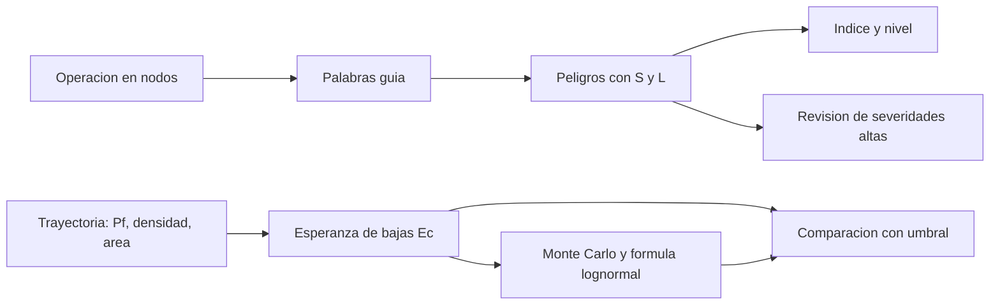

# B83-C21 — Identificación de peligros en sistemas de lanzamiento (HAZID)

<!-- nav:top -->
[🏠 Programa](../../../../README.md) · [📚 Bloque B83](../../../tronco-comun/B83-ingenieria-de-sistemas-y-diseno-de-misiones.md) · [← Anterior: B83-C20 — Diseño preliminar completo de misión](../B83-C20-diseno-preliminar-completo-de-mision/CLASE.md) · [Siguiente: B83-C22 — Análisis de modos y efectos de fallo (FMEA) en sistemas espaciales →](../../../tronco-comun/B83-ingenieria-de-sistemas-y-diseno-de-misiones.md#b83-c22)
<!-- /nav -->

## 1. Ubicación, nivel y alcance

Clase 21 del bloque B83 (clase de la ampliación `0.2.0`). Nivel N3. La **identificación de peligros** (HAZID) es un análisis preliminar y estructurado de qué puede causar daño en un sistema, antes de calcular cuánto riesgo implica. Aquí aplicas palabras guía a seis nodos de una campaña de lanzamiento **sintética**, clasificas doce peligros y estimas el riesgo para terceros de dos trayectorias con un modelo simple de esperanza de bajas. El manual de NASA (S4) enmarca el riesgo como un triplete de escenario, verosimilitud y consecuencia, que es lo que este registro captura.

## 2. Por qué esta clase existe

Los peligros que no se identifican no se pueden controlar. La decisión central: **¿qué puede salir mal en cada fase, qué tan grave y probable es, y el riesgo para terceros cabe en el umbral que el proyecto adoptó?** B83-C16 trata riesgos técnicos genéricos; esta clase se centra en peligros de seguridad.

## 3. Lo que podrás hacer al terminar

1. Dividir una operación en nodos y recorrerlos con palabras guía.
2. Registrar un peligro con escenario, severidad, verosimilitud e índice.
3. Clasificar por nivel y reconocer que un índice bajo puede ocultar una severidad catastrófica.
4. Estimar la esperanza de bajas de terceros con `Ec = Pf·ρ·Ac·(1 − refugio)`.
5. Propagar incertidumbre con Monte Carlo y comprobarlo con la fórmula lognormal.
6. Rotular que umbral, probabilidades y datos de población son sintéticos.

La evidencia es la **registro de peligros HAZID con riesgo estimado** del ejercicio 12 (sección 20).

## 4. Con qué llegas y cómo comprobarlo

1. ¿Qué es un nodo?
2. ¿Qué es una palabra guía?
3. ¿Qué es una distribución lognormal?
4. ¿Qué es la esperanza de bajas?
5. ¿Qué es el factor de error?

<details>
<summary>Ver respuestas</summary>

1. Una parte de la operación que se analiza por separado. 2. Un término («más», «menos», «no»…) que dispara la pregunta «¿qué pasa si…?». 3. Una distribución cuyo logaritmo es normal; el producto de lognormales es lognormal. 4. El número esperado de víctimas por un evento, antes de decidir si es aceptable. 5. La razón entre el percentil 95 y la mediana de una lognormal.
</details>

Con cuatro o cinco aciertos, sigue; si no, repasa los prerrequisitos.

## 5. Un caso de contexto y casos de referencia

El HAZID sintético recorre 6 nodos con 7 palabras guía (42 celdas) y registra 12 peligros (28,6 % de las celdas): 0 altos, 8 medios y 4 bajos. El mayor índice es 8 (Sin ventilacion de vapores de propelente). Para terceros, la trayectoria sobre tierra da `Ec = 1,5×10⁻³` y no cumple el umbral del ejemplo de `10⁻⁴`, con 98,89 % de probabilidad de excederlo; sobre el mar, `Ec = 1,5×10⁻⁵`, cumple, con 5,46 % de exceder.

## 6. Vocabulario

El **HAZID** identifica peligros con palabras guía sobre nodos. Un **peligro** es una fuente de daño; el **riesgo** combina severidad y verosimilitud. El **índice** `S×L` del ejemplo clasifica en alto (≥ 12), medio (6–11) y bajo (< 6). La **esperanza de bajas** `Ec = Pf·ρ·Ac·(1 − refugio)` usa la probabilidad de falla, la densidad de población, el área de baja efectiva y la fracción de refugio. El **umbral** de aceptación es de ejemplo. Una trayectoria **sobre el mar** reduce `ρ` en dos órdenes de magnitud.

## 7. Modelo mental: de la operación al riesgo para terceros



*Descripción textual:* la operación se divide en nodos y se recorre con palabras guía para listar peligros con severidad y verosimilitud; los de severidad alta se revisan aunque su índice sea bajo; por separado, la esperanza de bajas de la trayectoria se compara con el umbral y su incertidumbre se estudia por Monte Carlo y por fórmula.

Analogía: una inspección de seguridad en casa con una lista guiada: «¿y si no hay ventilación?», «¿y si hay demasiada presión?». Límite: una casa no tiene terceros ajenos que no consintieron el riesgo; un lanzamiento, sí, por eso el umbral para terceros es más exigente.

## 8. La explicación, paso a paso

### 8.1 El HAZID con palabras guía

Se cruzan 6 nodos (preparación, carga de propelente, integración, ascenso, separación, terminación de vuelo) con 7 palabras guía (No, Más, Menos, Parte de, Además de, Otro que, Temprano/Tarde): 42 celdas. El ejemplo registra 12 peligros (28,6 % de las celdas) que tocan 6 de 6 nodos. Un HAZID real recorre todas las celdas y descarta las no aplicables con justificación.

### 8.2 Índice y severidad

Los índices van de 3 a 8: ninguno alcanza «alto» porque la verosimilitud es baja. Pero cinco peligros tienen severidad 4 (catastrófica) con L1 o L2: un índice moderado oculta una consecuencia máxima. Regla del ejemplo: toda severidad 4 se revisa aunque el índice sea bajo y debe tener barreras independientes.

### 8.3 Riesgo para terceros

Con `Pf = 0,03`, `ρ = 20 personas/km²`, `Ac = 0,005 km²` y refugio 0,5, `Ec = 0,03·20·0,005·0,5 = 1,5×10⁻³`: excede `10⁻⁴`. Con `ρ = 0,2` (mar), `Ec = 1,5×10⁻⁵`. Con incertidumbre (factores de error 3 en `Pf` y 5 en `ρ`), la probabilidad de exceder el umbral es 98,89 % (tierra) y 5,46 % (mar) por la fórmula lognormal; Monte Carlo da 98,91 % y 5,51 %.

## 9. Magnitudes, símbolos y unidades

| Símbolo | Qué es | Unidad | Valor / nota |
|---|---|---|---|
| `S` | severidad | 1–4 | sintética |
| `L` | verosimilitud | 1–5 | sintética |
| `I` | índice `S×L` | — | 3–8 |
| `Ec` | esperanza de bajas | — | `1,5×10⁻³` (tierra); `1,5×10⁻⁵` (mar) |
| `P(Ec>u)` | prob. de exceder el umbral | % | 98,89 (tierra); 5,46 (mar) |
| `u` | umbral del ejemplo | — | `10⁻⁴` |

## 10. Convenciones y referencias

Sin constantes físicas ni sistema de referencia. Nodos, peligros, severidades, verosimilitudes, probabilidades, densidades, áreas y **umbral `10⁻⁴` sintéticos**: no son los criterios de ninguna autoridad de seguridad de lanzamiento (no consultados). Concepto de riesgo de S4. Monte Carlo: 200 000 muestras, semilla 83021. Tolerancia: Monte Carlo y probabilidad analítica difieren menos de 0,3 puntos porcentuales.

## 11. De dónde sale lo que afirmamos

| ID | Fuente | Localizador | Respalda | Estado |
|---|---|---|---|---|
| S4 | NASA, *Systems Engineering Handbook*, 6.4 Technical Risk Management — https://www.nasa.gov/reference/6-4-technical-risk-management/ (consultada 2026-11-10) | sección 6.4, conceptos clave | el riesgo se caracteriza por un triplete de escenarios, verosimilitudes y consecuencias, con incertidumbre en verosimilitud y consecuencia | Consultada |
| ECSS | ECSS-E-ST-10C, ECSS-M-ST-40C, ECSS-Q-ST-30-02C, ECSS-Q-ST-40-12C y demás estándares (ecss.nl) | — | — | No consultada: la página de estándares no mostró los documentos |
| — | ISO/IEC/IEEE 15288, INCOSE, SysML, MIL-STD-1629, IEC 60812 e IEC 61025 | — | — | No consultada |
| — | Relaciones matemáticas estándar usadas en el laboratorio (AHP, rutas críticas, ley de Stefan, confiabilidad exponencial, cortes mínimos, ecuación del cohete) | — | — | No consultada en una fuente concreta: las verifica el laboratorio por una segunda vía |

Límites: no se consultaron los criterios de seguridad de ninguna autoridad de lanzamiento ni normas de seguridad espacial (ECSS-Q-ST-40, NASA STD), ni el procedimiento HAZOP/HAZID formal; todo umbral y valor es sintético.

## 12. Cómo ver el registro de peligros

| Magnitud | Valor |
|---|---|
| Celdas / peligros | 42 / 12 |
| Cobertura de celdas | 28,6 % |
| Altos / medios / bajos | 0 / 8 / 4 |
| P(Ec > 10⁻⁴) tierra / mar | 98,89 % / 5,46 % |
| Cumple umbral (valor central) | tierra: no; mar: sí |

Descripción larga: el cambio de trayectoria baja la esperanza de bajas en dos órdenes de magnitud; la incertidumbre en `ρ` y `Pf` deja todavía una probabilidad pequeña de exceder el umbral sobre el mar.

## 13. Ejemplo trabajado: la esperanza de bajas sobre tierra

**Paso 1 · Datos.** `Pf = 0,03`; `ρ = 20/km²`; `Ac = 0,005 km²`; refugio 0,5.

**Paso 2 · Producto.** `0,03 × 20 × 0,005 = 3×10⁻³`.

**Paso 3 · Refugio.** `× (1 − 0,5) = 1,5×10⁻³`.

**Paso 4 · Veredicto.** `1,5×10⁻³ > 10⁻⁴`: no cumple; se rediseña la trayectoria.

## 14. Distintas formas de abordar el problema

**HAZID con palabras guía** (esta clase). **HAZOP** con parámetros de proceso (no usado). **Análisis de riesgo cuantitativo** con simulación de fragmentos y dispersión (no usado). Aquí solo se estima `Ec` con un modelo de una línea.

## 15. Práctica guiada

**Ejercicio 1 · con los pasos indicados.** Calcula el índice de un peligro con S3 y L2. *Pasos:* multiplica.

<details><summary>Solución comentada</summary>

`6`: medio.
</details>

**Ejercicio 2 · con una pista.** Calcula `Ec` con `Pf = 0,01`, `ρ = 10/km²`, `Ac = 0,01 km²` y refugio 0,5. *Pista:* multiplica y por 0,5.

<details><summary>Solución comentada</summary>

`5×10⁻⁴`.
</details>

**Ejercicio 3 · casi autónomo.** ¿Cumple el umbral `10⁻⁴`?

<details><summary>Solución comentada</summary>

No (`5×10⁻⁴ > 10⁻⁴`).
</details>

## 16. Práctica autónoma, transferencia e integrador

**Ejercicio 4 · autónomo.** ¿Cuántas celdas tiene un HAZID de 5 nodos y 7 palabras guía?

<details><summary>Solución comentada</summary>

35.
</details>

**Ejercicio 5 · autónomo.** Explica por qué una severidad 4 con L1 se revisa igualmente.

<details><summary>Solución comentada</summary>

Porque la consecuencia es catastrófica; un error en la verosimilitud sería muy costoso.
</details>

**Ejercicio 6 · autónomo.** ¿Qué efecto tiene mover la trayectoria de tierra a mar en este modelo?

<details><summary>Solución comentada</summary>

`ρ` baja 100 veces y `Ec` también.
</details>

**Ejercicio 7 · autónomo.** ¿Qué es un factor de error 3?

<details><summary>Solución comentada</summary>

El percentil 95 es 3 veces la mediana.
</details>

**Ejercicio 8 · autónomo.** ¿Qué supuesto del modelo `Ec` es el más discutible?

<details><summary>Solución comentada</summary>

Un solo área de baja efectiva y un solo valor de refugio para toda la zona.
</details>

**Ejercicio 9 · transferencia.** **Transferencia.** Un colega usa `10⁻⁴` como el límite oficial de una autoridad. ¿Es válido?

<details><summary>Solución comentada</summary>

No: es un umbral sintético.
</details>

**Ejercicio 10 · transferencia.** **Transferencia.** ¿Cómo se relaciona este HAZID con el FMEA (C22)?

<details><summary>Solución comentada</summary>

El HAZID lista peligros del sistema; el FMEA baja a modos de fallo de componentes que pueden causarlos.
</details>

**Ejercicio 11 · transferencia.** **Transferencia.** ¿Qué barrera propondrías para «sin comando de terminación de vuelo»?

<details><summary>Solución comentada</summary>

Un segundo canal de comando independiente y una prueba de extremo a extremo antes de la cuenta regresiva.
</details>

**Ejercicio 12 · integrador.** **Integrador.** Elabora tu *registro de peligros HAZID*: nodos, palabras guía, peligros con S/L/índice, revisión de severidades 4 y `Ec` con incertidumbre para dos trayectorias, con lista de qué es sintético.

<details><summary>Solución comentada</summary>

Secciones 8.1–8.3, el ejemplo 13 y la salida del laboratorio.
</details>

## 17. Laboratorio: HAZID con palabras guía y riesgo estimado para terceros

El script [registro_hazid.py](registro_hazid.py) recorre una rejilla de nodos y palabras guía, clasifica 12 peligros y estima la esperanza de bajas para dos trayectorias con incertidumbre por Monte Carlo y por fórmula (**comprueba** que ambas vías difieren menos de 0,3 puntos y que tierra no cumple y mar sí). Usa la biblioteca común [sistemas_comun.py](../sistemas_comun.py) del bloque.

**Datos:** todos **sintéticos** (nodos, peligros, probabilidades, densidades, umbral); sin constantes físicas. **Predice antes de ejecutar:** ¿cuántos peligros resultan «altos»? (ninguno, aunque cinco tienen severidad 4.) **Ejecución del 2026-11-10 (Python 3.12.9 | numpy 2.4.4):**

```text
Python 3.12.9 | numpy 2.4.4
Datos SINTETICOS: 6 nodos x 7 palabras guia; 12 peligros; Ec = Pf x rho x Ac x (1 - refugio); umbral del ejemplo 1e-4 (no consultado)
  [Carga de propele | No            ] S4 L2 indice  8 medio Sin ventilacion de vapores de propelente
  [Carga de propele | Mas           ] S4 L2 indice  8 medio Sobrepresion del tanque en la carga
  [Carga de propele | Ademas de     ] S3 L2 indice  6 medio Contaminante en la linea de propelente
  [Preparacion en t | Otro que      ] S2 L3 indice  6 medio Conector equivocado en la integracion electrica
  [Integracion con  | Parte de      ] S4 L1 indice  4 bajo  Fijacion parcial del adaptador
  [Ascenso          | Mas           ] S4 L2 indice  8 medio Carga aerodinamica mayor que la prevista
  [Ascenso          | Temprano/Tarde] S3 L2 indice  6 medio Corte de motor tardio
  [Ascenso          | No            ] S4 L1 indice  4 bajo  Sin guiado durante el ascenso
  [Separacion       | Temprano/Tarde] S3 L2 indice  6 medio Separacion temprana
  [Separacion       | Otro que      ] S2 L3 indice  6 medio Separacion con velocidad relativa equivocada
  [Aborto y termina | No            ] S4 L1 indice  4 bajo  Sin comando de terminacion de vuelo
  [Preparacion en t | Menos         ] S1 L3 indice  3 bajo  Presion de nitrogeno baja en pruebas
Celdas del HAZID: 42 ; peligros: 12 ; cobertura 28.6 % ; nodos con peligros: 6 de 6
Niveles: alto 0, medio 8, bajo 4 ; mayor indice 8: Sin ventilacion de vapores de propelente
Trayectoria sobre tierra : Ec = 1.500e-03 ; umbral 1e-4 -> NO CUMPLE ; P(Ec > umbral) MC 98.91 % ; analitica 98.89 %
Trayectoria sobre el mar : Ec = 1.500e-05 ; umbral 1e-4 -> CUMPLE ; P(Ec > umbral) MC 5.51 % ; analitica 5.46 %
Pruebas superadas.
```

```bash
python programa/clases/B83/B83-C21-identificacion-de-peligros-en-sistemas-de-lanzamiento-hazid/registro_hazid.py
```

**Límites:** modelo de una línea para `Ec`; sin dispersión de fragmentos ni viento; peligros listados solo de una fracción de las celdas; umbral ficticio.

## 18. Errores frecuentes y cómo corregirlos

**Descartar las severidades altas por su índice.** Revísalas siempre

**Mezclar HAZID con FMEA.** El HAZID identifica peligros del sistema; el FMEA, modos de fallo de componentes

**Usar un umbral ajeno sin citarlo.** Cita la autoridad y la versión del criterio

## 19. Cómo sabrás que vas bien

Tras 8.2: ¿qué peligros esperabas altos? Tras 8.3: ¿qué trayectoria cumple? Si dudas, repasa el ejemplo 13.

## 20. Qué entregas y cómo se evalúa

El producto es tu **registro de peligros HAZID con riesgo estimado** (ejercicio 12).

| Criterio | Inicial | En desarrollo | Logrado | Destacado |
|---|---|---|---|---|
| Conceptos | Los confunde | Parciales | Explica el método y su dominio | Explica los límites y las alternativas |
| Cálculo | Sin unidades | Con errores | Resultados con unidades y comprobados | Resuelve casos nuevos |
| Numérico | Sin comprobar | Un caso | Verifica por una segunda vía en varios casos | Interpreta las diferencias y los fallos |
| Fuentes | Sin fuente | Sin fecha | Fuentes con fecha y estado | Declara lo sintético y lo no consultado |
| Límites | No los nombra | Uno | Tres | Discute qué falta del modelo |

**Condiciones críticas (no se compensan con promedio):** rotular los datos como sintéticos; verificar el resultado por una segunda vía; citar solo lo consultado.

## 21. Ética, seguridad y límites

Clase educativa: los modelos son simplificados y los datos son sintéticos; ningún resultado describe una misión real, certifica una seguridad ni sustituye a los estándares vigentes y a la revisión de especialistas.  Accesibilidad: tablas equivalentes a las gráficas, fórmulas en texto, ejercicios sin conexión.

## 22. Para cerrar y seguir

El HAZID sintético lista 12 peligros sin ninguno alto, pero cinco con severidad 4; la trayectoria sobre tierra no cumple el umbral de ejemplo y la del mar sí. Queda una pregunta: ¿cómo se anticipan los modos de fallo de cada componente? (C22).

**Glosario español–inglés.** identificación de peligros · *hazard identification*; palabra guía · *guideword*; esperanza de bajas · *casualty expectation*; severidad · *severity*; verosimilitud · *likelihood*.

**Continuidad.** [B83-C22](../B83-C22-analisis-de-modos-y-efectos-de-fallo-fmea-en-sistemas-espaciales/CLASE.md) enseña el análisis de modos y efectos de fallo.

**Referencias:** ver sección 11.

<!-- nav:bottom -->
---

[← Anterior: B83-C20 — Diseño preliminar completo de misión](../B83-C20-diseno-preliminar-completo-de-mision/CLASE.md) · [📚 Bloque B83](../../../tronco-comun/B83-ingenieria-de-sistemas-y-diseno-de-misiones.md) · [Siguiente: B83-C22 — Análisis de modos y efectos de fallo (FMEA) en sistemas espaciales →](../../../tronco-comun/B83-ingenieria-de-sistemas-y-diseno-de-misiones.md#b83-c22)
<!-- /nav -->
