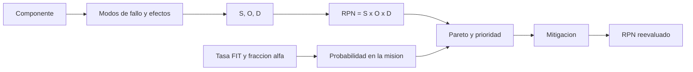

# B83-C22 — Análisis de modos y efectos de fallo (FMEA) en sistemas espaciales

<!-- nav:top -->
[🏠 Programa](../../../../README.md) · [📚 Bloque B83](../../../tronco-comun/B83-ingenieria-de-sistemas-y-diseno-de-misiones.md) · [← Anterior: B83-C21 — Identificación de peligros en sistemas de lanzamiento (HAZID)](../B83-C21-identificacion-de-peligros-en-sistemas-de-lanzamiento-hazid/CLASE.md) · [Siguiente: B83-C23 — Redundancia y tolerancia a fallos de misión →](../B83-C23-redundancia-y-tolerancia-a-fallos-de-mision/CLASE.md)
<!-- /nav -->

## 1. Ubicación, nivel y alcance

Clase 22 del bloque B83 (clase de la ampliación). Nivel N3. El **análisis de modos y efectos de fallo** (FMEA) recorre cada componente, lista cómo puede fallar (modo), qué provoca (efecto) y cuán grave, probable y detectable es, para priorizar acciones antes de construir. Aquí armas un FMEA de diez modos **sintéticos** de cinco componentes de ESTRELLA-S, calculas el número de prioridad de riesgo (RPN) y la probabilidad de cada modo en 3 años a partir de tasas de falla, y reevalúas tras mejorar la detección. El manual de NASA (S4) pide identificar y analizar fuentes, consecuencias y verosimilitud de los riesgos; el FMEA es una técnica que alimenta ese registro (la página consultada no la menciona).

## 2. Por qué esta clase existe

Los fallos que no se anticipan se descubren en órbita. La decisión central: **¿qué modos de fallo hay que atacar primero, cuánta probabilidad tienen en la vida de la misión y qué cambia si mejoro su detección?** B83-C16 gestiona riesgos en general y B88-C12 la detección en vuelo; esta clase enseña la técnica FMEA.

## 3. Lo que podrás hacer al terminar

1. Elaborar una fila de FMEA: componente, modo, efecto, S, O y D.
2. Calcular el RPN y ordenar por prioridad.
3. Convertir una tasa de falla (FIT) y una fracción de modo en probabilidad de misión.
4. Calcular cuántos modos explican el 80 % del RPN (análisis de Pareto).
5. Reevaluar el RPN tras una mitigación de detección.
6. Reconocer los límites del RPN y rotular lo sintético y lo no consultado.

La evidencia es la **tabla FMEA con priorización y reevaluación** del ejercicio 12 (sección 20).

## 4. Con qué llegas y cómo comprobarlo

1. ¿Qué es un FIT?
2. ¿Qué es la severidad?
3. ¿Qué es la detectabilidad?
4. ¿Qué es un modo de fallo?
5. ¿Qué es un diagrama de Pareto?

<details>
<summary>Ver respuestas</summary>

1. Un fallo por cada 10⁹ horas. 2. La gravedad del efecto del fallo (1 a 10 en el ejemplo). 3. Qué tan probable es que el fallo se detecte a tiempo: `D` alto significa difícil de detectar. 4. La forma en que un componente deja de cumplir su función. 5. Un orden decreciente que muestra qué pocos elementos explican la mayor parte del total.
</details>

Con cuatro o cinco aciertos, sigue; si no, repasa los prerrequisitos.

## 5. Un caso de contexto y casos de referencia

El FMEA sintético de ESTRELLA-S tiene 10 modos y un RPN total de 975. El mayor es **Rueda de reaccion: Friccion creciente** con RPN 150; 6 modos superan 100 y 7 de 10 suman el 80 % del total. Tras mejorar la detección en dos puntos en los tres modos mayores, el RPN total baja a 821 (15,8 % menos). Los 4 modos de severidad 8 o más suman 8,16 % de probabilidad en 3 años, y la probabilidad máxima de un modo es 6,11 %.

## 6. Vocabulario

Un **modo de fallo** es la forma de fallar; su **efecto** es la consecuencia. **S** (severidad), **O** (ocurrencia) y **D** (detección) puntúan de 1 a 10 (escala de ejemplo; en `D`, 10 es indetectable). El **RPN** es `S×O×D`. La **tasa de falla** `λ` se da en FIT; una fracción `α` del componente va a cada modo. La **probabilidad de misión** es `p = 1 − exp(−λ·α·t)`. El **Pareto** ordena por RPN. Una **mitigación de detección** baja `D`; una de diseño baja `O` o `S`.

## 7. Modelo mental: de la lista de modos a la prioridad



*Descripción textual:* cada componente se descompone en modos con efectos y puntajes S, O y D, de los que sale el RPN; las tasas de falla dan la probabilidad en la misión; ambos ordenan la prioridad, y la mitigación se evalúa recalculando el RPN.

Analogía: el chequeo médico de un auto: se revisa cada pieza, se anota cómo puede fallar, qué provoca y si el tablero avisaría. Límite: el taller no puede rediseñar la pieza en órbita; por eso la detección y la redundancia (C23) importan.

## 8. La explicación, paso a paso

### 8.1 Una fila de FMEA

Ejemplo: rueda de reacción, modo «fricción creciente», efecto «apuntamiento degradado», `S = 6`, `O = 5`, `D = 5`: `RPN = 150`, el mayor. Con `λ = 4000 FIT`, `α = 0,6` y `t = 26 280 h`, `p = 1 − exp(−4000·10⁻⁹·0,6·26 280) = 6,11 %`. La batería (cortocircuito de celda, `S = 9`) tiene RPN 135 y `p = 1,56 %`.

### 8.2 Prioridad y Pareto

El RPN total es 975; 6 modos superan 100; 7 de 10 explican el 80 %. El RPN tiene una limitación conocida: modos distintos pueden tener el mismo RPN con `S` muy diferente, y un RPN bajo puede ocultar una severidad alta; por eso los modos con `S ≥ 8` (4 aquí) se revisan aparte, con su probabilidad conjunta de 8,16 %.

### 8.3 Reevaluar tras mitigar

Mejorar la detección de la rueda (telemetría de corriente), del sensor solar (comparación cruzada) y de la batería (monitoreo de celdas) baja `D` en 2 puntos y el RPN total de 975 a 821 (15,8 % menos). La probabilidad de los modos no cambia: la detección reduce su efecto, no su ocurrencia. La segunda vía calcula el RPN con `numpy` y la probabilidad con una serie de Taylor: coinciden.

## 9. Magnitudes, símbolos y unidades

| Símbolo | Qué es | Unidad | Valor / nota |
|---|---|---|---|
| `S`, `O`, `D` | severidad, ocurrencia, detección | 1–10 | sintéticas |
| `RPN` | `S·O·D` | — | 150 (mayor); 975 (total) |
| `λ` | tasa de falla del componente | FIT | 500–4000 |
| `α` | fracción del modo | — | 0,25–1,00 |
| `p` | probabilidad en 3 años | % | 6,11 (máx.) |
| `t` | vida de la misión | h | 26 280 |

## 10. Convenciones y referencias

Sin constantes físicas ni sistema de referencia. Modos, efectos, `S/O/D`, tasas FIT y fracciones **sintéticos**; escala 1–10 y definición de RPN **de ejemplo**; las normas de FMEA (ECSS-Q-ST-30-02C, MIL-STD-1629, IEC 60812) **no se consultaron**. Probabilidad exponencial (tasa constante). `t = 3 años = 26 280 h`. Tolerancia: RPN por dos vías idéntico; probabilidad a `10⁻¹²`.

## 11. De dónde sale lo que afirmamos

| ID | Fuente | Localizador | Respalda | Estado |
|---|---|---|---|---|
| S4 | NASA, *Systems Engineering Handbook*, 6.4 Technical Risk Management — https://www.nasa.gov/reference/6-4-technical-risk-management/ (consultada 2026-11-10) | sección 6.4, 6.4.1.2.2 | los equipos técnicos identifican riesgos y analizan su fuente, consecuencia y verosimilitud; el riesgo se describe con escenarios, verosimilitudes y consecuencias | Consultada |
| ECSS | ECSS-E-ST-10C, ECSS-M-ST-40C, ECSS-Q-ST-30-02C, ECSS-Q-ST-40-12C y demás estándares (ecss.nl) | — | — | No consultada: la página de estándares no mostró los documentos |
| — | ISO/IEC/IEEE 15288, INCOSE, SysML, MIL-STD-1629, IEC 60812 e IEC 61025 | — | — | No consultada |
| — | Relaciones matemáticas estándar usadas en el laboratorio (AHP, rutas críticas, ley de Stefan, confiabilidad exponencial, cortes mínimos, ecuación del cohete) | — | — | No consultada en una fuente concreta: las verifica el laboratorio por una segunda vía |

Límites: la página de S4 no menciona el FMEA; no se consultó ninguna norma de FMEA; la escala S/O/D, la tasa de falla constante y todos los números son de ejemplo.

## 12. Cómo ver la tabla

| Magnitud | Valor |
|---|---|
| Modos / RPN total | 10 / 975 |
| Mayor RPN | Rueda de reaccion: Friccion creciente (150) |
| Modos con RPN ≥ 100 | 6 |
| Modos que suman 80 % | 7 de 10 |
| RPN tras mitigar | 821 (15,8 % menos) |
| Prob. de los modos S ≥ 8 | 8,16 % |

Descripción larga: el orden por RPN no coincide con el orden por probabilidad: el reinicio espurio de la computadora es muy probable (5,7 %) pero de baja severidad y su RPN es de solo 48, mientras que el cortocircuito de la batería tiene RPN alto con probabilidad baja.

## 13. Ejemplo trabajado: la fila de la rueda de reacción

**Paso 1 · Puntajes.** `S = 6`, `O = 5`, `D = 5`.

**Paso 2 · RPN.** `6×5×5 = 150`.

**Paso 3 · Probabilidad.** `λα t = 4000·10⁻⁹×0,6×26 280 = 0,0631`; `p = 1 − e^{−0,0631} = 6,11 %`.

**Paso 4 · Mitigación.** `D = 3`: `RPN = 90`.

## 14. Distintas formas de abordar el problema

**Tabla FMEA con RPN** (esta clase). **FMECA con índice de criticidad** que combina severidad, tasa y fracción (no usada). **Árbol de fallos** (C24): parte del efecto y busca causas. El FMEA va de causas a efectos; el árbol de fallos, de efectos a causas.

## 15. Práctica guiada

**Ejercicio 1 · con los pasos indicados.** Calcula el RPN con `S = 8`, `O = 3`, `D = 2`. *Pasos:* multiplica.

<details><summary>Solución comentada</summary>

`48`.
</details>

**Ejercicio 2 · con una pista.** Calcula `p` con `λ = 1000 FIT`, `α = 1` y `t = 26 280 h`. *Pista:* `x = 0,02628`.

<details><summary>Solución comentada</summary>

`1 − e^{−0,02628} = 2,59 %`.
</details>

**Ejercicio 3 · casi autónomo.** Si `D` baja de 6 a 4 con `S = 5` y `O = 4`, ¿cuál es el nuevo RPN?

<details><summary>Solución comentada</summary>

`80` (antes 120).
</details>

## 16. Práctica autónoma, transferencia e integrador

**Ejercicio 4 · autónomo.** ¿Por qué la detección no cambia `p`?

<details><summary>Solución comentada</summary>

Porque `p` depende de la tasa de falla; la detección permite reaccionar.
</details>

**Ejercicio 5 · autónomo.** ¿Por qué dos modos con RPN 100 pueden requerir trato distinto?

<details><summary>Solución comentada</summary>

Uno puede tener `S = 10` y baja `O×D`; el otro, `S = 2` y alta `O×D`.
</details>

**Ejercicio 6 · autónomo.** ¿Qué modos revisarías aparte aunque su RPN sea bajo?

<details><summary>Solución comentada</summary>

Los de severidad ≥ 8.
</details>

**Ejercicio 7 · autónomo.** Explica por qué la suma de `α` de un componente debe ser 1.

<details><summary>Solución comentada</summary>

Porque las fracciones reparten todos los fallos del componente entre sus modos.
</details>

**Ejercicio 8 · autónomo.** ¿Qué acción de diseño reduce `O`?

<details><summary>Solución comentada</summary>

Cambiar de componente, reducir el esfuerzo (derating) o añadir redundancia (C23).
</details>

**Ejercicio 9 · transferencia.** **Transferencia.** Un colega usa estas tasas FIT para un satélite real. ¿Es válido?

<details><summary>Solución comentada</summary>

No: son sintéticas.
</details>

**Ejercicio 10 · transferencia.** **Transferencia.** ¿Cómo se relaciona el RPN con el registro de riesgos (C16)?

<details><summary>Solución comentada</summary>

Los modos con RPN alto pasan al registro como riesgos con verosimilitud y consecuencia asignadas.
</details>

**Ejercicio 11 · transferencia.** **Transferencia.** ¿Por qué un FMEA debe actualizarse cuando cambia la configuración (C15)?

<details><summary>Solución comentada</summary>

Porque un cambio puede introducir modos nuevos o alterar efectos y detección.
</details>

**Ejercicio 12 · integrador.** **Integrador.** Elabora tu *tabla FMEA con priorización y reevaluación*: modos, S/O/D, RPN, probabilidades, Pareto, mitigación y lista de qué es sintético y no consultado.

<details><summary>Solución comentada</summary>

Secciones 8.1–8.3, el ejemplo 13 y la salida del laboratorio.
</details>

## 17. Laboratorio: tabla FMEA con RPN, probabilidades y reevaluación

El script [tabla_fmea.py](tabla_fmea.py) calcula RPN y probabilidades de misión de diez modos, el Pareto del 80 % y el efecto de una mitigación de detección (**comprueba** que RPN y probabilidades coinciden por dos vías, que las fracciones de modo suman 1 por componente y que mitigar reduce el RPN total). Usa la biblioteca común [sistemas_comun.py](../sistemas_comun.py) del bloque.

**Datos:** modos, puntajes, tasas FIT y fracciones **sintéticos**; sin constantes físicas; normas de FMEA **no consultadas**. **Predice antes de ejecutar:** ¿qué modo tiene el mayor RPN y cuál la mayor probabilidad? (la fricción de la rueda lidera ambos: RPN 150 y probabilidad de 6,11 %.) **Ejecución del 2026-11-10 (Python 3.12.9 | numpy 2.4.4):**

```text
Python 3.12.9 | numpy 2.4.4
Datos SINTETICOS: 10 modos de fallo; RPN = S x O x D; p = 1 - exp(-lambda alfa t), t = 26280 h (3 anos)
 # componente         modo                        S  O  D  RPN   p [%]
 1 Bateria            Cortocircuito de celda      9  3  5  135   1.564
 2 Bateria            Perdida de capacidad        6  5  4  120   3.612
 3 Panel solar        Falla de despliegue         8  3  2   48   0.524
 4 Panel solar        Degradacion acelerada       5  4  6  120   0.785
 5 Computadora        Latch-up por radiacion      9  4  3  108   1.952
 6 Computadora        Reinicio espurio            4  6  2   48   5.742
 7 Radio              Falla del amplificador      7  3  2   42   3.865
 8 Rueda de reaccion  Friccion creciente          6  5  5  150   6.112
 9 Rueda de reaccion  Bloqueo                     8  2  4   64   4.118
10 Sensor solar       Deriva de calibracion       5  4  7  140   2.080
RPN total = 975 ; mayor RPN = 150 (Rueda de reaccion: Friccion creciente) ; modos con RPN >= 100: 6
Modos que suman el 80 % del RPN: 7 de 10
Mitigacion (D - 2 en Rueda de reaccion: Friccion creciente, Sensor solar: Deriva de calibracion, Bateria: Cortocircuito de celda): RPN total 975 -> 821 (15.8 % menos)
Modos de severidad >= 8: 4 ; suma de sus probabilidades = 8.158 % ; probabilidad maxima = 6.112 %
Diferencias entre vias: RPN 0.0e+00 ; probabilidad 5.6e-17
Pruebas superadas.
```

```bash
python programa/clases/B83/B83-C22-analisis-de-modos-y-efectos-de-fallo-fmea-en-sistemas-espaciales/tabla_fmea.py
```

**Límites:** tasa constante (sin envejecimiento); modos independientes; RPN como puntaje ordinal; sin efectos en cascada; sin combinación con redundancia.

## 18. Errores frecuentes y cómo corregirlos

**Multiplicar escalas ordinales como si fueran números exactos.** Usa el RPN para priorizar, no como medida absoluta

**Ignorar las severidades altas con RPN bajo.** Revisa aparte `S ≥ 8`

**No actualizar el FMEA.** Revísalo con cada cambio de configuración

## 19. Cómo sabrás que vas bien

Tras 8.1: ¿qué modo esperabas con mayor RPN? Tras 8.3: ¿qué mitigación reduce más el RPN? Si dudas, repasa el ejemplo 13.

## 20. Qué entregas y cómo se evalúa

El producto es tu **tabla FMEA con priorización y reevaluación** (ejercicio 12).

| Criterio | Inicial | En desarrollo | Logrado | Destacado |
|---|---|---|---|---|
| Conceptos | Los confunde | Parciales | Explica el método y su dominio | Explica los límites y las alternativas |
| Cálculo | Sin unidades | Con errores | Resultados con unidades y comprobados | Resuelve casos nuevos |
| Numérico | Sin comprobar | Un caso | Verifica por una segunda vía en varios casos | Interpreta las diferencias y los fallos |
| Fuentes | Sin fuente | Sin fecha | Fuentes con fecha y estado | Declara lo sintético y lo no consultado |
| Límites | No los nombra | Uno | Tres | Discute qué falta del modelo |

**Condiciones críticas (no se compensan con promedio):** rotular los datos como sintéticos; verificar el resultado por una segunda vía; citar solo lo consultado.

## 21. Ética, seguridad y límites

Clase educativa: los modelos son simplificados y los datos son sintéticos; ningún resultado describe una misión real, certifica una seguridad ni sustituye a los estándares vigentes y a la revisión de especialistas.  Accesibilidad: tablas equivalentes a las gráficas, fórmulas en texto, ejercicios sin conexión.

## 22. Para cerrar y seguir

El FMEA sintético de ESTRELLA-S prioriza Rueda de reaccion: Friccion creciente (RPN 150) y la mitigación de detección reduce el RPN total un 15,8 %. Queda una pregunta: ¿qué conviene duplicar para tolerar fallos? (C23).

**Glosario español–inglés.** análisis de modos y efectos de fallo · *failure modes and effects analysis*; número de prioridad de riesgo · *risk priority number*; tasa de falla · *failure rate*; detectabilidad · *detectability*; mitigación · *mitigation*.

**Continuidad.** [B83-C23](../B83-C23-redundancia-y-tolerancia-a-fallos-de-mision/CLASE.md) decide qué se duplica para tolerar esos fallos.

**Referencias:** ver sección 11.

<!-- nav:bottom -->
---

[← Anterior: B83-C21 — Identificación de peligros en sistemas de lanzamiento (HAZID)](../B83-C21-identificacion-de-peligros-en-sistemas-de-lanzamiento-hazid/CLASE.md) · [📚 Bloque B83](../../../tronco-comun/B83-ingenieria-de-sistemas-y-diseno-de-misiones.md) · [Siguiente: B83-C23 — Redundancia y tolerancia a fallos de misión →](../B83-C23-redundancia-y-tolerancia-a-fallos-de-mision/CLASE.md)
<!-- /nav -->
