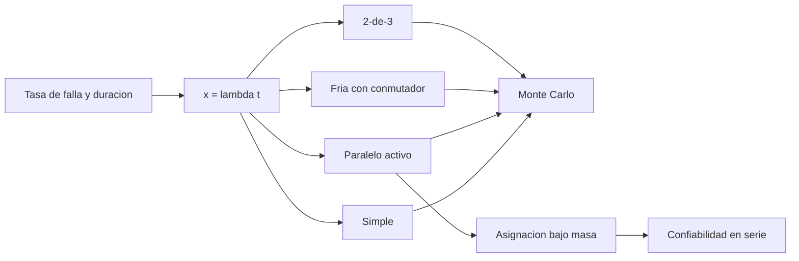

# B83-C23 — Redundancia y tolerancia a fallos de misión

<!-- nav:top -->
[🏠 Programa](../../../../README.md) · [📚 Bloque B83](../../../tronco-comun/B83-ingenieria-de-sistemas-y-diseno-de-misiones.md) · [← Anterior: B83-C22 — Análisis de modos y efectos de fallo (FMEA) en sistemas espaciales](../B83-C22-analisis-de-modos-y-efectos-de-fallo-fmea-en-sistemas-espaciales/CLASE.md) · [Siguiente: B83-C24 — Árboles de fallos (FTA) y análisis de causas →](../B83-C24-arboles-de-fallos-fta-y-analisis-de-causas/CLASE.md)
<!-- /nav -->

## 1. Ubicación, nivel y alcance

Clase 23 del bloque B83 (clase de la ampliación). Nivel N3. La **redundancia** duplica funciones para que la misión sobreviva al fallo de una unidad; cada duplicado cuesta masa, energía y complejidad. Aquí comparas cuatro configuraciones de una unidad (simple, paralelo activo, redundancia fría con conmutador imperfecto y 2-de-3 con votador), las verificas con Monte Carlo y decides qué unidades duplicar de una cadena en serie con un presupuesto de masa. Las tasas de falla, masas y la duración de la misión son **sintéticas**; el manual de NASA (S4) enmarca el riesgo como escenarios, verosimilitudes y consecuencias, lo que aquí se cuantifica como confiabilidad.

## 2. Por qué esta clase existe

Duplicar todo es imposible por masa y a veces contraproducente; no duplicar nada deja una misión frágil. La decisión central: **¿qué unidades duplicar, con qué esquema y cuánta confiabilidad compra cada kilogramo?**

## 3. Lo que podrás hacer al terminar

1. Calcular la confiabilidad exponencial `R = e^{−λt}` de una unidad.
2. Calcular la confiabilidad del paralelo activo, de la redundancia fría con conmutador y del 2-de-3.
3. Verificar las fórmulas con una simulación de Monte Carlo de semilla fija.
4. Calcular la confiabilidad de una cadena en serie.
5. Asignar redundancia bajo un presupuesto de masa por un método voraz y por enumeración.
6. Rotular lo sintético y los supuestos (fallas independientes, tasa constante, votador perfecto).

La evidencia es la **estudio de redundancia con confiabilidad de misión** del ejercicio 12 (sección 20).

## 4. Con qué llegas y cómo comprobarlo

1. ¿Qué es una vida exponencial?
2. ¿Qué es un sistema en serie?
3. ¿Qué es un paralelo activo?
4. ¿Qué es una redundancia fría?
5. ¿Qué es un método voraz?

<details>
<summary>Ver respuestas</summary>

1. Una vida con tasa de falla constante: `R(t) = e^{−λt}`. 2. Uno que falla si falla cualquier unidad: `R = Π Rᵢ`. 3. Dos unidades encendidas; el sistema falla si fallan las dos: `1 − (1 − R)²`. 4. Una unidad de repuesto apagada que se enciende al fallar la principal. 5. Uno que escoge en cada paso la mejor opción local.
</details>

Con cuatro o cinco aciertos, sigue; si no, repasa los prerrequisitos.

## 5. Un caso de contexto y casos de referencia

Para una unidad sintética de 8000 FIT en una misión de 5 años (`x = λt = 0,3504`), la confiabilidad es 70,44 % sin redundancia, 91,26 % con paralelo activo, 94,63 % con redundancia fría (conmutador de 0,98) y 78,95 % con 2-de-3. En una cadena de cuatro unidades en serie, la confiabilidad pasa de 43,51 % a 61,10 % duplicando 2,1 kg: la rueda de reacción y el controlador de batería. La enumeración exacta confirma la elección.

## 6. Vocabulario

La **confiabilidad** `R(t)` es la probabilidad de funcionar hasta `t`. Con tasa constante `λ`, `R = e^{−x}` con `x = λt`. **Paralelo activo** de dos: `2R − R²`. **Redundancia fría** con conmutador de confiabilidad `Rs`: `e^{−x}(1 + Rs·x)`. **2-de-3** con votador perfecto: `3R² − 2R³`. En **serie** se multiplican las `R`. La **asignación de redundancia** escoge qué duplicar bajo un presupuesto. El **método voraz** ordena por ganancia de `ln R` por kg; la **enumeración** prueba todos los casos.

## 7. Modelo mental: de la tasa de falla a la decisión de duplicar



*Descripción textual:* la tasa de falla y la duración dan `x`; con él se calculan las cuatro configuraciones, que se verifican por Monte Carlo; la configuración activa alimenta la asignación bajo presupuesto de masa y la confiabilidad en serie.

Analogía: llevar una rueda de repuesto: pesa y ocupa lugar pero evita quedarse varado; llevar tres no mejora mucho más. Límite: la rueda se cambia a mano; en un satélite, el conmutador también puede fallar.

## 8. La explicación, paso a paso

### 8.1 Cuatro esquemas

Con `x = 0,3504`: simple `e^{−x} = 70,44 %`; paralelo activo `2R − R² = 91,26 %`; fría `e^{−x}(1 + 0,98x) = 94,63 %` (supera al activo porque la unidad de repuesto no envejece mientras espera, a menos que el conmutador falle); 2-de-3 `3R² − 2R³ = 78,95 %`. Monte Carlo da 70,57 %, 91,39 %, 94,72 % y 79,13 %: las diferencias son menores que 0,3 puntos.

### 8.2 Cadena en serie

Las cuatro unidades tienen 80,33 %, 83,93 %, 70,44 % y 91,61 % de confiabilidad; en serie, 43,51 %. Duplicar una unidad con paralelo activo mejora `ln R` en proporción a su `x`: la rueda gana más, la computadora y la radio menos, el controlador es barato en masa. Con un presupuesto de 3,0 kg el método voraz duplica la rueda y el controlador (2,1 kg) y llega a 61,10 % (+17,59 puntos).

### 8.3 Verificación por enumeración

Se prueban los 16 subconjuntos de unidades duplicadas que cumplen el presupuesto: el mejor da 61,10 % y coincide con el voraz. En general el voraz no garantiza el óptimo (problema de la mochila); aquí coincide.

## 9. Magnitudes, símbolos y unidades

| Símbolo | Qué es | Unidad | Valor / nota |
|---|---|---|---|
| `λ` | tasa de falla de la unidad | FIT | 8000 (ejemplo) |
| `x` | `λt` | — | 0,3504 |
| `R_simple` | confiabilidad sin redundancia | % | 70,44 |
| `R_activo` | paralelo activo | % | 91,26 |
| `R_frío` | fría, `Rs = 0,98` | % | 94,63 |
| `R_serie` | cadena de 4 en serie | % | 43,51 → 61,10 |

## 10. Convenciones y referencias

Sin constantes físicas ni sistema de referencia. Tasas, masas, `Rs`, duración de 5 años (43 800 h) y presupuesto de 3,0 kg **sintéticos**. Supuestos: vida exponencial, fallas independientes, votador perfecto, sin fallos de causa común (que son el mayor límite de la redundancia real). Monte Carlo: 200 000 vidas, semilla 83023. Tolerancia: fórmulas y Monte Carlo a 0,3 puntos porcentuales. Las fórmulas de confiabilidad son estándar y **no se consultaron** en una fuente concreta.

## 11. De dónde sale lo que afirmamos

| ID | Fuente | Localizador | Respalda | Estado |
|---|---|---|---|---|
| S4 | NASA, *Systems Engineering Handbook*, 6.4 Technical Risk Management — https://www.nasa.gov/reference/6-4-technical-risk-management/ (consultada 2026-11-10) | sección 6.4, conceptos clave | el riesgo se caracteriza por escenarios, verosimilitudes y consecuencias; los equipos analizan fuente, consecuencia y verosimilitud | Consultada |
| ECSS | ECSS-E-ST-10C, ECSS-M-ST-40C, ECSS-Q-ST-30-02C, ECSS-Q-ST-40-12C y demás estándares (ecss.nl) | — | — | No consultada: la página de estándares no mostró los documentos |
| — | ISO/IEC/IEEE 15288, INCOSE, SysML, MIL-STD-1629, IEC 60812 e IEC 61025 | — | — | No consultada |
| — | Relaciones matemáticas estándar usadas en el laboratorio (AHP, rutas críticas, ley de Stefan, confiabilidad exponencial, cortes mínimos, ecuación del cohete) | — | — | No consultada en una fuente concreta: las verifica el laboratorio por una segunda vía |

Límites: no se consultó ninguna norma de confiabilidad (ECSS-Q-ST-30, MIL-HDBK-217, NASA); las fórmulas son estándar; no se modelan fallas de causa común ni la reparación.

## 12. Cómo ver la comparación de esquemas

| Magnitud | Valor |
|---|---|
| Simple | 70,44 % |
| Paralelo activo | 91,26 % |
| Fría (Rs = 0,98) | 94,63 % |
| 2-de-3 | 78,95 % |
| Serie: sin / con redundancia | 43,51 % / 61,10 % |

Descripción larga: la redundancia fría es la más confiable cuando el conmutador es bueno; el 2-de-3 pesa tres veces y rinde menos que el paralelo para fallas de este tamaño.

## 13. Ejemplo trabajado: la confiabilidad del paralelo activo

**Paso 1 · Una unidad.** `R = e^{−0,3504} = 70,44 %`.

**Paso 2 · Probabilidad de fallar.** `1 − R = 29,56 %`.

**Paso 3 · Dos en paralelo.** `1 − (1 − R)² = 1 − 0,0874 = 91,26 %`.

**Paso 4 · Ganancia.** `+20,8` puntos por 1 unidad más.

## 14. Distintas formas de abordar el problema

**Fórmulas cerradas** (esta clase). **Monte Carlo** (segunda vía). **Diagramas de bloques de confiabilidad y árboles de fallos** (C24): permiten estructuras más complejas. **Modelos de Markov** para conmutación imperfecta y reparación (no usados).

## 15. Práctica guiada

**Ejercicio 1 · con los pasos indicados.** Calcula `R` con `x = 0,2`. *Pasos:* `e^{−0,2}`.

<details><summary>Solución comentada</summary>

`0,8187`.
</details>

**Ejercicio 2 · con una pista.** Calcula el paralelo activo con `R = 0,8`. *Pista:* `2R − R²`.

<details><summary>Solución comentada</summary>

`0,96`.
</details>

**Ejercicio 3 · casi autónomo.** Calcula el 2-de-3 con `R = 0,9`. *Pista:* `3R² − 2R³`.

<details><summary>Solución comentada</summary>

`0,972`.
</details>

## 16. Práctica autónoma, transferencia e integrador

**Ejercicio 4 · autónomo.** Calcula la serie de tres unidades con `R = 0,9; 0,95; 0,99`.

<details><summary>Solución comentada</summary>

`0,846`.
</details>

**Ejercicio 5 · autónomo.** Si `Rs = 1`, ¿cuál es la fría con `x = 0,2`?

<details><summary>Solución comentada</summary>

`e^{−0,2}(1 + 0,2) = 0,9825`.
</details>

**Ejercicio 6 · autónomo.** ¿Por qué una fría puede superar al paralelo activo?

<details><summary>Solución comentada</summary>

Porque la unidad de repuesto no envejece mientras espera.
</details>

**Ejercicio 7 · autónomo.** ¿Qué riesgo no captura este modelo y es el mayor en la práctica?

<details><summary>Solución comentada</summary>

Las fallas de causa común (misma radiación, mismo defecto de diseño).
</details>

**Ejercicio 8 · autónomo.** ¿Por qué el método voraz puede fallar en general?

<details><summary>Solución comentada</summary>

Porque es un problema de mochila: lo mejor local no siempre es lo mejor global.
</details>

**Ejercicio 9 · transferencia.** **Transferencia.** Un colega usa 43,51 % como confiabilidad de un satélite real. ¿Es válido?

<details><summary>Solución comentada</summary>

No: tasas y masas son sintéticas.
</details>

**Ejercicio 10 · transferencia.** **Transferencia.** ¿Cómo cambia la decisión si el controlador de batería comparte el mismo diseño en ambas copias?

<details><summary>Solución comentada</summary>

Una falla de diseño afecta a las dos: el paralelo ya no multiplica; se requiere diversidad o análisis de causa común.
</details>

**Ejercicio 11 · transferencia.** **Transferencia.** ¿Cómo se conecta esto con la conmutación de B88?

<details><summary>Solución comentada</summary>

B88-C32 trata cómo conmutar unidades redundantes; aquí solo se modela su confiabilidad `Rs`.
</details>

**Ejercicio 12 · integrador.** **Integrador.** Elabora tu *estudio de redundancia con confiabilidad de misión*: cuatro esquemas, verificación por Monte Carlo, asignación bajo masa y lista de supuestos y de qué es sintético.

<details><summary>Solución comentada</summary>

Secciones 8.1–8.3, el ejemplo 13 y la salida del laboratorio.
</details>

## 17. Laboratorio: confiabilidad de misión con redundancia

El script [confiabilidad_de_mision.py](confiabilidad_de_mision.py) calcula la confiabilidad de cuatro esquemas, la verifica con Monte Carlo y asigna redundancia a una cadena en serie por método voraz y por enumeración (**comprueba** que Monte Carlo y las fórmulas difieren menos de 0,3 puntos, que la enumeración no es peor que el voraz y que la redundancia mejora a la unidad simple). Usa la biblioteca común [sistemas_comun.py](../sistemas_comun.py) del bloque.

**Datos:** todos **sintéticos** (tasas, masas, duración, `Rs`); fórmulas estándar no consultadas. **Predice antes de ejecutar:** ¿qué esquema da la mayor confiabilidad para una unidad? (la redundancia fría con buen conmutador.) **Ejecución del 2026-11-10 (Python 3.12.9 | numpy 2.4.4):**

```text
Python 3.12.9 | numpy 2.4.4
Datos SINTETICOS: mision de 5 anos = 43800 h ; unidad de ejemplo lambda = 8000 FIT -> x = lambda t = 0.3504 ; Rs = 0.98
configuracion           R analitica [%]  R Monte Carlo [%]
simple                           70.441             70.574
paralelo activo 2                91.262             91.391
fria 2 (Rs = 0.98)               94.629             94.720
2-de-3 (votador perfecto)           78.953             79.128
Cadena en serie de 4 unidades (R de cada una sin redundancia): Computadora de a bordo 80.33 %, Radio 83.93 %, Rueda de reaccion 70.44 %, Controlador de bateria 91.61 %
Serie sin redundancia = 43.509 % ; con redundancia voraz (presupuesto 3.0 kg): 61.098 % duplicando Rueda de reaccion, Controlador de bateria (2.1 kg)
Enumeracion exacta: 61.098 % duplicando Rueda de reaccion, Controlador de bateria ; misma eleccion: True ; mejora = 17.589 puntos
Pruebas superadas.
```

```bash
python programa/clases/B83/B83-C23-redundancia-y-tolerancia-a-fallos-de-mision/confiabilidad_de_mision.py
```

**Límites:** fallas independientes; tasa constante; sin fallas de causa común; sin reparación; votador perfecto; presupuesto en una sola dimensión (masa).

## 18. Errores frecuentes y cómo corregirlos

**Duplicar sin analizar la causa común.** Añade diversidad o separación

**Ignorar la confiabilidad del conmutador.** Inclúyela (`Rs`)

**Duplicar lo más barato y no lo más frágil.** Compara ganancia de `ln R` por kg

## 19. Cómo sabrás que vas bien

Tras 8.1: ¿qué esquema esperabas el mejor? Tras 8.3: ¿qué unidades duplica el voraz? Si dudas, repasa el ejemplo 13.

## 20. Qué entregas y cómo se evalúa

El producto es tu **estudio de redundancia con confiabilidad de misión** (ejercicio 12).

| Criterio | Inicial | En desarrollo | Logrado | Destacado |
|---|---|---|---|---|
| Conceptos | Los confunde | Parciales | Explica el método y su dominio | Explica los límites y las alternativas |
| Cálculo | Sin unidades | Con errores | Resultados con unidades y comprobados | Resuelve casos nuevos |
| Numérico | Sin comprobar | Un caso | Verifica por una segunda vía en varios casos | Interpreta las diferencias y los fallos |
| Fuentes | Sin fuente | Sin fecha | Fuentes con fecha y estado | Declara lo sintético y lo no consultado |
| Límites | No los nombra | Uno | Tres | Discute qué falta del modelo |

**Condiciones críticas (no se compensan con promedio):** rotular los datos como sintéticos; verificar el resultado por una segunda vía; citar solo lo consultado.

## 21. Ética, seguridad y límites

Clase educativa: los modelos son simplificados y los datos son sintéticos; ningún resultado describe una misión real, certifica una seguridad ni sustituye a los estándares vigentes y a la revisión de especialistas.  Accesibilidad: tablas equivalentes a las gráficas, fórmulas en texto, ejercicios sin conexión.

## 22. Para cerrar y seguir

Duplicar la rueda y el controlador sube la cadena sintética de 43,51 % a 61,10 % dentro de 3,0 kg. Queda una pregunta: ¿cómo se descompone un evento no deseado en causas combinadas? (C24).

**Glosario español–inglés.** redundancia · *redundancy*; confiabilidad · *reliability*; paralelo activo · *active parallel*; redundancia fría · *cold standby*; tolerancia a fallos · *fault tolerance*.

**Continuidad.** [B83-C24](../B83-C24-arboles-de-fallos-fta-y-analisis-de-causas/CLASE.md) construye árboles de fallos para analizar causas combinadas.

**Referencias:** ver sección 11.

<!-- nav:bottom -->
---

[← Anterior: B83-C22 — Análisis de modos y efectos de fallo (FMEA) en sistemas espaciales](../B83-C22-analisis-de-modos-y-efectos-de-fallo-fmea-en-sistemas-espaciales/CLASE.md) · [📚 Bloque B83](../../../tronco-comun/B83-ingenieria-de-sistemas-y-diseno-de-misiones.md) · [Siguiente: B83-C24 — Árboles de fallos (FTA) y análisis de causas →](../B83-C24-arboles-de-fallos-fta-y-analisis-de-causas/CLASE.md)
<!-- /nav -->
